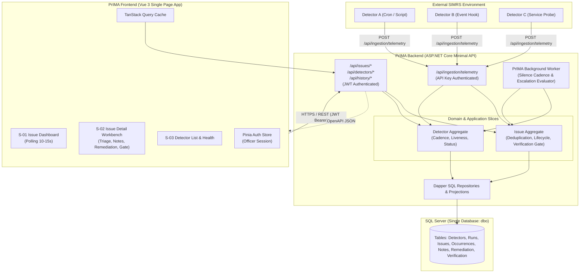
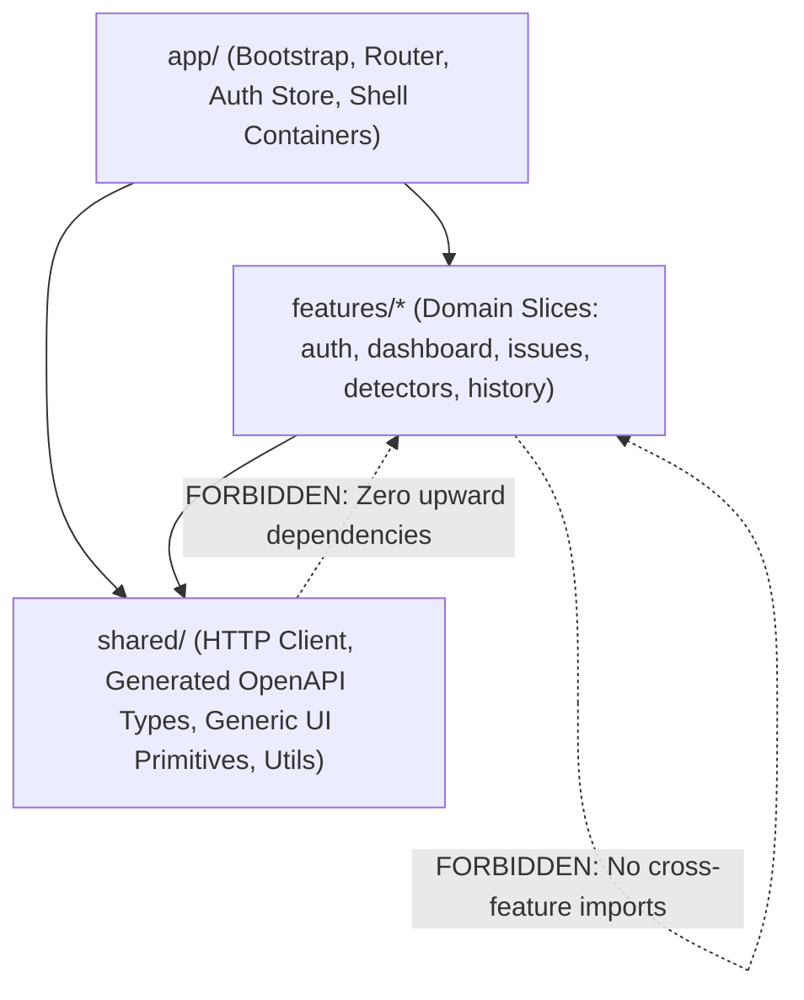

# PRIMA ARCHITECTURE SPECIFICATION
**System:** PrIMA (Proactive Inspection Monitoring App)  
**Document:** Unified Backend & Frontend Architecture  
**Status:** Approved Technical Architecture  
**Style:** Pragmatic, Direct, Minimalist  
**Stack:** .NET 8+ / ASP.NET Core Minimal APIs / SQL Server / Dapper + Vue 3 / Vite / Tailwind CSS v4 / PrimeVue v4 / TanStack Query  

---

## 1. Architectural Philosophy & Decisions

PrIMA is a specialized operational monitoring and issue management application designed for Hospital Information Systems (SIMRS). Its architecture is deliberately **pragmatic, explicit, and minimalist**:

1. **No Assembly Bloat:** The backend is packaged into a **Single Web API Project** (`src/backend/PrIMA.Api/`) partitioned cleanly using folder-based Vertical Slices and Domain-Driven Design (DDD). No multi-project ceremony.
2. **Domain-Driven Core with Mandatory CQRS:**
   - **Write Operations:** Mutate state strictly through Domain Aggregate Roots (`Detector`, `Issue`). Invariants and state machines live in the domain model. SQL updates live in explicit Dapper repositories.
   - **Read Operations:** Pure direct Dapper queries projected straight to DTOs in query handlers. No aggregate roots or change tracking overhead on reads.
3. **Autonomous Ingestion & Silence Supervision:**
   - Detectors run externally and post telemetry via a dedicated API Key authenticated ingestion endpoint (`/api/ingestion/telemetry`).
   - A built-in ASP.NET Core `BackgroundService` evaluates detector silence cadence and performs dynamic severity escalation on unacknowledged issues every 60 seconds.
4. **Zero-Infrastructure Real-Time Sync:**
   - The Vue frontend stays fresh using **TanStack Query automated polling** (every 10–15s for the active dashboard and feeds). No WebSocket or SignalR infrastructure required.
5. **Lightweight Auth & Attribution:**
   - Simple local accounts for EDP officers with JWT Bearer tokens. Every investigation note, remediation action, and verification is deterministically attributed to the authenticated officer. Flat v1 operational authorization allows any active officer (`IsActive = 1`, across `EdpOfficer`, `SystemAnalyst`, `Lead`) full operational access, with `Role` used for audit attribution and session UI.
6. **Single Database Schema (`dbo`):**
   - Clean relational SQL Server tables managed via embedded **DbUp SQL migration scripts** executed on startup.

---

## 2. Technology Stack Reference

| Layer | Technology | Version | Purpose & Rationale |
|---|---|---|---|
| **Backend Runtime** | .NET (C#) | `8.0+` | High throughput, modern Minimal APIs, strong typing |
| **API Framework** | ASP.NET Core Minimal APIs | `8.0+` | Direct route mapping, OpenAPI/Scalar, zero controller boilerplate |
| **Data Access** | Dapper | `2.1+` | Explicit, fast SQL execution with zero ORM abstraction overhead |
| **Database** | Microsoft SQL Server | `2019+` | Enterprise persistence in hospital environments |
| **DB Migrations** | DbUp (SQL Server) | `5.0+` | Plain `.sql` scripts executed on application bootstrap |
| **Validation** | FluentValidation | `11.9+` | Request format validation at API boundary |
| **Authentication** | JWT Bearer Authentication | `8.0+` | 12-hour HS256 tokens with Officer ID, Username, FullName, and Role; passwords hashed via ASP.NET Core `PasswordHasher<object>` (PBKDF2) |
| **Frontend Framework** | Vue 3 (Composition API) | `3.5+` | `<script setup lang="ts">`, high reactivity, low bundle size |
| **Build Tool** | Vite | `6.0+` | Ultra-fast HMR and ESM bundling |
| **CSS & Design System** | Tailwind CSS v4 + PrimeVue v4 | Tailwind `^4.0`, PrimeVue `^4.2` | CSS-first Tailwind v4 (`@tailwindcss/vite`) + PrimeVue Aura preset |
| **Server State** | TanStack Query for Vue | `5.60+` | Query caching, deduplication, auto-polling (10-15s), mutation invalidation |
| **Client State** | Pinia | `2.2+` | Officer JWT session and active filter persistence only |
| **Forms & Validation** | VeeValidate + Zod | VeeValidate `^4.14`, Zod `^3.23` | Schema-first client validation matching RFC 7807 problem details |
| **API Contract Sync** | openapi-typescript | `7.4+` | Synchronizes backend `/swagger/v1/swagger.json` to frontend TypeScript types |

---

## 3. End-to-End System Topology



---

## 4. Backend Architecture (`src/backend/PrIMA.Api/`)

### 4.1 Solution & Directory Structure

```text
src/
├── backend/
│   ├── PrIMA.Api/                         # Single ASP.NET Core Minimal API project
│   │   ├── Program.cs                     # WebApplication entrypoint, middleware, and slice endpoint mapping
│   │   ├── appsettings.json               # Connection string, JWT key, Ingestion API keys, cadence defaults
│   │   ├── appsettings.Development.json   # Local development config (SeedDemoData=true)
│   │   ├── Common/                        # Shared kernel primitives
│   │   │   ├── Result.cs                  # Result<T> functional outcome pattern
│   │   │   ├── DomainError.cs             # Strongly typed error records (NotFound, Conflict, Validation)
│   │   │   ├── ProblemDetailsExtensions.cs # RFC 7807 ProblemDetails mapping
│   │   │   ├── IEndpoint.cs               # Endpoint scanning interface
│   │   │   ├── ISqlConnectionFactory.cs   # SQL Server connection factory (Dapper)
│   │   │   └── CurrentOfficer.cs          # Scoped officer identity from JWT claims
│   │   │
│   │   ├── Migrations/                    # DbUp SQL migration scripts
│   │   │   ├── MigrationRunner.cs         # Executes scripts at startup (EnsureDatabase)
│   │   │   └── Scripts/
│   │   │       ├── 001_InitialSchema.sql  # Tables, indexes, foreign keys
│   │   │       ├── 002_SeedInitialUsers.sql # Seeded baseline EDP officer accounts
│   │   │       └── 003_IssueActivityLogs.sql # Immutable issue activity audit logs (Stage 2)
│   │   │
│   │   ├── Seeding/                       # Development-only fixtures
│   │   │   └── DevelopmentDemoDataSeeder.cs # Gated on IsDevelopment() && SeedDemoData
│   │   │
│   │   ├── BackgroundServices/            # Periodic workers (Stage 3+)
│   │   │   └── MonitoringSupervisorWorker.cs # Silence checker & auto-escalation timer (Stage 3)
│   │   │
│   │   ├── Domain/                        # Pure domain layer (Zero external dependencies)
│   │   │   ├── Detectors/
│   │   │   │   ├── Detector.cs            # Detector Aggregate Root
│   │   │   │   ├── InspectionRun.cs       # Inspection Run Entity
│   │   │   │   ├── MonitoringScope.cs     # Value Object / Enum (DataIntegrity, Process, Sync, Infra)
│   │   │   │   ├── DetectorHealth.cs      # Healthy, Silent, Failing
│   │   │   │   └── IDetectorRepository.cs # Write persistence interface
│   │   │   │
│   │   │   └── Issues/
│   │   │       ├── Issue.cs               # Issue Aggregate Root
│   │   │       ├── CorrelationKey.cs      # Value Object (Deterministic key)
│   │   │       ├── TelemetryEvidence.cs   # Value Object (Diagnostic snapshot)
│   │   │       ├── Occurrence.cs          # Entity (Immutable observation, linked to InspectionRunId)
│   │   │       ├── InvestigationNote.cs   # Entity (Chronological notes)
│   │   │       ├── RemediationRecord.cs   # Value Object (Action category + description)
│   │   │       ├── VerificationRecord.cs  # Value Object (Method + CleanPassed result)
│   │   │       ├── DismissalRecord.cs     # Value Object (Reason + Rationale)
│   │   │       ├── IssueStatus.cs         # Open, Acknowledged, Investigating, Resolved, Dismissed, Reopened
│   │   │       ├── IssueSeverity.cs       # Low, Medium, High, Critical
│   │   │       ├── SeverityRank.cs        # TINYINT rank (Critical=4, High=3, Medium=2, Low=1)
│   │   │       ├── IssueErrors.cs         # Domain error factory
│   │   │       └── IIssueRepository.cs    # Write persistence interface
│   │   │
│   │   ├── Infrastructure/                # Persistence & external communication
│   │   │   ├── Persistence/
│   │   │   │   ├── SqlConnectionFactory.cs # SqlConnection provider
│   │   │   │   ├── DetectorRepository.cs  # Dapper implementation of IDetectorRepository
│   │   │   │   └── IssueRepository.cs     # Dapper implementation of IIssueRepository
│   │   │   └── Webhooks/
│   │   │       └── DetectorWebhookClient.cs # HTTP client to trigger on-demand detector runs
│   │   │
│   │   └── Features/                      # Vertical Slices (grouped by operational capability)
│   │       ├── Auth/
│   │       │   ├── LoginEndpoint.cs
│   │       │   ├── LoginRequest.cs
│   │       │   └── LoginResponse.cs
│   │       │
│   │       ├── Ingestion/                 # External detector telemetry intake
│   │       │   ├── IngestTelemetryEndpoint.cs # POST /api/ingestion/telemetry
│   │       │   ├── IngestTelemetryRequest.cs  # findings[] batch payload
│   │       │   ├── IngestTelemetryResponse.cs # results[] batch response
│   │       │   ├── IngestTelemetryValidator.cs
│   │       │   └── IngestTelemetryHandler.cs  # Deduplication, Occurrence appending, or Issue creation
│   │       │
│   │       ├── Issues/                    # Operational issue management
│   │       │   ├── GetDashboardFeed/      # Query: S-01 Issue Feed & Summary Counters (WIB boundary)
│   │       │   ├── GetIssueById/          # Query: S-02 Full issue details + timeline composite projection (Stage 2)
│   │       │   ├── TakeIt/                # Command: Single-tap Acknowledge + Assign to caller -> Investigating (Stage 2)
│   │       │   ├── AssignIssue/           # Command: Assign officer -> Acknowledged (or Reassign in Investigating) (Stage 2)
│   │       │   ├── AcknowledgeIssue/      # Command: Explicit acknowledge without assignee change (Stage 2)
│   │       │   ├── StartInvestigation/    # Command: Move from Acknowledged -> Investigating (Stage 2)
│   │       │   ├── AddInvestigationNote/  # Command: Append note to timeline (Stage 2)
│   │       │   ├── RecordRemediation/     # Command: Record action taken (M-02, Stage 2)
│   │       │   ├── RecordManualVerification/ # Command: Manual query result record (M-03, CleanPassed vs StillPresent) (Stage 2)
│   │       │   ├── ResolveIssue/          # Command: Transition to Resolved enforcing verification gate (BR-PRIMA-004, Stage 2)
│   │       │   └── DismissIssue/          # Command: Transition to Dismissed with rationale >= 20 chars (M-01, Stage 2)
│   │       │
│   │       ├── Officers/                  # EDP officer directory (Stage 2)
│   │       │   └── GetOfficers/           # Query: Lookup active officers for assignment dropdowns (GET /api/officers)
│   │       │
│   │       ├── Detectors/                 # Detector portfolio management (Stage 3)
│   │       │   ├── GetDetectorList/       # Query: S-03 list + health status
│   │       │   ├── GetDetectorById/       # Query: S-04 detail + recent runs
│   │       │   ├── RegisterDetector/      # Command: S-05 create
│   │       │   ├── UpdateDetector/        # Command: S-05 update config
│   │       │   ├── ToggleDetectorStatus/  # Command: Active <-> Paused / Retire
│   │       │   └── TriggerManualRun/      # Command: E-7 on-demand execution
│   │       │
│   │       └── History/                   # Historical reports & retrospectives (Stage 4)
│   │           ├── GetHistoricalIssues/   # Query: S-07 filterable history
│   │           └── GetReliabilityKpi/     # Query: S-07 summary KPIs (pass rates, MTTR)
│   │
│   └── PrIMA.Api.Tests/                   # Automated xUnit test suite (Unit & Integration tests)
│
├── frontend/                              # Vue 3 Single Page Application (features/auth, features/dashboard)
└── tools/
    └── telemetry-simulator/               # Zero-dependency Node.js CLI simulator (simulate.mjs)
```

---

### 4.2 Domain Model & Invariants

#### 4.2.1 Issue Aggregate Root & State Transitions
The `Issue` aggregate is the single authority for issue state, recurrence, and lifecycle progression:

```csharp
namespace PrIMA.Api.Domain.Issues;

public sealed class Issue
{
    public Guid Id { get; private set; }
    public CorrelationKey CorrelationKey { get; private set; } = null!;
    public string Title { get; private set; } = string.Empty;
    public Guid DetectorId { get; private set; }
    public string DetectorName { get; private set; } = string.Empty;
    public MonitoringScope Scope { get; private set; }
    public IssueSeverity BaseSeverity { get; private set; }
    public IssueSeverity CurrentSeverity { get; private set; }
    public byte SeverityRank => CurrentSeverity switch
    {
        IssueSeverity.Critical => 4,
        IssueSeverity.High => 3,
        IssueSeverity.Medium => 2,
        _ => 1
    };
    public IssueStatus Status { get; private set; }
    public int EscalationLevel { get; private set; }
    public int OccurrenceCount { get; private set; } = 1;
    public string? CurrentAssignee { get; private set; }
    public DateTime CreatedAtUtc { get; private set; }
    public DateTime LastOccurrenceAtUtc { get; private set; }
    public DateTime? AcknowledgedAtUtc { get; private set; }
    public DateTime? ResolvedAtUtc { get; private set; }
    public DateTime? DismissedAtUtc { get; private set; }
    public DateTime? ReopenedAtUtc { get; private set; }

    private readonly List<Occurrence> _occurrences = [];
    public IReadOnlyCollection<Occurrence> Occurrences => _occurrences.AsReadOnly();

    private readonly List<InvestigationNote> _notes = [];
    public IReadOnlyCollection<InvestigationNote> Notes => _notes.AsReadOnly();

    public RemediationRecord? LatestRemediation { get; private set; }
    public VerificationRecord? LatestVerification { get; private set; }
    public DismissalRecord? Dismissal { get; private set; }

    private Issue() { }

    // Factory: Initial anomaly discovery
    public static Issue Create(
        Guid detectorId,
        string detectorName,
        MonitoringScope scope,
        string title,
        CorrelationKey correlationKey,
        IssueSeverity baseSeverity,
        TelemetryEvidence evidence,
        Guid inspectionRunId,
        DateTime discoveredAtUtc)
    {
        var issue = new Issue
        {
            Id = Guid.NewGuid(),
            DetectorId = detectorId,
            DetectorName = detectorName,
            Scope = scope,
            Title = title,
            CorrelationKey = correlationKey,
            BaseSeverity = baseSeverity,
            CurrentSeverity = baseSeverity,
            Status = IssueStatus.Open,
            EscalationLevel = 0,
            OccurrenceCount = 1,
            CreatedAtUtc = discoveredAtUtc,
            LastOccurrenceAtUtc = discoveredAtUtc
        };

        issue._occurrences.Add(new Occurrence(Guid.NewGuid(), issue.Id, inspectionRunId, 1, discoveredAtUtc, evidence));
        return issue;
    }

    // BR-PRIMA-001 & BR-PRIMA-002: Ingest recurring finding
    public void RecordRecurringOccurrence(TelemetryEvidence evidence, Guid inspectionRunId, DateTime occurrenceTimeUtc)
    {
        OccurrenceCount++;
        var nextNumber = OccurrenceCount;
        _occurrences.Add(new Occurrence(Guid.NewGuid(), Id, inspectionRunId, nextNumber, occurrenceTimeUtc, evidence));
        LastOccurrenceAtUtc = occurrenceTimeUtc;

        // BR-PRIMA-002: Reopen if previously closed & clear prior audit state
        if (Status is IssueStatus.Resolved or IssueStatus.Dismissed)
        {
            Status = IssueStatus.Reopened;
            ReopenedAtUtc = occurrenceTimeUtc;
            CurrentAssignee = null;
            AcknowledgedAtUtc = null;
            ResolvedAtUtc = null;
            DismissedAtUtc = null;
            Dismissal = null;
            LatestVerification = null; // Prior verification invalid; SQL repository sets IsSuperseded = 1 on prior governance rows
        }

        // BR-PRIMA-003: Dynamic severity escalation deferred to Stage 3 (CheckRecurrenceEscalation)
    }

    // Acknowledge & Assign ("Take It") — single tap moves Open/Reopened/Acknowledged to Investigating
    public Result TakeIt(string officerName, DateTime timestampUtc)
    {
        if (Status is IssueStatus.Resolved or IssueStatus.Dismissed)
            return Result.Failure(IssueErrors.InvalidStateTransition(Status, IssueStatus.Investigating));

        Status = IssueStatus.Investigating;
        CurrentAssignee = officerName.Trim();
        AcknowledgedAtUtc ??= timestampUtc;
        return Result.Success();
    }

    // Explicit assignment (OQ-002, OQ-007)
    public Result Assign(string officerName, DateTime timestampUtc)
    {
        if (Status is IssueStatus.Resolved or IssueStatus.Dismissed)
            return Result.Failure(IssueErrors.InvalidStateTransition(Status, IssueStatus.Acknowledged));

        CurrentAssignee = officerName.Trim();

        // If Open or Reopened, transition to Acknowledged and halt unacknowledged SLA timer
        if (Status is IssueStatus.Open or IssueStatus.Reopened)
        {
            Status = IssueStatus.Acknowledged;
            AcknowledgedAtUtc = timestampUtc;
        }
        // If already Investigating, CurrentAssignee is updated without state regression (OQ-007)

        return Result.Success();
    }

    // Explicit acknowledgement
    public Result Acknowledge(string officerName, DateTime timestampUtc)
    {
        if (Status is not (IssueStatus.Open or IssueStatus.Reopened))
            return Result.Failure(IssueErrors.InvalidStateTransition(Status, IssueStatus.Acknowledged));

        Status = IssueStatus.Acknowledged;
        CurrentAssignee ??= officerName.Trim();
        AcknowledgedAtUtc = timestampUtc;
        return Result.Success();
    }

    // Start investigation from Acknowledged
    public Result StartInvestigation(string officerName, DateTime timestampUtc)
    {
        if (Status != IssueStatus.Acknowledged)
            return Result.Failure(IssueErrors.InvalidStateTransition(Status, IssueStatus.Investigating));

        Status = IssueStatus.Investigating;
        CurrentAssignee = officerName.Trim();
        return Result.Success();
    }

    // Append investigation note (C-3)
    public Result AddNote(string noteText, string officerName, DateTime timestampUtc)
    {
        if (Status is IssueStatus.Resolved or IssueStatus.Dismissed)
            return Result.Failure(IssueErrors.ActionRequiresActiveStatus());

        if (string.IsNullOrWhiteSpace(noteText))
            return Result.Failure(IssueErrors.EmptyNoteText());

        _notes.Add(new InvestigationNote(Guid.NewGuid(), Id, officerName.Trim(), noteText.Trim(), timestampUtc));
        return Result.Success();
    }

    // Record Remediation (M-02)
    public Result RecordRemediation(string category, string description, string officerName, DateTime timestampUtc)
    {
        if (Status != IssueStatus.Investigating)
            return Result.Failure(IssueErrors.ActionRequiresStatus(IssueStatus.Investigating));

        if (string.IsNullOrWhiteSpace(description))
            return Result.Failure(IssueErrors.EmptyRemediationDescription());

        LatestRemediation = new RemediationRecord(category.Trim(), description.Trim(), officerName.Trim(), timestampUtc);
        
        // GAP-005 & OQ-005: Supersede prior failed or stale verification upon remediation retry
        if (LatestVerification != null)
        {
            LatestVerification = null;
        }

        return Result.Success();
    }

    // Record Verification (M-03)
    public Result RecordVerification(string method, bool cleanPassed, string evidenceNotes, string verifiedBy, DateTime timestampUtc)
    {
        if (Status != IssueStatus.Investigating)
            return Result.Failure(IssueErrors.ActionRequiresStatus(IssueStatus.Investigating));

        if (LatestRemediation == null)
            return Result.Failure(IssueErrors.RemediationRequiredBeforeVerification());

        if (string.IsNullOrWhiteSpace(evidenceNotes))
            return Result.Failure(IssueErrors.EmptyVerificationEvidence());

        LatestVerification = new VerificationRecord(method.Trim(), cleanPassed, evidenceNotes.Trim(), verifiedBy.Trim(), timestampUtc);
        return Result.Success();
    }

    // BR-PRIMA-004: Mandatory Verification Gate
    public Result MarkResolved(string officerName, DateTime timestampUtc)
    {
        if (Status != IssueStatus.Investigating)
            return Result.Failure(IssueErrors.InvalidStateTransition(Status, IssueStatus.Resolved));

        if (LatestVerification == null || !LatestVerification.CleanPassed || LatestVerification.IsSuperseded)
            return Result.Failure(IssueErrors.VerificationGateFailed());

        Status = IssueStatus.Resolved;
        ResolvedAtUtc = timestampUtc;
        return Result.Success();
    }

    // BR-PRIMA-006: Dismissal with justification (M-01)
    public Result Dismiss(string reason, string rationale, string officerName, DateTime timestampUtc)
    {
        if (Status is IssueStatus.Resolved or IssueStatus.Dismissed)
            return Result.Failure(IssueErrors.InvalidStateTransition(Status, IssueStatus.Dismissed));

        if (string.IsNullOrWhiteSpace(rationale) || rationale.Trim().Length < 20)
            return Result.Failure(IssueErrors.DismissalRationaleTooShort());

        Status = IssueStatus.Dismissed;
        Dismissal = new DismissalRecord(reason.Trim(), rationale.Trim(), officerName.Trim(), timestampUtc);
        return Result.Success();
    }

    // Escalation rule
    public void CheckSlaEscalation(TimeSpan unacknowledgedTimeout, DateTime currentUtc)
    {
        if (Status == IssueStatus.Open && (currentUtc - CreatedAtUtc) > unacknowledgedTimeout)
        {
            ElevateSeverity();
        }
    }

    private void CheckRecurrenceEscalation()
    {
        if (_occurrences.Count >= 5 && CurrentSeverity < IssueSeverity.Critical)
        {
            ElevateSeverity();
        }
    }

    private void ElevateSeverity()
    {
        if (CurrentSeverity == IssueSeverity.Low) CurrentSeverity = IssueSeverity.Medium;
        else if (CurrentSeverity == IssueSeverity.Medium) CurrentSeverity = IssueSeverity.High;
        else if (CurrentSeverity == IssueSeverity.High) CurrentSeverity = IssueSeverity.Critical;
        EscalationLevel++;
    }
}
```

---

### 4.3 Ingestion Protocol & Deduplication Flow

Detectors execute externally and post inspection results to:  
`POST /api/ingestion/telemetry`  
**Header:** `X-Detector-API-Key: <secret_key>`

#### Request Payload
```json
{
  "detectorId": "3fa85f64-5717-4562-b3fc-2c963f66afa6",
  "executionTimestampUtc": "2026-11-20T05:30:00Z",
  "triggerSource": "Scheduled",
  "outcome": "FindingDiscovered",
  "durationMs": 1420,
  "failureReason": null,
  "findings": [
    {
      "targetEntityReference": "INV-2026-11-0042",
      "title": "Unbalanced Journal: Billing Invoice INV-2026-11-0042",
      "baseSeverity": "High",
      "evidence": {
        "module": "Billing",
        "sourceTable": "acc_journal_entries",
        "recordKeys": "invoice_id=984321, batch_no=B20261120-1",
        "debitTotal": 1500000.00,
        "creditTotal": 1450000.00,
        "varianceDelta": 50000.00,
        "trace": "Debit lines sum to 1,500,000 but credit lines sum to 1,450,000. Variance delta of 50,000 unallocated."
      }
    }
  ]
}
```

#### Ingestion Processing Pipeline
1. **Authenticate Detector:** Validate `X-Detector-API-Key` using constant-time byte comparison (`FixedTimeEquals`) against configured `Ingestion:ApiKeys` array. Return `401 Unauthorized` on failure.
2. **Validate Detector State:** Query `dbo.Detectors` by `detectorId`:
   - If not found: return `404 Not Found` (RFC 7807).
   - If `AdminStatus` is `Paused` or `Retired`: return `409 Conflict` (RFC 7807) without recording telemetry.
3. **Validate Outcome & Payload:**
   - In Stage 1, reject `outcome == "ExecutionFailed"` with `422 Unprocessable Entity` (deferred to Stage 3 infrastructure synthesis).
   - If `outcome == "Passed"`: `findings` must be empty or null.
   - If `outcome == "FindingDiscovered"`: `findings` must contain `>= 1` items.
   - Reject duplicate `targetEntityReference` (case-insensitive after trimming) within the same batch with `422 Unprocessable Entity`.
4. **Atomic Transaction (Run + Findings):** Inside a single SQL Server database transaction:
   - Persist execution telemetry record in `dbo.InspectionRuns`.
   - Update detector liveness: set `LastRunAtUtc`, `LastHealthyHeartbeatUtc`, and status = `Healthy`.
   - For each finding in `findings[]`:
     - Compute canonical `CorrelationKey = $"{DetectorId:D}:{TargetEntityReference.Trim().ToUpperInvariant()}"`.
     - Query `dbo.Issues` with `(UPDLOCK, HOLDLOCK)` by `CorrelationKey`.
     - **If Active Match Found** (`Open`, `Acknowledged`, `Investigating`, `Reopened`):
       - Load `Issue` aggregate, call `issue.RecordRecurringOccurrence(evidence, inspectionRunId, executionTimestampUtc)`.
       - If `Status == Investigating`, execute `UPDATE dbo.VerificationRecords SET IsSuperseded = 1 WHERE IssueId = @IssueId AND IsSuperseded = 0;` to re-lock the Verification Gate (`BR-PRIMA-004`, `GAP-005`).
       - Update `dbo.Issues` (`OccurrenceCount`, `LastOccurrenceAtUtc`), insert `dbo.Occurrences`.
       - Set finding result `action = "Appended"`.
     - **If Closed Match Found** (`Resolved`, `Dismissed`):
       - Load `Issue` aggregate, call `issue.RecordRecurringOccurrence(...)` (`BR-PRIMA-002`).
       - Update `dbo.Issues` (`Status = Reopened`, reset assignee and resolution timestamps).
       - Mark prior `dbo.RemediationRecords`, `dbo.VerificationRecords`, and `dbo.DismissalRecords` as `IsSuperseded = 1`.
       - Insert `dbo.Occurrences`.
       - Set finding result `action = "Reopened"`.
     - **If No Match Found**:
       - Instantiate new `Issue` aggregate via `Issue.Create(...)`.
       - Insert into `dbo.Issues` (with `SeverityRank`) and `dbo.Occurrences` (`OccurrenceNumber = 1`).
       - Set finding result `action = "Created"`.
5. **Return Status:** `200 OK` with `inspectionRunId`, `detectorId`, `outcome`, `processedFindingsCount`, and `results[]` array.

---

### 4.4 Automated Background Supervision (`MonitoringSupervisorWorker`)

> [!NOTE]
> Autonomous silence supervision and background SLA escalation are registered starting in **Stage 3** per the Development Roadmap (`docs/PRIMA-DEVELOPMENT-ROADMAP.md`). In Stage 1, no background supervisor worker is registered.

An ASP.NET Core `BackgroundService` runs on a 60-second loop (Stage 3+):
1. **Silence Detection (BR-PRIMA-010 & BR-PRIMA-005):**
   - Query all active detectors where `(UtcNow - LastHeartbeatAtUtc) > (ExpectedCadenceSeconds * 2)`.
   - Update detector health to `Silent`.
   - Synthesize an issue with Scope = `Infrastructure & Service`, Title = `"Silent Detector: {DetectorName} has missed cadence"`, and CorrelationKey = `"SILENT:{DetectorId}"`.
2. **Dynamic Severity Escalation (BR-PRIMA-003):**
   - Query open issues where `Status == 'Open' AND AcknowledgedAtUtc IS NULL`.
   - If unacknowledged for > 30 minutes (or configured SLA), call `issue.CheckSlaEscalation(...)` and persist elevated severity.

---

### 4.5 Error Handling & RFC 7807 ProblemDetails

Errors follow the `Result<T>` pattern. Handlers translate domain failures to RFC 7807 responses using `ToProblemDetails()`:

| Error Type | HTTP Status | Title | Example Detail |
|---|---|---|---|
| `Validation` | 422 Unprocessable Entity | `"Validation Error"` | `"Dismissal rationale must be at least 20 characters."` |
| `Conflict` | 409 Conflict | `"Business Rule Conflict"` | `"Cannot resolve issue without clean verification record."` |
| `NotFound` | 404 Not Found | `"Resource Not Found"` | `"Issue '3fa85f64...' was not found."` |
| `Unauthorized` | 401 Unauthorized | `"Unauthorized"` | `"Invalid or expired authentication token."` |

---

## 5. Frontend Architecture (`src/frontend/`)

> [!NOTE]
> **Scope Boundary:** This section governs frontend **technical architecture** only (layering, dependency direction, state ownership, API integration, and contract safety). Visual layout, navigation ergonomics, and screen composition are owned by the Screen Inventory and UI/UX Guidelines.

### 5.1 Layer Boundaries & Dependency Direction

The frontend uses a **Feature-Oriented Modular Architecture** with strict unidirectional dependencies:



- **State Ownership Rule:** Server state belongs exclusively in **TanStack Query**. Client session state (JWT token, officer identity) belongs in **Pinia**. Ephemeral component state belongs in Vue Composition API (`ref` / `computed`).
- **Contract Synchronization:** TypeScript DTOs are generated from backend `/swagger/v1/swagger.json` via `openapi-typescript` into `src/shared/types/api.generated.ts` (never edited manually).
- **Error Mapping:** The centralized Axios interceptor translates RFC 7807 `ProblemDetails` into typed `ApiError` instances. `422` field errors map directly to VeeValidate (`form.setErrors()`); `401` responses trigger session expiration and redirect to login.

---

### 5.2 Frontend Directory Structure

```text
src/frontend/
├── index.html
├── package.json
├── vite.config.ts                     # Configured with @tailwindcss/vite plugin & /api proxy
│
├── src/
│   ├── main.ts                       # App bootstrap, Pinia, PrimeVue, TanStack Query provider
│   ├── App.vue                       # Root component & router-view
│   ├── assets/
│   │   └── main.css                  # CSS-first Tailwind entrypoint (@import "tailwindcss";)
│   │
│   ├── app/                          # Application Infrastructure Layer
│   │   ├── config/
│   │   │   └── primevue.ts           # PrimeVue v4 preset & PassThrough config
│   │   ├── router/
│   │   │   └── index.ts              # Route hierarchy & JWT auth guards (/login, /)
│   │   ├── stores/
│   │   │   └── auth.store.ts         # Officer session & JWT token store (localStorage persistence)
│   │   └── layouts/
│   │       ├── AppLayout.vue         # Authenticated shell container (Dashboard active, Detectors/History disabled)
│   │       └── AuthLayout.vue        # Unauthenticated shell container
│   │
│   ├── shared/                       # Domain-Agnostic Kernel
│   │   ├── components/               # Reusable generic UI wrappers & AppErrorBoundary.vue
│   │   ├── services/
│   │   │   └── http.ts               # Axios instance, Bearer injection, RFC 7807 error mapper
│   │   ├── types/
│   │   │   ├── api.generated.ts      # Auto-generated OpenAPI types (read-only)
│   │   │   └── common.ts             # ApiError, ProblemDetails types
│   │   └── utils/
│   │       └── dateUtils.ts          # date-fns ISO-8601 & relative time utilities
│   │
│   └── features/                     # Vertical Feature Slices
│       ├── auth/                     # Officer authentication slice (S-00)
│       ├── dashboard/                # Active issue feed & summary queries (S-01, 10s polling)
│       ├── issues/                   # Issue detail queries, lifecycle mutations, Zod form schemas (Stage 2)
│       ├── detectors/                # Detector CRUD, status mutations, run logs (Stage 3)
│       └── history/                  # Historical issue & reliability KPI queries (Stage 4)
```

Each feature slice follows the standard internal anatomy:
```text
features/<feature>/
├── api/          # Axios calls, Query Key factories, TanStack Query/Mutation composables
├── components/   # Feature-scoped components
├── schemas/      # Zod validation schemas (paired with VeeValidate)
├── types/        # Feature-specific view/filter types
└── views/        # Route-level page orchestrators (no raw HTTP calls)
```

---

### 5.3 State Management & Polling Conventions

```typescript
// features/dashboard/api/useDashboardQueries.ts
import { useQuery } from '@tanstack/vue-query';
import { dashboardKeys } from './dashboard.keys';
import { apiClient } from '@/shared/services/http';

export function useIssueFeed(filters: Ref<IssueFilters>) {
  return useQuery({
    queryKey: computed(() => dashboardKeys.feed(filters.value)),
    queryFn: async () => {
      const response = await apiClient.get('/api/issues/dashboard-feed', {
        params: filters.value
      });
      return response.data;
    },
    refetchInterval: 10_000, // Automatic polling every 10 seconds
    refetchOnWindowFocus: true,
    staleTime: 5_000
  });
}
```

---

## 6. Database Schema Specification (SQL Server / `dbo`)

Migrations are executed via DbUp at startup in script `001_InitialSchema.sql`:

```sql
-- Detectors Portfolio
CREATE TABLE dbo.Detectors (
    Id UNIQUEIDENTIFIER PRIMARY KEY,
    Name NVARCHAR(150) NOT NULL,
    Description NVARCHAR(500) NOT NULL,
    Scope NVARCHAR(50) NOT NULL,               -- DataIntegrity, ProcessIntegrity, DataSync, Infrastructure
    TargetModule NVARCHAR(100) NOT NULL,
    ExpectedCadenceSeconds INT NOT NULL,
    WebhookUrl NVARCHAR(500) NULL,             -- Endpoint for on-demand re-runs
    AdminStatus NVARCHAR(30) NOT NULL,         -- Active, Paused, Retired
    HealthStatus NVARCHAR(30) NOT NULL,        -- Healthy, Silent, Failing
    LastRunAtUtc DATETIME2 NULL,
    LastHealthyHeartbeatUtc DATETIME2 NULL,
    CreatedAtUtc DATETIME2 NOT NULL DEFAULT SYSUTCDATETIME(),
    CONSTRAINT UQ_Detectors_Name UNIQUE (Name)
);

-- Inspection Run Telemetry Log
CREATE TABLE dbo.InspectionRuns (
    Id UNIQUEIDENTIFIER PRIMARY KEY,
    DetectorId UNIQUEIDENTIFIER NOT NULL FOREIGN KEY REFERENCES dbo.Detectors(Id),
    ExecutionTimestampUtc DATETIME2 NOT NULL,
    TriggerSource NVARCHAR(30) NOT NULL,       -- Scheduled, Manual, EventHook
    Outcome NVARCHAR(30) NOT NULL,             -- Passed, FindingDiscovered, ExecutionFailed
    DurationMs INT NOT NULL,
    FailureReason NVARCHAR(1000) NULL,
    CreatedAtUtc DATETIME2 NOT NULL DEFAULT SYSUTCDATETIME()
);
CREATE INDEX IX_InspectionRuns_DetectorId_Time ON dbo.InspectionRuns(DetectorId, ExecutionTimestampUtc DESC);

-- Issues (Central Anomaly Tracking)
CREATE TABLE dbo.Issues (
    Id UNIQUEIDENTIFIER PRIMARY KEY,
    CorrelationKey NVARCHAR(250) NOT NULL,     -- Deterministic deduplication key
    Title NVARCHAR(250) NOT NULL,
    DetectorId UNIQUEIDENTIFIER NOT NULL FOREIGN KEY REFERENCES dbo.Detectors(Id),
    DetectorName NVARCHAR(150) NOT NULL,
    Scope NVARCHAR(50) NOT NULL,
    BaseSeverity NVARCHAR(20) NOT NULL,        -- Low, Medium, High, Critical
    CurrentSeverity NVARCHAR(20) NOT NULL,
    SeverityRank TINYINT NOT NULL,             -- Critical=4, High=3, Medium=2, Low=1
    Status NVARCHAR(30) NOT NULL,              -- Open, Acknowledged, Investigating, Resolved, Dismissed, Reopened
    EscalationLevel INT NOT NULL DEFAULT 0,
    OccurrenceCount INT NOT NULL DEFAULT 1,
    CurrentAssignee NVARCHAR(100) NULL,
    CreatedAtUtc DATETIME2 NOT NULL,
    LastOccurrenceAtUtc DATETIME2 NOT NULL,
    AcknowledgedAtUtc DATETIME2 NULL,
    ResolvedAtUtc DATETIME2 NULL,
    DismissedAtUtc DATETIME2 NULL,
    ReopenedAtUtc DATETIME2 NULL
);
CREATE UNIQUE INDEX UX_Issues_CorrelationKey ON dbo.Issues(CorrelationKey);
CREATE INDEX IX_Issues_Status_SeverityRank ON dbo.Issues(Status, SeverityRank DESC, LastOccurrenceAtUtc DESC);

-- Occurrences (Immutable observation snapshots)
CREATE TABLE dbo.Occurrences (
    Id UNIQUEIDENTIFIER PRIMARY KEY,
    IssueId UNIQUEIDENTIFIER NOT NULL FOREIGN KEY REFERENCES dbo.Issues(Id),
    InspectionRunId UNIQUEIDENTIFIER NOT NULL FOREIGN KEY REFERENCES dbo.InspectionRuns(Id),
    OccurrenceNumber INT NOT NULL,
    TimestampUtc DATETIME2 NOT NULL,
    Module NVARCHAR(100) NOT NULL,
    SourceTable NVARCHAR(100) NULL,
    RecordKeys NVARCHAR(500) NULL,
    DebitTotal DECIMAL(18,2) NULL,
    CreditTotal DECIMAL(18,2) NULL,
    VarianceDelta DECIMAL(18,2) NULL,
    TraceString NVARCHAR(MAX) NULL
);
CREATE INDEX IX_Occurrences_IssueId ON dbo.Occurrences(IssueId, OccurrenceNumber);
CREATE INDEX IX_Occurrences_InspectionRunId ON dbo.Occurrences(InspectionRunId);

-- Investigation Notes (Append-only)
CREATE TABLE dbo.InvestigationNotes (
    Id UNIQUEIDENTIFIER PRIMARY KEY,
    IssueId UNIQUEIDENTIFIER NOT NULL FOREIGN KEY REFERENCES dbo.Issues(Id),
    OfficerName NVARCHAR(100) NOT NULL,
    NoteText NVARCHAR(MAX) NOT NULL,
    CreatedAtUtc DATETIME2 NOT NULL DEFAULT SYSUTCDATETIME()
);

-- Remediation Records
CREATE TABLE dbo.RemediationRecords (
    Id UNIQUEIDENTIFIER PRIMARY KEY,
    IssueId UNIQUEIDENTIFIER NOT NULL FOREIGN KEY REFERENCES dbo.Issues(Id),
    ActionCategory NVARCHAR(50) NOT NULL,      -- DataCorrection, ServiceRestart, ConfigurationAdjustment, CodeRemediationRequested
    SummaryDescription NVARCHAR(MAX) NOT NULL,
    PerformedBy NVARCHAR(100) NOT NULL,
    TimestampUtc DATETIME2 NOT NULL,
    IsSuperseded BIT NOT NULL DEFAULT 0
);
CREATE INDEX IX_RemediationRecords_IssueId ON dbo.RemediationRecords(IssueId);

-- Verification Records
CREATE TABLE dbo.VerificationRecords (
    Id UNIQUEIDENTIFIER PRIMARY KEY,
    IssueId UNIQUEIDENTIFIER NOT NULL FOREIGN KEY REFERENCES dbo.Issues(Id),
    VerificationMethod NVARCHAR(50) NOT NULL,  -- AutomatedReRun, ManualQueryConfirmed
    CleanPassed BIT NOT NULL,
    EvidenceNotes NVARCHAR(MAX) NOT NULL,
    VerifiedBy NVARCHAR(100) NOT NULL,
    TimestampUtc DATETIME2 NOT NULL,
    IsSuperseded BIT NOT NULL DEFAULT 0
);
CREATE INDEX IX_VerificationRecords_IssueId ON dbo.VerificationRecords(IssueId);

-- Dismissal Records
CREATE TABLE dbo.DismissalRecords (
    Id UNIQUEIDENTIFIER PRIMARY KEY,
    IssueId UNIQUEIDENTIFIER NOT NULL FOREIGN KEY REFERENCES dbo.Issues(Id),
    DismissalReason NVARCHAR(50) NOT NULL,     -- FalsePositive, AcceptedOperationalException, DuplicateManualReport
    JustificationRationale NVARCHAR(MAX) NOT NULL,
    DismissedBy NVARCHAR(100) NOT NULL,
    TimestampUtc DATETIME2 NOT NULL,
    IsSuperseded BIT NOT NULL DEFAULT 0
);
CREATE INDEX IX_DismissalRecords_IssueId ON dbo.DismissalRecords(IssueId);

-- Seeded EDP Officer Accounts
CREATE TABLE dbo.Officers (
    Id UNIQUEIDENTIFIER PRIMARY KEY,
    Username NVARCHAR(50) NOT NULL UNIQUE,
    FullName NVARCHAR(100) NOT NULL,
    PasswordHash NVARCHAR(255) NOT NULL,
    Role NVARCHAR(30) NOT NULL,                -- EdpOfficer, SystemAnalyst, Lead
    IsActive BIT NOT NULL DEFAULT 1
);

-- Issue Activity Audit Logs (003_IssueActivityLogs.sql, Stage 2)
CREATE TABLE dbo.IssueActivityLogs (
    Id UNIQUEIDENTIFIER PRIMARY KEY,
    IssueId UNIQUEIDENTIFIER NOT NULL FOREIGN KEY REFERENCES dbo.Issues(Id),
    ActivityType NVARCHAR(50) NOT NULL,        -- Created, Acknowledged, Assigned, Reassigned, InvestigationStarted, NoteAdded, RemediationRecorded, VerificationRecorded, Resolved, Dismissed, Reopened
    ActorName NVARCHAR(100) NOT NULL,
    TimestampUtc DATETIME2 NOT NULL DEFAULT SYSUTCDATETIME(),
    Summary NVARCHAR(500) NOT NULL,
    DetailsJson NVARCHAR(MAX) NULL
);
CREATE INDEX IX_IssueActivityLogs_IssueId_Time ON dbo.IssueActivityLogs(IssueId, TimestampUtc DESC);
```

---

## 7. Verification & Implementation Checklist

1. **Backend Minimal API Bootstrap (Stage 1):**
   - [ ] Verify `PrIMA.Api` runs on .NET 8 Minimal APIs with Swagger (`/swagger/v1/swagger.json`) and DbUp migrations running on startup with `EnsureDatabase`.
   - [ ] Confirm baseline officer seeding in `002_SeedInitialUsers.sql` and development demo data seeder gated on `IsDevelopment() && SeedDemoData`.
   - [ ] Confirm `POST /api/auth/login` verifies PBKDF2 hash, issues 12h HS256 JWT, and enforces `IsActive = 1`.
   - [ ] Confirm `POST /api/ingestion/telemetry` properly validates `X-Detector-API-Key`, detector status (404/409), processes `findings[]` batch in an atomic transaction, computes canonical `CorrelationKey`, and enforces BR-PRIMA-001 (deduplication) and BR-PRIMA-002 (auto-reopening with `IsSuperseded = 1`).
   - [ ] Confirm `GET /api/issues/dashboard-feed` projects global summary counters with `OperationalTimeZone` (`WIB`) midnight calculation and returns active issues ordered by `SeverityRank DESC, LastOccurrenceAtUtc DESC`.
2. **Frontend Vue 3 Client (Stage 1):**
   - [ ] Verify `openapi-typescript` generates `src/shared/types/api.generated.ts` cleanly from `/swagger/v1/swagger.json`.
   - [ ] Confirm Axios interceptor attaches JWT Bearer token, stores session in `localStorage` via `auth.store.ts`, and maps RFC 7807 `ProblemDetails` (`422`, `409`, `401`) into `ApiError`.
   - [ ] Confirm TanStack Query auto-polling triggers every 10s on `S-01` without flashing full-page skeletons on background refetch.
   - [ ] Confirm Stage 1 navigation boundaries: `Dashboard` active, `Detectors` and `History` visually disabled with tooltips, `Resolved Today` tile non-clickable, and feed rows non-navigating.
3. **Downstream Stages (Stage 2+):**
   - [ ] Confirm the Verification Gate: `POST /api/issues/{id}/resolve` fails with `409 Conflict` if no `CleanPassed` verification record exists (Stage 2).
   - [ ] Confirm `MonitoringSupervisorWorker` transitions silent detectors and escalates unacknowledged issues (Stage 3).
   - [ ] Confirm `ExecutionFailed` infrastructure anomaly synthesis (Stage 3).
