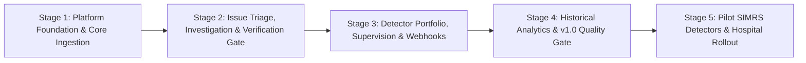

# PRIMA — DEVELOPMENT ROADMAP
**System:** PrIMA (Proactive Inspection Monitoring App)  
**Document:** Staged Development & Rollout Roadmap  
**Status:** Planned  
**Architecture Stack:** .NET 8+ Minimal APIs / SQL Server / Dapper / DbUp + Vue 3 / Vite / Tailwind CSS v4 / PrimeVue v4 / TanStack Query v5  

**Companion Documents:**
- [PrIMA Product Definition](./PrIMA%20-%20Product%20Definition.md)
- [PrIMA Domain Specification](./PRIMA-DOMAIN.md)
- [PrIMA Use Case Discovery](./PRIMA-USE-CASE-DISCOVERY.md)
- [PrIMA Screen Inventory](./PRIMA-SCREEN-INVENTORY.md)
- [PrIMA UI/UX Guideline](./PRIMA-UI-UX-GUIDELINE.md)
- [PrIMA Architecture Specification](./PRIMA-ARCHITECTURE.md)

---

## 1. Roadmap Philosophy & Delivery Strategy

PrIMA is structured around a **5-stage vertical-slice delivery strategy** designed to de-risk integration early, deliver tangible operational capability at the end of every stage, and strictly preserve the architectural boundaries defined in [PRIMA-ARCHITECTURE.md](./PRIMA-ARCHITECTURE.md):

1. **Walking Skeleton & Ingestion Contract First (Stage 1):** Establish the single-project .NET 8 Minimal API host, DbUp SQL Server schema, JWT officer authentication, standardized `POST /api/ingestion/telemetry` contract, and live-polling Dashboard (`S-01`) so external Detector development and UI workflows can converge early on a real, testable ingestion pipeline.
2. **Complete Single-Screen Operational Resolution Loop (Stage 2):** Build the full Issue Detail Workbench (`S-02`) and modals (`M-01`–`M-03`) before portfolio management so EDP officers can triage, investigate, record remediations, enforce the mandatory Verification Gate (`BR-PRIMA-004`), and resolve or dismiss issues end-to-end.
3. **Autonomous Supervision & Detector Portfolio (Stage 3):** Activate `MonitoringSupervisorWorker` (`BR-PRIMA-003`, `BR-PRIMA-005`, `BR-PRIMA-010`), `ExecutionFailed` anomaly synthesis, full Detector portfolio CRUD/health screens (`S-03`–`S-06`), and webhook-driven verification (`D-2`) on top of the proven issue engine.
4. **Retrospective Analytics & v1.0 Quality Gate (Stage 4):** Deliver read-only period-close KPIs and historical issue audit exploration (`S-07`), then complete full-stack compliance verification against [PRIMA-UI-UX-GUIDELINE.md](./PRIMA-UI-UX-GUIDELINE.md) and all 10 domain business rules.
5. **Detector Handshake Protocol, Pilot SIMRS Detector Suite & Hospital Rollout (Stage 5):** Implement the zero-drift Detector Enrollment & Handshake protocol (`POST /api/detectors/enrollment-tokens`, `POST /api/detectors/handshake`), deploy the standardized runner SDK/template, implement real non-intrusive SIMRS Detectors (`BR-PRIMA-007`) across all four monitoring scopes (`DataIntegrity`, `ProcessIntegrity`, `DataSync`, `Infrastructure`), harden on-premise hospital deployment security, run staging UAT, and transition EDP teams to production.

### Stage Overview Summary

| Stage | Name | Core Objective | Key Milestone | Screens & Modals | Use Cases | Business Rules |
|---|---|---|---|---|---|---|
| **Stage 1** | Platform Foundation & Core Telemetry Ingestion | Stand up backend, database, officer auth, standardized telemetry ingestion with deduplication, and the live-polling active issue dashboard. | Walking Skeleton & Live Ingestion Pipeline | `S-00`, `S-01` | `A-1`, `A-2`, Officer Auth | `BR-PRIMA-001`, `BR-PRIMA-002` (ingestion reopen), `BR-PRIMA-009` |
| **Stage 2** | Issue Triage, Investigation & Verification-Gated Resolution | Deliver the complete `S-02` operational workbench covering assignment, evidence review, notes, remediation, mandatory verification, dismissal, and resolution. | Complete End-to-End Manual Issue Resolution Loop | `S-02`, `M-01`, `M-02`, `M-03` | `A-3`, `B-1`–`B-3`, `C-1`–`C-3`, `D-1`, `D-3`, `D-4` | `BR-PRIMA-004`, `BR-PRIMA-006`, `BR-PRIMA-008`, `BR-PRIMA-009` |
| **Stage 3** | Detector Portfolio, Automated Supervision & Webhook Verification | Enable detector lifecycle management, autonomous silence/escalation supervision, `ExecutionFailed` synthesis, and webhook-driven verification. | Autonomous Proactive Supervision & Self-Monitoring | `S-03`, `S-04`, `S-05`, `S-06` (+ `S-01`/`S-02` upgrades) | `D-2`, `E-1`–`E-7`, `F-1`, `F-2`, `G-1`, `G-2` | `BR-PRIMA-003`, `BR-PRIMA-005`, `BR-PRIMA-010` |
| **Stage 4** | Historical Reliability Analytics, Reporting & v1.0 Quality Gate | Provide read-only period-close reliability KPIs and audit history (`S-07`), and verify full v1.0 conformance across domain, API, and UX rules. | Feature-Complete PrIMA v1.0 Release Candidate | `S-07` (+ full-app polish) | `H-1`, `H-2` | Full verification of `BR-PRIMA-001`–`010` |
| **Stage 5** | Detector Handshake Protocol, Pilot SIMRS Detector Suite & Hospital Production Rollout | Implement zero-drift detector enrollment/handshake protocol, build non-intrusive SIMRS pilot detectors across all 4 monitoring scopes, harden on-premise deployment, complete UAT, and go live in hospital ops. | Hospital On-Premise Production Go-Live & Automated Detector Enrollment | `S-03`/`S-05` (Enrollment Token Modal), Production Operational Rollout | End-to-end validation of `A-1`–`H-2`, Handshake Enrollment | `BR-PRIMA-007` (production SIMRS validation), `BR-PRIMA-010` (cadence drift guard) |

---

## 2. Detailed Stage Breakdown

### Stage 1: Platform Foundation & Core Telemetry Ingestion

#### Objective
Establish the end-to-end backend, SQL Server persistence, and Vue 3 frontend foundation—including JWT officer authentication, the API-key-authenticated telemetry ingestion contract, deterministic correlation deduplication, and the live-polling Issue Dashboard—so external detectors can report live anomalies into PrIMA and EDP officers can sign in to view the active issue queue in real time.

#### Target Milestone
**Walking Skeleton & Live Ingestion Pipeline** — An officer can authenticate via `S-00` and watch anomalies submitted by a telemetry simulator deduplicate into active issues or reopen closed issues on `S-01` within one 10-second polling cycle.

#### Scope & Deliverables
- **Backend (`src/backend/PrIMA.Api/`):**
  - Bootstrap single-project ASP.NET Core `.NET 8+` Minimal API host (`Program.cs`, `appsettings.json`), OpenAPI/Swagger (`/swagger/v1/swagger.json`), FluentValidation, and shared kernel primitives in `Common/` (`Result.cs`, `DomainError.cs`, `ProblemDetailsExtensions.cs`, `IEndpoint.cs`, `ISqlConnectionFactory.cs`, `CurrentOfficer.cs`).
  - Configure DbUp startup runner (`Migrations/MigrationRunner.cs`) with `001_InitialSchema.sql` (all core tables in `dbo`: `Detectors`, `InspectionRuns`, `Issues`, `Occurrences`, `InvestigationNotes`, `RemediationRecords`, `VerificationRecords`, `DismissalRecords`, `Officers`) and `002_SeedInitialUsers.sql` (initial EDP officer accounts and baseline test detector rows).
  - Implement officer authentication slice (`Features/Auth/LoginEndpoint.cs`, `LoginRequest.cs`, `LoginResponse.cs`) issuing JWT Bearer tokens carrying Officer ID, Username, FullName, and Role.
  - Implement core Domain aggregates and value objects (`Domain/Detectors/Detector.cs`, `InspectionRun.cs`, `MonitoringScope.cs`, `DetectorHealth.cs`, `IDetectorRepository.cs`; `Domain/Issues/Issue.cs`, `CorrelationKey.cs`, `TelemetryEvidence.cs`, `Occurrence.cs`, `IssueStatus.cs`, `IssueSeverity.cs`, `IssueErrors.cs`, `IIssueRepository.cs`) and Dapper write repositories (`Infrastructure/Persistence/SqlConnectionFactory.cs`, `DetectorRepository.cs`, `IssueRepository.cs`).
  - Implement standardized Ingestion vertical slice (`Features/Ingestion/IngestTelemetryEndpoint.cs`, `IngestTelemetryRequest.cs`, `IngestTelemetryValidator.cs`, `IngestTelemetryHandler.cs`) on `POST /api/ingestion/telemetry` protected by `X-Detector-API-Key`, handling `Passed` and `FindingDiscovered` outcomes, computing deterministic `CorrelationKey = $"{DetectorId}:{TargetEntityReference}"`, enforcing `BR-PRIMA-001` (append immutable `Occurrence` to active issue), `BR-PRIMA-002` (auto-reopen `Resolved`/`Dismissed` issue on matching recurrence), and `BR-PRIMA-009` (immutable occurrence audit snapshots).
  - Implement Dashboard CQRS read slice (`Features/Issues/GetDashboardFeed`) returning active summary counters (`Critical`, `High`, `Open`, `Reopened`, `Resolved Today`) and the filtered active feed sorted by `CurrentSeverity DESC, LastOccurrenceAtUtc DESC` (strictly excluding `Resolved` and `Dismissed`).
  - Provide a lightweight CLI/script telemetry simulator to exercise `Passed`, new `FindingDiscovered`, duplicate `FindingDiscovered`, and recurrence-after-close payloads.
- **Frontend (`src/frontend/`):**
  - Initialize Vue 3.5+ (`<script setup lang="ts">`) + Vite 6 + Tailwind CSS v4 + PrimeVue v4 (Aura preset in `src/app/config/primevue.ts`) + Pinia (`src/app/stores/auth.store.ts`) + Vue Router (`src/app/router/index.ts` with JWT auth guards) + TanStack Query v5.
  - Configure centralized Axios HTTP client (`src/shared/services/http.ts`) with Bearer token injection and RFC 7807 `ProblemDetails` -> `ApiError` mapping, plus `openapi-typescript` contract generation into `src/shared/types/api.generated.ts`.
  - Implement shared domain primitives and formatters (`src/shared/components/AppErrorBoundary.vue`, `<IssueSeverityBadge>`, `<IssueStatusChip>`, `<ScopeTag>`, `<DetectorHealthBadge>`, `<CopyableValue>`, `src/shared/utils/dateUtils.ts` for `Asia/Jakarta` `WIB` and relative timestamps, and `currencyUtils.ts` for `id-ID` IDR formatting).
  - Build `AuthLayout.vue` and `S-00 Officer Login` (`/login`) with inline `401` feedback and `?redirect=` restoration.
  - Build `AppLayout.vue` (fixed `240px` left sidebar on desktop, collapsible PrimeVue `Drawer` below `1024px`, active route styling, live polling status pill, and officer session footer).
  - Build foundational `S-01 Issue Dashboard` (`/`, 10-second `refetchInterval`) with Summary Bar filter tiles, Status & Scope filter chips, `300ms` debounced free-text search, virtualized Issue Feed (`border-l-4` severity accent, occurrence counts, relative `WIB` tooltips), and contextual empty states (`All Clear` vs. `No matching records found`).

#### Business Rules & Use Cases Covered
- **Business Rules:** `BR-PRIMA-001` (Deterministic Anomaly Deduplication), `BR-PRIMA-002` (Automatic Recurrence Reopening on ingestion), `BR-PRIMA-009` (Immutable Occurrence Audit Trail).
- **Use Cases:** Officer Authentication (`S-00`), `A-1` (View Issue Dashboard), `A-2` (Filter & Search Issues).

#### Exit Criteria
- [ ] `PrIMA.Api` boots cleanly and DbUp executes `001_InitialSchema.sql` and `002_SeedInitialUsers.sql` idempotently on SQL Server.
- [ ] `openapi-typescript` generates `src/shared/types/api.generated.ts` from `/swagger/v1/swagger.json` with zero manual edits.
- [ ] Telemetry simulator posting `FindingDiscovered` creates an `Open` `Issue` with `Occurrence #1`; posting the same `CorrelationKey` again appends `Occurrence #2` without creating a duplicate `Issue`.
- [ ] Telemetry simulator posting a `CorrelationKey` matching a seeded/closed issue transitions it to `Reopened` and clears prior verification/dismissal state.
- [ ] Officer can log in on `S-00`, navigate `AppLayout.vue`, filter/search active issues on `S-01`, and receive 10-second polling updates without full-page skeleton flashes or resetting active filters.

---

### Stage 2: Issue Triage, Investigation & Verification-Gated Resolution

#### Objective
Deliver the complete single-screen operational workbench (`S-02`) and its focused workflow modals (`M-01`–`M-03`) so EDP officers can take ownership of anomalies, inspect structured telemetry evidence and occurrence timelines, record investigation notes, log remediations, satisfy the mandatory Verification Gate, and resolve or dismiss issues with full actor and timestamp traceability.

#### Target Milestone
**Complete End-to-End Manual Issue Resolution Loop** — An officer can take an `Open` or `Reopened` issue from `S-01` all the way to `Resolved` (via `M-02` + `M-03`) or `Dismissed` (via `M-01`) inside `S-02`, with strict domain-rule enforcement at both API and UI boundaries.

#### Scope & Deliverables
- **Backend (`Features/Issues/*` & Migrations):**
  - Complete `Issue` aggregate domain behavior (`TakeIt`, `RecordRemediation`, `RecordVerification`, `MarkResolved`, `Dismiss`, note appending) and `IssueErrors` in `Domain/Issues/`.
  - Add DbUp migration `003_IssueActivityLogs.sql` (`dbo.IssueActivityLogs`) to persist the immutable audit trail required by `S-02` Section 9 (capturing status transitions, assignment changes, notes/remediation/verification milestones, and later escalation events with actor and UTC timestamp).
  - Implement Issue query and command slices in `Features/Issues/`:
    - `GetIssueById`: Complete issue payload, chronological `Occurrences`, `InvestigationNotes`, `RemediationRecords`, `VerificationRecords`, `DismissalRecord`, and `ActivityLogs`.
    - `AcknowledgeIssue`: `Open` / `Reopened` -> `Acknowledged` (halting unacknowledged SLA timers).
    - `AssignIssue`: Self-assign `Take It` (combined Acknowledge + Assign -> `Investigating` per `BR-PRIMA-008`) and explicit `Assign to…` / `Reassign` to another seeded EDP officer.
    - `AddInvestigationNote`: Append-only officer-attributed diagnostic note.
    - `RecordRemediation` (`M-02`): Persist `RemediationRecord` (`DataCorrection`, `ServiceRestart`, `ConfigurationAdjustment`, `CodeRemediation`) while in `Investigating`.
    - `RecordManualVerification` (`M-03`): Persist `VerificationRecord` (`ManualQueryConfirmed`, `CleanPassed` or `AnomalyStillPresent`) requiring prior remediation.
    - `ResolveIssue`: Transition `Investigating` -> `Resolved`, strictly enforcing `BR-PRIMA-004` (`409 Conflict` ProblemDetails if no `CleanPassed` `VerificationRecord` exists).
    - `DismissIssue` (`M-01`): Transition `Open` / `Acknowledged` / `Investigating` / `Reopened` -> `Dismissed`, strictly enforcing `BR-PRIMA-006` (`422 Unprocessable Entity` if justification rationale trimmed length `< 20` chars).
- **Frontend (`src/features/issues/`):**
  - Implement `S-02 Issue Detail Workbench` (`/issues/:id`, 10-second background-safe polling):
    - Sticky header (`Back to Dashboard` navigation preservation, copyable `CorrelationKey`, `Occurrence #N` counter, clickable Detector link, severity/status/scope badges) and context-sensitive Action Bar strictly driven by the state machine in [PRIMA-UI-UX-GUIDELINE.md §7](./PRIMA-UI-UX-GUIDELINE.md#7-interactive-state-machine--context-sensitive-action-bar-rules-s-02).
    - Left primary column (`lg:col-span-8`): Always-visible Latest Telemetry Evidence card (2x2 metadata grid with copyable `RecordKeys`, null-safe `id-ID` IDR financial comparison strip with rose `VarianceDelta` highlight, dark monospace `TraceString` box with copy button); collapsible `Occurrences & Timeline` sorted newest-first with inline expandable evidence preserving expanded IDs across poll ticks; append-only `Investigation Notes` with `Ctrl+Enter` submission and draft preservation across polls.
    - Right governance column (`lg:col-span-4`): 3-step `Verification Gate` checklist card keeping `Mark Resolved` visibly locked until `CleanPassed` exists (plus solid emerald banner when `Resolved`, or prominent `DismissalRecord` card when `Dismissed`); `Remediation History` and `Verification Record` cards; `Ownership & Timestamps` card; collapsible `Activity Log` collapsed by default.
  - Implement VeeValidate + Zod workflow modals (`PrimeVue Dialog`, `Esc` support, click-outside lock while `isPending`):
    - `M-01 Dismiss Issue`: Dismissal Reason select + Justification Rationale textarea with live `0 / 20 min chars` counter.
    - `M-02 Record Remediation`: Action Category select + SOP Description textarea.
    - `M-03 Manual Verification`: Verification Evidence/Notes textarea + visual selectable `Anomaly Gone (Clean)` vs. `Anomaly Still Present` radio cards.
  - Wire TanStack Query mutation invalidation matrix (`['issues', 'detail', issueId]`, `['dashboard', 'feed']`) and RFC 7807 `422` field error mapping / `409` warn toast + query resync / `404` inline recovery state.

#### Business Rules & Use Cases Covered
- **Business Rules:** `BR-PRIMA-004` (Mandatory Verification Gate), `BR-PRIMA-006` (Documented Justification for Issue Dismissal), `BR-PRIMA-008` (Explicit Assignment and Accountability), `BR-PRIMA-009` (Immutable Occurrence Audit Trail).
- **Use Cases:** `A-3` (View Issue Detail), `B-1` (Acknowledge Issue), `B-2` (Assign Issue / `Take It`), `B-3` (Dismiss Issue), `C-1` (Review Telemetry Evidence), `C-2` (Review Occurrence History), `C-3` (Add Investigation Note), `D-1` (Record Remediation Action), `D-3` (Record Manual Verification), `D-4` (Mark Issue Resolved).

#### Exit Criteria
- [ ] `POST /api/issues/{id}/resolve` returns `409 Conflict` when no `CleanPassed` `VerificationRecord` exists, and `S-02` keeps `Mark Resolved` visually disabled until `CleanPassed` is recorded.
- [ ] Submitting `M-01` with a rationale under 20 characters fails Zod client validation and, if bypassed via API, returns `422 Unprocessable Entity` mapped inline via `form.setErrors()`.
- [ ] Recording a `AnomalyStillPresent` verification in `M-03` keeps the issue in `Investigating` with an alert banner and allows retrying remediation (`M-02`).
- [ ] Completing `Take It` -> Notes -> `M-02` -> `M-03` (`CleanPassed`) -> `Mark Resolved` moves the issue to read-only `Resolved`, logs every step to `dbo.IssueActivityLogs`, and removes the issue from `S-01`.
- [ ] Background 10-second polling on `S-02` never closes open modals (`M-01`–`M-03`), collapses expanded occurrences, or clears an unsaved investigation note draft.

---

### Stage 3: Detector Portfolio, Automated Supervision & Webhook Verification

#### Objective
Enable full administrative lifecycle management of the Detector portfolio (`S-03`–`S-06`), activate autonomous background supervision for detector silence (`BR-PRIMA-010`), execution failures (`BR-PRIMA-005`), and dynamic severity escalation (`BR-PRIMA-003`), and connect on-demand detector webhooks so PrIMA proactively detects monitoring blind spots and automates post-remediation verification (`D-2`).

#### Target Milestone
**Autonomous Proactive Supervision & Self-Monitoring** — PrIMA detects silent or crashing detectors as `Infrastructure` issues, dynamically escalates stale or high-recurrence issues, surfaces real-time alert strips on `S-01`, and triggers detector runs/re-verifications via webhook.

#### Scope & Deliverables
- **Backend (`Features/Detectors/*`, `BackgroundServices/`, `Infrastructure/Webhooks/`):**
  - Complete `Detector` aggregate domain logic (`Domain/Detectors/Detector.cs`) governing administrative lifecycle (`Active <-> Paused -> Retired`, rejecting execution runs and suppressing silence alerts when `Paused` or `Retired`) and health transitions (`Healthy`, `Silent`, `Failing`).
  - Extend `IngestTelemetryHandler` to process `outcome == "ExecutionFailed"`: record failed `InspectionRun` with `FailureReason`, set detector `HealthStatus = Failing`, and auto-synthesize/append an `Infrastructure` issue with deterministic `CorrelationKey` (`FAIL:{DetectorId}`) per `BR-PRIMA-005`.
  - Implement `BackgroundServices/MonitoringSupervisorWorker.cs` running on a 60-second loop:
    - **Silence Detection (`BR-PRIMA-010` & `BR-PRIMA-005`):** Evaluate `Active` detectors where `(UtcNow - LastHealthyHeartbeatUtc) > (ExpectedCadenceSeconds * 2)`, mark `HealthStatus = Silent`, and synthesize/append an `Infrastructure` issue (`SILENT:{DetectorId}`).
    - **Dynamic Severity Escalation (`BR-PRIMA-003`):** Escalate unacknowledged `Open` issues past the configured SLA timeout (default 30 minutes) and issues reaching the recurrence threshold (`>= 5` occurrences), elevating `CurrentSeverity`, incrementing `EscalationLevel`, and recording an escalation event in `dbo.IssueActivityLogs`.
  - Implement `Infrastructure/Webhooks/DetectorWebhookClient.cs` and vertical slices:
    - `Features/Issues/TriggerVerificationRun`: Invoke detector `WebhookUrl` to execute an immediate check after remediation and persist a `VerificationRecord` (`AutomatedReRun`, `CleanPassed` or `AnomalyStillPresent`) per `D-2`.
    - `Features/Detectors/GetDetectorList`: Portfolio summary counts (`Healthy`, `Failing`, `Silent`, `Paused`) and filterable detector rows (`S-03`).
    - `Features/Detectors/GetDetectorById`: Detector config, 30-day run stats (`LastSuccessfulRun`, `LastFailure`, `TotalRuns30d`, `PassRate%`), last 10 `InspectionRuns`, and active linked issues (`S-04`).
    - `Features/Detectors/RegisterDetector` & `UpdateDetector`: Create `Active` detectors and update mutable config while keeping detector identity immutable (`S-05`).
    - `Features/Detectors/ToggleDetectorStatus`: `Pause`, `Resume`, and irreversible `Retire` (`S-04`).
    - `Features/Detectors/TriggerManualRun`: On-demand execution via webhook (`E-7`) recording `Manual` `InspectionRun` and telemetry outcome.
    - `Features/Detectors/GetInspectionRuns`: Filterable historical run log by date range, outcome, and trigger source (`S-06`).
- **Frontend (`src/features/detectors/` + `S-01` / `S-02` Enhancements):**
  - Build `S-03 Detector List` (`/detectors`, 15-second polling): Health Summary Bar, Admin Status / Health / Scope filter strips, instant search, virtualized portfolio list, `+ Register Detector` CTA, and sidebar `Detectors` alert dot when any detector is `Failing` or `Silent`.
  - Build `S-04 Detector Detail` (`/detectors/:id`, 15-second polling): Sticky header, status-driven Action Bar (`Trigger Run`, `Pause`/`Resume`, `Edit`, `Retire` guarded by PrimeVue `ConfirmDialog`), 4-column 30-day stats row (`tabular-nums` emerald/amber/rose pass-rate coloring), inline-expandable Recent Inspection Runs (last 10 + `View All Runs ->`), and Active Linked Issues navigating to `S-02`.
  - Build `S-05 Detector Form` (`/detectors/new`, `/detectors/:id/edit`): VeeValidate + Zod validated form with immutable `Name` in edit mode, split `ExpectedCadence` duration input (Minutes/Hours) showing live `2x` silence threshold helper text, and optional `WebhookUrl`.
  - Build `S-06 Inspection Run Log` (`/detectors/:id/runs`): Date range picker (default last 7 days), Outcome & Trigger filter pills, virtualized expandable run list revealing full `FailureReason` stack trace or copyable `CorrelationKey` + `Finding ->` link to `S-02`.
  - Upgrade `S-01 Issue Dashboard`: Add conditional top Alert Strip (`⚠ N issues escalated · M issues reopened` with one-click filter navigation for `G-1` and `G-2`), `↑ Escalated` severity indicator pills, and 2-second soft highlight cues on newly surfaced `Critical`/`Reopened` rows.
  - Upgrade `S-02 Issue Detail Workbench`: Enable `Trigger Verification Re-run` (`D-2`) when detector `WebhookUrl` is configured; disable gracefully with an explanatory tooltip directing officers to `M-03 Manual Verification` when no webhook is configured.

#### Business Rules & Use Cases Covered
- **Business Rules:** `BR-PRIMA-003` (Dynamic Severity Escalation), `BR-PRIMA-005` (Unified Treatment of Detector Health Anomalies), `BR-PRIMA-010` (Detector Silence Detection Cadence).
- **Use Cases:** `D-2` (Trigger Verification Re-run), `E-1`–`E-7` (Detector List, Detail, Register, Edit, Pause/Resume, Retire, Manual Run), `F-1`–`F-2` (Inspection Run Log & Detail), `G-1`–`G-2` (Escalation & Reopened Awareness).

#### Exit Criteria
- [ ] Halting a simulated `Active` detector heartbeat beyond `2x` `ExpectedCadenceSeconds` causes `MonitoringSupervisorWorker` to mark it `Silent` and create/append an `Infrastructure` issue visible on `S-01`.
- [ ] Posting `ExecutionFailed` marks the detector `Failing` and synthesizes an `Infrastructure` issue; pausing the detector suppresses silence transitions while `Paused`.
- [ ] Unacknowledged `Open` issues past SLA timeout and issues with `>= 5` occurrences elevate `CurrentSeverity`, increment `EscalationLevel`, and surface in the `S-01` Alert Strip.
- [ ] `Trigger Run` (`S-04`) and `Trigger Verification Re-run` (`S-02`) invoke configured detector webhooks, log `InspectionRuns`, and create `AutomatedReRun` `VerificationRecord` entries; detectors without `WebhookUrl` fall back cleanly to `M-03`.
- [ ] Retiring a detector via `S-04` requires `ConfirmDialog` approval, transitions it to read-only `Retired`, and preserves historical runs and issues.

---

### Stage 4: Historical Reliability Analytics, Reporting & v1.0 Quality Gate

#### Objective
Deliver retrospective period-close reporting, operational reliability KPIs, and historical audit exploration (`S-07`), and execute a full-stack quality gate confirming complete adherence to every domain invariant, API contract, and UI/UX guideline before hospital pilot deployment.

#### Target Milestone
**Feature-Complete PrIMA v1.0 Release Candidate** — All 8 screens (`S-00`–`S-07`) and 3 modals (`M-01`–`M-03`) are complete, audited against all 10 business rules, and ready for real SIMRS detector integration.

#### Scope & Deliverables
- **Backend (`Features/History/*` & Test Suite):**
  - Implement `Features/History/GetReliabilityKpi`: Parameterized Dapper aggregation queries for selected date ranges computing the 6 KPI tiles (`Total Issues`, `Resolution Rate %`, `Avg. Time to Acknowledge (h)` / MTTA, `Avg. Time to Resolve (h)` / MTTR, `Detector Pass Rate %`, `Reopened Issues`) plus Scope and Severity breakdown counts.
  - Implement `Features/History/GetHistoricalIssues`: Filterable historical query supporting `All`, `Resolved`, `Dismissed`, `Reopened`, and active statuses across Scope, Detector, Severity, and UTC/WIB date boundaries.
  - Verify SQL Server query execution plans and indexing across `dbo.Issues`, `dbo.Occurrences`, and `dbo.InspectionRuns` under high-volume simulated telemetry.
  - Complete automated domain unit tests (covering `Issue` and `Detector` aggregate invariants) and API integration tests (verifying RFC 7807 `401`/`404`/`409`/`422` contracts, deduplication, reopening, verification gate, and KPI math).
- **Frontend (`src/features/history/` & Full-App UX Audit):**
  - Build `S-07 History & Reports` (`/history`, strictly read-only):
    - Date Range Picker (`Today`, `This Week`, `This Month`, `Last Month`, `Custom` presets).
    - 6-Tile KPI Grid (`font-mono tabular-nums`).
    - 2-Column Scope & Severity Breakdown tables using pure CSS horizontal proportion bars (zero external charting libraries, per [PRIMA-UI-UX-GUIDELINE.md §10](./PRIMA-UI-UX-GUIDELINE.md#10-ai-agent-implementation-checklist--anti-patterns-do-not-do)).
    - Filterable Issue History Table routing to read-only `S-02` while preserving `Back to History` origin navigation.
  - Connect `S-01` `Resolved Today` summary tile click directly to `/history` pre-filtered to `Today + Resolved`.
  - Execute complete UI/UX & Engineering Compliance Audit:
    - Confirm feature-slice isolation (`src/features/{auth,dashboard,issues,detectors,history}/`) with zero cross-feature imports and regenerated `api.generated.ts`.
    - Validate virtualized scrolling (`VirtualScroller` / virtualized `DataTable`, zero pagination) on `S-01`, `S-03`, `S-06`, and `S-07` under 1,000+ simulated rows.
    - Verify keyboard navigation (`Esc` on modals, `Ctrl+Enter` on notes, `focus-visible` rings), tablet `< 1024px` collapsible sidebar drawer, and silent network disconnect handling (`"Reconnecting..."` indicator after `>= 2` consecutive failed background polls without toast spam).

#### Business Rules & Use Cases Covered
- **Use Cases:** `H-1` (View System Health Summary), `H-2` (View Issue History).
- **Business Rules:** End-to-end automated regression verification across `BR-PRIMA-001` through `BR-PRIMA-010`.

#### Exit Criteria
- [ ] All 8 screens (`S-00`–`S-07`) and 3 modals (`M-01`–`M-03`) are complete and pass end-to-end integration tests.
- [ ] `S-07` KPI tiles (Resolution Rate %, MTTA, MTTR, Detector Pass Rate %, Reopened count) and Scope/Severity breakdowns reconcile 100% with SQL Server test fixtures.
- [ ] Clicking `Resolved Today` on `S-01` opens `S-07` pre-filtered, and opening a closed issue from `S-07` displays read-only `S-02` with a working `Back to History` link.
- [ ] Automated backend domain/API test suite passes with zero skipped assertions covering `BR-PRIMA-001`–`010`.
- [ ] Frontend checklist in [PRIMA-UI-UX-GUIDELINE.md §10](./PRIMA-UI-UX-GUIDELINE.md#10-ai-agent-implementation-checklist--anti-patterns-do-not-do) passes with zero forbidden anti-patterns.

---

### Stage 5: Detector Handshake Protocol, Pilot SIMRS Detector Suite & Hospital Production Rollout

#### Objective
Implement the zero-drift Detector Enrollment & Handshake protocol to eliminate manual registration discrepancies, build and safety-validate the initial production Detector suite covering all four SIMRS monitoring scopes under strict non-interference guarantees (`BR-PRIMA-007`), harden on-premise security and operational packaging, and transition hospital EDP teams onto PrIMA through staging UAT and production hypercare.

#### Target Milestone
**Hospital On-Premise Production Go-Live & Automated Detector Enrollment** — PrIMA, its automated detector handshake enrollment protocol, and its initial 4-scope SIMRS Detector suite run autonomously in the hospital environment, catching real operational exceptions early without configuration drift and without impacting SIMRS transactions.

#### Scope & Deliverables
- **Detector Enrollment & Handshake Protocol (Zero-Drift Auto-Registration):**
  - **Backend Handshake & Token Slice (`Features/Detectors/Enrollment/*`):**
    - `POST /api/detectors/enrollment-tokens`: Allows authenticated EDP officers to generate a cryptographically random, short-lived enrollment token (e.g., `PRM-TOKEN-...`) without needing to manually fill out technical metadata in advance.
    - `POST /api/detectors/handshake`: Endpoint called by detector scripts on initial boot. Payload provides the detector's runtime technical manifest (`enrollmentToken`, `name`, `targetModule`, `scope`, `expectedCadenceSeconds`, `webhookUrl`, `description`, `version`). The endpoint validates the token, generates a unique permanent `detectorId` (GUID), provisions API credentials, and activates the detector in `dbo.Detectors`.
    - Enforce sanity guardrails: enforce unique names (`BR-PRIMA-008`), bounded cadence limits (e.g., minimum 30s, maximum 86400s) to prevent circumventing silence supervision (`BR-PRIMA-010`), and single-use token expiration.
    - Telemetry cadence drift monitoring: On subsequent `POST /api/ingestion/telemetry` runs, detect and warn if the detector's actual execution frequency diverges significantly from the registered `expectedCadenceSeconds`.
  - **Frontend Integration (`S-03 Detector List` & `S-05 Detector Form`):**
    - Add "Quick Enroll / Handshake" option: A modal on `S-03` and `S-05` to generate and copy an Enrollment Token with a single click, providing ready-to-copy environment variable snippets (`PRIMA_ENROLLMENT_TOKEN=...`, `PRIMA_SERVER_URL=...`) for edge technicians.
    - Support visual `PendingEnrollment` state in `S-03` portfolio list for generated tokens awaiting initial detector contact.
- **Reference Detector SDK / Runner Template (`src/tools/detector-runner-template/`) & Pilot Suite:**
  - Create a standardized, lightweight Detector runner template implementing:
    - Automatic initial bootstrap handshake: If unconfigured, exchanges `PRIMA_ENROLLMENT_TOKEN` for permanent `detectorId` via `POST /api/detectors/handshake` and caches configuration locally.
    - Standardized `POST /api/ingestion/telemetry` client with structured `TelemetryEvidence` payloads.
    - Comprehensive `ExecutionFailed` error trapping (`BR-PRIMA-005`).
    - Optional local HTTP webhook listener endpoint for `Trigger Run` (`S-04`) and `Trigger Verification Re-run` (`S-02` / `D-2`).
  - Build and register initial pilot Detectors across all four scopes from [PrIMA Product Definition §3](./PrIMA%20-%20Product%20Definition.md#3-scope-of-monitoring):
    1. **Data Integrity:** *Journal Balance Detector* (unbalanced debit/credit ledger entries) and *Duplicate Receivable Detector* (duplicate receivable creation for a single source transaction).
    2. **Process Integrity:** *Missing Auto-Journal / Unprocessed Billing Pipeline Detector* (completed transactions missing expected downstream journal generation).
    3. **Data Synchronization:** *EMR Synchronization Detector* (failed or missing EMR sync records) and *SIMRS–HFIS Doctor Schedule Detector* (schedule mismatches between SIMRS and HFIS).
    4. **Infrastructure & Service:** *Remote Print Server Queue Detector* (stalled or unresponsive print spooler queues on hospital client stations).
- **Operational Safety & Deployment Hardening (`BR-PRIMA-007` & Product Definition §9):**
  - Enforce non-intrusive read-only inspection constraints: provision dedicated read-only SIMRS database credentials (or read-replica connections), enforce strict query timeouts, and verify zero blocking locks or measurable latency impact during peak SIMRS hours.
  - Finalize hospital on-premise deployment packaging: TLS/HTTPS reverse-proxy configuration, secure environment/secret storage for JWT signing keys and per-detector `X-Detector-API-Key` credentials, health-check endpoints, structured application logging, SQL Server backup/retention policy for `InspectionRuns` and `Occurrences`, and optional secure remote access for the ICS team per hospital security policy.
  - Seed hospital-specific EDP officer accounts via deployment configuration / `002_SeedInitialUsers.sql`.
- **UAT, SOP Enablement & Production Hypercare:**
  - Conduct staging UAT with EDP Officers, System Analysts, and the Product Owner simulating real anomalies across all 4 scopes (including detector handshake enrollment, silence, and failure recovery).
  - Publish concise EDP Remediation SOP quick-reference sheets mapped to each pilot detector's `ActionCategory` and verification queries.
  - Execute a 2-week production hypercare period to tune detector cadences, silence multipliers, escalation SLA thresholds, and false-positive rules, establishing baseline MTTA/MTTR metrics for period-close reviews.

#### Business Rules & Use Cases Covered
- **Business Rules:** `BR-PRIMA-007` (Non-Interfering Inspection Constraint verified under real SIMRS workloads), `BR-PRIMA-010` (Cadence verification & silence supervision integrity), and live operational validation of `BR-PRIMA-001`–`010`.
- **Use Cases:** Full hospital operational validation of `A-1` through `H-2` plus automated Handshake Enrollment.

#### Exit Criteria
- [ ] The Detector Enrollment & Handshake workflow is fully verified: generating an enrollment token in PrIMA UI, passing it to an unconfigured detector script, successfully completing handshake registration, and receiving verified telemetry without manual technical data entry in UI.
- [ ] Read-only permissions, query timeouts, and lock-impact benchmarks are signed off (`BR-PRIMA-007`) for every pilot Detector prior to production activation.
- [ ] All 4 monitoring scopes (`DataIntegrity`, `ProcessIntegrity`, `DataSync`, `Infrastructure`) report live telemetry to the hospital PrIMA instance on schedule.
- [ ] Hospital EDP officers complete UAT scenarios and resolve or dismiss live pilot findings through `S-01`–`S-07` without ad-hoc database workarounds.
- [ ] Production hypercare review confirms acceptable false-positive dismissal rates and verified early detection of pre-close anomalies against [PrIMA Product Definition §10](./PrIMA%20-%20Product%20Definition.md#10-success-criteria).

---

## 3. Complete Traceability Matrix

### 3.1 Screens & Modals (`S-00`–`S-07`, `M-01`–`M-03`)

| ID | Screen / Modal | Delivery Stage | Notes |
|---|---|---|---|
| `S-00` | Officer Login | Stage 1 | `AuthLayout.vue`, JWT Bearer authentication |
| `S-01` | Issue Dashboard | Stage 1 (Core) / Stage 3 (Alert Strip & Escalation cues) / Stage 4 (Deep-link to `S-07`) | Virtualized feed, 10s polling |
| `S-02` | Issue Detail Workbench | Stage 2 (Core + `M-01`–`M-03`) / Stage 3 (Webhook `D-2` trigger) | Single-screen lifecycle + Verification Gate |
| `M-01` | Dismiss Issue (Modal) | Stage 2 | Min 20-char rationale (`BR-PRIMA-006`) |
| `M-02` | Record Remediation (Modal) | Stage 2 | Required before Verification Gate |
| `M-03` | Manual Verification (Modal) | Stage 2 | Clean vs. Anomaly Still Present |
| `S-03` | Detector List | Stage 3 (Core) / Stage 5 (Enrollment Token Modal) | 15s polling, portfolio health summary, quick enrollment |
| `S-04` | Detector Detail | Stage 3 | Admin status actions + `ConfirmDialog` retire |
| `S-05` | Detector Form *(Register / Edit)* | Stage 3 (Core) / Stage 5 (Handshake pairing mode) | Immutable `Name` on edit, optional `WebhookUrl`, enrollment token flow |
| `S-06` | Inspection Run Log | Stage 3 | 7-day default, expandable failures & findings |
| `S-07` | History & Reports | Stage 4 | Read-only KPIs, CSS breakdown bars, history |

### 3.2 Use Case Groups (`A-1`–`H-2`)

| Group | Use Cases | Stage |
|---|---|---|
| **A — Dashboard & Issue Monitoring** | `A-1`, `A-2` | Stage 1 |
| **A — Dashboard & Issue Monitoring** | `A-3` | Stage 2 |
| **B — Issue Triage** | `B-1`, `B-2`, `B-3` | Stage 2 |
| **C — Investigation & Evidence Review** | `C-1`, `C-2`, `C-3` | Stage 2 |
| **D — Remediation & Verification** | `D-1`, `D-3`, `D-4` | Stage 2 |
| **D — Remediation & Verification** | `D-2` (Automated Webhook Re-run) | Stage 3 |
| **E — Detector Management** | `E-1`–`E-7`, Detector Handshake Enrollment | Stage 3 (`E-1`–`E-7`) / Stage 5 (Handshake protocol & runner SDK) |
| **F — Inspection Run History** | `F-1`, `F-2` | Stage 3 |
| **G — Notifications & Escalation Awareness** | `G-1`, `G-2` | Stage 3 |
| **H — Historical Reporting & Trends** | `H-1`, `H-2` | Stage 4 |

### 3.3 Domain Business Rules (`BR-PRIMA-001`–`010`)

| Business Rule | Summary | Implementation Stage | Verification Stage |
|---|---|---|---|
| `BR-PRIMA-001` | Deterministic Anomaly Deduplication | Stage 1 | Stage 1 & Stage 4 |
| `BR-PRIMA-002` | Automatic Recurrence Reopening | Stage 1 (Ingestion) / Stage 3 (Alert Strip) | Stage 1, Stage 3 & Stage 4 |
| `BR-PRIMA-003` | Dynamic Severity Escalation | Stage 3 | Stage 3 & Stage 4 |
| `BR-PRIMA-004` | Mandatory Verification Gate | Stage 2 | Stage 2 & Stage 4 |
| `BR-PRIMA-005` | Unified Treatment of Detector Health Anomalies | Stage 3 | Stage 3 & Stage 4 |
| `BR-PRIMA-006` | Documented Justification for Issue Dismissal | Stage 2 | Stage 2 & Stage 4 |
| `BR-PRIMA-007` | Non-Interfering Inspection Constraint | Stage 5 (Real SIMRS Probes) | Stage 5 |
| `BR-PRIMA-008` | Explicit Assignment and Accountability | Stage 2 | Stage 2 & Stage 4 |
| `BR-PRIMA-009` | Immutable Occurrence Audit Trail | Stage 1 & Stage 2 | Stage 2 & Stage 4 |
| `BR-PRIMA-010` | Detector Silence Detection Cadence | Stage 3 | Stage 3 & Stage 4 |

---

## 4. Key Sequencing Risks, Spec Alignments & Guardrails

The following cross-specification alignments must be addressed cleanly in their designated stages so implementation matches all approved contracts:

1. **Activity Log Persistence (`S-02` Section 9 vs. `001_InitialSchema.sql`):**  
   `PRIMA-SCREEN-INVENTORY.md` and `PRIMA-UI-UX-GUIDELINE.md` specify a collapsible immutable **Activity Log** on `S-02` recording status transitions, assignment changes, and escalation events, while `001_InitialSchema.sql` in `PRIMA-ARCHITECTURE.md` does not yet define a dedicated audit log table. **Resolution:** Add `003_IssueActivityLogs.sql` (`dbo.IssueActivityLogs`) in **Stage 2** and emit audit entries across Stage 2 triage/resolution commands and Stage 3 `MonitoringSupervisorWorker` escalations.
2. **`ExecutionFailed` Ingestion Handling (`BR-PRIMA-005` vs. `IngestTelemetryHandler`):**  
   `PRIMA-ARCHITECTURE.md §4.3` illustrates `Passed` and `FindingDiscovered`, whereas `PRIMA-DOMAIN.md` (`BR-PRIMA-005`, §8.3) and the `dbo.InspectionRuns` schema include `ExecutionFailed`. **Resolution:** Implement explicit `ExecutionFailed` handling inside `IngestTelemetryHandler` in **Stage 3** to set `HealthStatus = Failing` and auto-synthesize/append an `Infrastructure` Issue.
3. **Optional `WebhookUrl` Graceful Fallback (`D-2` vs. `D-3`):**  
   Hospital detectors executed as outbound-only cron jobs or local scripts behind firewall/NAT boundaries may not expose an inbound HTTP webhook. **Resolution:** Keep `WebhookUrl` optional in `S-05`; in **Stage 3**, visibly disable `Trigger Verification Re-run` (`S-02`) and `Trigger Run` (`S-04`) with an informative tooltip whenever `WebhookUrl` is null, directing officers to `M-03 Manual Verification`.
4. **Strict Non-Interference Enforcement (`BR-PRIMA-007`):**  
   No SIMRS detector may enter hospital production in **Stage 5** without dedicated read-only database credentials, explicit command timeouts, and load/lock verification confirming zero disruption to live hospital transactions.
5. **Strict v1.0 Scope Discipline:**  
   Guard **Stages 1–4** against scope creep—avoid pagination on `S-01`/`S-03`/`S-06`, external charting libraries on `S-07`, multi-step resolution wizards on `S-02`, or premature v2 configuration UIs.
6. **Detector Handshake Governance & Silence Boundary (`BR-PRIMA-008` & `BR-PRIMA-010`):**  
   Self-describing detector handshakes eliminate manual configuration drift by declaring `expectedCadenceSeconds`, `targetModule`, and `webhookUrl` directly from the detector script. However, to preserve governance and prevent rogue or buggy scripts from disabling silence alarms, the `POST /api/detectors/handshake` endpoint enforces strict validation bounds (minimum 30 seconds, maximum 24 hours), requires a valid single-use enrollment token issued by an authenticated officer, and maintains name uniqueness (`BR-PRIMA-008`). Telemetry ingestion further monitors for cadence drift between the actual execution interval and the registered cadence.

---

## 5. Post-v1 Evolution (Future Backlog Beyond Stage 5)

Items intentionally excluded from v1 ([PRIMA-SCREEN-INVENTORY.md](./PRIMA-SCREEN-INVENTORY.md#out-of-scope-screens-v1) & [PRIMA-USE-CASE-DISCOVERY.md](./PRIMA-USE-CASE-DISCOVERY.md#use-cases-not-in-scope-intentionally-excluded)) form the candidate backlog after Stage 5 production stabilization:

- **User & Role Management Admin CRUD:** In-app officer provisioning, password resets, and role administration beyond `002_SeedInitialUsers.sql`.
- **Configurable SLA & Escalation Rules UI:** Admin controls for per-detector/per-scope unacknowledged timeouts, silence multipliers, and recurrence thresholds.
- **External Push Notification Channels:** Alert dispatching to WhatsApp, Telegram, email, or external webhooks for `Critical`, `Reopened`, and `Silent` events alongside configurable officer notification preferences.
- **Advanced Multi-Period Analytics:** Multi-month reliability trend visualizations, cross-detector failure comparisons, and exportable period-close audit packages.
- **Optional Multi-Hospital Fleet Overview:** Read-only executive aggregation across independent hospital PrIMA installations for the ICS team while preserving isolated local hospital storage and operational autonomy.
