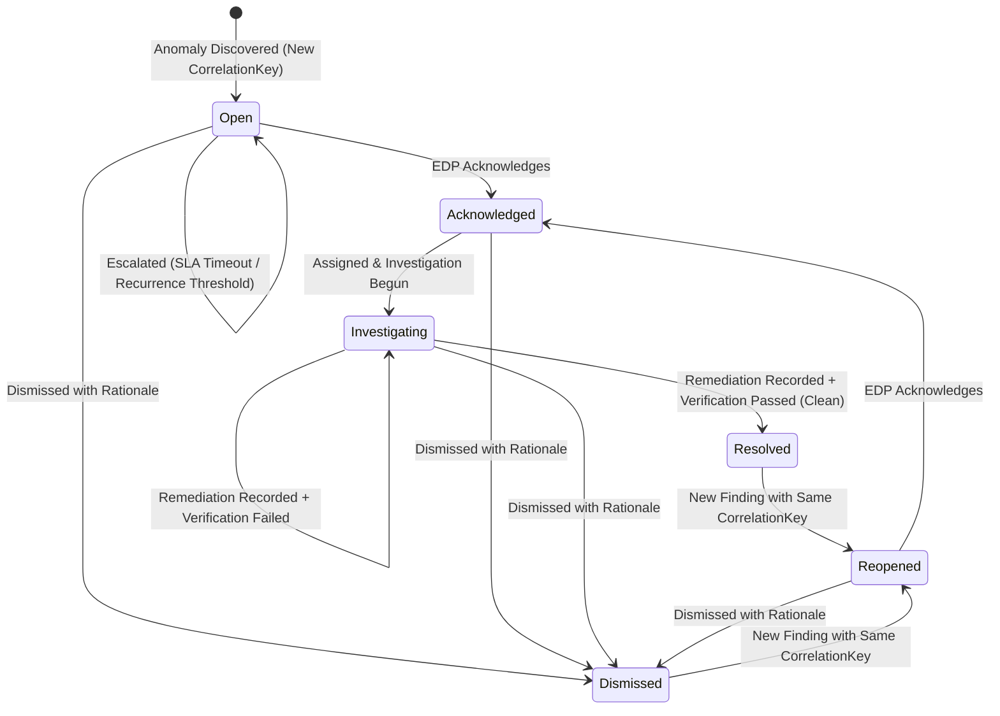
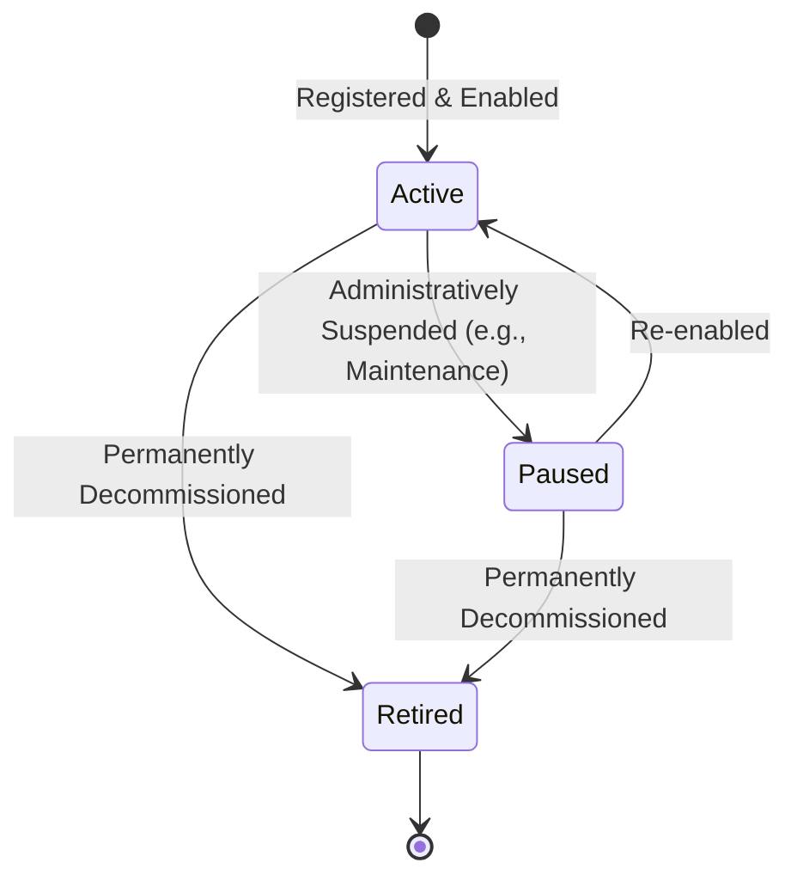
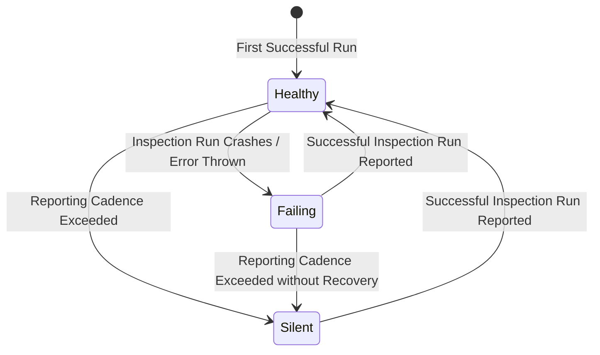
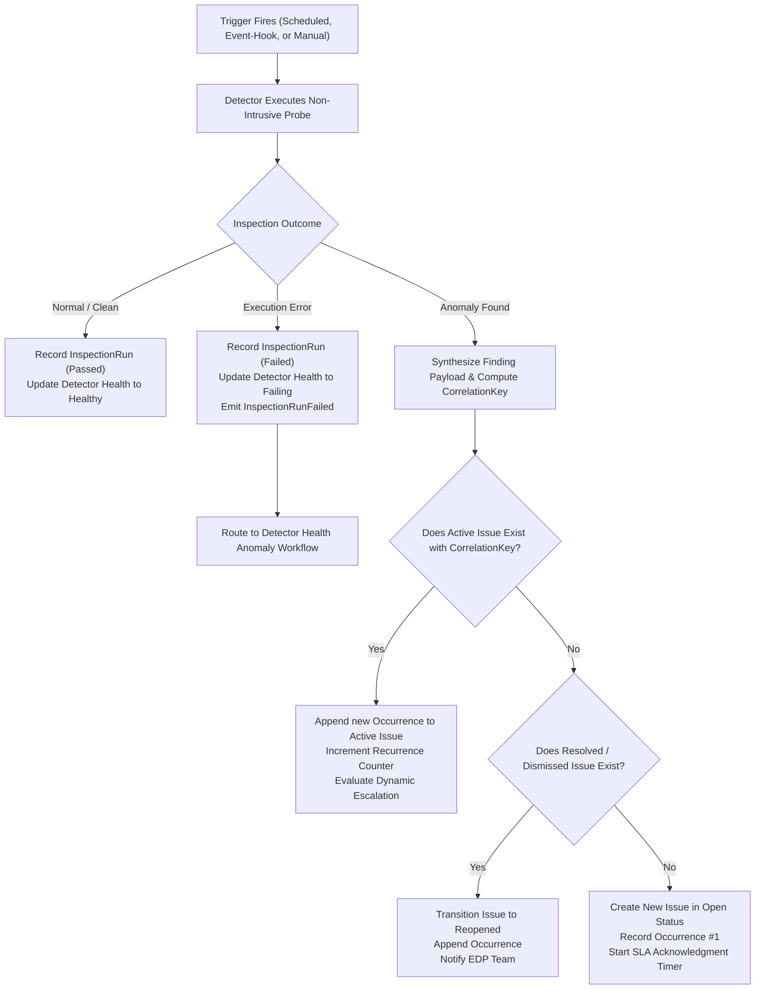
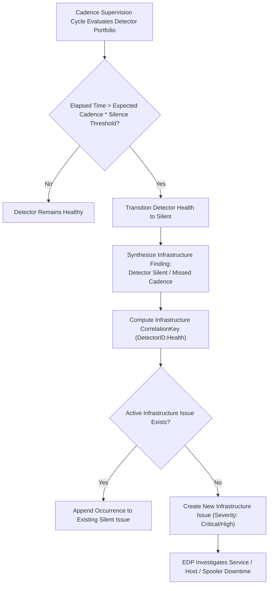
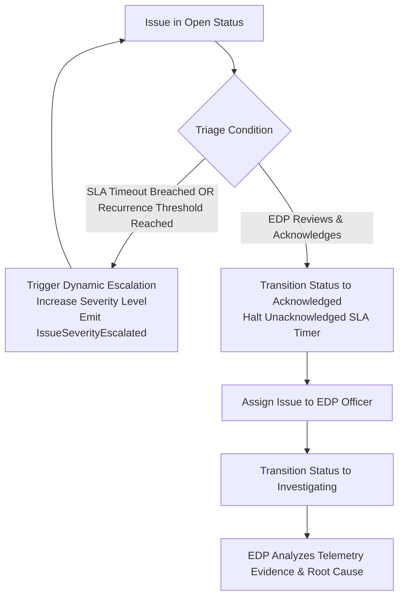
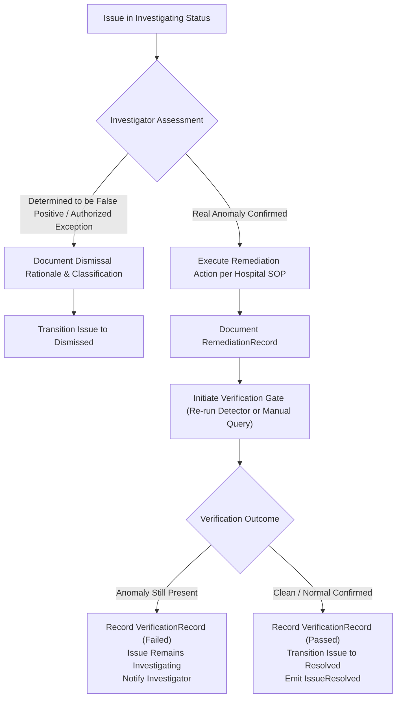
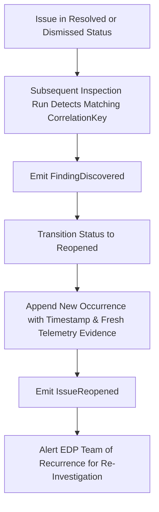

# PRIMA DOMAIN SPECIFICATION
**System:** PrIMA (Proactive Inspection Monitoring App)  
**Specification Type:** Canonical Business Domain Specification  
**Language:** English  
**Artifact Authority:** AI-Agent Business Specification  

---

# 1. Business Overview

## 1.1 Business Purpose
The primary purpose of PrIMA (Proactive Inspection Monitoring App) is to provide proactive, systematic, and automated operational monitoring and issue management for Hospital Information Systems (SIMRS). It continuously monitors data consistency, transaction completeness, inter-module synchronizations, and critical background services, identifying operational anomalies before they accumulate, impact downstream clinical/financial workflows, or disrupt accounting period closures.

## 1.2 Business Value
- **Elimination of Latent Defects:** Eliminates reliance on end-user complaints, delayed periodic reconciliations, and stressful monthly period-close manual checks.
- **Financial and Transactional Safeguards:** Prevents financial imbalances (e.g., unposted or unadjusted journal variances, duplicate receivables, billing-to-ledger misalignments) from lingering undetected.
- **Autonomous Detection & Centralized Triage:** Separates independent inspection logic from centralized issue tracking, providing IT and EDP teams with a unified operational workspace.
- **Auditable & Traceable Remediation:** Enforces end-to-end accountability from anomaly discovery and recurrence logging to formal root-cause analysis, corrective remediation, and verification.
- **Continuous Systemic Improvement:** Maintains a persistent operational track record that feeds hospital software improvement, stability audits, and vendor quality management.

## 1.3 Scope
The domain encompasses:
1. **Inspection Portfolio & Telemetry Supervision:** Registering independent inspection components (Detectors), tracking scheduled and manual execution runs, and detecting detector unresponsiveness (silent detectors).
2. **Finding Ingestion & Correlation Deduplication:** Ingesting standardized inspection findings and correlating recurring observations to prevent dashboard clutter.
3. **Dynamic Issue Escalation:** Elevating anomaly severity based on unacknowledged time thresholds or recurring finding frequency.
4. **Issue Lifecycle & Resolution Governance:** Governing the operational workflow of operational exceptions from triage, acknowledgment, and assignment to investigation, remediation, and verification-gated resolution.

## 1.4 Business Boundaries
- **No In-Flight Transaction Validation:** PrIMA does not intercept or validate user input transactions in real time; real-time transactional integrity is strictly owned by individual SIMRS modules.
- **No Autonomous Code or Data Patching:** PrIMA observes, alerts, and coordinates resolution; it does not automatically execute unverified database modifications or business data mutations.
- **No Generic End-User Bug Tracker:** PrIMA exclusively manages system-detectable operational exceptions and infrastructure anomalies, not user feature requests or subjective usability reports.
- **No Operational Shift Scheduling:** PrIMA records the operational actors and timestamps of issue handling but does not manage employee shift rosters or hospital payroll schedules.

---

# 2. Ubiquitous Language

| Term | Definition |
|---|---|
| **Detector** | An autonomous inspection unit responsible for evaluating a specific business rule or integrity constraint across SIMRS data, processes, synchronizations, or services. |
| **Inspection Run** | A single execution cycle of a detector producing an operational telemetry outcome (Passed/Clean, Finding Discovered, or Execution Failed). |
| **Trigger** | The catalyst initiating a detector execution run, classified as either Automatic (scheduled interval, time-of-day cadence, process completion hook) or Manual (on-demand by an EDP officer). |
| **Finding** | An empirical observation emitted by a detector during an inspection run indicating that an abnormal condition or business policy breach was detected. |
| **Correlation Key** | A deterministic identity token derived from the Detector identity and the specific transactional or business entity key (e.g., Batch Number, Invoice ID, Service Name) used to group recurring findings. |
| **Issue** | The canonical operational problem entity tracked by PrIMA that requires EDP triage, investigation, corrective action, and verification. |
| **Occurrence** | An immutable chronological instance of an anomaly finding recorded against an ongoing or historical issue, preserving temporal evidence and recurrence frequency. |
| **Telemetry Evidence** | Structured diagnostic data captured during inspection (e.g., table name, unbalanced debit/credit amounts, variance delta, query timestamp) providing proof of the anomaly. |
| **Dynamic Escalation** | An automated domain policy that upgrades an issue's severity or urgency level when it remains unacknowledged beyond an SLA limit or exceeds recurrence thresholds. |
| **Silent Detector** | An abnormal detector operational state where a registered active detector fails to report execution telemetry within its established cadence threshold. |
| **Issue Acknowledgment** | A formal business action by an EDP officer taking initial ownership and confirming awareness of a newly discovered issue. |
| **Issue Assignment** | The delegation of responsibility for an issue's investigation and resolution to a specific EDP support officer. |
| **Remediation Action** | The documented operational or technical correction executed by an EDP officer in accordance with standard operating procedures to resolve an issue's root cause. |
| **Verification Gate** | A mandatory business checkpoint requiring empirical proof (either an automated detector re-run finding no anomalies or formal manual verification) before an issue can enter the Resolved state. |
| **Dismissal** | An explicit administrative resolution where an issue is classified as a False Positive or an Authorized Operational Exception, requiring mandatory business rationale. |
| **Reopened Issue** | An issue previously marked Resolved or Dismissed that is returned to active lifecycle status because a subsequent inspection run detected the anomaly under the same correlation key. |

---

# 3. Business Capabilities

### 3.1 Detector Portfolio Management
The ability to maintain an inventory of independent inspection checks, defining their business descriptions, monitoring scopes, target hospital modules, operational parameters, and execution cadence policies.

### 3.2 Inspection Triggering & Cadence Supervision
The ability to execute detector checks across automated schedules, event-driven process hooks, or on-demand manual requests, ensuring execution cycles are tracked without impacting operational SIMRS throughput.

### 3.3 Detector Liveness & Health Monitoring
The ability to continuously supervise the operational status of detectors, identifying execution crashes, timeout failures, and silent detectors that have breached expected reporting intervals.

### 3.4 Anomaly Ingestion & Correlation Deduplication
The ability to ingest raw findings from any standardized detector, synthesize deterministic correlation keys, and seamlessly append recurring findings to existing active issues rather than generating duplicate alerts.

### 3.5 Dynamic Severity & Urgency Escalation
The ability to adjust an issue's operational priority and severity dynamically based on time elapsed without acknowledgment, recurrence counts, or operational risk criteria.

### 3.6 Issue Triage & Accountability Assignment
The ability to expose discovered issues to operational personnel, manage formal acknowledgment, and assign investigation responsibilities to qualified EDP officers.

### 3.7 Anomaly Investigation & Evidence Tracking
The ability to capture, correlate, and inspect contextual telemetry evidence, historical occurrences, and root-cause diagnostic traces for any active or historical problem.

### 3.8 Remediation Recording & Verification Gate Enforcement
The ability to record corrective remediation actions and enforce empirical verification checks (confirming the defect has vanished) before an issue can be formally declared Resolved.

### 3.9 Exception Dismissal & False-Positive Governance
The ability to formally dismiss non-defects or approved business exceptions with mandatory documented justifications, maintaining an audit trail while clearing active operational queues.

### 3.10 Systemic Reliability & Operational Trend Analytics
The ability to aggregate historical occurrences, detector pass rates, mean time to acknowledge, and mean time to resolve, providing hospital IT leadership with actionable system health indicators.

---

# 4. Actors & Roles

### 4.1 EDP / IT Support Officer
- **Responsibilities:** Monitors the active issue stream, acknowledges incoming alerts, conducts root-cause investigations on SIMRS anomalies, performs data or system corrections according to hospital SOPs, triggers verification checks, and executes resolution or dismissal.
- **Permissions:** Acknowledge issues, accept issue assignments, reassign issues, document investigation findings, execute manual inspection triggers, record remediation actions, submit verification results, and dismiss false positives.

### 4.2 System Analyst
- **Responsibilities:** Analyzes chronic or recurring issue patterns across hospital modules, defines detector specifications, tunes cadence and escalation thresholds, and escalates code-level software defects to software engineering vendors.
- **Permissions:** Register and configure detectors, adjust cadence policies, configure correlation rules, analyze historical telemetry trends, and review dismissed issues.

### 4.3 Product Owner / EDP Lead
- **Responsibilities:** Oversees hospital-wide information system stability, evaluates operational integrity metrics before financial period closures, monitors EDP team SLA compliance, and approves detector portfolio changes.
- **Permissions:** Full read access to all telemetry, issues, and audit trails; manage administrative status of detectors; authorize policy overrides for disputed or high-impact operational exceptions.

### 4.4 Automated Inspection Agent
- **Responsibilities:** An external system process or background runner that executes detector logic against SIMRS databases, spoolers, or APIs and posts standardized inspection telemetry and findings to PrIMA.
- **Permissions:** Submit inspection execution telemetry, report findings, and query detector registration parameters via the standardized communication contract.

---

# 5. Domain Objects

### 5.1 Detector (Entity - Aggregate Root)
- **Purpose:** Represents an autonomous inspection capability within the monitoring portfolio.
- **Attributes:** Detector ID, Name, Description, Monitoring Scope (`Data Integrity`, `Process Integrity`, `Data Synchronization`, `Infrastructure & Service`), Target Module, Expected Cadence (Interval), Administrative Status (`Active`, `Paused`, `Retired`), Health Status (`Healthy`, `Silent`, `Failing`), Last Execution Timestamp, Last Healthy Heartbeat.
- **Relationships:** Owns a collection of recent `InspectionRun` records; referenced by `Issue` and `Finding`.

### 5.2 InspectionRun (Entity)
- **Purpose:** Represents a single execution event of a detector.
- **Attributes:** Run ID, Detector ID, Execution Timestamp, Trigger Source (`Scheduled`, `Manual`, `EventHook`), Outcome (`Passed`, `FindingDiscovered`, `ExecutionFailed`), Execution Duration, Failure Reason (if failed).
- **Relationships:** Owned by `Detector`.

### 5.3 Finding (Value Object)
- **Purpose:** The raw empirical payload generated when an inspection run identifies an anomaly.
- **Attributes:** Detector ID, Target Entity Reference, Anomaly Description, Base Severity (`Critical`, `High`, `Medium`, `Low`), Telemetry Evidence, Discovered At Timestamp.
- **Relationships:** Ingested to create or update an `Issue` and recorded as an `Occurrence`.

### 5.4 CorrelationKey (Value Object)
- **Purpose:** A deterministic identifier ensuring deduplication and recurrence correlation.
- **Attributes:** Key String (synthesized as `DetectorID:TargetEntityIdentifier`).
- **Invariants:** Must be non-empty and case-insensitively deterministic.

### 5.5 TelemetryEvidence (Value Object)
- **Purpose:** Structured diagnostic proof captured at the time of anomaly discovery.
- **Attributes:** Module Name, Source Table, Record Keys, Debit Total, Credit Total, Variance Delta, Root Cause Trace String.
- **Invariants:** Immutable once captured.

### 5.6 Issue (Entity - Aggregate Root)
- **Purpose:** The central operational entity representing an active or historical system defect.
- **Attributes:** Issue ID, Correlation Key, Title, Detector ID, Monitoring Scope, Base Severity, Current Escalated Severity, Lifecycle Status (`Open`, `Acknowledged`, `Investigating`, `Resolved`, `Dismissed`, `Reopened`), Created At, Acknowledged At, Resolved At, Reopened At, Current Assignee, Dynamic Escalation Level.
- **Relationships:** Owns a collection of `Occurrence` records, `InvestigationNote` records, `RemediationRecord`, and `VerificationRecord`.

### 5.7 Occurrence (Entity)
- **Purpose:** An individual observation entry documenting each time a recurring anomaly is detected.
- **Attributes:** Occurrence ID, Issue ID, Occurrence Number (1..N), Timestamp, Inspection Run ID, Telemetry Evidence Snapshot.
- **Relationships:** Owned by `Issue`.

### 5.8 RemediationRecord (Value Object)
- **Purpose:** Formal documentation of the corrective action applied to address the issue.
- **Attributes:** Remediation Timestamp, Performed By (EDP Officer), Action Category (`DataCorrection`, `ServiceRestart`, `ConfigurationAdjustment`, `CodeRemediationRequested`), Summary Description.
- **Invariants:** Must specify an authorized EDP officer and non-empty action description.

### 5.9 VerificationRecord (Value Object)
- **Purpose:** Empirical confirmation that the reported anomaly is no longer present.
- **Attributes:** Verification Timestamp, Verified By (EDP Officer or Automated Inspection), Verification Method (`AutomatedReRun`, `ManualQueryConfirmed`), Result (`CleanPassed`, `AnomalyStillPresent`), Evidence Snapshot.
- **Invariants:** Must confirm `CleanPassed` to allow the issue to transition to `Resolved`.

### 5.10 DismissalRecord (Value Object)
- **Purpose:** Administrative documentation when an issue is closed as a non-defect.
- **Attributes:** Dismissed Timestamp, Dismissed By (EDP Officer), Dismissal Reason (`FalsePositive`, `AcceptedOperationalException`, `DuplicateManualReport`), Justification Rationale.
- **Invariants:** Rationale must not be empty.

---

# 6. Aggregates

## 6.1 Detector Aggregate
- **Aggregate Root:** `Detector`
- **Consistency Boundary:** Encompasses the detector configuration, administrative lifecycle, expected cadence policies, and recent inspection execution history.
- **Business Responsibility:**
  - Enforce administrative transitions (`Active` <-> `Paused` -> `Retired`).
  - Record execution run outcomes and maintain runtime health state (`Healthy`, `Silent`, `Failing`).
  - Determine whether expected cadence has been breached, triggering silent detector state transitions.
  - Reject execution runs if the detector is in `Retired` or `Paused` status.

## 6.2 Issue Aggregate
- **Aggregate Root:** `Issue`
- **Consistency Boundary:** Encompasses the issue identity, correlation key, severity escalation state, lifecycle status, assignment, occurrences, remediation notes, verification records, and dismissal records.
- **Business Responsibility:**
  - Guarantee that all recurring findings with matching correlation keys are appended as `Occurrence` entities rather than creating separate duplicate issues.
  - Maintain the integrity of the issue lifecycle (`Open` -> `Acknowledged` -> `Investigating` -> `Resolved` / `Dismissed` <-> `Reopened`).
  - Enforce the Verification Gate: forbid transitioning to `Resolved` without a valid, successful `VerificationRecord`.
  - Enforce Dismissal Justification: forbid transitioning to `Dismissed` without a documented `DismissalRecord`.
  - Calculate dynamic severity escalation based on unacknowledged duration and cumulative occurrence count.

---

# 7. Business Rules

### BR-PRIMA-001: Deterministic Anomaly Deduplication
When a finding is ingested, the system shall compute its `CorrelationKey`. If an active issue (`Open`, `Acknowledged`, or `Investigating`) with an identical `CorrelationKey` exists, the finding shall be recorded as a new `Occurrence` within that existing issue, incrementing its recurrence counter. A new `Issue` shall not be created.

### BR-PRIMA-002: Automatic Recurrence Reopening
If an ingested finding matches the `CorrelationKey` of an issue whose current status is `Resolved` or `Dismissed`, the system shall transition that issue to `Reopened`, record the finding as a new `Occurrence`, and notify the EDP team.

### BR-PRIMA-003: Dynamic Severity Escalation
Every issue shall inherit its initial severity level from the finding. If an issue in `Open` status remains unacknowledged beyond its configured SLA timeout, or if its cumulative occurrence count reaches the recurrence escalation threshold, the system shall automatically elevate its severity to the next higher level (e.g., `Medium` -> `High` -> `Critical`).

### BR-PRIMA-004: Mandatory Verification Gate
An issue in `Investigating` status shall not transition to `Resolved` based solely on the submission of a `RemediationRecord`. Transition to `Resolved` strictly requires a `VerificationRecord` with an outcome of `CleanPassed`, obtained either via an automated detector re-run finding zero anomalies or an explicit, documented manual query verification.

### BR-PRIMA-005: Unified Treatment of Detector Health Anomalies
When an active detector fails execution (`ExecutionFailed`) or exceeds its configured silence threshold without reporting telemetry (`DetectorBecameSilent`), the system shall automatically synthesize an `Issue` under the `Infrastructure & Service` monitoring scope. This issue shall possess a deterministic correlation key, follow the standard issue lifecycle, and be assigned and resolved by EDP personnel.

### BR-PRIMA-006: Documented Justification for Issue Dismissal
An issue may transition from `Open`, `Acknowledged`, or `Investigating` to `Dismissed` if it is determined to be a false positive or an accepted operational exception. Every dismissal must include a `DismissalRecord` containing the officer's identity, the dismissal classification, and an explicit explanatory rationale.

### BR-PRIMA-007: Non-Interfering Inspection Constraint
Detectors must operate strictly as non-intrusive read-only probes. An inspection run must not acquire long-lived exclusive database locks, modify business transaction states, or interrupt ongoing SIMRS transactional processing.

### BR-PRIMA-008: Explicit Assignment and Accountability
Transition from `Acknowledged` to `Investigating` requires an assigned EDP officer. All subsequent remediation entries and verification submissions must be attributed to an identified human actor or validated automated agent.

### BR-PRIMA-009: Immutable Occurrence Audit Trail
Once appended to an issue, an `Occurrence` record and its accompanying `TelemetryEvidence` snapshot are immutable. They shall never be modified or deleted, ensuring permanent historical auditability for system quality reviews.

### BR-PRIMA-010: Detector Silence Detection Cadence
The system shall evaluate detector liveness at regular intervals. A detector whose elapsed time since its last telemetry report exceeds its defined `ExpectedCadence * SilenceMultiplier` (default: 2.0x cadence) shall immediately be transitioned to `Silent` health status and trigger BR-PRIMA-005.

---

# 8. State Machines & Lifecycles

## 8.1 Issue Lifecycle State Machine

### State Definitions
- **Open:** The issue has been registered by the system and is awaiting initial human triage. Unacknowledged escalation timers are active.
- **Acknowledged:** An EDP officer has formally noted the issue. Unacknowledged escalation timers are stopped. The issue awaits active assignment and investigation.
- **Investigating:** An assigned EDP officer is actively diagnosing the root cause or executing corrective remediation steps according to SOP.
- **Resolved:** Remediation has been recorded AND verification has empirically proven that the anomaly no longer exists.
- **Dismissed:** The issue was determined to be a false positive or an authorized operational exception; it is cleared from active work queues with documented justification.
- **Reopened:** A previously Resolved or Dismissed issue that has recurred because an identical anomaly was detected again by a subsequent inspection run.

## 8.2 Detector Administrative Lifecycle

### State Definitions
- **Active:** The detector is enabled; scheduled runs and incoming telemetry are processed normally.
- **Paused:** The detector is temporarily disabled (e.g., during module upgrades or schema migrations); execution runs and silence alerts are suppressed.
- **Retired:** The detector is permanently retired from the active portfolio; historical issues and telemetry remain queryable for audit.

## 8.3 Detector Operational Health Lifecycle

### State Definitions
- **Healthy:** The detector is reporting within its expected cadence and its execution runs complete without runtime errors.
- **Silent:** The detector has missed its expected reporting window; potential agent downtime, remote spooler crash, or network severance.
- **Failing:** The detector executed but encountered an internal runtime exception (e.g., query syntax error, connection refused, credential rejection).

---

# 9. Domain Events

| Domain Event | Emitted When | Payload / Business Context |
|---|---|---|
| `DetectorRegistered` | A new detector is added to the monitoring catalog. | Detector ID, Name, Scope, Target Module, Cadence. |
| `DetectorStatusChanged` | Administrative status changes (`Active`, `Paused`, `Retired`). | Detector ID, Previous Status, New Status, Officer ID. |
| `InspectionRunCompleted` | A detector finishes an execution cycle with `Passed` or `FindingDiscovered`. | Run ID, Detector ID, Outcome, Duration, Finding Count. |
| `InspectionRunFailed` | A detector fails to complete an execution run. | Run ID, Detector ID, Error Reason, Timestamp. |
| `DetectorBecameSilent` | A detector breaches its expected cadence threshold without reporting. | Detector ID, Expected Cadence, Elapsed Duration, Timestamp. |
| `FindingDiscovered` | A detector discovers an abnormal operational condition. | Detector ID, Target Entity, Base Severity, Evidence. |
| `IssueCreated` | A finding with a new correlation key is ingested. | Issue ID, Correlation Key, Detector ID, Scope, Severity. |
| `OccurrenceRecorded` | A recurring finding is appended to an active issue. | Issue ID, Occurrence ID, Occurrence Number, Evidence. |
| `IssueSeverityEscalated` | An issue is escalated due to unacknowledged delay or recurrence count. | Issue ID, Previous Severity, New Severity, Reason. |
| `IssueAcknowledged` | An EDP officer acknowledges an open issue. | Issue ID, Officer ID, Acknowledged Timestamp. |
| `IssueAssigned` | An issue is assigned to an EDP officer for investigation. | Issue ID, Assignee Officer ID, Assigned Timestamp. |
| `IssueRemediationRecorded` | Corrective remediation actions are documented on an issue. | Issue ID, Officer ID, Action Category, Description. |
| `IssueVerificationPassed` | Post-remediation verification confirms the anomaly is resolved. | Issue ID, Verification Method, Evidence, Timestamp. |
| `IssueVerificationFailed` | Post-remediation verification reveals the anomaly still persists. | Issue ID, Verification Method, Remaining Anomaly Evidence. |
| `IssueResolved` | An issue successfully satisfies the verification gate and is closed. | Issue ID, Resolving Officer ID, Resolved Timestamp. |
| `IssueDismissed` | An issue is classified as a false positive or accepted exception. | Issue ID, Officer ID, Dismissal Reason, Justification. |
| `IssueReopened` | A new finding arrives matching a previously Resolved or Dismissed issue. | Issue ID, Correlation Key, Occurrence ID, Timestamp. |

---

# 10. Business Workflows

## 10.1 Autonomous Inspection and Anomaly Ingestion Workflow

## 10.2 Detector Health Supervision Workflow

## 10.3 Issue Triage, Ownership, and Dynamic Escalation Workflow

## 10.4 Remediation and Verification Gate Workflow

## 10.5 Post-Resolution Recurrence Workflow

