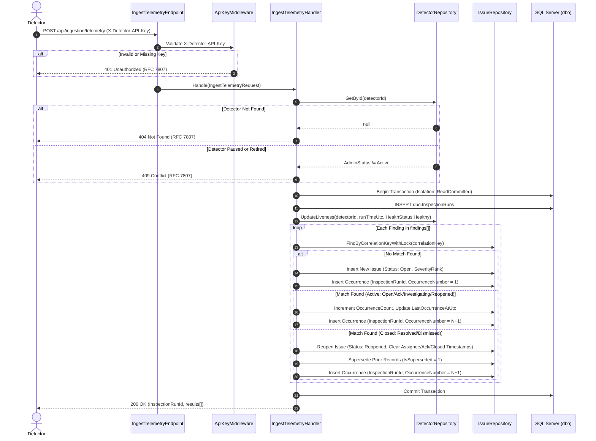

# 1. Overview

This architecture artifact defines the target technical realization for **PrIMA Stage 1: Platform Foundation & Core Telemetry Ingestion** (`Code: PRIMA-STAGE-1`, `Type: CHANGE-REQUEST`), delivering the **Walking Skeleton & Live Ingestion Pipeline** milestone defined in `docs/PRIMA-DEVELOPMENT-ROADMAP.md` and `docs/issues/IS001-PRIMA-STAGE-1-ISSUE.md`.

This architecture realizes the complete set of approved decisions recorded in `docs/issues/IS001-PRIMA-STAGE-1-FEASIBILITY-ASSESSMENT.md`, harmonizes with the base architecture principles in `docs/PRIMA-ARCHITECTURE.md`, and aligns with the design guidelines in `docs/PRIMA-UI-UX-GUIDELINE.md` and `docs/PRIMA-SCREEN-INVENTORY.md`.

---

# 2. Architectural Basis

## Business Context

PrIMA (Proactive Inspection Monitoring App) is an operational exception workbench for EDP / IT Support officers overseeing Hospital Information Systems (SIMRS). 
The business knowledge, operational flow, and domain orchestration realized by this architecture are derived from:
- `docs/PRIMA-DOMAIN.md`: Ubiquitous Language, Aggregate Roots (`Detector`, `Issue`), Value Objects (`CorrelationKey`, `TelemetryEvidence`), and Business Rules `BR-PRIMA-001` (Deduplication), `BR-PRIMA-002` (Auto-reopening), and `BR-PRIMA-009` (Occurrence Audit Trail).
- `docs/PRIMA-USE-CASE-DISCOVERY.md`: Actor profile (EDP / IT Support Officer) and Primary Use Cases `A-1` (View Live Issue Dashboard) and `A-2` (Filter & Search Active Issues).
- `docs/PRIMA-SCREEN-INVENTORY.md`: Screens `S-00` (Officer Login) and `S-01` (Issue Dashboard).
- `docs/PRIMA-UI-UX-GUIDELINE.md`: Desktop-first workbench layout, semantic design tokens, high information density, and non-disruptive polling conventions.

## Analysis Input

This architecture strictly consumes and realizes the approved decisions from:
- `docs/issues/IS001-PRIMA-STAGE-1-FEASIBILITY-ASSESSMENT.md` (`Status: READY-FOR-PLANNING`):
  - `GAP-001`: Greenfield project layout, .NET 8 TFM, DbUp bootstrap, Vite dev proxy, and zero-dependency Node simulator.
  - `GAP-002`: `POST /api/ingestion/telemetry` batch `findings[]` array payload and atomic transaction processing.
  - `GAP-003`: `001_InitialSchema.sql` structural fixes (`InspectionRunId`, nullable fields, `SeverityRank`, `OccurrenceCount`, `DismissedAtUtc`, `IsSuperseded`, `UQ_Detectors_Name`, and canonical enums).
  - `GAP-004`: Ingestion detector validation (`404`), `Paused`/`Retired` guardrails (`409`), and Stage 1 `ExecutionFailed` rejection (`422`).
  - `GAP-005`: `BR-PRIMA-002` non-destructive reopen SQL updates (`IsSuperseded = 1`) and aggregate reset semantics.
  - `GAP-006`: Deferral of `BR-PRIMA-003` recurrence escalation and `MonitoringSupervisorWorker` to Stage 3.
  - `GAP-007`: `CorrelationKey` canonicalization formula (`$"{detectorId:D}:{targetEntityReference.Trim().ToUpperInvariant()}"`) and intra-batch uniqueness validation.
  - `GAP-008`: Single-owner SDLC architecture alignment.
  - `OQ-001`: Configured shared `Ingestion:ApiKeys` array with constant-time byte comparison.
  - `OQ-002`: Flat v1 operational authorization for active officers (`IsActive = 1`) with attribution-only role claim.
  - `OQ-003`: PBKDF2 `PasswordHasher<object>`, 12-hour HS256 JWT Bearer tokens, and Pinia `localStorage` session persistence.
  - `OQ-004`: Clear separation of DbUp baseline officer seed (`002_SeedInitialUsers.sql`) from development-only demo fixtures (`DevelopmentDemoDataSeeder`).
  - `OQ-005`: `S-01` `Resolved Today` `Asia/Jakarta` (`WIB`) midnight calculation, global summary counters, and server-side filtering.
  - `OQ-006`: Stage 1 frontend navigation boundaries (disabled sidebar links with tooltips, counter-only tiles, non-navigating rows).

---

# 3. Scope

## In Scope (Stage 1)

1. **Backend Foundation (`src/backend/PrIMA.Api/`):**
   - Single ASP.NET Core `.NET 8` Minimal API project with vertical slices and DDD aggregate roots.
   - Swagger / OpenAPI documentation exposed at `/swagger/v1/swagger.json`.
   - DbUp database migrations with automatic database creation (`EnsureDatabase.For.SqlDatabase`) against local SQL Server 2022.
   - RFC 7807 `ProblemDetails` exception and validation error mapping.
2. **Officer Authentication (`S-00`):**
   - `POST /api/auth/login` issuing 12-hour HS256 JWT Bearer tokens.
   - Seeded baseline officer accounts (`002_SeedInitialUsers.sql`) with PBKDF2 hashes.
   - Flat v1 operational access for all active (`IsActive = 1`) officers (`EdpOfficer`, `SystemAnalyst`, `Lead`).
3. **Telemetry Ingestion Pipeline:**
   - `POST /api/ingestion/telemetry` authenticated via `X-Detector-API-Key` using constant-time comparison against configured keys.
   - Support for `Passed` (0 findings) and `FindingDiscovered` (`1..N` findings) in a single atomic database transaction.
   - Detector guardrails: `404 Not Found` for unknown detector; `409 Conflict` for `Paused` or `Retired` detector; `422 Unprocessable Entity` for `ExecutionFailed` (deferred to Stage 3).
   - Updates detector liveness (`LastRunAtUtc`, `LastHealthyHeartbeatUtc`, `HealthStatus = Healthy`).
4. **Deterministic Anomaly Deduplication (`BR-PRIMA-001`) & Audit Trail (`BR-PRIMA-009`):**
   - Canonical `CorrelationKey` generation: `$"{detectorId:D}:{targetEntityReference.Trim().ToUpperInvariant()}"`.
   - Creation of `Open` issues with initial immutable `Occurrence` snapshot linked to `InspectionRunId`.
   - Appending new immutable `Occurrence` to existing active issues (`Open`, `Acknowledged`, `Investigating`, `Reopened`) without duplicating the issue.
   - Batch-level duplicate detection rejecting duplicate `targetEntityReference` items with `422`.
5. **Automatic Recurrence Reopening (`BR-PRIMA-002`):**
   - Reopening matching `Resolved` or `Dismissed` issues to `Reopened`.
   - Resetting `CurrentAssignee = null`, `AcknowledgedAtUtc = null`, `ResolvedAtUtc = null`, `DismissedAtUtc = null`.
   - Preserving `CurrentSeverity` and `EscalationLevel` (retaining `0` in Stage 1).
   - Marking prior `RemediationRecords`, `VerificationRecords`, and `DismissalRecords` as `IsSuperseded = 1` in SQL without data deletion.
6. **Live Active Issue Dashboard (`S-01`):**
   - `GET /api/issues/dashboard-feed` returning global summary counters (`criticalCount`, `highCount`, `openCount`, `reopenedCount`, `resolvedTodayCount`) and active issue feed items.
   - `Resolved Today` computed across `[startOfTodayWibUtc, startOfTomorrowWibUtc)` derived from `OperationalTimeZone` (`Asia/Jakarta`, UTC+7).
   - Feed items strictly sorted by `SeverityRank DESC, LastOccurrenceAtUtc DESC`, strictly excluding `Resolved` and `Dismissed` issues.
   - Server-side filtering by `status`, `severity`, `scope`, and text `search`. Rejecting closed status filter queries with `422`.
7. **Frontend Application (`src/frontend/`):**
   - Vue 3.5+ Composition API (`<script setup lang="ts">`), Vite 6, Tailwind CSS v4 CSS-first (`@tailwindcss/vite`), PrimeVue v4 (Aura preset).
   - Feature slices: `features/auth/` (`S-00`) and `features/dashboard/` (`S-01`).
   - Pinia `auth.store.ts` storing JWT in `localStorage` for F5 persistence; Axios interceptor handling `401` redirects.
   - TanStack Query polling active dashboard every 10 seconds with zero-disruption rendering (no skeleton flashing on background refresh).
   - Stage 1 navigation boundaries: `Dashboard` active; `Detectors` and `History & Reports` visually disabled with tooltips; `Resolved Today` counter tile and issue feed rows non-navigating.
   - Type generation script syncing OpenAPI JSON to `src/shared/types/api.generated.ts`.
8. **Tooling & Test Baseline:**
   - Zero-dependency Node.js CLI telemetry simulator (`src/tools/telemetry-simulator/simulate.mjs`).
   - Development-only demo seeder (`DevelopmentDemoDataSeeder`) gated on `IsDevelopment() && SeedDemoData == true`.
   - Automated test suite (`src/backend/PrIMA.Api.Tests/`) covering domain invariants, API authentication, ingestion batch rules, and dashboard queries.

## Out of Scope (Deferred to Later Stages)

- **Stage 2:** `S-02` Issue Detail Workbench, modals `M-01`–`M-03`, manual investigation notes, manual remediation, verification triggers, issue resolve/dismiss endpoints (`BR-PRIMA-004`, `BR-PRIMA-006`, `BR-PRIMA-008`), and `dbo.IssueActivityLogs`.
- **Stage 3:** Detector portfolio screens (`S-03`–`S-06`), background supervisor worker (`MonitoringSupervisorWorker`), cadence silence detection (`BR-PRIMA-010`), SLA/recurrence escalation (`BR-PRIMA-003`), `ExecutionFailed` infrastructure issue synthesis (`BR-PRIMA-005`), top Alert Strip on `S-01` (`G-1`, `G-2`), and detector webhook execution (`D-2`).
- **Stage 4:** Historical retrospective screens (`S-07`), reliability KPIs, MTTR analytics, and v1.0 quality gate.
- **Stage 5:** SIMRS pilot detector suite and hospital on-premise production rollout (`BR-PRIMA-007`).

---

# 4. Technical Decisions

## 4.1 Solution Topology & Workspace Layout

The repository is structured to eliminate multi-project ceremony while enforcing clear boundaries between backend API, automated tests, frontend single-page application, and telemetry simulation tooling:

```text
b23-prima-proactive-monitoring/
├── docs/                                  # Permanent and working SDLC artifacts
├── src/
│   ├── backend/
│   │   ├── PrIMA.Api/                     # Single ASP.NET Core 8 Minimal API project
│   │   └── PrIMA.Api.Tests/               # xUnit integration & unit test suite
│   ├── frontend/                          # Vue 3 + Vite + Tailwind v4 + PrimeVue v4 SPA
│   └── tools/
│       └── telemetry-simulator/           # Zero-dependency Node.js CLI simulator (simulate.mjs)
```

### 4.1.1 Backend Project (`src/backend/PrIMA.Api/`)
- **Target Framework:** `net8.0`.
- **Framework Packages:**
  - `Microsoft.AspNetCore.OpenApi` & `Swashbuckle.AspNetCore` (OpenAPI contract generation at `/swagger/v1/swagger.json`).
  - `Microsoft.Data.SqlClient` & `Dapper` (High-performance direct SQL execution).
  - `dbup-sqlserver` (Embedded SQL migrations and database creation).
  - `FluentValidation.AspNetCore` (Boundary request validation).
  - `Microsoft.AspNetCore.Authentication.JwtBearer` (Token validation).
- **Directory Structure:**
  ```text
  src/backend/PrIMA.Api/
  ├── Program.cs
  ├── appsettings.json
  ├── appsettings.Development.json
  ├── Common/
  │   ├── Result.cs
  │   ├── DomainError.cs
  │   ├── ProblemDetailsExtensions.cs
  │   ├── ISqlConnectionFactory.cs
  │   └── CurrentOfficer.cs
  ├── Migrations/
  │   ├── MigrationRunner.cs
  │   └── Scripts/
  │       ├── 001_InitialSchema.sql
  │       └── 002_SeedInitialUsers.sql
  ├── Seeding/
  │   └── DevelopmentDemoDataSeeder.cs      # Gated on IsDevelopment() && SeedDemoData
  ├── Domain/
  │   ├── Detectors/
  │   │   ├── Detector.cs
  │   │   ├── InspectionRun.cs
  │   │   ├── MonitoringScope.cs
  │   │   ├── AdminStatus.cs
  │   │   ├── DetectorHealth.cs
  │   │   └── IDetectorRepository.cs
  │   └── Issues/
  │       ├── Issue.cs
  │       ├── Occurrence.cs
  │       ├── CorrelationKey.cs
  │       ├── TelemetryEvidence.cs
  │       ├── IssueStatus.cs
  │       ├── IssueSeverity.cs
  │       ├── SeverityRank.cs
  │       ├── IssueErrors.cs
  │       └── IIssueRepository.cs
  ├── Infrastructure/
  │   └── Persistence/
  │       ├── SqlConnectionFactory.cs
  │       ├── DetectorRepository.cs
  │       └── IssueRepository.cs
  └── Features/
      ├── Auth/
      │   ├── LoginEndpoint.cs
      │   ├── LoginRequest.cs
      │   ├── LoginResponse.cs
      │   └── LoginValidator.cs
      ├── Ingestion/
      │   ├── IngestTelemetryEndpoint.cs
      │   ├── IngestTelemetryRequest.cs
      │   ├── IngestTelemetryResponse.cs
      │   ├── IngestTelemetryValidator.cs
      │   └── IngestTelemetryHandler.cs
      └── Issues/
          └── GetDashboardFeed/
              ├── GetDashboardFeedEndpoint.cs
              ├── GetDashboardFeedQuery.cs
              ├── GetDashboardFeedResponse.cs
              └── GetDashboardFeedHandler.cs
  ```

## 4.2 Ingestion Protocol & Batch Processing (`GAP-002`)

External detectors post inspection telemetry to:  
`POST /api/ingestion/telemetry`  
**Header:** `X-Detector-API-Key: <key>`

### 4.2.1 Request Contract
```json
{
  "detectorId": "3fa85f64-5717-4562-b3fc-2c963f66afa6",
  "executionTimestampUtc": "2026-11-20T08:30:00Z",
  "triggerSource": "Scheduled",
  "outcome": "FindingDiscovered",
  "durationMs": 1420,
  "failureReason": null,
  "findings": [
    {
      "targetEntityReference": "INV-2026-11-0042",
      "title": "Unbalanced Journal: Billing Invoice INV-2026-11-0042",
      "baseSeverity": "High",
      "evidence": {
        "module": "Billing",
        "sourceTable": "acc_journal_entries",
        "recordKeys": "invoice_id=984321, batch_no=B20261120-1",
        "debitTotal": 1500000.00,
        "creditTotal": 1450000.00,
        "varianceDelta": 50000.00,
        "trace": "Debit lines sum to 1,500,000 but credit lines sum to 1,450,000."
      }
    }
  ]
}
```

### 4.2.2 Validation Rules (`IngestTelemetryValidator`)
1. `detectorId`: Required, valid GUID.
2. `executionTimestampUtc`: Required, past or present timestamp within 24 hours skew.
3. `triggerSource`: Must match canonical values (`Scheduled`, `Manual`, `EventHook`).
4. `outcome`: Must match canonical values (`Passed`, `FindingDiscovered`, `ExecutionFailed`).
   - If `outcome == "ExecutionFailed"`: Reject in Stage 1 with `422 Unprocessable Entity` (`"ExecutionFailed outcome is supported in Stage 3 with infrastructure anomaly synthesis."`).
   - If `outcome == "Passed"`: `findings` must be `null` or empty array.
   - If `outcome == "FindingDiscovered"`: `findings` must contain `>= 1` items.
5. In `findings[]`:
   - `targetEntityReference`: Non-empty string, trimmed length `<= 213` chars.
   - Intra-batch uniqueness: Reject duplicate `targetEntityReference` (case-insensitive after trimming) within the same payload with `422 Unprocessable Entity`.
   - `title`: Non-empty string, length `<= 250` chars.
   - `baseSeverity`: Must be one of `Low`, `Medium`, `High`, `Critical`.
   - `evidence.module`: Non-empty string, length `<= 100` chars.
   - `evidence.sourceTable`: Nullable, length `<= 100` chars.
   - `evidence.recordKeys`: Nullable, length `<= 500` chars.

### 4.2.3 Response Contract
```json
{
  "inspectionRunId": "9b1deb4d-3b7d-4bad-9bdd-2b0d7b3dcb6d",
  "detectorId": "3fa85f64-5717-4562-b3fc-2c963f66afa6",
  "outcome": "FindingDiscovered",
  "processedFindingsCount": 1,
  "results": [
    {
      "correlationKey": "3fa85f64-5717-4562-b3fc-2c963f66afa6:INV-2026-11-0042",
      "issueId": "a1b2c3d4-e5f6-7a8b-9c0d-1e2f3a4b5c6d",
      "action": "Created",
      "occurrenceId": "f7e6d5c4-b3a2-1098-7654-3210fedcba98",
      "occurrenceNumber": 1
    }
  ]
}
```
`action` values: `Created`, `Appended`, `Reopened`.

## 4.3 Ingestion Guardrails & Transaction Boundaries (`GAP-004`, `ASM-005`, `RISK-001`)

The ingestion pipeline executes inside a single database transaction with update locks:



- **Concurrency Protection:** Ingestion queries matching issues via `SELECT ... WITH (UPDLOCK, HOLDLOCK) WHERE CorrelationKey = @Key` inside the transaction. If a rare race triggers SQL error `2601` or `2627` on `UX_Issues_CorrelationKey`, the handler retries the finding lookup once before propagating failure.

## 4.4 Anomaly Deduplication (`BR-PRIMA-001`) & Canonicalization (`GAP-007`)

1. **Canonical Formula:**
   $$\text{CorrelationKey} = \text{detectorId.ToString("D")} + \text{":"} + \text{targetEntityReference.Trim().ToUpperInvariant()}$$
   *Example:* `3fa85f64-5717-4562-b3fc-2c963f66afa6:INV-2026-11-0042`
2. **Active Status Set:** Deduplication matches issues in `Status IN ('Open', 'Acknowledged', 'Investigating', 'Reopened')`.
3. **Stability Invariant:** On recurring occurrences matching an active issue, existing `Issue.Title` and `Issue.BaseSeverity` are **immutable** and never overwritten by subsequent telemetry payloads.

## 4.5 Recurrence Reopening (`BR-PRIMA-002`) & Governance Audit (`GAP-005`)

When an ingested finding matches an existing issue with `Status IN ('Resolved', 'Dismissed')`:
1. `Issue.Status` transitions to `IssueStatus.Reopened`.
2. `Issue.ReopenedAtUtc` is set to `occurrenceTimeUtc`.
3. Audit reset:
   - `CurrentAssignee = null`
   - `AcknowledgedAtUtc = null`
   - `ResolvedAtUtc = null`
   - `DismissedAtUtc = null`
4. Urgency preservation:
   - `CurrentSeverity` is preserved at its prior value.
   - `EscalationLevel` is preserved at its prior value (0 in Stage 1).
5. Non-destructive SQL update:
   - Historical rows in `dbo.RemediationRecords`, `dbo.VerificationRecords`, and `dbo.DismissalRecords` are updated with `IsSuperseded = 1` for that `IssueId`. Zero rows are deleted.
   - An immutable `Occurrence` snapshot is appended with incremented `OccurrenceNumber`.

## 4.6 Recurrence Escalation & Background Worker Deferral (`GAP-006`, `ASM-003`)

- Dynamic severity escalation (`BR-PRIMA-003`) based on unacknowledged timeout or `>= 5` occurrences is **strictly deferred to Stage 3**.
- In Stage 1, `Issue.RecordRecurringOccurrence` only appends the occurrence snapshot, increments `OccurrenceCount`, updates `LastOccurrenceAtUtc`, and executes `BR-PRIMA-002` reopening when applicable.
- `EscalationLevel` remains `0` throughout Stage 1.
- `MonitoringSupervisorWorker` is **not** registered in `Program.cs` in Stage 1.

## 4.7 Officer Authentication & Flat v1 Authorization (`OQ-002`, `OQ-003`)

1. **Password Verification:** ASP.NET Core `Microsoft.AspNetCore.Identity.PasswordHasher<object>` verifies passwords against PBKDF2 hashes in `dbo.Officers.PasswordHash`.
2. **Account Status:** Login requires `IsActive == true`. Inactive accounts are rejected with `401 Unauthorized` (`"Invalid username or password."`).
3. **JWT Bearer Tokens:**
   - Algorithm: `HS256`.
   - Signing Key: Configured in `appsettings.json` (`Jwt:SigningKey`, `>= 32` bytes).
   - Lifetime: Configurable (`Jwt:ExpirationHours`, defaulting to `12` hours).
   - Claims:
     - `sub`: Officer ID (`Guid`).
     - `name`: Username (`string`).
     - `fullName`: Full Name (`string`).
     - `role`: Role (`EdpOfficer`, `SystemAnalyst`, `Lead`).
4. **Flat Authorization:** All authenticated officers have full operational access to Stage 1 endpoints via `.RequireAuthorization()`. `Role` is used solely for audit log attribution and UI header display.
5. **Session Persistence:**
   - Frontend `auth.store.ts` persists the token and officer object in browser `localStorage`.
   - On page reload (F5) or multi-tab usage, the session is restored synchronously before route resolution.
   - Axios interceptor attaches `Authorization: Bearer <token>` to all API requests.
   - On `401 Unauthorized`, `auth.store.ts` clears session state and navigates to `/login?redirect=<safe-path>`.

## 4.8 Live Dashboard Feed (`S-01`) & Query Semantics (`OQ-005`, `RISK-002`, `RISK-005`)

### 4.8.1 Endpoint Contract
`GET /api/issues/dashboard-feed`  
**Query Parameters:**
- `status`: Optional string (`Open`, `Acknowledged`, `Investigating`, `Reopened`). Reject `Resolved` or `Dismissed` with `422`.
- `severity`: Optional string (`Critical`, `High`, `Medium`, `Low`).
- `scope`: Optional string (`DataIntegrity`, `ProcessIntegrity`, `DataSync`, `Infrastructure`).
- `search`: Optional string (case-insensitive substring matched against `Title`, `DetectorName`, and `CorrelationKey`).

### 4.8.2 Response Structure
```json
{
  "summary": {
    "criticalCount": 2,
    "highCount": 5,
    "openCount": 4,
    "reopenedCount": 1,
    "resolvedTodayCount": 7
  },
  "items": [
    {
      "id": "a1b2c3d4-e5f6-7a8b-9c0d-1e2f3a4b5c6d",
      "correlationKey": "3fa85f64-5717-4562-b3fc-2c963f66afa6:INV-2026-11-0042",
      "title": "Unbalanced Journal: Billing Invoice INV-2026-11-0042",
      "detectorId": "3fa85f64-5717-4562-b3fc-2c963f66afa6",
      "detectorName": "Billing Journal Balance Checker",
      "scope": "DataIntegrity",
      "currentSeverity": "High",
      "severityRank": 3,
      "status": "Open",
      "escalationLevel": 0,
      "occurrenceCount": 3,
      "currentAssignee": null,
      "createdAtUtc": "2026-11-20T07:15:00Z",
      "lastOccurrenceAtUtc": "2026-11-20T08:30:00Z"
    }
  ]
}
```

### 4.8.3 SQL Query Architecture
1. **Summary Counters (Global & Unfiltered):**
   ```sql
   SELECT
       COUNT(CASE WHEN Status NOT IN ('Resolved', 'Dismissed') AND CurrentSeverity = 'Critical' THEN 1 END) AS CriticalCount,
       COUNT(CASE WHEN Status NOT IN ('Resolved', 'Dismissed') AND CurrentSeverity = 'High' THEN 1 END) AS HighCount,
       COUNT(CASE WHEN Status = 'Open' THEN 1 END) AS OpenCount,
       COUNT(CASE WHEN Status = 'Reopened' THEN 1 END) AS ReopenedCount,
       COUNT(CASE WHEN Status = 'Resolved' AND ResolvedAtUtc >= @StartOfTodayWibUtc AND ResolvedAtUtc < @StartOfTomorrowWibUtc THEN 1 END) AS ResolvedTodayCount
   FROM dbo.Issues;
   ```
   *Timezone Boundary:* `@StartOfTodayWibUtc` and `@StartOfTomorrowWibUtc` are computed in UTC by converting the current UTC instant to the configured `OperationalTimeZone` (`Asia/Jakarta`), determining midnight boundaries, and converting back to UTC.
2. **Active Feed Items:**
   ```sql
   SELECT
       Id, CorrelationKey, Title, DetectorId, DetectorName, Scope,
       CurrentSeverity, SeverityRank, Status, EscalationLevel, OccurrenceCount,
       CurrentAssignee, CreatedAtUtc, LastOccurrenceAtUtc
   FROM dbo.Issues
   WHERE Status NOT IN ('Resolved', 'Dismissed')
     AND (@Status IS NULL OR Status = @Status)
     AND (@Severity IS NULL OR CurrentSeverity = @Severity)
     AND (@Scope IS NULL OR Scope = @Scope)
     AND (@Search IS NULL OR (
          Title LIKE '%' + @Search + '%' OR
          DetectorName LIKE '%' + @Search + '%' OR
          CorrelationKey LIKE '%' + @Search + '%'
     ))
   ORDER BY SeverityRank DESC, LastOccurrenceAtUtc DESC;
   ```

## 4.9 Database Migrations & Seed Separation (`GAP-003`, `OQ-004`, `RISK-003`)

1. **DbUp Startup Runner:** On `Program.cs` startup, DbUp executes `EnsureDatabase.For.SqlDatabase(connectionString)` followed by embedded `.sql` scripts inside `src/backend/PrIMA.Api/Migrations/Scripts/`:
   - `001_InitialSchema.sql`: Creates all baseline tables, indexes, and constraints.
   - `002_SeedInitialUsers.sql`: Idempotently seeds default officer accounts (`ahmad.budi`, `siti.rahma`, `edp.lead`).
2. **Development Demo Data Seeder (`DevelopmentDemoDataSeeder.cs`):**
   - Configured via `SeedDemoData` (boolean, `false` in `appsettings.json`, `true` in `appsettings.Development.json`).
   - Executes only when `IHostEnvironment.IsDevelopment() && configuration.GetValue<bool>("SeedDemoData")`.
   - Seeds 4 active detectors across all scopes, 1 paused detector (for `409` testing), 1 resolved issue with `VerificationRecord` (`CleanPassed = 1`), and 1 dismissed issue with `DismissalRecord`.

## 4.10 Frontend Architecture & UI/UX Discipline (`GAP-001`, `OQ-006`, `ASM-006`)

1. **Tooling & Styling:**
   - Vue 3.5+ Composition API (`<script setup lang="ts">`).
   - Vite 6 dev server with `/api` proxy targeting backend at `http://localhost:5000`.
   - Tailwind CSS v4 CSS-first integration via `@tailwindcss/vite` and `@import "tailwindcss";` in `src/assets/main.css`.
   - PrimeVue v4 with Aura preset, configured with `cssLayer: false` (or explicit Tailwind layer ordering) to eliminate style cascade conflicts.
2. **Feature Slice Structure:**
   - `src/features/auth/`: Sign-in view (`S-00`), VeeValidate + Zod schema, API integration.
   - `src/features/dashboard/`: Dashboard view (`S-01`), summary bar component, filter bar component, active feed component with virtual scrolling, TanStack Query hooks.
3. **Polling & Interactivity Boundaries:**
   - TanStack Query polls `GET /api/issues/dashboard-feed` every 10 seconds.
   - Non-disruptive rendering: Skeleton is rendered **only** when `isPending` (initial cold load). Background refetches (`isFetching && !isPending`) update data seamlessly without scroll resets or filter wipes.
   - Navigation guards restrict unauthenticated users to `/login`. Visiting `/login` while authenticated redirects to `/`.
   - Stage 1 navigation affordances:
     - Sidebar `Dashboard` is active with an `open + reopened` badge pill.
     - Sidebar `Detectors` and `History & Reports` links are visibly disabled (`aria-disabled="true"`) with PrimeVue tooltips (`"Coming in Stage 3"` and `"Coming in Stage 4"`).
     - `Resolved Today` summary tile is non-clickable with tooltip `"History view available in Stage 4"`.
     - Active issue rows are non-navigating (cursor default, no dead link to `/issues/:id`).

## 4.11 Telemetry Simulator CLI Utility (`GAP-001`)

A zero-dependency Node.js CLI script is located at `src/tools/telemetry-simulator/simulate.mjs`:
- Executes directly via `node simulate.mjs <scenario>` (supported natively on Node 22).
- Supported CLI scenarios:
  1. `passed`: Submits a clean inspection run with 0 findings.
  2. `new-finding`: Submits a new finding generating an `Open` issue.
  3. `duplicate-finding`: Submits the same finding again to test `BR-PRIMA-001` occurrence appending.
  4. `recurrence-resolved`: Submits a finding matching the seeded `Resolved` issue to test `BR-PRIMA-002` reopening.
  5. `recurrence-dismissed`: Submits a finding matching the seeded `Dismissed` issue to test `BR-PRIMA-002` reopening.
  6. `batch-findings`: Submits multiple distinct findings in a single run to verify `findings[]` batch handling.
- Configurable via CLI flags: `--url <endpoint>` and `--key <api_key>`.

## 4.12 Automated Testing Strategy (`GAP-001`)

The xUnit project `src/backend/PrIMA.Api.Tests/` enforces quality gates from Day 1:
1. **Domain Unit Tests:**
   - `CorrelationKeyTests`: Verify canonicalization formula, trimming, and casing invariance.
   - `IssueAggregateTests`: Verify `Create`, `RecordRecurringOccurrence` deduplication, `BR-PRIMA-002` state resets, and preservation of severity.
2. **API Integration Tests (`WebApplicationFactory<Program>`):**
   - `AuthEndpointsTests`: Seeded credential authentication, invalid login `401`, JWT claim structure, inactive officer rejection.
   - `IngestionEndpointsTests`: Missing/invalid API key `401`, unknown detector `404`, paused detector `409`, `ExecutionFailed` rejection `422`, intra-batch duplicate `422`, clean passed `200`, and single-run batch ingestion.
   - `DashboardFeedTests`: Summary counter accuracy, `WIB` midnight boundary calculation, active sorting (`SeverityRank DESC, LastOccurrenceAtUtc DESC`), filter filtering, and closed-status query rejection (`422`).

---

# 5. Component Responsibilities

| Component | Layer / Directory | Primary Responsibility |
|---|---|---|
| `Program.cs` | Backend Root | WebApplication bootstrap, middleware pipeline, service registration, Minimal API mapping. |
| `MigrationRunner` | Migrations | Executes DbUp migrations against SQL Server on startup using `EnsureDatabase`. |
| `DevelopmentDemoDataSeeder` | Seeding | Seeds development demo detectors and closed issues when `IsDevelopment() && SeedDemoData`. |
| `LoginEndpoint` & `LoginHandler` | Features/Auth | Authenticates officer credentials, verifies PBKDF2 hash, issues HS256 JWT Bearer token. |
| `IngestTelemetryEndpoint` & `Handler` | Features/Ingestion | Authenticates detector API key, executes atomic run + batch findings ingestion transaction. |
| `IngestTelemetryValidator` | Features/Ingestion | Validates payload schemas, trigger sources, outcomes, and batch uniqueness rules. |
| `GetDashboardFeedEndpoint` & `Handler` | Features/Issues | Projects global summary counters and active sorted feed items from SQL Server. |
| `Detector` (Aggregate Root) | Domain/Detectors | Enforces detector invariants, evaluates admin status (`Active`, `Paused`, `Retired`), records run heartbeat. |
| `Issue` (Aggregate Root) | Domain/Issues | Enforces anomaly identity, deduplication (`BR-PRIMA-001`), occurrence appending, and auto-reopening (`BR-PRIMA-002`). |
| `CorrelationKey` (Value Object) | Domain/Issues | Enforces canonicalization formula and string length constraints. |
| `DetectorRepository` | Infrastructure | Dapper SQL persistence for `dbo.Detectors` and `dbo.InspectionRuns`. |
| `IssueRepository` | Infrastructure | Dapper SQL persistence for `dbo.Issues`, `dbo.Occurrences`, and governance table updates. |
| `http.ts` | Frontend/Shared | Axios HTTP client injecting JWT Bearer tokens and mapping RFC 7807 ProblemDetails to `ApiError`. |
| `auth.store.ts` | Frontend/App | Pinia client store managing officer session and syncing JWT token to `localStorage`. |
| `router/index.ts` | Frontend/App | Vue Router configuration enforcing auth guards on `/` and `/login`. |
| `AppLayout.vue` | Frontend/App | Authenticated desktop shell, sidebar navigation, disabled Stage 3/4 links, officer footer. |
| `DashboardView.vue` | Frontend/Features | S-01 layout orchestrator combining summary bar, filter bar, and live active issue feed. |
| `useDashboardQueries.ts` | Frontend/Features | TanStack Query composable managing 10-second background polling and cache invalidation. |
| `simulate.mjs` | Tools/Simulator | Node CLI script generating realistic detector telemetry runs and test scenarios. |

---

# 6. Integration Design

| Source | Target | Protocol / Mechanism | Purpose |
|---|---|---|---|
| External Detectors / Simulator | `IngestTelemetryEndpoint` | HTTP POST (JSON) + `X-Detector-API-Key` | Ingests inspection runs and finding batches into the system. |
| Frontend (`features/auth`) | `LoginEndpoint` | HTTP POST (JSON) | Submits officer credentials and receives JWT Bearer token. |
| Frontend (`features/dashboard`) | `GetDashboardFeedEndpoint` | HTTP GET (REST) + JWT Bearer | Fetches live active issue feed and global summary counters (10s polling). |
| `IngestTelemetryHandler` | `DetectorRepository` | C# Method Call / Dapper SQL | Validates detector status and updates heartbeat timestamps. |
| `IngestTelemetryHandler` | `IssueRepository` | C# Method Call / Dapper SQL (Transaction) | Atomically queries, inserts, or updates issues and appends occurrences. |
| `GetDashboardFeedHandler` | SQL Server (`dbo.Issues`) | Direct Dapper Query (CQRS Read) | Executes optimized aggregation and filtered feed query. |
| `openapi-typescript` CLI | `PrIMA.Api` Swagger | HTTP GET `/swagger/v1/swagger.json` | Generates strongly typed TypeScript definitions (`api.generated.ts`). |

---

# 7. Data Ownership

| Data Entity | Primary Owner | Storage Table | Mutation Mechanism |
|---|---|---|---|
| Officer Accounts | Auth Feature | `dbo.Officers` | Seeded via DbUp; read on login. |
| Detectors Portfolio | Detectors Slice | `dbo.Detectors` | Seeded in dev; updated on telemetry ingestion heartbeat. |
| Inspection Run Logs | Ingestion Slice | `dbo.InspectionRuns` | Inserted per telemetry POST. Append-only. |
| Issues | Issue Aggregate | `dbo.Issues` | Created or updated exclusively via `Issue` aggregate through `IssueRepository`. |
| Issue Occurrences | Issue Aggregate | `dbo.Occurrences` | Appended exclusively via `Issue.Create` or `Issue.RecordRecurringOccurrence`. Append-only. |
| Governance Records | Issue Aggregate | `dbo.RemediationRecords`, `dbo.VerificationRecords`, `dbo.DismissalRecords` | Seeded in dev; updated with `IsSuperseded = 1` on recurrence reopening (`BR-PRIMA-002`). |

---

# 8. Database Design

## 8.1 Schema Corrections (`001_InitialSchema.sql`)

The database runs in a single relational schema (`dbo`) on Microsoft SQL Server. The table definitions below realize all structural schema fixes approved in `GAP-003`:

```sql
-- Detectors Portfolio
CREATE TABLE dbo.Detectors (
    Id UNIQUEIDENTIFIER PRIMARY KEY,
    Name NVARCHAR(150) NOT NULL,
    Description NVARCHAR(500) NOT NULL,
    Scope NVARCHAR(50) NOT NULL,               -- DataIntegrity, ProcessIntegrity, DataSync, Infrastructure
    TargetModule NVARCHAR(100) NOT NULL,
    ExpectedCadenceSeconds INT NOT NULL,
    WebhookUrl NVARCHAR(500) NULL,
    AdminStatus NVARCHAR(30) NOT NULL,         -- Active, Paused, Retired
    HealthStatus NVARCHAR(30) NOT NULL,        -- Healthy, Silent, Failing
    LastRunAtUtc DATETIME2 NULL,
    LastHealthyHeartbeatUtc DATETIME2 NULL,
    CreatedAtUtc DATETIME2 NOT NULL DEFAULT SYSUTCDATETIME(),
    CONSTRAINT UQ_Detectors_Name UNIQUE (Name)
);

-- Inspection Run Telemetry Log
CREATE TABLE dbo.InspectionRuns (
    Id UNIQUEIDENTIFIER PRIMARY KEY,
    DetectorId UNIQUEIDENTIFIER NOT NULL FOREIGN KEY REFERENCES dbo.Detectors(Id),
    ExecutionTimestampUtc DATETIME2 NOT NULL,
    TriggerSource NVARCHAR(30) NOT NULL,       -- Scheduled, Manual, EventHook
    Outcome NVARCHAR(30) NOT NULL,             -- Passed, FindingDiscovered, ExecutionFailed
    DurationMs INT NOT NULL,
    FailureReason NVARCHAR(1000) NULL,
    CreatedAtUtc DATETIME2 NOT NULL DEFAULT SYSUTCDATETIME()
);
CREATE INDEX IX_InspectionRuns_DetectorId_Time ON dbo.InspectionRuns(DetectorId, ExecutionTimestampUtc DESC);

-- Issues (Central Anomaly Tracking)
CREATE TABLE dbo.Issues (
    Id UNIQUEIDENTIFIER PRIMARY KEY,
    CorrelationKey NVARCHAR(250) NOT NULL,     -- Deterministic deduplication key
    Title NVARCHAR(250) NOT NULL,
    DetectorId UNIQUEIDENTIFIER NOT NULL FOREIGN KEY REFERENCES dbo.Detectors(Id),
    DetectorName NVARCHAR(150) NOT NULL,
    Scope NVARCHAR(50) NOT NULL,               -- DataIntegrity, ProcessIntegrity, DataSync, Infrastructure
    BaseSeverity NVARCHAR(20) NOT NULL,        -- Low, Medium, High, Critical
    CurrentSeverity NVARCHAR(20) NOT NULL,     -- Low, Medium, High, Critical
    SeverityRank TINYINT NOT NULL,             -- Critical=4, High=3, Medium=2, Low=1
    Status NVARCHAR(30) NOT NULL,              -- Open, Acknowledged, Investigating, Resolved, Dismissed, Reopened
    EscalationLevel INT NOT NULL DEFAULT 0,
    OccurrenceCount INT NOT NULL DEFAULT 1,
    CurrentAssignee NVARCHAR(100) NULL,
    CreatedAtUtc DATETIME2 NOT NULL,
    LastOccurrenceAtUtc DATETIME2 NOT NULL,
    AcknowledgedAtUtc DATETIME2 NULL,
    ResolvedAtUtc DATETIME2 NULL,
    DismissedAtUtc DATETIME2 NULL,
    ReopenedAtUtc DATETIME2 NULL
);
CREATE UNIQUE INDEX UX_Issues_CorrelationKey ON dbo.Issues(CorrelationKey);
CREATE INDEX IX_Issues_Status_SeverityRank ON dbo.Issues(Status, SeverityRank DESC, LastOccurrenceAtUtc DESC);

-- Occurrences (Immutable observation snapshots)
CREATE TABLE dbo.Occurrences (
    Id UNIQUEIDENTIFIER PRIMARY KEY,
    IssueId UNIQUEIDENTIFIER NOT NULL FOREIGN KEY REFERENCES dbo.Issues(Id),
    InspectionRunId UNIQUEIDENTIFIER NOT NULL FOREIGN KEY REFERENCES dbo.InspectionRuns(Id),
    OccurrenceNumber INT NOT NULL,
    TimestampUtc DATETIME2 NOT NULL,
    Module NVARCHAR(100) NOT NULL,
    SourceTable NVARCHAR(100) NULL,
    RecordKeys NVARCHAR(500) NULL,
    DebitTotal DECIMAL(18,2) NULL,
    CreditTotal DECIMAL(18,2) NULL,
    VarianceDelta DECIMAL(18,2) NULL,
    TraceString NVARCHAR(MAX) NULL
);
CREATE INDEX IX_Occurrences_IssueId ON dbo.Occurrences(IssueId, OccurrenceNumber);
CREATE INDEX IX_Occurrences_InspectionRunId ON dbo.Occurrences(InspectionRunId);

-- Investigation Notes (Append-only)
CREATE TABLE dbo.InvestigationNotes (
    Id UNIQUEIDENTIFIER PRIMARY KEY,
    IssueId UNIQUEIDENTIFIER NOT NULL FOREIGN KEY REFERENCES dbo.Issues(Id),
    OfficerName NVARCHAR(100) NOT NULL,
    NoteText NVARCHAR(MAX) NOT NULL,
    CreatedAtUtc DATETIME2 NOT NULL DEFAULT SYSUTCDATETIME()
);

-- Remediation Records
CREATE TABLE dbo.RemediationRecords (
    Id UNIQUEIDENTIFIER PRIMARY KEY,
    IssueId UNIQUEIDENTIFIER NOT NULL FOREIGN KEY REFERENCES dbo.Issues(Id),
    ActionCategory NVARCHAR(50) NOT NULL,      -- DataCorrection, ServiceRestart, ConfigurationAdjustment, CodeRemediationRequested
    SummaryDescription NVARCHAR(MAX) NOT NULL,
    PerformedBy NVARCHAR(100) NOT NULL,
    TimestampUtc DATETIME2 NOT NULL,
    IsSuperseded BIT NOT NULL DEFAULT 0
);
CREATE INDEX IX_RemediationRecords_IssueId ON dbo.RemediationRecords(IssueId);

-- Verification Records
CREATE TABLE dbo.VerificationRecords (
    Id UNIQUEIDENTIFIER PRIMARY KEY,
    IssueId UNIQUEIDENTIFIER NOT NULL FOREIGN KEY REFERENCES dbo.Issues(Id),
    VerificationMethod NVARCHAR(50) NOT NULL,  -- AutomatedReRun, ManualQueryConfirmed
    CleanPassed BIT NOT NULL,
    EvidenceNotes NVARCHAR(MAX) NOT NULL,
    VerifiedBy NVARCHAR(100) NOT NULL,
    TimestampUtc DATETIME2 NOT NULL,
    IsSuperseded BIT NOT NULL DEFAULT 0
);
CREATE INDEX IX_VerificationRecords_IssueId ON dbo.VerificationRecords(IssueId);

-- Dismissal Records
CREATE TABLE dbo.DismissalRecords (
    Id UNIQUEIDENTIFIER PRIMARY KEY,
    IssueId UNIQUEIDENTIFIER NOT NULL FOREIGN KEY REFERENCES dbo.Issues(Id),
    DismissalReason NVARCHAR(50) NOT NULL,     -- FalsePositive, AcceptedOperationalException, DuplicateManualReport
    JustificationRationale NVARCHAR(MAX) NOT NULL,
    DismissedBy NVARCHAR(100) NOT NULL,
    TimestampUtc DATETIME2 NOT NULL,
    IsSuperseded BIT NOT NULL DEFAULT 0
);
CREATE INDEX IX_DismissalRecords_IssueId ON dbo.DismissalRecords(IssueId);

-- Seeded EDP Officer Accounts
CREATE TABLE dbo.Officers (
    Id UNIQUEIDENTIFIER PRIMARY KEY,
    Username NVARCHAR(50) NOT NULL UNIQUE,
    FullName NVARCHAR(100) NOT NULL,
    PasswordHash NVARCHAR(255) NOT NULL,
    Role NVARCHAR(30) NOT NULL,                -- EdpOfficer, SystemAnalyst, Lead
    IsActive BIT NOT NULL DEFAULT 1
);
```

## 8.2 Baseline Schema vs. Prior Specification Reconciliation

| Table / Object | Column / Constraint | Status in Stage 1 | Rationale / Gap Closure |
|---|---|---|---|
| `dbo.Detectors` | `CONSTRAINT UQ_Detectors_Name UNIQUE (Name)` | Added | Prevents duplicate detector names (`GAP-003`). |
| `dbo.Occurrences` | `InspectionRunId UNIQUEIDENTIFIER NOT NULL` | Added (FK + Index) | Traces each occurrence to its originating inspection sweep (`GAP-003`, `BR-PRIMA-009`). |
| `dbo.Occurrences` | `SourceTable`, `RecordKeys` | Changed to `NULL` | Allows non-DB probes (`Infrastructure`, `DataSync`) to ingest without fake values (`GAP-003`). |
| `dbo.Issues` | `SeverityRank TINYINT NOT NULL` | Added | Eliminates alphabetical severity sorting bug (`GAP-003`, `RISK-002`). |
| `dbo.Issues` | `IX_Issues_Status_SeverityRank` | Added Index | Replaces alphabetical index with numeric ranking (`4 > 3 > 2 > 1`). |
| `dbo.Issues` | `OccurrenceCount INT NOT NULL DEFAULT 1` | Added | Fast query projection without joining `dbo.Occurrences` on feed (`GAP-003`). |
| `dbo.Issues` | `DismissedAtUtc DATETIME2 NULL` | Added | Symmetric lifecycle timestamp for issue dismissals (`GAP-003`). |
| `dbo.RemediationRecords` | `IsSuperseded BIT NOT NULL DEFAULT 0` | Added | Non-destructive invalidation of remediation upon recurrence (`GAP-003`, `GAP-005`). |
| `dbo.VerificationRecords` | `IsSuperseded BIT NOT NULL DEFAULT 0` | Added | Enforces verification gate re-evaluation upon recurrence (`GAP-003`, `GAP-005`). |
| `dbo.DismissalRecords` | `IsSuperseded BIT NOT NULL DEFAULT 0` | Added | Preserves dismissal audit history upon recurrence (`GAP-003`, `GAP-005`). |

---

# 9. Cross-Cutting Concerns

## 9.1 Security & Authentication

- **Detector Ingestion Auth:** `X-Detector-API-Key` header verified against `Ingestion:ApiKeys` string array in `appsettings.json` via `CryptographicOperations.FixedTimeEquals` to prevent timing attacks. Returns RFC 7807 `401 Unauthorized` on failure.
- **Officer Session Auth:** JWT Bearer authentication signed via HS256 (`Jwt:SigningKey`, `>= 32` bytes). Issued with 12-hour expiration matching hospital EDP operational shifts.
- **Redirect Validation:** Login redirect query parameter (`?redirect=...`) validated on client-side to ensure it is a relative in-app URL starting with `/` (and not `//`) to prevent open redirect vulnerabilities.

## 9.2 Concurrency & Transactional Integrity

- Ingestion telemetry requests sharing a `CorrelationKey` execute inside a SQL transaction using update locks (`UPDLOCK, HOLDLOCK`) on the existing issue lookup.
- If concurrent workers race on a new issue creation, the unique constraint `UX_Issues_CorrelationKey` prevents duplicates, and the ingestion handler retries lookup once upon catching SQL errors `2601` or `2627`.
- Each `POST /api/ingestion/telemetry` commits exactly 1 `InspectionRun` and all associated findings atomically.

## 9.3 Observability & Error Contracts (RFC 7807)

API error responses conform strictly to RFC 7807 `ProblemDetails`:
- `401 Unauthorized`: Missing or invalid API key or JWT token.
- `404 Not Found`: Detector ID not registered in `dbo.Detectors`.
- `409 Conflict`: Ingestion attempted on `Paused` or `Retired` detector (`PRIMA-DOMAIN.md §6.1`).
- `422 Unprocessable Entity`: Request format failure, validation error, intra-batch duplicate entity references, or unsupported `ExecutionFailed` outcome.
- Axios interceptor translates ProblemDetails responses into typed `ApiError` instances, providing field errors directly to form schemas.

## 9.4 Timezone & Temporal Invariants

- **Storage Invariant:** All database timestamps (`CreatedAtUtc`, `ExecutionTimestampUtc`, `LastOccurrenceAtUtc`, `ResolvedAtUtc`, etc.) are generated and stored strictly in UTC (`DATETIME2`).
- **Operational Presentation:** Displayed in the UI in `Asia/Jakarta` (`WIB`, UTC+7) per `docs/PRIMA-UI-UX-GUIDELINE.md §3.1`.
- **`Resolved Today` Calculation:** Derived from `OperationalTimeZone` (`Asia/Jakarta`). The server computes the boundary `[startOfTodayWibUtc, startOfTomorrowWibUtc)` in UTC so morning handovers (`00:00–06:59 WIB`) count today's resolutions accurately (`RISK-005`).

---

# 10. Implementation Constraints

1. **Backend Minimal APIs Only:** Single `.NET 8` Minimal API project (`src/backend/PrIMA.Api/`). Zero controller classes or MediatR libraries. Vertical slice handlers map directly via route builder extension methods.
2. **Mandatory Dapper for Data Access:** All database queries and commands must use direct Dapper SQL execution. No Entity Framework Core or heavy ORM.
3. **DbUp Startup Migrations:** Database schema evolution is driven exclusively through embedded `.sql` scripts in `Migrations/Scripts/`.
4. **Pure Aggregate Root Authority:** State mutations on issues must pass through `Issue` aggregate root methods (`Create`, `RecordRecurringOccurrence`). Repositories persist state changes explicitly via SQL.
5. **No Cross-Feature Imports in Frontend:** Frontend slices (`features/auth`, `features/dashboard`) must not import each other. Cross-cutting logic lives in `shared/` or `app/`.
6. **Zero-Pagination Feed on S-01:** Active dashboard feed displays all matching items using virtual scrolling. No pagination controls.
7. **Non-Disruptive Polling:** Polling (10s) must never flash full-page loading indicators or reset active user filters.
8. **Contract Synchronization:** `src/frontend/src/shared/types/api.generated.ts` must be auto-generated via `openapi-typescript` against `/swagger/v1/swagger.json` and never manually edited.

---

# 11. Acceptance Conditions

The implementation of Stage 1 is architecturally complete when:

1. **Database Bootstrap:** Starting `PrIMA.Api` automatically creates the database if absent, applies `001_InitialSchema.sql` and `002_SeedInitialUsers.sql` without error, and seeds development fixtures when `SeedDemoData == true`.
2. **Authentication Flow:** An officer can sign in at `S-00` (`POST /api/auth/login`) with seeded credentials, store session in `localStorage`, reload the browser (F5) without losing session, and be redirected to `S-01`.
3. **Telemetry Ingestion:**
   - Submitting `outcome == "Passed"` records an `InspectionRun` with 0 findings and returns `200 OK`.
   - Submitting `outcome == "FindingDiscovered"` with 1 finding records an `InspectionRun`, creates an `Open` issue with `OccurrenceNumber = 1`, and returns `200 OK`.
   - Submitting a recurring finding with matching `CorrelationKey` appends `OccurrenceNumber = 2`, increments `OccurrenceCount`, and returns `200 OK` without creating a duplicate issue (`BR-PRIMA-001`).
   - Submitting a finding matching a seeded `Resolved` or `Dismissed` issue reopens the issue (`Status = Reopened`), clears assignee/resolution timestamps, marks prior governance rows `IsSuperseded = 1`, and returns `200 OK` (`BR-PRIMA-002`).
   - Submitting unknown `detectorId` returns `404 Not Found`; submitting on a `Paused` detector returns `409 Conflict`; submitting `ExecutionFailed` returns `422 Unprocessable Entity`.
4. **Live Dashboard (`S-01`):**
   - Summary bar displays accurate counts for `Critical`, `High`, `Open`, `Reopened`, and `Resolved Today` (WIB boundary).
   - Feed lists active issues ordered by `SeverityRank DESC, LastOccurrenceAtUtc DESC` and strictly excludes `Resolved` and `Dismissed`.
   - Polling updates feed every 10 seconds without UI flicker.
   - Filtering by status, severity, scope, and text search updates feed accurately.
   - Sidebar reflects Stage 1 boundaries (`Dashboard` active; `Detectors` and `History` disabled with tooltips).
5. **Simulator Verification:** Running `node src/tools/telemetry-simulator/simulate.mjs` successfully exercises `passed`, `new-finding`, `duplicate-finding`, `recurrence-resolved`, and `batch-findings`.
6. **Automated Test Gate:** All tests in `src/backend/PrIMA.Api.Tests/` pass cleanly via `dotnet test`.
