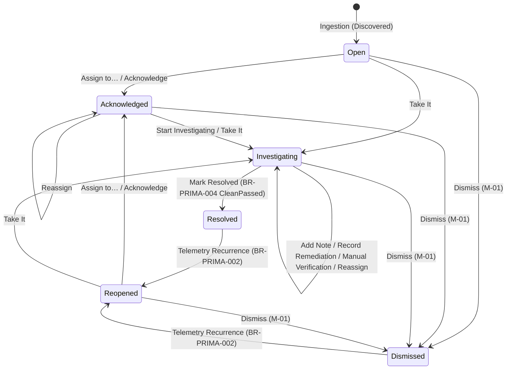

# 1. Overview

This architecture artifact defines the target technical realization for **PrIMA Stage 2: Issue Triage, Investigation & Verification-Gated Resolution** (`Code: PRIMA-STAGE-2`, `Type: CHANGE-REQUEST`), delivering the **Complete End-to-End Manual Issue Resolution Loop** milestone defined in `docs/PRIMA-DEVELOPMENT-ROADMAP.md` and `docs/issues/IS002-PRIMA-STAGE-2-ISSUE.md`.

Stage 2 builds directly upon the operational Stage 1 platform foundation (Minimal API host, JWT authentication, core telemetry ingestion with deduplication/reopening, and the active issue dashboard). It realizes the full operational workspace on the frontend (`S-02` Issue Detail Workbench and workflow modals `M-01`, `M-02`, `M-03`), backed by vertical slice command/query endpoints in `PrIMA.Api`, strict domain invariant enforcement in the `Issue` aggregate, and an immutable activity audit log (`dbo.IssueActivityLogs`).

This architecture realizes the complete set of approved decisions recorded in `docs/issues/IS002-PRIMA-STAGE-2-FEASIBILITY-ASSESSMENT.md`, harmonizes with the base architecture principles in `docs/PRIMA-ARCHITECTURE.md`, and adheres strictly to `docs/PRIMA-UI-UX-GUIDELINE.md` and `docs/PRIMA-SCREEN-INVENTORY.md`.

---

# 2. Architectural Basis

## Business Context

PrIMA (Proactive Inspection Monitoring App) provides a dedicated operational workbench for EDP / IT Support officers monitoring Hospital Information Systems (SIMRS).
The business knowledge, operational flow, and domain orchestration realized by this architecture are derived from:
- `docs/PRIMA-DOMAIN.md`: Ubiquitous Language, Aggregate Roots (`Detector`, `Issue`), Value Objects (`CorrelationKey`, `TelemetryEvidence`, `RemediationRecord`, `VerificationRecord`, `DismissalRecord`), Lifecycle States (`Open`, `Acknowledged`, `Investigating`, `Resolved`, `Dismissed`, `Reopened`), and Business Rules:
  - `BR-PRIMA-004`: Mandatory Verification Gate (an issue cannot be resolved without a clean verification record).
  - `BR-PRIMA-006`: Documented Dismissal Justification (dismissal requires structured reason and min 20 chars rationale).
  - `BR-PRIMA-008`: Operational Attribution & Accountability (all lifecycle actions deterministically attributed to the authenticated officer).
  - `BR-PRIMA-009`: Complete Occurrence Audit Trail (chronological, immutable telemetry observations and activity history).
- `docs/PRIMA-USE-CASE-DISCOVERY.md`: Primary Use Cases:
  - `A-3`: View Issue Detail Workbench
  - `B-1`: Acknowledge Issue
  - `B-2`: Assign Issue / "Take It" Single-Tap Flow
  - `B-3`: Dismiss Issue with Justification
  - `C-1`: Review Telemetry Evidence
  - `C-2`: Review Occurrence History
  - `C-3`: Add Investigation Note
  - `D-1`: Record Remediation Action
  - `D-3`: Record Manual Verification
  - `D-4`: Mark Issue Resolved
- `docs/PRIMA-SCREEN-INVENTORY.md`: Screen `S-02` (Issue Detail Workbench) and Modals `M-01` (Dismiss Issue), `M-02` (Record Remediation), `M-03` (Manual Verification).
- `docs/PRIMA-UI-UX-GUIDELINE.md`: Desktop-first 2-column asymmetric workbench (`grid-cols-1 lg:grid-cols-12`), sticky header with context-sensitive Action Bar, null-safe IDR financial strip, 10s non-disruptive polling, and VeeValidate + Zod form schemas.

## Analysis Input

This architecture strictly consumes and realizes the approved decisions from:
- `docs/issues/IS002-PRIMA-STAGE-2-FEASIBILITY-ASSESSMENT.md` (`Status: READY-FOR-PLANNING`):
  - `GAP-001`: Complete lifecycle command endpoints in `Features/Issues/` and domain invariant enforcement in `Issue.cs`.
  - `GAP-002`: DbUp migration `003_IssueActivityLogs.sql` creating `dbo.IssueActivityLogs` and transactional audit persistence.
  - `GAP-003`: Frontend `src/features/issues/` feature slice with 10 view components, 3 modals, and TanStack Query composables.
  - `GAP-004`: Officer lookup endpoint `GET /api/officers` in `Features/Officers/` returning active EDP officers.
  - `GAP-005` & `OQ-005`: Verification invalidation (`IsSuperseded = 1`) on recurring telemetry ingestion during `Investigating` and on remediation retry.
  - `GAP-006`: `ActiveIssueFeed.vue` table row click navigation to `/issues/:id` and header back-navigation.
  - `OQ-001`: Action Bar verification presentation: promote `Manual Verification` (`M-03`) to primary button when remediation is recorded; omit `Trigger Verification Re-run` until Stage 3 webhook integration.
  - `OQ-002`: Officer assignment lifecycle transitions: `Assign to…` on `Open`/`Reopened` transitions to `Acknowledged` (setting `AcknowledgedAtUtc = now` and halting unacknowledged SLA timer); primary action for assigned officer becomes `Start Investigating`.
  - `OQ-003`: Dedicated `POST /api/issues/{id}/take-it` (zero payload, moves caller to `Investigating`) alongside `POST /api/issues/{id}/assign` (`{ officerId: Guid }`).
  - `OQ-004`: `dbo.IssueActivityLogs` schema, indexing, and transactional persistence.
  - `OQ-006`: Detector reference in `S-02` sticky header is a styled badge with informational tooltip, without active router link in Stage 2.
  - `OQ-007`: Reassignment permitted during `Investigating` status without lifecycle regression.
  - `OQ-008`: Composite `GET /api/issues/{id}` query projection via Dapper `QueryMultipleAsync` in a single database round-trip.

---

# 3. Scope

## In Scope (Stage 2)

1. **Backend Domain Aggregate (`PrIMA.Api/Domain/Issues/Issue.cs`):**
   - Implement explicit domain methods enforcing lifecycle transitions and invariants: `TakeIt`, `Assign`, `Acknowledge`, `StartInvestigation`, `AddNote`, `RecordRemediation`, `RecordVerification`, `MarkResolved`, `Dismiss`.
   - Implement Verification Gate enforcement (`BR-PRIMA-004`): `MarkResolved` fails with `409 Conflict` (ProblemDetails) unless an active, un-superseded `CleanPassed` verification record exists.
   - Implement Dismissal rationale validation (`BR-PRIMA-006`): `Dismiss` fails with `422 Unprocessable Entity` if trimmed rationale length is `< 20` characters.
   - Maintain encapsulated child collections for occurrences, notes, remediation records, verification records, dismissal records, and activity logs.
   - Invalidation logic: mark active verifications `IsSuperseded = 1` when recurrence is ingested on an active `Investigating` issue, and supersede prior failed verifications upon recording a new remediation attempt.
2. **Database Migration & Audit Trail Persistence:**
   - DbUp migration `003_IssueActivityLogs.sql` creating `dbo.IssueActivityLogs` table and composite index `(IssueId, TimestampUtc DESC)`.
   - Atomic audit logging: all status changes, assignments, notes, remediations, verifications, dismissals, and recurrence reopenings write to `dbo.IssueActivityLogs` inside their primary SQL transactions.
3. **Backend API Endpoints (`PrIMA.Api/Features/`):**
   - `POST /api/issues/{id}/take-it`: Single-action triage (Acknowledge + assign to caller + move to `Investigating`).
   - `POST /api/issues/{id}/assign`: Explicit assignment to an active officer (transitions `Open`/`Reopened` to `Acknowledged`; preserves `Investigating` if already investigating).
   - `POST /api/issues/{id}/acknowledge`: Explicit acknowledge without assignment change.
   - `POST /api/issues/{id}/start-investigation`: Assigned officer begins active investigation (`Acknowledged` -> `Investigating`).
   - `POST /api/issues/{id}/notes`: Append-only investigation notes.
   - `POST /api/issues/{id}/remediation`: Record operational remediation action (`M-02`).
   - `POST /api/issues/{id}/verification/manual`: Record manual query confirmation (`M-03`, `CleanPassed` vs. `AnomalyStillPresent`).
   - `POST /api/issues/{id}/resolve`: Enforce verification gate and transition to `Resolved`.
   - `POST /api/issues/{id}/dismiss`: Documented issue dismissal (`M-01`).
   - `GET /api/issues/{id}`: High-performance composite query projection via Dapper `QueryMultipleAsync`.
   - `GET /api/officers`: Lookup of active officers for assignment dropdowns.
4. **Frontend Feature Slice (`src/frontend/src/features/issues/`):**
   - Single-screen operational workbench `IssueDetailView.vue` registered at `/issues/:id`.
   - Desktop 2-column asymmetric grid (`lg:grid-cols-12`):
     - Left column (8 cols): `WorkbenchHeader` (sticky), `LatestEvidenceCard`, `OccurrencesTimeline` (collapsible, newest-first), `InvestigationNotesStream` (append-only with `Ctrl+Enter` composer).
     - Right column (4 cols): `VerificationGateCard` (3-step checklist), `VerificationRecordCard`, `RemediationHistoryCard`, `DismissalRecordCard`, `OwnershipTimestampsCard`, `ActivityLogAccordion` (collapsed by default).
   - Workflow dialogs: `DismissIssueModal.vue` (`M-01`), `RecordRemediationModal.vue` (`M-02`), `ManualVerificationModal.vue` (`M-03`) with VeeValidate + Zod validation.
   - Composable `useIssueDetail.ts`: TanStack Query auto-polling (10s), draft preservation across background refetches, and mutation cache invalidation.
5. **Dashboard S-01 Linkage & Router Integration:**
   - Clickable feed rows in `ActiveIssueFeed.vue` navigating to `/issues/:id` (copy buttons excluded).
   - Header back navigation in `WorkbenchHeader.vue` returning to `/` (or history).

## Out of Scope (Deferred to Later Stages)

- **Stage 3:** Automated detector portfolio management (`S-03`–`S-06`), background supervisor worker (`MonitoringSupervisorWorker`), cadence silence detection (`BR-PRIMA-010`), SLA/recurrence escalation (`BR-PRIMA-003`), `ExecutionFailed` infrastructure anomaly synthesis (`BR-PRIMA-005`), top Alert Strip on `S-01`, and webhook-driven automated re-verification (`D-2`).
- **Stage 4:** Historical retrospective screens (`S-07`), reliability KPIs, MTTR analytics, and v1.0 quality gate.
- **Stage 5:** SIMRS detector integration and hospital on-premise production rollout (`BR-PRIMA-007`).

---

# 4. Technical Decisions

## 4.1 Domain Model & State Machine Realization

The `Issue` aggregate root (`src/backend/PrIMA.Api/Domain/Issues/Issue.cs`) is the single authority for issue state, recurrence, and lifecycle progression.



### 4.1.1 Issue Aggregate Methods & Invariants

```csharp
namespace PrIMA.Api.Domain.Issues;

public sealed class Issue
{
    // Identity & Core Attributes
    public Guid Id { get; private set; }
    public CorrelationKey CorrelationKey { get; private set; } = null!;
    public string Title { get; private set; } = null!;
    public Guid DetectorId { get; private set; }
    public string DetectorName { get; private set; } = null!;
    public MonitoringScope Scope { get; private set; }
    public IssueSeverity BaseSeverity { get; private set; }
    public IssueSeverity CurrentSeverity { get; private set; }
    public byte SeverityRank { get; private set; }
    public IssueStatus Status { get; private set; }
    public int EscalationLevel { get; private set; }
    public int OccurrenceCount { get; private set; }
    public string? CurrentAssignee { get; private set; }
    
    // Lifecycle Timestamps (UTC)
    public DateTime CreatedAtUtc { get; private set; }
    public DateTime LastOccurrenceAtUtc { get; private set; }
    public DateTime? AcknowledgedAtUtc { get; private set; }
    public DateTime? ResolvedAtUtc { get; private set; }
    public DateTime? DismissedAtUtc { get; private set; }
    public DateTime? ReopenedAtUtc { get; private set; }

    // Child Collections & Governance State
    private readonly List<Occurrence> _occurrences = [];
    public IReadOnlyCollection<Occurrence> Occurrences => _occurrences.AsReadOnly();

    private readonly List<InvestigationNote> _notes = [];
    public IReadOnlyCollection<InvestigationNote> Notes => _notes.AsReadOnly();

    public RemediationRecord? LatestRemediation { get; private set; }
    public VerificationRecord? LatestVerification { get; private set; }
    public DismissalRecord? Dismissal { get; private set; }

    // --- Lifecycle Commands ---

    // B-1 & B-2: Single-tap triage flow
    public Result TakeIt(string officerName, DateTime timestampUtc)
    {
        if (Status is IssueStatus.Resolved or IssueStatus.Dismissed)
            return Result.Failure(IssueErrors.InvalidStateTransition(Status, IssueStatus.Investigating));

        Status = IssueStatus.Investigating;
        CurrentAssignee = officerName.Trim();
        AcknowledgedAtUtc ??= timestampUtc;
        return Result.Success();
    }

    // B-2 & OQ-002 / OQ-007: Explicit assignment
    public Result Assign(string officerName, DateTime timestampUtc)
    {
        if (Status is IssueStatus.Resolved or IssueStatus.Dismissed)
            return Result.Failure(IssueErrors.InvalidStateTransition(Status, IssueStatus.Acknowledged));

        CurrentAssignee = officerName.Trim();

        // If Open or Reopened, transition to Acknowledged and halt unacknowledged SLA timer
        if (Status is IssueStatus.Open or IssueStatus.Reopened)
        {
            Status = IssueStatus.Acknowledged;
            AcknowledgedAtUtc = timestampUtc;
        }
        // If already Investigating, CurrentAssignee is updated without state regression (OQ-007)

        return Result.Success();
    }

    // B-1: Explicit acknowledgement
    public Result Acknowledge(string officerName, DateTime timestampUtc)
    {
        if (Status is not (IssueStatus.Open or IssueStatus.Reopened))
            return Result.Failure(IssueErrors.InvalidStateTransition(Status, IssueStatus.Acknowledged));

        Status = IssueStatus.Acknowledged;
        CurrentAssignee ??= officerName.Trim();
        AcknowledgedAtUtc = timestampUtc;
        return Result.Success();
    }

    // B-2: Start investigating from Acknowledged
    public Result StartInvestigation(string officerName, DateTime timestampUtc)
    {
        if (Status != IssueStatus.Acknowledged)
            return Result.Failure(IssueErrors.InvalidStateTransition(Status, IssueStatus.Investigating));

        Status = IssueStatus.Investigating;
        CurrentAssignee = officerName.Trim();
        return Result.Success();
    }

    // C-3: Append investigation note
    public Result AddNote(string noteText, string officerName, DateTime timestampUtc)
    {
        if (Status is IssueStatus.Resolved or IssueStatus.Dismissed)
            return Result.Failure(IssueErrors.ActionRequiresActiveStatus());

        if (string.IsNullOrWhiteSpace(noteText))
            return Result.Failure(IssueErrors.EmptyNoteText());

        _notes.Add(new InvestigationNote(Guid.NewGuid(), Id, officerName.Trim(), noteText.Trim(), timestampUtc));
        return Result.Success();
    }

    // D-1: Record remediation action (M-02)
    public Result RecordRemediation(string category, string description, string officerName, DateTime timestampUtc)
    {
        if (Status != IssueStatus.Investigating)
            return Result.Failure(IssueErrors.ActionRequiresStatus(IssueStatus.Investigating));

        if (string.IsNullOrWhiteSpace(description))
            return Result.Failure(IssueErrors.EmptyRemediationDescription());

        LatestRemediation = new RemediationRecord(category.Trim(), description.Trim(), officerName.Trim(), timestampUtc);
        
        // GAP-005 & OQ-005: Supersede prior failed or stale verification record upon remediation retry
        if (LatestVerification != null)
        {
            LatestVerification = null;
        }

        return Result.Success();
    }

    // D-3: Record manual verification result (M-03)
    public Result RecordVerification(string method, bool cleanPassed, string evidenceNotes, string verifiedBy, DateTime timestampUtc)
    {
        if (Status != IssueStatus.Investigating)
            return Result.Failure(IssueErrors.ActionRequiresStatus(IssueStatus.Investigating));

        if (LatestRemediation == null)
            return Result.Failure(IssueErrors.RemediationRequiredBeforeVerification());

        if (string.IsNullOrWhiteSpace(evidenceNotes))
            return Result.Failure(IssueErrors.EmptyVerificationEvidence());

        LatestVerification = new VerificationRecord(method.Trim(), cleanPassed, evidenceNotes.Trim(), verifiedBy.Trim(), timestampUtc);
        return Result.Success();
    }

    // D-4 & BR-PRIMA-004: Mandatory Verification Gate
    public Result MarkResolved(string officerName, DateTime timestampUtc)
    {
        if (Status != IssueStatus.Investigating)
            return Result.Failure(IssueErrors.InvalidStateTransition(Status, IssueStatus.Resolved));

        // Gate enforcement
        if (LatestVerification == null || !LatestVerification.CleanPassed || LatestVerification.IsSuperseded)
            return Result.Failure(IssueErrors.VerificationGateFailed());

        Status = IssueStatus.Resolved;
        ResolvedAtUtc = timestampUtc;
        return Result.Success();
    }

    // B-3 & BR-PRIMA-006: Documented Dismissal
    public Result Dismiss(string reason, string rationale, string officerName, DateTime timestampUtc)
    {
        if (Status is IssueStatus.Resolved or IssueStatus.Dismissed)
            return Result.Failure(IssueErrors.InvalidStateTransition(Status, IssueStatus.Dismissed));

        if (string.IsNullOrWhiteSpace(rationale) || rationale.Trim().Length < 20)
            return Result.Failure(IssueErrors.DismissalRationaleTooShort());

        Status = IssueStatus.Dismissed;
        DismissedAtUtc = timestampUtc;
        Dismissal = new DismissalRecord(reason.Trim(), rationale.Trim(), officerName.Trim(), timestampUtc);
        return Result.Success();
    }
}
```

### 4.1.2 Verification Invalidation Rules (`GAP-005`, `OQ-005`)

1. **Recurrence on Active `Investigating` Issue:**  
   Inside `POST /api/ingestion/telemetry` (`IngestTelemetryHandler`), when an incoming finding matches an active issue whose status is `Investigating` and has recorded verifications:
   - The SQL transaction executes:
     `UPDATE dbo.VerificationRecords SET IsSuperseded = 1 WHERE IssueId = @IssueId AND IsSuperseded = 0;`
   - This immediately re-locks the Verification Gate (`BR-PRIMA-004`). If an officer attempts to call `POST /api/issues/{id}/resolve`, it fails with `409 Conflict`.
2. **Remediation Retry:**  
   When an officer records a new remediation (`M-02`), the command executes:
   - `UPDATE dbo.VerificationRecords SET IsSuperseded = 1 WHERE IssueId = @IssueId AND IsSuperseded = 0;`
   - Requiring a fresh verification cycle before resolution can unlock.

---

## 4.2 Minimal API Endpoints & Request/Response Contracts

All mutating endpoints require JWT Bearer authentication (`[Authorize]`). Officer identity is extracted from `CurrentOfficer` (scoped from JWT claims: `OfficerId`, `FullName`, `Username`).

| Method | Route | Request DTO | Response | Status Codes | Authorization & Validation Rules |
|---|---|---|---|---|---|
| `POST` | `/api/issues/{id}/take-it` | *(None)* | `204 NoContent` | `204`, `401`, `404`, `409` | Authenticated. Caller is assigned as `CurrentAssignee`. Status -> `Investigating`. Returns `409` if issue is `Resolved`/`Dismissed`. |
| `POST` | `/api/issues/{id}/assign` | `AssignIssueRequest { Guid OfficerId }` | `204 NoContent` | `204`, `401`, `404`, `409`, `422` | Authenticated. Validates `OfficerId` exists in `dbo.Officers` where `IsActive = 1`. If `Open`/`Reopened`, status -> `Acknowledged`. If `Investigating`, preserves status. |
| `POST` | `/api/issues/{id}/acknowledge` | *(None)* | `204 NoContent` | `204`, `401`, `404`, `409` | Authenticated. Moves `Open`/`Reopened` -> `Acknowledged`. Sets `AcknowledgedAtUtc = now`. Returns `409` if invalid state. |
| `POST` | `/api/issues/{id}/start-investigation` | *(None)* | `204 NoContent` | `204`, `401`, `404`, `409` | Authenticated. Moves `Acknowledged` -> `Investigating`. Assigns caller if unassigned. |
| `POST` | `/api/issues/{id}/notes` | `AddNoteRequest { string NoteText }` | `NoteDto` | `201 Created`, `401`, `404`, `409`, `422` | Authenticated. `NoteText` required (non-empty). Appends to `dbo.InvestigationNotes` with caller identity and UTC timestamp. |
| `POST` | `/api/issues/{id}/remediation` | `RecordRemediationRequest { string ActionCategory, string SummaryDescription }` | `204 NoContent` | `204`, `401`, `404`, `409`, `422` | Authenticated. Issue must be `Investigating`. Category must be valid enum. Supersedes active verifications. |
| `POST` | `/api/issues/{id}/verification/manual` | `RecordManualVerificationRequest { bool CleanPassed, string EvidenceNotes }` | `204 NoContent` | `204`, `401`, `404`, `409`, `422` | Authenticated. Issue must be `Investigating` with `LatestRemediation != null`. Records manual check. Unlocks resolution if `CleanPassed == true`. |
| `POST` | `/api/issues/{id}/resolve` | *(None)* | `204 NoContent` | `204`, `401`, `404`, `409` | Authenticated. Issue must be `Investigating` with un-superseded `CleanPassed` verification. Returns `409 Conflict` if verification gate fails (`BR-PRIMA-004`). |
| `POST` | `/api/issues/{id}/dismiss` | `DismissIssueRequest { string DismissalReason, string JustificationRationale }` | `204 NoContent` | `204`, `401`, `404`, `409`, `422` | Authenticated. Reason must be valid enum. Rationale must be `>= 20` chars trimmed (`BR-PRIMA-006`); returns `422` if under 20 chars. |
| `GET` | `/api/issues/{id}` | *(None)* | `IssueDetailDto` | `200 OK`, `401`, `404` | Authenticated. Composite multi-query projection returning issue metadata, occurrences, notes, remediations, verifications, dismissal, and activity logs. |
| `GET` | `/api/officers` | *(None)* | `List<OfficerDto>` | `200 OK`, `401` | Authenticated. Returns active officers (`Id`, `Username`, `FullName`, `Role`) from `dbo.Officers` where `IsActive = 1`. |

---

## 4.3 Composite Query Projection (`GetIssueById`)

To maximize performance, avoid N+1 queries, and ensure consistent atomic snapshots across 10-second TanStack Query polls, `GET /api/issues/{id}` executes a single Dapper `QueryMultipleAsync` round-trip:

```csharp
public async Task<IssueDetailDto?> Handle(Guid issueId, CancellationToken cancellationToken)
{
    using var conn = _connectionFactory.CreateConnection();
    const string sql = """
        -- 1. Issue Metadata
        SELECT 
            i.Id, i.CorrelationKey, i.Title, i.DetectorId, i.DetectorName, i.Scope,
            i.BaseSeverity, i.CurrentSeverity, i.SeverityRank, i.Status, i.EscalationLevel,
            i.OccurrenceCount, i.CurrentAssignee, i.CreatedAtUtc, i.LastOccurrenceAtUtc,
            i.AcknowledgedAtUtc, i.ResolvedAtUtc, i.DismissedAtUtc, i.ReopenedAtUtc
        FROM dbo.Issues i
        WHERE i.Id = @IssueId;

        -- 2. Occurrences (newest first)
        SELECT 
            o.Id, o.IssueId, o.InspectionRunId, o.OccurrenceNumber, o.TimestampUtc,
            o.Module, o.SourceTable, o.RecordKeys, o.DebitTotal, o.CreditTotal, o.VarianceDelta, o.TraceString
        FROM dbo.Occurrences o
        WHERE o.IssueId = @IssueId
        ORDER BY o.OccurrenceNumber DESC;

        -- 3. Investigation Notes (chronological)
        SELECT 
            n.Id, n.IssueId, n.OfficerName, n.NoteText, n.CreatedAtUtc
        FROM dbo.InvestigationNotes n
        WHERE n.IssueId = @IssueId
        ORDER BY n.CreatedAtUtc ASC;

        -- 4. Remediation Records (newest first)
        SELECT 
            r.Id, r.IssueId, r.ActionCategory, r.SummaryDescription, r.PerformedBy, r.TimestampUtc, r.IsSuperseded
        FROM dbo.RemediationRecords r
        WHERE r.IssueId = @IssueId
        ORDER BY r.TimestampUtc DESC;

        -- 5. Verification Records (newest first)
        SELECT 
            v.Id, v.IssueId, v.VerificationMethod, v.CleanPassed, v.EvidenceNotes, v.VerifiedBy, v.TimestampUtc, v.IsSuperseded
        FROM dbo.VerificationRecords v
        WHERE v.IssueId = @IssueId
        ORDER BY v.TimestampUtc DESC;

        -- 6. Dismissal Record (if any)
        SELECT 
            d.Id, d.IssueId, d.DismissalReason, d.JustificationRationale, d.DismissedBy, d.TimestampUtc, d.IsSuperseded
        FROM dbo.DismissalRecords d
        WHERE d.IssueId = @IssueId AND d.IsSuperseded = 0;

        -- 7. Activity Logs (newest first)
        SELECT 
            a.Id, a.IssueId, a.ActivityType, a.ActorName, a.TimestampUtc, a.Summary, a.DetailsJson
        FROM dbo.IssueActivityLogs a
        WHERE a.IssueId = @IssueId
        ORDER BY a.TimestampUtc DESC;
        """;

    using var multi = await conn.QueryMultipleAsync(new CommandDefinition(sql, new { IssueId = issueId }, cancellationToken: cancellationToken));
    
    var issue = await multi.ReadSingleOrDefaultAsync<IssueDetailHeaderRaw>();
    if (issue == null) return null;

    var occurrences = (await multi.ReadAsync<OccurrenceItemDto>()).ToList();
    var notes = (await multi.ReadAsync<InvestigationNoteDto>()).ToList();
    var remediations = (await multi.ReadAsync<RemediationRecordDto>()).ToList();
    var verifications = (await multi.ReadAsync<VerificationRecordDto>()).ToList();
    var dismissal = await multi.ReadSingleOrDefaultAsync<DismissalRecordDto>();
    var activityLogs = (await multi.ReadAsync<IssueActivityLogDto>()).ToList();

    return new IssueDetailDto(
        issue,
        occurrences,
        notes,
        remediations,
        verifications,
        dismissal,
        activityLogs
    );
}
```

---

## 4.4 Database Schema & Migration `003_IssueActivityLogs.sql`

Migration script `src/backend/PrIMA.Api/Migrations/Scripts/003_IssueActivityLogs.sql`:

```sql
-- Migration: 003_IssueActivityLogs.sql
-- Description: Immutable audit trail for issue lifecycle events, notes, remediations, verifications, and dismissals.

IF NOT EXISTS (SELECT * FROM sys.tables WHERE name = 'IssueActivityLogs' AND schema_id = SCHEMA_ID('dbo'))
BEGIN
    CREATE TABLE dbo.IssueActivityLogs (
        Id UNIQUEIDENTIFIER PRIMARY KEY,
        IssueId UNIQUEIDENTIFIER NOT NULL FOREIGN KEY REFERENCES dbo.Issues(Id),
        ActivityType NVARCHAR(50) NOT NULL,
        ActorName NVARCHAR(100) NOT NULL,
        TimestampUtc DATETIME2 NOT NULL DEFAULT SYSUTCDATETIME(),
        Summary NVARCHAR(500) NOT NULL,
        DetailsJson NVARCHAR(MAX) NULL
    );

    CREATE INDEX IX_IssueActivityLogs_IssueId_Time 
        ON dbo.IssueActivityLogs(IssueId, TimestampUtc DESC);
END;
```

### Supported `ActivityType` Values:
- `Created`: Initial anomaly discovery from telemetry ingestion.
- `Acknowledged`: Issue acknowledged by officer.
- `Assigned`: Issue explicitly assigned to an officer.
- `Reassigned`: Assignee updated during investigation (`OQ-007`).
- `InvestigationStarted`: Officer transitions status to `Investigating`.
- `NoteAdded`: Diagnostic note appended.
- `RemediationRecorded`: Corrective action recorded (`M-02`).
- `VerificationRecorded`: Verification outcome recorded (`M-03`).
- `Resolved`: Issue transitioned to `Resolved` after clean verification.
- `Dismissed`: Issue transitioned to `Dismissed` with justification (`M-01`).
- `Reopened`: Anomaly recurred via telemetry ingestion (`BR-PRIMA-002`).

---

## 4.5 Activity Logging & Transactional Persistence

To guarantee strict compliance with `BR-PRIMA-009`, all command handlers write to `dbo.IssueActivityLogs` within their primary database transaction:

```csharp
public static async Task InsertActivityLogAsync(
    IDbConnection conn,
    IDbTransaction tx,
    Guid issueId,
    string activityType,
    string actorName,
    string summary,
    string? detailsJson = null)
{
    const string sql = """
        INSERT INTO dbo.IssueActivityLogs (Id, IssueId, ActivityType, ActorName, TimestampUtc, Summary, DetailsJson)
        VALUES (@Id, @IssueId, @ActivityType, @ActorName, SYSUTCDATETIME(), @Summary, @DetailsJson);
        """;

    await conn.ExecuteAsync(sql, new
    {
        Id = Guid.NewGuid(),
        IssueId = issueId,
        ActivityType = activityType,
        ActorName = actorName,
        Summary = summary,
        DetailsJson = detailsJson
    }, transaction: tx);
}
```

---

## 4.6 Frontend Technical Realization (`src/frontend/src/features/issues/`)

### 4.6.1 Directory & Component Structure

```text
src/frontend/src/features/issues/
├── api/
│   ├── issueDetail.keys.ts             # TanStack Query Key factory ['issues', 'detail', id]
│   └── useIssueDetailQueries.ts        # Query and mutation composables
├── components/
│   ├── WorkbenchHeader.vue             # Sticky header, badges, copy key, context-sensitive Action Bar
│   ├── LatestEvidenceCard.vue          # Metadata 2x2 grid, null-safe IDR financial strip, trace block
│   ├── OccurrencesTimeline.vue         # Collapsible list, newest-first, inline evidence expansion
│   ├── InvestigationNotesStream.vue    # Append-only chronological list, Ctrl+Enter composer
│   ├── VerificationGateCard.vue        # 3-step checklist, locked/unlocked indicator, emerald banner
│   ├── RemediationHistoryCard.vue      # Recorded remediations list with category chips
│   ├── VerificationRecordCard.vue      # Recorded verification outcomes (CleanPassed / AnomalyStillPresent)
│   ├── DismissalRecordCard.vue         # Dismissal reason chip, rationale, actor, timestamp
│   ├── OwnershipTimestampsCard.vue     # Assignee, CreatedAt, AcknowledgedAt, LastSeen, Reassign button
│   ├── ActivityLogAccordion.vue        # Collapsed-by-default audit trail with relative+WIB tooltips
│   └── modals/
│       ├── DismissIssueModal.vue       # M-01: Reason select, min 20 char counter, VeeValidate+Zod
│       ├── RecordRemediationModal.vue  # M-02: Action category select, SOP description
│       └── ManualVerificationModal.vue # M-03: Evidence notes, radio cards (CleanPassed vs. StillPresent)
├── composables/
│   └── useIssueDetail.ts               # Local reactive state (active modals, draft notes, expanded IDs)
├── schemas/
│   └── issueModals.schema.ts           # Zod validation schemas for M-01, M-02, M-03
└── views/
    └── IssueDetailView.vue             # Route orchestrator (/issues/:id) with 8/4 desktop grid
```

### 4.6.2 Context-Sensitive Action Bar State Matrix (`S-02`)

The `WorkbenchHeader.vue` Action Bar renders contextually based on `issue.status`, `latestRemediation`, and `latestVerification` (resolving `OQ-001` and `OQ-002`):

| `Issue.Status` | Condition | Primary Action Button | Secondary Action Buttons | Disabled State / Verification Gate Rule |
|---|---|---|---|---|
| `Open` | Initial discovery | **`Take It`** (`bg-slate-900 text-white`) — Moves to `Investigating` | `Assign to…` · `Dismiss` (`M-01`) | Gate Step 1 pending; `Mark Resolved` hidden |
| `Reopened` | Recurred after close | **`Take It`** (`bg-purple-700 text-white`) — Moves to `Investigating` | `Assign to…` · `Dismiss` (`M-01`) | Prior verification invalidated (`BR-PRIMA-002`) |
| `Acknowledged` | Assigned / acknowledged | **`Start Investigating`** (`bg-indigo-600 text-white`) — Moves to `Investigating` | `Reassign` · `Dismiss` (`M-01`) | Gate Step 1 requires investigation start |
| `Investigating` | `LatestRemediation == null` | **`Record Remediation`** (`bg-slate-900 text-white` → `M-02`) | `Add Note` · `Dismiss` (`M-01`) | `Mark Resolved` visible as **disabled** (`🔒 Remediation & verification required`) |
| `Investigating` | `LatestRemediation != null` AND `LatestVerification == null` | **`Manual Verification`** (`bg-emerald-600 text-white` → `M-03`) *(Promoted per OQ-001)* | `Add Note` · `Dismiss` (`M-01`) | `Mark Resolved` visible as **disabled** (`🔒 Clean verification required`) |
| `Investigating` | `LatestVerification.CleanPassed == false` (`AnomalyStillPresent`) | **`Record Remediation`** (Retry → `M-02`) | `Manual Verification` (`M-03`) · `Add Note` · `Dismiss` | Verification card shows rose warning; `Mark Resolved` remains **disabled** |
| `Investigating` | `LatestVerification.CleanPassed == true` (`CleanPassed`) | **`Mark Resolved`** (`bg-emerald-600 hover:bg-emerald-700 text-white` with `pi pi-check-circle`) | `Add Note` | **Gate Unlocked (`BR-PRIMA-004`)**: Transitions directly to `Resolved` |
| `Resolved` | Closed (Verified Clean) | *(None — read-only badge)* | *(None)* | All mutating buttons and note composer hidden |
| `Dismissed` | Closed (Dismissed) | *(None — read-only badge)* | *(None)* | All mutating buttons and note composer hidden |

### 4.6.3 Polling, Draft Preservation & Modal Isolation

1. **Query Configuration:** `refetchInterval: 10_000`, `refetchOnWindowFocus: true`, `staleTime: 5_000`.
2. **Draft & Expansion State Preservation:**
   - Note draft (`noteDraftText = ref('')`) is decoupled from query cache and retained until explicit submission.
   - Expanded occurrence IDs (`expandedOccurrenceIds = ref<Set<string>>(new Set())`) track stable entity IDs so background refetches never collapse accordion items.
   - Modals operate with independent reactive dialog visibility (`isDismissModalOpen`, `isRemediationModalOpen`, `isVerificationModalOpen`), preserving user form input during 10s background poll cycles.
3. **Mutation Cache Invalidation:**
   - All mutations invalidate `['issues', 'detail', issueId]`.
   - Lifecycle-altering mutations (`TakeIt`, `Assign`, `Resolve`, `Dismiss`) also invalidate `['dashboard', 'feed']` to keep the S-01 feed synchronized immediately.

---

# 5. Component Responsibilities

| Component | Responsibility |
|---|---|
| `Issue` (Domain Aggregate) | Encapsulates all issue lifecycle state transitions, invariant checks (`BR-PRIMA-004`, `BR-PRIMA-006`, `BR-PRIMA-008`), recurrence reopening, and child collections. |
| `IssueRepository` (Infrastructure) | Direct Dapper persistence executing single-row updates, child inserts, supersession queries, and activity log inserts within transactions. |
| `GetIssueByIdHandler` (Feature Slice) | Executes the composite `QueryMultipleAsync` SQL query and maps the 7 result sets into `IssueDetailDto`. |
| `TakeItEndpoint` & Handler | Maps `POST /api/issues/{id}/take-it`, sets authenticated officer as assignee, transitions status to `Investigating`, and appends activity log. |
| `AssignIssueEndpoint` & Handler | Maps `POST /api/issues/{id}/assign`, validates officer in `dbo.Officers`, updates status (`Acknowledged` if open/reopened; keeps `Investigating` if already investigating), and appends activity log. |
| `AcknowledgeIssueEndpoint` & Handler | Maps `POST /api/issues/{id}/acknowledge`, transitions status to `Acknowledged`, sets `AcknowledgedAtUtc`, and appends activity log. |
| `StartInvestigationEndpoint` & Handler | Maps `POST /api/issues/{id}/start-investigation`, transitions status to `Investigating`, ensures assignee is caller, and appends activity log. |
| `AddNoteEndpoint` & Handler | Maps `POST /api/issues/{id}/notes`, inserts `dbo.InvestigationNotes`, and appends activity log. |
| `RecordRemediationEndpoint` & Handler | Maps `POST /api/issues/{id}/remediation`, inserts `dbo.RemediationRecords`, supersedes prior verifications, and appends activity log. |
| `RecordManualVerificationEndpoint` & Handler | Maps `POST /api/issues/{id}/verification/manual`, inserts `dbo.VerificationRecords`, and appends activity log. |
| `ResolveIssueEndpoint` & Handler | Maps `POST /api/issues/{id}/resolve`, verifies `CleanPassed` verification gate, transitions status to `Resolved`, and appends activity log. |
| `DismissIssueEndpoint` & Handler | Maps `POST /api/issues/{id}/dismiss`, validates min 20 chars rationale, transitions status to `Dismissed`, and appends activity log. |
| `GetOfficersEndpoint` & Handler | Maps `GET /api/officers`, queries active accounts from `dbo.Officers` for assignment dropdowns. |
| `IngestTelemetryHandler` (Ingestion) | Updated to set `IsSuperseded = 1` on active verifications when a recurring finding matches an active `Investigating` issue. |
| `IssueDetailView.vue` | Orchestrates the desktop 2-column layout (`S-02`), connects query composables, and coordinates modal triggers. |
| `WorkbenchHeader.vue` | Sticky header rendering title, status/severity badges, copyable correlation key, detector badge with tooltip, and context-sensitive Action Bar. |
| `LatestEvidenceCard.vue` | Structured 2x2 metadata well, null-safe IDR financial comparison strip, and dark monospace trace block with copy button. |
| `OccurrencesTimeline.vue` | Collapsible occurrence history sorted newest-first with inline evidence expansion preserving expanded IDs across polls. |
| `InvestigationNotesStream.vue` | Chronological append-only notes stream with officer badge, relative+WIB timestamp, and `Ctrl+Enter` note composer. |
| `VerificationGateCard.vue` | 3-step checklist communicating `BR-PRIMA-004` requirements, locked/unlocked status, and solid emerald banner when resolved. |
| `RemediationHistoryCard.vue` | Displays list of recorded remediation actions with category chips, descriptions, actor, and timestamp. |
| `VerificationRecordCard.vue` | Displays recorded verification outcomes (CleanPassed vs. AnomalyStillPresent) with evidence notes. |
| `DismissalRecordCard.vue` | Displays dismissal reason chip, rationale, actor, and timestamp for dismissed issues. |
| `OwnershipTimestampsCard.vue` | Displays current assignee, created, acknowledged, and last seen timestamps, with `Reassign` button. |
| `ActivityLogAccordion.vue` | Collapsed-by-default audit trail accordion displaying immutable timeline of all issue events. |
| `DismissIssueModal.vue` (`M-01`) | Dialog for issue dismissal with reason select and live character counter (min 20 chars). |
| `RecordRemediationModal.vue` (`M-02`) | Dialog for logging corrective actions with action category select and description. |
| `ManualVerificationModal.vue` (`M-03`) | Dialog for recording manual verification checks with evidence notes and selectable outcome cards. |
| `ActiveIssueFeed.vue` (`S-01`) | Updated to enable row-click navigation to `/issues/:id` while ignoring clicks on copy buttons. |

---

# 6. Integration Design

| Source | Target | Purpose | Protocol |
|---|---|---|---|
| `ActiveIssueFeed.vue` (`S-01`) | `IssueDetailView.vue` (`S-02`) | Navigate from active issue dashboard feed row to full operational workbench | Vue Router (`/issues/:id`) |
| `WorkbenchHeader.vue` | `DashboardView.vue` (`S-01`) | Navigate back from issue detail to active dashboard | Vue Router (`/`) |
| `useIssueDetail.ts` | `/api/issues/{id}` | Retrieve complete composite issue details, occurrences, notes, and audit history | HTTPS / REST (GET, JWT Bearer) |
| `useIssueDetail.ts` | `/api/issues/{id}/*` | Execute lifecycle command mutations (`take-it`, `assign`, `notes`, `remediation`, `verification/manual`, `resolve`, `dismiss`) | HTTPS / REST (POST, JWT Bearer) |
| `useIssueDetail.ts` | `/api/officers` | Fetch active officer list to populate assignment dropdowns in header and ownership card | HTTPS / REST (GET, JWT Bearer) |
| `IngestTelemetryHandler` | `dbo.VerificationRecords` | Invalidate active verifications (`IsSuperseded = 1`) when recurrence matches an `Investigating` issue | SQL via Dapper (`IDbTransaction`) |
| Backend Command Handlers | `dbo.IssueActivityLogs` | Record immutable activity event for every lifecycle action within command transaction | SQL via Dapper (`IDbTransaction`) |
| Centralized Axios Interceptor | Vue UI Components | Translate RFC 7807 `ProblemDetails` (`422`, `409`, `404`, `401`) into typed `ApiError` instances | In-memory TypeScript mapping |

---

# 7. Data Ownership

| Data Entity | Owner | Mutating Authority |
|---|---|---|
| `dbo.Issues` (Status, Assignee, Timestamps) | `Issue` Aggregate Root | `IssueRepository` via explicit command handlers and `IngestTelemetryHandler` |
| `dbo.Occurrences` | `Issue` Aggregate Root | `IngestTelemetryHandler` strictly via `issue.RecordRecurringOccurrence` |
| `dbo.InvestigationNotes` | `Issue` Aggregate Root | `AddNoteHandler` strictly via `issue.AddNote` |
| `dbo.RemediationRecords` | `Issue` Aggregate Root | `RecordRemediationHandler` strictly via `issue.RecordRemediation` |
| `dbo.VerificationRecords` | `Issue` Aggregate Root | `RecordManualVerificationHandler`, `RecordRemediationHandler` (supersession), and `IngestTelemetryHandler` (supersession) |
| `dbo.DismissalRecords` | `Issue` Aggregate Root | `DismissIssueHandler` strictly via `issue.Dismiss` |
| `dbo.IssueActivityLogs` | Audit Subsystem | Shared append-only transaction helper (`InsertActivityLogAsync`) invoked by all mutating command and ingestion handlers |
| `dbo.Officers` | Security / Identity Subsystem | Read-only in Stage 2 (`GetOfficersHandler`); seeded by `002_SeedInitialUsers.sql` |

---

# 8. Database Design

## 8.1 New Tables

| Table | Purpose |
|---|---|
| `dbo.IssueActivityLogs` | Immutable audit trail storing chronological events (lifecycle changes, notes, remediations, verifications, dismissals, reopenings) with actor and UTC timestamp. |

## 8.2 Modified Tables

| Table | Change |
|---|---|
| `dbo.Issues` | Status progressions (`Investigating`, `Acknowledged`, `Resolved`, `Dismissed`), assignment tracking (`CurrentAssignee`), and lifecycle timestamps (`AcknowledgedAtUtc`, `ResolvedAtUtc`, `DismissedAtUtc`, `ReopenedAtUtc`). |
| `dbo.RemediationRecords` | Invalidation flag `IsSuperseded` updated to `1` when prior records are superseded. |
| `dbo.VerificationRecords` | Invalidation flag `IsSuperseded` updated to `1` on recurrence ingestion (`GAP-005`) or remediation retry. |

## 8.3 Relationships

- `dbo.IssueActivityLogs.IssueId` → `dbo.Issues.Id` (`ON DELETE CASCADE` or standard FK constraint).
- Composite index on `dbo.IssueActivityLogs(IssueId, TimestampUtc DESC)` for sub-millisecond retrieval of issue timeline events.

## 8.4 Migration Considerations

- Migration script is strictly numbered `003_IssueActivityLogs.sql` placed in `src/backend/PrIMA.Api/Migrations/Scripts/`.
- Executed on application startup by `MigrationRunner.cs` via DbUp `EnsureDatabase.For.SqlDatabase`.
- Fully backward-compatible; existing Stage 1 tables (`dbo.Issues`, `dbo.Occurrences`, `dbo.Officers`, `dbo.Detectors`, `dbo.InspectionRuns`) remain intact.

---

# 9. Cross-Cutting Concerns

## 9.1 Security & Officer Attribution (`BR-PRIMA-008`)

- All issue command endpoints require authenticated officer context (`[Authorize]`).
- Scoped service `CurrentOfficer` extracts `OfficerId`, `FullName`, and `Username` from JWT claims (`ClaimTypes.NameIdentifier`, `ClaimTypes.Name`, `ClaimTypes.GivenName`).
- Self-mutating endpoints (`TakeIt`, `AddNote`, `RecordRemediation`, `RecordVerification`, `Resolve`, `Dismiss`) deterministically attribute the actor's full name and officer identity into governance records and `dbo.IssueActivityLogs`.

## 9.2 Transactional Integrity & Audit Consistency (`BR-PRIMA-009`)

- To prevent split-brain states where an issue's status updates but an audit log or child governance record is lost, all operations execute within an explicit `IDbTransaction`.
- If an unhandled database error occurs, the transaction rolls back cleanly, returning a `500 Internal Server Error` ProblemDetails.

## 9.3 RFC 7807 ProblemDetails Error Handling

The Minimal API translates domain and validation failures to standard RFC 7807 responses:
- `422 Unprocessable Entity`: Validation failures (e.g. dismissal rationale `< 20` characters, invalid category). Maps field errors to VeeValidate `form.setErrors()`.
- `409 Conflict`: Business invariant conflicts (e.g. `MarkResolved` invoked without clean verification, or invalid state machine transitions). Displayed via PrimeVue `Toast` (`severity="warn"`).
- `404 Not Found`: Issue or Officer ID does not exist.
- `401 Unauthorized`: Missing or expired token. Redirects to `/login`.

## 9.4 Non-Disruptive Polling & State Isolation

- TanStack Query auto-polling runs every 10 seconds on `S-02`.
- Form drafts (note textarea input) and open modal dialogs (`M-01`–`M-03`) maintain independent reactive state in Vue Composition API, decoupled from query response refetches.
- Polling updates read-only header status and occurrence count in place without re-rendering modal trees or collapsing open accordions.

## 9.5 Regional Localization (`id-ID` & `WIB`)

- Financial evidence (`DebitTotal`, `CreditTotal`, `VarianceDelta`) formatted using `Intl.NumberFormat('id-ID', { style: 'currency', currency: 'IDR' })` (`Rp 1.500.000,00`).
- Null safety: if financial fields are `null`, the financial sub-grid is completely hidden.
- Operational timestamps stored in UTC (`DATETIME2`) and formatted in `Asia/Jakarta` (`WIB`, UTC+7) on the frontend via `formatWibDateTime`.

---

# 10. Implementation Constraints

1. **Framework & Minimal API Boundaries:**
   - Implementations in `src/backend/PrIMA.Api/` must use .NET 8 Minimal APIs and vertical slice organization (`Features/Issues/`, `Features/Officers/`).
   - No Entity Framework or bloated repository ceremony. Use Dapper with explicit SQL statements.
2. **Domain Aggregate Encapsulation:**
   - Invariant enforcement belongs inside `Issue.cs`. Handlers instantiate or load the aggregate, invoke domain methods, check `Result`, and persist via Dapper.
3. **Frontend Slice Isolation:**
   - All issue detail code belongs in `src/frontend/src/features/issues/`.
   - Zero imports from other feature directories (`auth`, `dashboard`, `detectors`, `history`). Only import from `shared/` or `app/`.
4. **Contract Synchronization:**
   - Frontend TypeScript types must be strictly generated from backend OpenAPI Swagger (`npm run codegen:api`) into `src/shared/types/api.generated.ts`. Zero manual edits to generated contracts.
5. **No External Charting:**
   - No external charting libraries (`Chart.js`, `ECharts`). Financial comparison uses simple CSS grids and formatted text wells.

---

# 11. Acceptance Conditions

The implementation of Stage 2 is architecturally complete when:

1. **Database Schema:** Migration `003_IssueActivityLogs.sql` executes cleanly on startup via DbUp, creating `dbo.IssueActivityLogs` with its composite index.
2. **Domain Invariants:**
   - Calling `MarkResolved` without an un-superseded `CleanPassed` verification record returns `409 Conflict` (Verification Gate enforced).
   - Calling `Dismiss` with a rationale under 20 characters returns `422 Unprocessable Entity` (Dismissal Justification enforced).
   - Telemetry recurrence on an active `Investigating` issue supersedes prior active verifications (`IsSuperseded = 1`).
   - Recording a new remediation supersedes prior failed verifications.
3. **API Contracts:** All 9 issue command endpoints, `GetIssueById` composite query, and `GetOfficers` query are exposed in Minimal API, documented in Swagger, and protected by JWT authorization.
4. **Activity Audit Trail:** Every status change, assignment, note, remediation, verification, dismissal, and recurrence reopening writes an atomic record to `dbo.IssueActivityLogs`.
5. **Frontend Workbench (`S-02`):**
   - Single-screen workbench at `/issues/:id` renders sticky header, telemetry evidence with null-safe IDR formatting and dark monospace trace box, collapsible occurrences timeline, append-only notes stream, 3-step verification gate card, governance history cards, ownership card, and collapsed activity log accordion.
   - Action Bar deterministically renders buttons based on state; `Mark Resolved` remains locked until `CleanPassed` verification exists; `Manual Verification` (`M-03`) is promoted to primary when remediation is recorded.
   - Modals `M-01`, `M-02`, and `M-03` function with client-side VeeValidate + Zod validation.
   - 10-second background polling refreshes data silently without wiping form drafts, closing modals, or collapsing expanded occurrences.
6. **Dashboard S-01 Linkage:** Tapping an issue row on `S-01` navigates to `/issues/:id`; header back button navigates back to `/`.
