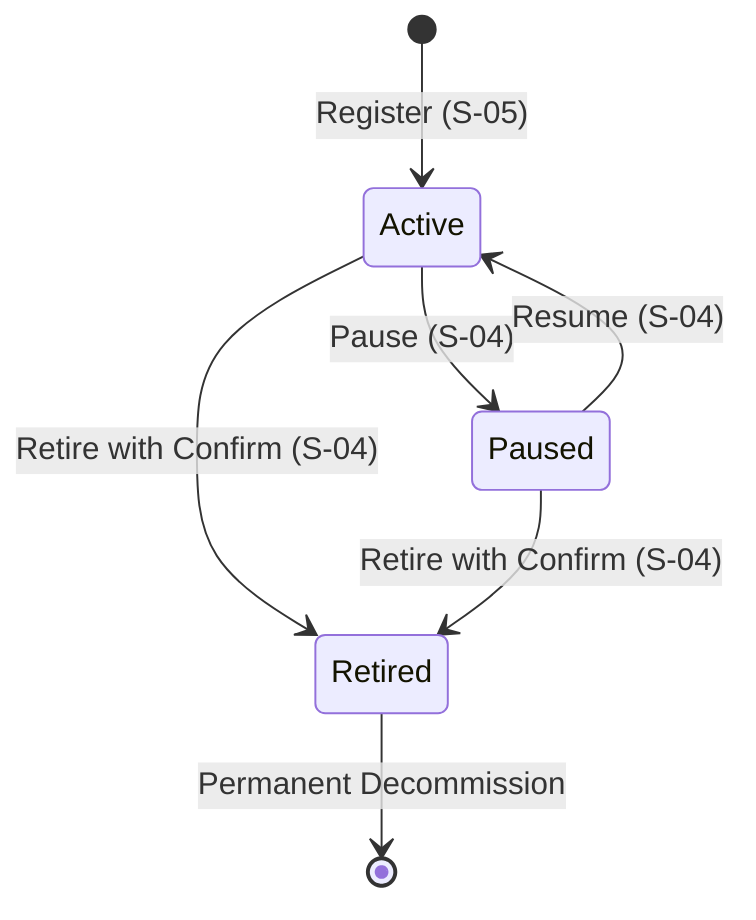
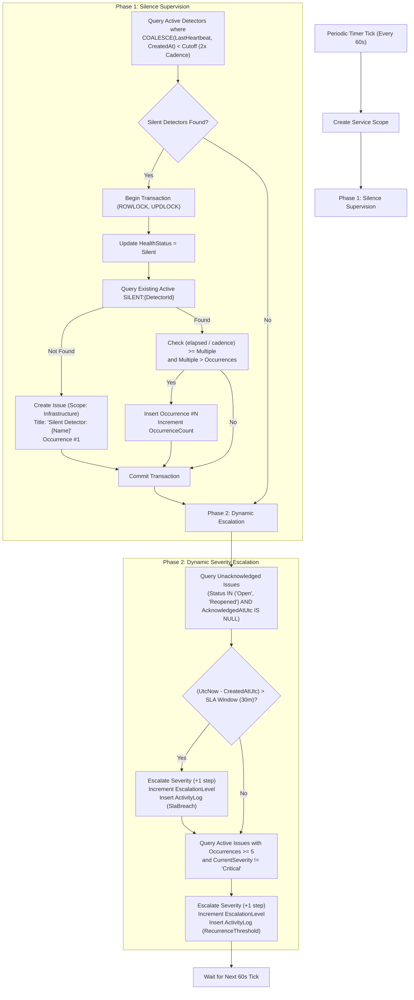

# 1. Overview

This architecture artifact defines the target technical realization for **PrIMA Stage 3: Detector Portfolio, Automated Supervision & Webhook Verification** (`Code: PRIMA-STAGE-3`, `Type: CHANGE-REQUEST`), delivering the **Autonomous Proactive Supervision & Self-Monitoring** milestone specified in `docs/PRIMA-DEVELOPMENT-ROADMAP.md` and `docs/issues/IS003-PRIMA-STAGE-3-ISSUE.md`.

Stage 3 transforms PrIMA from a responsive triage workbench into an autonomous, self-supervising platform that monitors the health of its own monitoring probes. It introduces the autonomous background supervision engine (`MonitoringSupervisorWorker`), enables bi-directional external probe orchestration via webhooks (`DetectorWebhookClient`), expands telemetry ingestion to handle execution failures and recovery, and delivers the complete operational portfolio management interface (`S-03` Detector List, `S-04` Detector Detail, `S-05` Detector Form, `S-06` Inspection Run Log), alongside contextual upgrades to `S-01` Issue Dashboard, `S-02` Issue Detail Workbench, and `AppLayout.vue`.

This architecture realizes the complete set of approved decisions recorded in `docs/issues/IS003-PRIMA-STAGE-3-FEASIBILITY-ASSESSMENT.md` (`Status: READY-FOR-PLANNING`), adheres to the architectural foundations established in `docs/PRIMA-ARCHITECTURE.md`, and complies strictly with `docs/PRIMA-UI-UX-GUIDELINE.md` and `docs/PRIMA-SCREEN-INVENTORY.md`.

---

# 2. Architectural Basis

## Business Context

PrIMA operates as the proactive data and process integrity guardian for Hospital Information Systems (SIMRS).
The business knowledge, operational workflows, and domain orchestration realized by this architecture are derived from:
- `docs/PRIMA-DOMAIN.md`: Ubiquitous Language, Aggregate Roots (`Detector`, `Issue`), Value Objects (`CorrelationKey`, `TelemetryEvidence`, `VerificationRecord`), Administrative States (`Active`, `Paused`, `Retired`), Health States (`Healthy`, `Failing`, `Silent`), Inspection Outcomes (`Passed`, `FindingDiscovered`, `ExecutionFailed`), and Business Rules:
  - `BR-PRIMA-003`: Dynamic Severity Escalation (unattended SLA breach escalation and recurrence threshold escalation).
  - `BR-PRIMA-004`: Mandatory Verification Gate (automated verification re-run via webhook unlocks issue resolution).
  - `BR-PRIMA-005`: Fail-Safe Infrastructure Anomaly Synthesis (`SILENT:{DetectorId}` and `FAIL:{DetectorId}` synthetic issues).
  - `BR-PRIMA-007`: SIMRS Integration Protocol & Probe Ergonomics (non-intrusive lightweight probe model, 15-second execution timeout).
  - `BR-PRIMA-008`: Operational Attribution & Accountability (authenticated EDP officer triggering actions and audit trails).
  - `BR-PRIMA-010`: Silence Detection & Heartbeat Invariants (2× cadence silence threshold, cadence-multiplied occurrences).
- `docs/PRIMA-USE-CASE-DISCOVERY.md`: Primary Use Cases:
  - `D-2`: Trigger Verification Re-run (Automated webhook re-run from Workbench `S-02`)
  - `E-1`: View Detector Portfolio (`S-03`)
  - `E-2`: View Detector Detail & Health History (`S-04`)
  - `E-3`: Register New Detector (`S-05`)
  - `E-4`: Edit Detector Configuration (`S-05`)
  - `E-5`: Pause / Resume Detector (`S-04`)
  - `E-6`: Retire Detector (`S-04`)
  - `E-7`: Trigger On-Demand Manual Run (`S-04`)
  - `F-1`: View Inspection Run Log (`S-06`)
  - `F-2`: Inspect Run Execution Detail (`S-06`)
  - `G-1`: View Escalated Issues on Dashboard (`S-01`)
  - `G-2`: Track Escalation in Issue Audit Trail (`S-02`)
- `docs/PRIMA-SCREEN-INVENTORY.md`: Screens `S-03` (Detector List), `S-04` (Detector Detail), `S-05` (Detector Form), `S-06` (Inspection Run Log), and Stage 3 enhancements to `S-01` and `S-02`.
- `docs/PRIMA-UI-UX-GUIDELINE.md`: Desktop-first layouts, 15-second polling on `S-03`/`S-04`, virtualized data grids without pagination, color-coded pass rates (Emerald `>= 95%`, Amber `85%–94%`, Rose `< 85%`), split cadence duration picker, sticky headers, and VeeValidate + Zod form validation.

## Analysis Input

This architecture strictly consumes and realizes the approved decisions from `docs/issues/IS003-PRIMA-STAGE-3-FEASIBILITY-ASSESSMENT.md` (`Status: READY-FOR-PLANNING`):
- `GAP-001` & `DEC-003`, `DEC-005`, `DEC-006`, `DEC-007`: `MonitoringSupervisorWorker` background service for silence detection (`BR-PRIMA-010`), infrastructure issue synthesis (`BR-PRIMA-005`), and dynamic severity escalation (`BR-PRIMA-003`).
- `GAP-002` & `DEC-004`: `IngestTelemetryHandler` processing `outcome == "ExecutionFailed"` and handling detector health recovery while preserving EDP issue accountability.
- `GAP-003` & `DEC-001`, `DEC-002`: `DetectorWebhookClient` with strict 15s timeout for on-demand manual runs (`E-7`) and automated verification re-runs (`D-2`).
- `GAP-004` & `DEC-008`, `DEC-009`: Complete detector portfolio API endpoints in `Features/Detectors/*` with standardized 30-day pass rate calculation and issue lifecycle autonomy on detector retirement.
- `GAP-005`: Frontend feature slice `src/frontend/src/features/detectors/` implementing `S-03`, `S-04`, `S-05`, and `S-06`.
- `GAP-006`: `Detector` and `Issue` domain aggregate enhancements for configuration updates, silence thresholds, administrative transitions, and severity stepping.
- `GAP-007` & `DEC-010`: Dashboard `S-01` top Alert Strip (`G-1`), `EscalatedOnly` feed filter, `S-02` header detector router link, and `AppLayout.vue` sidebar health alert dot.

---

# 3. Scope

## In Scope (Stage 3)

1. **Backend Domain Aggregate Enhancements:**
   - `Detector.cs`: Implement configuration updates (`UpdateConfiguration`), administrative transitions (`Pause`, `Resume`, `Retire`), health tracking (`MarkSilent`, `MarkFailing`, `ResetHealthOnRecovery`), and silence threshold evaluation (`IsSilenceThresholdExceeded`).
   - `Issue.cs`: Implement dynamic severity escalation (`EscalateSeverity`, `CheckSlaEscalation`, `CheckRecurrenceEscalation`) enforcing multi-step escalation capped at `Critical` and atomic audit logging.
2. **Autonomous Background Supervisor Engine (`MonitoringSupervisorWorker.cs`):**
   - Registered as a hosted `BackgroundService` executing every 60 seconds with scoped database execution.
   - **Phase 1 (Silence Supervision):** Evaluates `Active` detectors where `COALESCE(LastHealthyHeartbeatUtc, CreatedAtUtc) < (UtcNow - ExpectedCadenceSeconds * 2.0)`. Transitions health to `Silent`, synthesizes or appends to `SILENT:{DetectorId}` infrastructure issue, and increments occurrences at cadence multiples (2×, 3×, 4×).
   - **Phase 2 (Dynamic Severity Escalation):** Evaluates unacknowledged issues (`Status IN ('Open', 'Reopened')`) past the SLA timeout (+1 severity step per window) and recurring issues (`Status IN ('Open', 'Acknowledged', 'Investigating', 'Reopened')` with `OccurrenceCount >= 5`), persisting elevated severity and recording `dbo.IssueActivityLogs`.
3. **External Webhook Client (`DetectorWebhookClient.cs`):**
   - Implemented via `IHttpClientFactory` with strict 15-second request timeout and cancellation tokens.
   - Executes synchronous HTTP POST to `{WebhookUrl}` with `{ detectorId, triggerSource, issueId? }`.
   - Handles network timeouts, unreachability, and HTTP 5xx errors by recording an `ExecutionFailed` run, marking detector `Failing`, and synthesizing `FAIL:{DetectorId}`.
4. **Extended Telemetry Ingestion Pipeline (`IngestTelemetryHandler.cs`):**
   - Handles `outcome == "ExecutionFailed"`: persists run with `FailureReason`, marks detector `HealthStatus = Failing`, and auto-synthesizes or appends to `FAIL:{DetectorId}` issue.
   - Handles detector recovery (`DEC-004`): resets `HealthStatus = Healthy`, updates `LastHealthyHeartbeatUtc`, and records recovery activity log on active infrastructure issues.
5. **Detector Portfolio Minimal API Endpoints (`Features/Detectors/*` & `Features/Issues/*`):**
   - `GET /api/detectors`: Portfolio list with health status, cadence, 30-day clean pass rate, and active issue counts (`S-03`).
   - `GET /api/detectors/summary`: Global health counts (`HealthyCount`, `FailingCount`, `SilentCount`, `PausedCount`) for `S-03` and sidebar alert dot.
   - `GET /api/detectors/{id}`: Detailed detector context, 30-day reliability statistics, recent 10 runs, and linked active issues (`S-04`).
   - `POST /api/detectors`: Register new detector (`S-05`).
   - `PUT /api/detectors/{id}`: Update detector configuration with immutable `Name` (`S-05`).
   - `POST /api/detectors/{id}/toggle-status`: Administrative lifecycle transitions (`Active <-> Paused -> Retired`) (`S-04`).
   - `POST /api/detectors/{id}/trigger-run`: Synchronous on-demand inspection run via webhook (`S-04`, `E-7`).
   - `GET /api/detectors/{id}/runs`: Historical inspection run log with date filtering and pagination/scrolling (`S-06`).
   - `POST /api/issues/{id}/verification/trigger-run`: Automated verification re-run via webhook (`S-02`, `D-2`).
   - `GET /api/issues/dashboard-feed`: Extended with `EscalatedCount` summary and `EscalatedOnly` query parameter (`S-01`, `DEC-010`).
6. **Frontend Detector Feature Slice (`src/frontend/src/features/detectors/`):**
   - `S-03` Detector Portfolio List (`/detectors`): 4-state Health Summary Bar, multi-attribute filter strips, instant search, virtualized table/cards, `+ Register Detector` CTA.
   - `S-04` Detector Detail (`/detectors/:id`): Sticky header, status-sensitive Action Bar, 4-column 30-day reliability stats card, recent 10 inspection runs with inline detail expansion, linked active issues list.
   - `S-05` Detector Form (`/detectors/new`, `/detectors/:id/edit`): VeeValidate + Zod form, split cadence picker (Minutes/Hours) with dynamic 2× silence threshold helper, validated optional `WebhookUrl`.
   - `S-06` Inspection Run Log (`/detectors/:id/runs`): Context header, 7-day date range picker, outcome and trigger filter pills, expandable rows with monospace trace/failure blocks and copy buttons.
7. **Cross-Feature Integrations & Linkages:**
   - `AppLayout.vue`: Activate `Detectors` sidebar item (`/detectors`) with amber/rose indicator dot when `(FailingCount + SilentCount) > 0`.
   - `S-01 Issue Dashboard`: Conditional top Alert Strip (`⚠ N issues escalated · M issues reopened`), `↑ Escalated` badge chips, and `escalatedOnly` query filter.
   - `S-02 Issue Detail Workbench`: Active router link on header detector badge (`/detectors/:id`), and Action Bar automated verification re-run trigger with graceful fallback to `M-03`.

## Out of Scope (Deferred)

- **Stage 4:** Retrospective reporting, period-close KPI reporting (`S-07`, `H-1`, `H-2`), multi-period trend visualizations, MTTR analytics, and full v1.0 quality gate.
- **Stage 5:** Pilot SIMRS detector suite across hospital modules (`BR-PRIMA-007`) and hospital on-premise production deployment.

---

# 4. Technical Decisions

## 4.1 Realization of Approved Feasibility Decisions

The 10 gap-closure decisions approved in `IS003-PRIMA-STAGE-3-FEASIBILITY-ASSESSMENT.md` are realized as follows:

| Decision ID | Target GAP / OQ | Target Technical Architecture Realization |
|---|---|---|
| `DEC-001` | `GAP-003`, `OQ-001` | **Synchronous HTTP Webhook Client:** `DetectorWebhookClient` uses `IHttpClientFactory` configured with a 15-second `Timeout`. Sends `POST {WebhookUrl}` with `{ detectorId, triggerSource, issueId? }`. The caller awaits response JSON conforming to telemetry contracts, persists `InspectionRun`, and updates health or verification status within the HTTP transaction. |
| `DEC-002` | `GAP-003`, `OQ-002` | **Comprehensive Webhook Failure Treatment:** Catching `TaskCanceledException` (timeout), `HttpRequestException`, or HTTP 5xx records an `InspectionRun` with `Outcome = ExecutionFailed`, sets detector `HealthStatus = Failing`, synthesizes or appends `FAIL:{DetectorId}` issue per `BR-PRIMA-005`, records failed verification (if from `D-2`), and returns `504 Gateway Timeout` or `502 Bad Gateway` ProblemDetails. |
| `DEC-003` | `GAP-001`, `OQ-003` | **Silence Baseline for Unrun Detectors:** `MonitoringSupervisorWorker` executes SQL using `COALESCE(LastHealthyHeartbeatUtc, CreatedAtUtc) < @SilenceCutoff` (`UtcNow - ExpectedCadenceSeconds * 2.0`). Newly deployed detectors that fail to report within 2× cadence transition to `Silent` without delay. |
| `DEC-004` | `GAP-001`, `OQ-004` | **Health Reset with Preserved EDP Governance on Recovery:** In `IngestTelemetryHandler`, when an incoming run from a `Silent` or `Failing` detector has `Outcome == Passed` or `FindingDiscovered`, detector health resets to `Healthy`. Existing `SILENT:{id}` or `FAIL:{id}` issues remain open; an activity log (`ActivityType = "DetectorRecovered"`) is appended so EDP officers verify and formally close the issue per `BR-PRIMA-004`. |
| `DEC-005` | `GAP-001`, `OQ-005` | **Cadence-Multiplied Silence Occurrences:** `MonitoringSupervisorWorker` calculates `multiples = (int)(elapsedSeconds / cadenceSeconds)`. It records Occurrence #1 upon crossing 2× cadence, and appends a new occurrence only when `multiples >= 3` and `multiples > (issue.OccurrenceCount + 1)`. This caps occurrence writes to 1 per cadence window while maintaining audit fidelity. |
| `DEC-006` | `GAP-001`, `OQ-006` | **Multi-Step SLA Escalation Capped at Critical:** In `Issue.cs`, `EscalateSeverity` elevates severity by +1 step (`Low` -> `Medium` -> `High` -> `Critical`) and increments `EscalationLevel`. Once `Critical`, severity stepping ceases. Recurrence (`>= 5` occurrences) independently triggers +1 step. An atomic log is written to `dbo.IssueActivityLogs`. |
| `DEC-007` | `GAP-001`, `OQ-007` | **Escalation Lifecycle Eligibility:** In `MonitoringSupervisorWorker`, unacknowledged SLA escalation queries `Status IN ('Open', 'Reopened') AND AcknowledgedAtUtc IS NULL`. Acknowledging an issue halts SLA escalation. Recurrence escalation queries `Status IN ('Open', 'Acknowledged', 'Investigating', 'Reopened') AND OccurrenceCount >= 5 AND CurrentSeverity != 'Critical'`. |
| `DEC-008` | `GAP-004`, `OQ-008` | **Standardized 30-Day Clean Pass Rate Calculation:** In Dapper queries for `S-03` and `S-04`: `CAST(ROUND(COUNT(CASE WHEN Outcome = 'Passed' THEN 1 END) * 100.0 / NULLIF(COUNT(*), 0), 1) AS DECIMAL(5,1))`. Frontend colors apply: Emerald (`>= 95.0%`), Amber (`85.0%–94.9%`), Rose (`< 85.0%`). If total runs = 0, display `100.0%` (slate). |
| `DEC-009` | `GAP-004`, `OQ-009` | **Issue Autonomy on Detector Retirement:** `ToggleDetectorStatusHandler` updates `AdminStatus = Retired`, blocking future runs (`409 Conflict`) and suppressing silence checks. Linked active issues remain open and addressable through normal investigation, remediation, verification, and resolution. |
| `DEC-010` | `GAP-007`, `OQ-010` | **Dedicated Escalated Filter & Sidebar Health Polling:** Extended `GetDashboardFeedHandler` to include `EscalatedCount` in `DashboardFeedSummaryDto` and `bool? EscalatedOnly` filter in `GetDashboardFeedQuery`. Added `GET /api/detectors/summary` returning health counts; `AppLayout.vue` polls this endpoint (or feed summary) to render the navigation alert dot when `(FailingCount + SilentCount) > 0`. |

---

## 4.2 Domain Model & Invariants

### 4.2.1 Detector Aggregate Root & Administrative Lifecycle

The `Detector` aggregate root (`src/backend/PrIMA.Api/Domain/Detectors/Detector.cs`) governs detector configuration, cadence parameters, and administrative lifecycle transitions:



#### Health Status Transitions:
- `Healthy` -> `Silent`: Initiated autonomously by `MonitoringSupervisorWorker` when `COALESCE(LastHealthyHeartbeatUtc, CreatedAtUtc) < (UtcNow - ExpectedCadenceSeconds * 2.0)`.
- `Healthy` -> `Failing`: Initiated by `IngestTelemetryHandler` or `DetectorWebhookClient` when `Outcome == ExecutionFailed`.
- `Silent` / `Failing` -> `Healthy`: Initiated by `IngestTelemetryHandler` upon receiving a successful inspection run (`Passed` or `FindingDiscovered`).

#### Detector Aggregate Definition:

```csharp
namespace PrIMA.Api.Domain.Detectors;

public sealed class Detector
{
    public Guid Id { get; private set; }
    public string Name { get; private set; } = null!;
    public string Description { get; private set; } = null!;
    public MonitoringScope Scope { get; private set; }
    public string TargetModule { get; private set; } = null!;
    public int ExpectedCadenceSeconds { get; private set; }
    public string? WebhookUrl { get; private set; }
    public AdminStatus AdminStatus { get; private set; }
    public DetectorHealth HealthStatus { get; private set; }
    public DateTime? LastRunAtUtc { get; private set; }
    public DateTime? LastHealthyHeartbeatUtc { get; private set; }
    public DateTime CreatedAtUtc { get; private set; }

    public bool IsActive => AdminStatus == AdminStatus.Active;
    public bool IsPaused => AdminStatus == AdminStatus.Paused;
    public bool IsRetired => AdminStatus == AdminStatus.Retired;

    private Detector() { }

    public static Detector Create(
        string name,
        string description,
        MonitoringScope scope,
        string targetModule,
        int expectedCadenceSeconds,
        string? webhookUrl = null,
        DateTime? createdAtUtc = null)
    {
        if (string.IsNullOrWhiteSpace(name)) throw new ArgumentException("Detector name cannot be empty.", nameof(name));
        if (string.IsNullOrWhiteSpace(description)) throw new ArgumentException("Description cannot be empty.", nameof(description));
        if (string.IsNullOrWhiteSpace(targetModule)) throw new ArgumentException("Target module cannot be empty.", nameof(targetModule));
        if (expectedCadenceSeconds <= 0) throw new ArgumentOutOfRangeException(nameof(expectedCadenceSeconds), "Cadence must be > 0.");

        return new Detector
        {
            Id = Guid.NewGuid(),
            Name = name.Trim(),
            Description = description.Trim(),
            Scope = scope,
            TargetModule = targetModule.Trim(),
            ExpectedCadenceSeconds = expectedCadenceSeconds,
            WebhookUrl = string.IsNullOrWhiteSpace(webhookUrl) ? null : webhookUrl.Trim(),
            AdminStatus = AdminStatus.Active,
            HealthStatus = DetectorHealth.Healthy,
            CreatedAtUtc = createdAtUtc ?? DateTime.UtcNow
        };
    }

    public Result UpdateConfiguration(
        string description,
        MonitoringScope scope,
        string targetModule,
        int expectedCadenceSeconds,
        string? webhookUrl)
    {
        if (IsRetired)
            return Result.Failure(DetectorErrors.CannotModifyRetiredDetector);

        if (string.IsNullOrWhiteSpace(description))
            return Result.Failure(DetectorErrors.EmptyDescription);

        if (string.IsNullOrWhiteSpace(targetModule))
            return Result.Failure(DetectorErrors.EmptyTargetModule);

        if (expectedCadenceSeconds <= 0)
            return Result.Failure(DetectorErrors.InvalidCadence);

        Description = description.Trim();
        Scope = scope;
        TargetModule = targetModule.Trim();
        ExpectedCadenceSeconds = expectedCadenceSeconds;
        WebhookUrl = string.IsNullOrWhiteSpace(webhookUrl) ? null : webhookUrl.Trim();
        return Result.Success();
    }

    public Result Pause()
    {
        if (IsRetired) return Result.Failure(DetectorErrors.CannotModifyRetiredDetector);
        if (IsPaused) return Result.Failure(DetectorErrors.AlreadyPaused);

        AdminStatus = AdminStatus.Paused;
        return Result.Success();
    }

    public Result Resume()
    {
        if (IsRetired) return Result.Failure(DetectorErrors.CannotModifyRetiredDetector);
        if (IsActive) return Result.Failure(DetectorErrors.AlreadyActive);

        AdminStatus = AdminStatus.Active;
        return Result.Success();
    }

    public Result Retire()
    {
        if (IsRetired) return Result.Failure(DetectorErrors.AlreadyRetired);

        AdminStatus = AdminStatus.Retired;
        return Result.Success();
    }

    public bool IsSilenceThresholdExceeded(DateTime currentUtc)
    {
        if (!IsActive) return false;
        var baseline = LastHealthyHeartbeatUtc ?? CreatedAtUtc;
        var elapsed = (currentUtc - baseline).TotalSeconds;
        return elapsed > (ExpectedCadenceSeconds * 2.0);
    }

    public void MarkSilent(DateTime timestampUtc)
    {
        HealthStatus = DetectorHealth.Silent;
    }

    public void MarkFailing(DateTime timestampUtc)
    {
        LastRunAtUtc = timestampUtc;
        HealthStatus = DetectorHealth.Failing;
    }

    public void RecordSuccessfulRun(DateTime timestampUtc)
    {
        LastRunAtUtc = timestampUtc;
        LastHealthyHeartbeatUtc = timestampUtc;
        HealthStatus = DetectorHealth.Healthy;
    }
}
```

---

### 4.2.2 Issue Aggregate Severity Escalation

The `Issue` aggregate root (`src/backend/PrIMA.Api/Domain/Issues/Issue.cs`) is expanded to support deterministic dynamic escalation (`BR-PRIMA-003`, `DEC-006`, `DEC-007`):

```csharp
namespace PrIMA.Api.Domain.Issues;

public sealed class Issue
{
    // ... Existing Stage 1 & Stage 2 properties ...

    public Result EscalateSeverity(string reason, DateTime utcNow)
    {
        if (Status is IssueStatus.Resolved or IssueStatus.Dismissed)
            return Result.Failure(IssueErrors.ActionRequiresActiveStatus());

        if (CurrentSeverity == IssueSeverity.Critical)
            return Result.Success(); // Severity already capped at Critical

        var previousSeverity = CurrentSeverity;
        CurrentSeverity = CurrentSeverity switch
        {
            IssueSeverity.Low => IssueSeverity.Medium,
            IssueSeverity.Medium => IssueSeverity.High,
            IssueSeverity.High => IssueSeverity.Critical,
            _ => IssueSeverity.Critical
        };

        EscalationLevel++;
        return Result.Success();
    }

    public bool CheckSlaEscalation(TimeSpan slaTimeout, DateTime utcNow, out string reason)
    {
        reason = string.Empty;
        if (Status is not (IssueStatus.Open or IssueStatus.Reopened))
            return false;

        if (AcknowledgedAtUtc != null)
            return false;

        var unackDuration = utcNow - CreatedAtUtc;
        if (unackDuration > slaTimeout && CurrentSeverity < IssueSeverity.Critical)
        {
            reason = $"Issue unacknowledged for {(int)unackDuration.TotalMinutes} minutes (SLA window: {(int)slaTimeout.TotalMinutes}m).";
            return true;
        }

        return false;
    }

    public bool CheckRecurrenceEscalation(DateTime utcNow, out string reason)
    {
        reason = string.Empty;
        if (Status is IssueStatus.Resolved or IssueStatus.Dismissed)
            return false;

        if (OccurrenceCount >= 5 && CurrentSeverity < IssueSeverity.Critical)
        {
            reason = $"Issue recurred {OccurrenceCount} times across monitoring cycles.";
            return true;
        }

        return false;
    }
}
```

---

## 4.3 Background Worker Architecture (`MonitoringSupervisorWorker`)

`MonitoringSupervisorWorker` runs as a hosted service within `PrIMA.Api`, instantiating a scoped service provider every 60 seconds.



### 4.3.1 Silence Detection Execution Details (`DEC-003`, `DEC-005`)

1. **Detection Query:**
   ```sql
   SELECT 
       d.Id, d.Name, d.Description, d.Scope, d.TargetModule, d.ExpectedCadenceSeconds,
       d.WebhookUrl, d.AdminStatus, d.HealthStatus, d.LastRunAtUtc, d.LastHealthyHeartbeatUtc, d.CreatedAtUtc
   FROM dbo.Detectors d WITH (NOLOCK)
   WHERE d.AdminStatus = 'Active'
     AND COALESCE(d.LastHealthyHeartbeatUtc, d.CreatedAtUtc) < DATEADD(SECOND, -(d.ExpectedCadenceSeconds * 2.0), SYSUTCDATETIME());
   ```
2. **Transactional Lock & Health Update:**
   Inside an explicit transaction with `(UPDLOCK, ROWLOCK)` on `dbo.Detectors`:
   - Verify `COALESCE(LastHealthyHeartbeatUtc, CreatedAtUtc)` under lock to prevent race conditions with incoming healthy telemetry.
   - Set `HealthStatus = 'Silent'`.
3. **Infrastructure Anomaly Correlation (`SILENT:{DetectorId}`):**
   - Query `dbo.Issues` by `CorrelationKey = @CorrelationKey` (`SILENT:{DetectorId}`) where `Status NOT IN ('Resolved', 'Dismissed')`.
   - If not found:
     - Instantiate `Issue.Create` with:
       - Scope: `MonitoringScope.Infrastructure`
       - Title: `$"Silent Detector: {detector.Name} has missed cadence"`
       - BaseSeverity: `IssueSeverity.High`
       - TelemetryEvidence: `module = detector.TargetModule`, `trace = $"Detector '{detector.Name}' missed heartbeat. Cadence: {detector.ExpectedCadenceSeconds}s. Threshold: {detector.ExpectedCadenceSeconds * 2}s."`
     - Insert into `dbo.Issues` and `dbo.Occurrences` (`OccurrenceNumber = 1`).
     - Insert activity log: `ActivityType = "Created"`, summary: `"Infrastructure issue auto-synthesized due to missed cadence."`
   - If active match found (`DEC-005`):
     - Calculate `int multiples = (int)(elapsedSeconds / detector.ExpectedCadenceSeconds)`.
     - If `multiples >= 3` and `multiples > (issue.OccurrenceCount + 1)`:
       - Append new `Occurrence` with `OccurrenceNumber = issue.OccurrenceCount + 1`.
       - Update `dbo.Issues` (`OccurrenceCount = @NewCount`, `LastOccurrenceAtUtc = SYSUTCDATETIME()`).
       - Insert activity log: `ActivityType = "RecurrenceObserved"`, summary: `$"Prolonged silence breached {multiples}x cadence window."`

### 4.3.2 Severity Escalation Execution Details (`DEC-006`, `DEC-007`)

1. **SLA Timeout Escalation:**
   - Evaluates active issues where `Status IN ('Open', 'Reopened') AND AcknowledgedAtUtc IS NULL AND CurrentSeverity != 'Critical'`.
   - Default SLA timeout: 30 minutes (configurable via `Supervisor:UnacknowledgedSlaTimeoutMinutes` in `appsettings.json`).
   - If `(UtcNow - CreatedAtUtc).TotalMinutes > (SlaTimeoutMinutes * (EscalationLevel + 1))`:
     - Elevate severity: `Low` -> `Medium` -> `High` -> `Critical`.
     - Increment `EscalationLevel`.
     - Update `dbo.Issues` (`CurrentSeverity`, `SeverityRank`, `EscalationLevel`).
     - Insert into `dbo.IssueActivityLogs`:
       - `ActivityType = "SeverityEscalated"`
       - `ActorName = "System"`
       - `Summary = $"SLA breach: Unacknowledged for {(int)(UtcNow - CreatedAtUtc).TotalMinutes}m. Escalated to {NewSeverity}."`
2. **Recurrence Threshold Escalation:**
   - Evaluates active issues where `Status IN ('Open', 'Acknowledged', 'Investigating', 'Reopened') AND OccurrenceCount >= 5 AND CurrentSeverity != 'Critical'`.
   - If the issue has not yet received a recurrence escalation step:
     - Elevate severity: +1 step.
     - Increment `EscalationLevel`.
     - Update `dbo.Issues`.
     - Insert into `dbo.IssueActivityLogs`:
       - `ActivityType = "SeverityEscalated"`
       - `ActorName = "System"`
       - `Summary = $"Recurrence threshold breached: {OccurrenceCount} occurrences recorded. Escalated to {NewSeverity}."`

---

## 4.4 Webhook Client & Ingestion Pipeline

### 4.4.1 `DetectorWebhookClient` Architecture (`DEC-001`, `DEC-002`)

The webhook client interacts synchronously with external detector probe services.

```csharp
namespace PrIMA.Api.Infrastructure.Webhooks;

public interface IDetectorWebhookClient
{
    Task<Result<WebhookExecutionResult>> ExecuteRunAsync(
        Guid detectorId,
        string webhookUrl,
        string triggerSource,
        Guid? issueId = null,
        CancellationToken cancellationToken = default);
}

public sealed record WebhookExecutionResult(
    string Outcome,
    int DurationMs,
    string? FailureReason,
    IReadOnlyList<WebhookFindingDto> Findings);

public sealed record WebhookFindingDto(
    string TargetEntityReference,
    string Title,
    string BaseSeverity,
    WebhookEvidenceDto Evidence);

public sealed record WebhookEvidenceDto(
    string Module,
    string? SourceTable,
    string? RecordKeys,
    decimal? DebitTotal,
    decimal? CreditTotal,
    decimal? VarianceDelta,
    string? Trace);
```

#### Outbound Protocol & Resilience Rules:
- **Request Format:** `POST {WebhookUrl}`
  - Headers: `Content-Type: application/json`, `User-Agent: PrIMA-Supervisor/1.0`, `X-PrIMA-Delivery-Id: <Guid>`
  - Body:
    ```json
    {
      "detectorId": "3fa85f64-5717-4562-b3fc-2c963f66afa6",
      "triggerSource": "Manual",
      "issueId": null,
      "dispatchedAtUtc": "2026-11-21T08:15:00Z"
    }
    ```
- **Timeout Policy:** 15 seconds strict via `HttpClient.Timeout`.
- **Error Handling & Failure Recording (`DEC-002`):**
  If the call fails due to `TaskCanceledException` (timeout), `HttpRequestException`, or HTTP 5xx:
  1. Record `InspectionRun`: `Outcome = "ExecutionFailed"`, `FailureReason = ex.Message`, `DurationMs = elapsedMs`.
  2. Mark detector: `HealthStatus = Failing`.
  3. Synthesize / Append `dbo.Issues`: `CorrelationKey = $"FAIL:{detectorId}"`, `Scope = Infrastructure`, `Title = $"Execution Failure: {detector.Name}"`, `BaseSeverity = High`.
  4. Return `Result.Failure` mapped to RFC 7807 `504 Gateway Timeout` or `502 Bad Gateway`.

---

### 4.4.2 Extended Ingestion Pipeline (`IngestTelemetryHandler`)

`IngestTelemetryHandler.cs` is extended to support execution failures and health recovery:

1. **Handling `outcome == "ExecutionFailed"` (`GAP-002`):**
   - Record `InspectionRun` with `Outcome = ExecutionFailed`, `FailureReason = request.FailureReason`.
   - Update detector health: `HealthStatus = Failing`.
   - Synthesize or append to infrastructure issue:
     - `CorrelationKey = $"FAIL:{detector.Id}"`
     - `Scope = MonitoringScope.Infrastructure`
     - `Title = $"Execution Failure: {detector.Name}"`
     - `BaseSeverity = IssueSeverity.High`
     - `TelemetryEvidence`: `Module = detector.TargetModule`, `TraceString = request.FailureReason ?? "Detector reported execution failure without details."`
   - Return `200 OK` with processed count = 0.
2. **Handling Recovery on Successful Ingestion (`DEC-004`):**
   - If the detector's current `HealthStatus` is `Silent` or `Failing`, and the incoming run has `outcome == "Passed"` or `"FindingDiscovered"`:
     - Reset `HealthStatus = Healthy`, update `LastHealthyHeartbeatUtc = request.ExecutionTimestampUtc`.
     - Query open infrastructure issues matching `SILENT:{detector.Id}` or `FAIL:{detector.Id}`.
     - For each matching active issue, insert into `dbo.IssueActivityLogs`:
       - `ActivityType = "DetectorRecovered"`
       - `ActorName = "System"`
       - `Summary = $"Detector resumed healthy reporting via run '{inspectionRun.Id}'. Issue remains open for EDP verification."`

---

## 4.5 Minimal API Endpoints & Request/Response Contracts

All management endpoints require JWT authentication (`[Authorize]`). Officer identity is extracted from `CurrentOfficer`.

| Method | Route | Request DTO | Response DTO | Status Codes | Authorization & Validation Rules |
|---|---|---|---|---|---|
| `GET` | `/api/detectors` | Query params: `Scope?`, `AdminStatus?`, `HealthStatus?`, `Search?` | `List<DetectorListItemDto>` | `200 OK`, `401` | Authenticated. Ordered by `HealthStatus` priority (`Failing` -> `Silent` -> `Healthy`), then `Name ASC`. |
| `GET` | `/api/detectors/summary` | *(None)* | `DetectorSummaryDto` | `200 OK`, `401` | Authenticated. Returns portfolio counts: `HealthyCount`, `FailingCount`, `SilentCount`, `PausedCount`. Polled by sidebar and `S-03`. |
| `GET` | `/api/detectors/{id}` | *(None)* | `DetectorDetailDto` | `200 OK`, `401`, `404` | Authenticated. Returns detector metadata, 30-day reliability statistics, recent 10 inspection runs, and linked active issues. |
| `POST` | `/api/detectors` | `RegisterDetectorRequest` | `DetectorDetailDto` | `201 Created`, `401`, `409`, `422` | Authenticated. Validates unique `Name`, valid `Scope`, `Cadence > 0`, optional valid URL for `WebhookUrl`. |
| `PUT` | `/api/detectors/{id}` | `UpdateDetectorRequest` | `204 NoContent` | `204`, `401`, `404`, `409`, `422` | Authenticated. `Name` is immutable. Updates `Description`, `Scope`, `TargetModule`, `ExpectedCadenceSeconds`, `WebhookUrl`. Rejects retired detectors (`409`). |
| `POST` | `/api/detectors/{id}/toggle-status` | `ToggleDetectorStatusRequest` | `204 NoContent` | `204`, `401`, `404`, `409`, `422` | Authenticated. Handles `Action = "Pause"`, `"Resume"`, `"Retire"`. Retiring requires irreversible confirmation. |
| `POST` | `/api/detectors/{id}/trigger-run` | *(None)* | `InspectionRunResultDto` | `200 OK`, `401`, `404`, `409`, `502`, `504` | Authenticated. Invokes `WebhookUrl` synchronously. Records run (`TriggerSource = Manual`). Returns `409` if detector has no webhook or is paused/retired. |
| `GET` | `/api/detectors/{id}/runs` | Query params: `StartDateUtc?`, `EndDateUtc?`, `Outcome?`, `TriggerSource?`, `Limit?`, `Offset?` | `InspectionRunLogResponse` | `200 OK`, `401`, `404` | Authenticated. Default date range: last 7 days. Returns runs with duration, failure reason, and linked finding issue references. |
| `POST` | `/api/issues/{id}/verification/trigger-run` | *(None)* | `VerificationResultDto` | `200 OK`, `401`, `404`, `409`, `502`, `504` | Authenticated (`D-2`). Dispatches webhook check for issue's detector. If clean pass (0 findings), unlocks Verification Gate (`BR-PRIMA-004`). |
| `GET` | `/api/issues/dashboard-feed` | Query params: `...`, `EscalatedOnly?` | `GetDashboardFeedResponse` | `200 OK`, `401`, `422` | Extended with `EscalatedCount` in `DashboardFeedSummaryDto` and `bool? EscalatedOnly` filter (`DEC-010`). |

---

### 4.5.1 Detailed DTO Specifications

```csharp
// --- S-03 List & Summary ---
public sealed record DetectorSummaryDto(
    int TotalCount,
    int HealthyCount,
    int FailingCount,
    int SilentCount,
    int PausedCount);

public sealed record DetectorListItemDto(
    Guid Id,
    string Name,
    string Description,
    string Scope,
    string TargetModule,
    int ExpectedCadenceSeconds,
    string? WebhookUrl,
    string AdminStatus,
    string HealthStatus,
    DateTime? LastRunAtUtc,
    DateTime? LastHealthyHeartbeatUtc,
    decimal PassRate30d,
    int TotalRuns30d,
    int ActiveIssuesCount);

// --- S-04 Detail & Stats ---
public sealed record DetectorReliabilityStatsDto(
    DateTime? LastSuccessfulRunAtUtc,
    DateTime? LastFailureAtUtc,
    int TotalRuns30d,
    decimal PassRate30d);

public sealed record RecentRunSummaryDto(
    Guid Id,
    DateTime ExecutionTimestampUtc,
    string TriggerSource,
    string Outcome,
    int DurationMs,
    string? FailureReason,
    int FindingsCount);

public sealed record LinkedActiveIssueDto(
    Guid Id,
    string CorrelationKey,
    string Title,
    string CurrentSeverity,
    byte SeverityRank,
    string Status,
    int EscalationLevel,
    int OccurrenceCount,
    DateTime LastOccurrenceAtUtc);

public sealed record DetectorDetailDto(
    Guid Id,
    string Name,
    string Description,
    string Scope,
    string TargetModule,
    int ExpectedCadenceSeconds,
    string? WebhookUrl,
    string AdminStatus,
    string HealthStatus,
    DateTime? LastRunAtUtc,
    DateTime? LastHealthyHeartbeatUtc,
    DateTime CreatedAtUtc,
    DetectorReliabilityStatsDto ReliabilityStats,
    IReadOnlyList<RecentRunSummaryDto> RecentRuns,
    IReadOnlyList<LinkedActiveIssueDto> ActiveIssues);

// --- S-05 Register / Edit Requests ---
public sealed record RegisterDetectorRequest(
    string Name,
    string Description,
    string Scope,
    string TargetModule,
    int ExpectedCadenceSeconds,
    string? WebhookUrl);

public sealed record UpdateDetectorRequest(
    string Description,
    string Scope,
    string TargetModule,
    int ExpectedCadenceSeconds,
    string? WebhookUrl);

public sealed record ToggleDetectorStatusRequest(string Action); // "Pause", "Resume", "Retire"

// --- S-06 Run Log ---
public sealed record InspectionRunDetailDto(
    Guid Id,
    Guid DetectorId,
    DateTime ExecutionTimestampUtc,
    string TriggerSource,
    string Outcome,
    int DurationMs,
    string? FailureReason,
    int FindingsCount,
    IReadOnlyList<Guid> DiscoveredIssueIds);

public sealed record InspectionRunLogResponse(
    int TotalCount,
    IReadOnlyList<InspectionRunDetailDto> Runs);
```

---

## 4.6 Frontend Technical Realization (`src/frontend/src/features/detectors/`)

### 4.6.1 Directory & Component Structure

```text
src/frontend/src/features/detectors/
├── api/
│   ├── detector.keys.ts                # TanStack Query key factory ['detectors', 'list'|'detail'|'runs'|'summary']
│   └── useDetectorQueries.ts           # Query and mutation composables
├── components/
│   ├── HealthSummaryBar.vue            # 4-chip summary strip (Healthy, Failing, Silent, Paused) with filter clicks
│   ├── DetectorFilterBar.vue           # Scope, AdminStatus, HealthStatus pills + instant search input
│   ├── DetectorCard.vue                # Grid card view (fallback/alternative to table)
│   ├── DetectorTable.vue               # Virtualized data table with sortable columns, pass rate color pills
│   ├── ReliabilityStatsCard.vue        # 4-column 30-day reliability metrics (Emerald/Amber/Rose pass rate)
│   ├── RecentRunsTable.vue             # Recent 10 inspection runs with inline detail expansion
│   ├── LinkedActiveIssuesList.vue      # Active issues table linking directly to S-02
│   ├── RunLogFilterBar.vue             # S-06 Date range picker, outcome pills, trigger pills
│   └── ConfirmRetireDialog.vue         # Confirmation dialog for permanent retirement
├── composables/
│   └── useDetectorForm.ts              # Cadence unit conversion (Minutes/Hours) & threshold helper
├── schemas/
│   └── detectorForm.schema.ts          # Zod validation schema for S-05
├── types/
│   └── detectorView.types.ts           # Filter interfaces and UI state types
└── views/
    ├── DetectorListView.vue            # S-03 Portfolio list view (/detectors)
    ├── DetectorDetailView.vue          # S-04 Detector detail view (/detectors/:id)
    ├── DetectorFormView.vue            # S-05 Register / Edit form (/detectors/new, /detectors/:id/edit)
    └── InspectionRunLogView.vue        # S-06 Historical inspection run log (/detectors/:id/runs)
```

---

### 4.6.2 Context-Sensitive Action Bar State Matrix (`S-04`)

In `DetectorDetailView.vue`, the Action Bar dynamically reflects the detector's `AdminStatus` and `WebhookUrl` configuration:

| `AdminStatus` | `WebhookUrl` Configured | Available Action Buttons | Button Styles & Ergonomics |
|---|---|---|---|
| `Active` | Present | **`Trigger Run`** (Primary) · `Pause` · `Edit` · `Retire` | `Trigger Run`: `bg-slate-900 text-white` with loading spinner. `Pause`: `bg-amber-50 text-amber-700 border-amber-300`. `Edit`: `bg-white border-slate-300`. `Retire`: `text-rose-600 hover:bg-rose-50`. |
| `Active` | Null / Empty | `Trigger Run` (Disabled with tooltip) · `Pause` · `Edit` · `Retire` | `Trigger Run` disabled: tooltip `"No webhook configured. Add webhook URL in settings."` |
| `Paused` | Any | **`Resume`** (Primary) · `Edit` · `Retire` | `Resume`: `bg-emerald-600 text-white`. `Trigger Run` hidden. |
| `Retired` | Any | *(Read-only — all action buttons disabled or hidden)* | Banner: `"This detector is permanently decommissioned. Runs and silence checks are inactive."` |

---

### 4.6.3 Polling, Virtualization & Cache Management

1. **Polling Intervals:**
   - `S-03` Detector Portfolio: 15 seconds (`refetchInterval: 15_000`, `staleTime: 7_500`).
   - `S-04` Detector Detail: 15 seconds (`refetchInterval: 15_000`, `staleTime: 7_500`).
   - Global Health Summary (sidebar indicator): 15 seconds.
2. **Draft & Expansion Preservation:**
   - In `S-04` and `S-06`, expanded inspection run rows track stable run IDs in a local reactive `Set<string>`. Polling refetches never collapse open execution details.
   - In `S-05`, the form state is held in VeeValidate state, completely detached from background query cycles.
3. **Cache Invalidation Rules:**
   - `RegisterDetector` / `UpdateDetector`: Invalidates `['detectors', 'list']`, `['detectors', 'detail', id]`, `['detectors', 'summary']`.
   - `ToggleDetectorStatus`: Invalidates `['detectors', 'detail', id]`, `['detectors', 'list']`, `['detectors', 'summary']`.
   - `TriggerManualRun`: Invalidates `['detectors', 'detail', id]`, `['detectors', 'runs', id]`, `['dashboard', 'feed']`.
   - `TriggerVerificationRun`: Invalidates `['issues', 'detail', issueId]`, `['dashboard', 'feed']`.

---

# 5. Component Responsibilities

| Component | Layer / Area | Responsibility |
|---|---|---|
| `Detector` | Domain Aggregate | Encapsulates detector configuration, cadence parameters, silence threshold rules, administrative state transitions (`Pause`, `Resume`, `Retire`), and health updates. |
| `Issue` | Domain Aggregate | Encapsulates SLA unacknowledged escalation, recurrence threshold escalation, severity level progression, and capping at `Critical`. |
| `DetectorRepository` | Infrastructure | Dapper data access for `dbo.Detectors` and `dbo.InspectionRuns`, implementing single-row updates, liveness touches, and transactional locks. |
| `MonitoringSupervisorWorker` | Background Service | Hosted service executing 60s loop: Phase 1 evaluates silence and synthesizes `SILENT:{id}` issues; Phase 2 executes dynamic SLA and recurrence severity escalation. |
| `DetectorWebhookClient` | Infrastructure | Typed `HttpClient` executing outbound webhook calls with 15s timeout, mapping network failures to `ExecutionFailed` runs and ProblemDetails. |
| `IngestTelemetryHandler` | Feature Slice | Processes incoming telemetry: handles `outcome == "ExecutionFailed"` via `FAIL:{id}` issue synthesis; resets health and logs recovery for previously silent/failing detectors (`DEC-004`). |
| `GetDetectorListHandler` | Feature Slice | Projects detector portfolio list with 30-day clean pass rate, total runs, and active issue counts (`S-03`). |
| `GetDetectorSummaryHandler` | Feature Slice | Projects global health counts (`HealthyCount`, `FailingCount`, `SilentCount`, `PausedCount`) for S-03 and navigation sidebar dot. |
| `GetDetectorByIdHandler` | Feature Slice | Composite Dapper query projecting detector context, 30-day reliability statistics, recent 10 runs, and linked active issues (`S-04`). |
| `RegisterDetectorHandler` | Feature Slice | Registers new detector aggregate, validates unique name and cadence, defaults to `Active` (`S-05`). |
| `UpdateDetectorHandler` | Feature Slice | Updates existing detector configuration; enforces name immutability and rejects retired detectors (`S-05`). |
| `ToggleDetectorStatusHandler` | Feature Slice | Executes administrative lifecycle transitions (`Pause`, `Resume`, `Retire`) on `Detector` aggregate. |
| `TriggerManualRunHandler` | Feature Slice | Dispatches on-demand inspection via `DetectorWebhookClient`, records `InspectionRun` with `TriggerSource = "Manual"`, and returns immediate outcome. |
| `GetInspectionRunsHandler` | Feature Slice | Queries historical inspection runs with date range filtering, outcome pills, and duration/trace details (`S-06`). |
| `TriggerVerificationRunHandler` | Feature Slice | Dispatches automated verification re-run from Issue Workbench (`D-2`), records `VerificationRecord`, and unlocks/locks Verification Gate. |
| `DetectorListView.vue` (`S-03`) | Frontend View | Renders portfolio overview, 4-state summary bar, multi-attribute filter strips, virtualized table, and `+ Register Detector` CTA. |
| `DetectorDetailView.vue` (`S-04`) | Frontend View | Renders single-detector context, sticky header, status-sensitive Action Bar, 30-day reliability card, recent runs list, and linked active issues. |
| `DetectorFormView.vue` (`S-05`) | Frontend View | Renders registration and edit form with VeeValidate + Zod, split cadence picker, and 2× silence threshold calculation. |
| `InspectionRunLogView.vue` (`S-06`) | Frontend View | Renders historical run log, date range picker, outcome/trigger filter pills, expandable trace blocks, and copy buttons. |
| `AppLayout.vue` | Frontend Shell | Activates `Detectors` sidebar route (`/detectors`) with amber/rose alert dot when `(FailingCount + SilentCount) > 0`. |
| `DashboardView.vue` (`S-01`) | Frontend View | Upgraded with conditional top Alert Strip (`G-1`), `EscalatedOnly` feed filter, and visual escalation badges. |
| `WorkbenchHeader.vue` (`S-02`) | Frontend Component | Upgraded with active router link on detector badge and webhook `Trigger Verification Re-run` button in Action Bar. |

---

# 6. Integration Design

| Source | Target | Purpose | Protocol / Mechanism |
|---|---|---|---|
| `MonitoringSupervisorWorker` | `dbo.Detectors` & `dbo.Issues` | Evaluate silence thresholds, update health, synthesize `SILENT:{id}` issues, and escalate issue severities | Scoped Dapper / SQL Server Transaction |
| `DetectorWebhookClient` | External Detector Webhook | Dispatch synchronous on-demand inspection runs (`E-7`) and verification re-runs (`D-2`) | HTTPS / POST (15s timeout, JSON payload) |
| `IngestTelemetryHandler` | `dbo.Detectors` & `dbo.Issues` | Ingest runs, record `ExecutionFailed` anomalies, reset health on recovery, and append recovery activity logs | Dapper / SQL Server Transaction |
| `TriggerManualRunHandler` | `DetectorWebhookClient` | Execute immediate probe run triggered from `S-04` Action Bar | C# Scoped Dependency Injection |
| `TriggerVerificationRunHandler` | `DetectorWebhookClient` | Execute verification re-run triggered from `S-02` Action Bar | C# Scoped Dependency Injection |
| `WorkbenchHeader.vue` (`S-02`) | `DetectorDetailView.vue` (`S-04`) | Navigate from issue detail workbench to detector portfolio detail | Vue Router (`/detectors/:detectorId`) |
| `DetectorDetailView.vue` (`S-04`) | `IssueDetailView.vue` (`S-02`) | Navigate from linked active issues card directly to operational workbench | Vue Router (`/issues/:id`) |
| `DetectorDetailView.vue` (`S-04`) | `InspectionRunLogView.vue` (`S-06`) | Navigate to full historical run log filtered to current detector | Vue Router (`/detectors/:id/runs`) |
| `AppLayout.vue` | `/api/detectors/summary` | Poll detector health summary to display amber/rose sidebar indicator dot | TanStack Query / Axios (15s polling) |
| `DashboardView.vue` (`S-01`) | `/api/issues/dashboard-feed` | Filter feed by escalated issues when clicking "Filter Escalated →" on Alert Strip | TanStack Query / Axios (`params: { escalatedOnly: true }`) |

---

# 7. Data Ownership

| Data Entity | Primary Owner | Mutating Authority |
|---|---|---|
| `dbo.Detectors` (Configuration & Cadence) | `Detector` Aggregate | `RegisterDetectorHandler`, `UpdateDetectorHandler` |
| `dbo.Detectors` (AdminStatus) | `Detector` Aggregate | `ToggleDetectorStatusHandler` |
| `dbo.Detectors` (HealthStatus & Liveness) | `Detector` Aggregate | `MonitoringSupervisorWorker` (Silent), `IngestTelemetryHandler` (Healthy/Failing), `DetectorWebhookClient` (Failing) |
| `dbo.InspectionRuns` | Telemetry Subsystem | `IngestTelemetryHandler`, `TriggerManualRunHandler`, `TriggerVerificationRunHandler` |
| `dbo.Issues` (Infrastructure Anomalies) | `Issue` Aggregate | `MonitoringSupervisorWorker` (`SILENT:{id}`), `IngestTelemetryHandler` (`FAIL:{id}`), `DetectorWebhookClient` (`FAIL:{id}`) |
| `dbo.Issues` (Severity & Escalation) | `Issue` Aggregate | `MonitoringSupervisorWorker` via `issue.EscalateSeverity` |
| `dbo.Occurrences` | `Issue` Aggregate | `IngestTelemetryHandler`, `MonitoringSupervisorWorker` (cadence-multiplied silence occurrences) |
| `dbo.VerificationRecords` | `Issue` Aggregate | `TriggerVerificationRunHandler` (AutomatedReRun), `RecordManualVerificationHandler` (ManualQueryConfirmed) |
| `dbo.IssueActivityLogs` | Audit Subsystem | Shared transaction helper (`InsertActivityLogAsync`) invoked by all command handlers, supervisor worker, and ingestion |

---

# 8. Database Design

## 8.1 Schema Verification

Stage 3 utilizes the database schema established in `001_InitialSchema.sql` and `003_IssueActivityLogs.sql`. All required tables, columns, constraints, and indexes are already present:

- `dbo.Detectors`: `Id`, `Name`, `Description`, `Scope`, `TargetModule`, `ExpectedCadenceSeconds`, `WebhookUrl`, `AdminStatus`, `HealthStatus`, `LastRunAtUtc`, `LastHealthyHeartbeatUtc`, `CreatedAtUtc`.
- `dbo.InspectionRuns`: `Id`, `DetectorId`, `ExecutionTimestampUtc`, `TriggerSource`, `Outcome`, `DurationMs`, `FailureReason`, `CreatedAtUtc`.
- `dbo.Issues`: `Id`, `CorrelationKey`, `Title`, `DetectorId`, `DetectorName`, `Scope`, `BaseSeverity`, `CurrentSeverity`, `SeverityRank`, `Status`, `EscalationLevel`, `OccurrenceCount`, `CurrentAssignee`, `CreatedAtUtc`, `LastOccurrenceAtUtc`, `AcknowledgedAtUtc`, `ResolvedAtUtc`, `DismissedAtUtc`, `ReopenedAtUtc`.
- `dbo.Occurrences`: `Id`, `IssueId`, `InspectionRunId`, `OccurrenceNumber`, `TimestampUtc`, `Module`, `SourceTable`, `RecordKeys`, `DebitTotal`, `CreditTotal`, `VarianceDelta`, `TraceString`.
- `dbo.IssueActivityLogs`: `Id`, `IssueId`, `ActivityType`, `ActorName`, `TimestampUtc`, `Summary`, `DetailsJson`.

## 8.2 Query Projections & Indexing Efficiency

1. **Portfolio List (`S-03`):**
   ```sql
   SELECT 
       d.Id, d.Name, d.Description, d.Scope, d.TargetModule, d.ExpectedCadenceSeconds,
       d.WebhookUrl, d.AdminStatus, d.HealthStatus, d.LastRunAtUtc, d.LastHealthyHeartbeatUtc,
       ISNULL(r.TotalRuns30d, 0) AS TotalRuns30d,
       ISNULL(r.PassRate30d, 100.0) AS PassRate30d,
       ISNULL(i.ActiveIssuesCount, 0) AS ActiveIssuesCount
   FROM dbo.Detectors d
   LEFT JOIN (
       SELECT 
           DetectorId,
           COUNT(*) AS TotalRuns30d,
           CAST(ROUND(COUNT(CASE WHEN Outcome = 'Passed' THEN 1 END) * 100.0 / NULLIF(COUNT(*), 0), 1) AS DECIMAL(5,1)) AS PassRate30d
       FROM dbo.InspectionRuns
       WHERE ExecutionTimestampUtc >= DATEADD(DAY, -30, SYSUTCDATETIME())
       GROUP BY DetectorId
   ) r ON r.DetectorId = d.Id
   LEFT JOIN (
       SELECT 
           DetectorId,
           COUNT(*) AS ActiveIssuesCount
       FROM dbo.Issues
       WHERE Status NOT IN ('Resolved', 'Dismissed')
       GROUP BY DetectorId
   ) i ON i.DetectorId = d.Id
   ORDER BY 
       CASE d.HealthStatus 
           WHEN 'Failing' THEN 1 
           WHEN 'Silent' THEN 2 
           WHEN 'Healthy' THEN 3 
           ELSE 4 
       END ASC,
       d.Name ASC;
   ```
   *Performance:* Covered efficiently by `IX_InspectionRuns_DetectorId_Time` and `IX_Issues_Status_SeverityRank`.
2. **Supervisor Silence Sweep (Phase 1):**
   Evaluates with `COALESCE(LastHealthyHeartbeatUtc, CreatedAtUtc) < @SilenceCutoff` on `AdminStatus = 'Active'`. The detector table size is small (< 1,000 rows); in-memory scan is sub-millisecond.

---

# 9. Cross-Cutting Concerns

## 9.1 Security & Role Attribution (`BR-PRIMA-008`)

- **Telemetry Ingestion:** Authenticated via `X-Detector-API-Key` header with constant-time byte comparison (`FixedTimeEquals`).
- **Detector Portfolio APIs:** Authenticated via JWT Bearer tokens (`[Authorize]`). All mutations (`RegisterDetector`, `UpdateDetector`, `ToggleDetectorStatus`, `TriggerManualRun`) attribute the authenticated officer's identity into `dbo.IssueActivityLogs`.

## 9.2 Webhook Resiliency & Timeouts (`BR-PRIMA-007`)

- Outbound HTTP requests enforce a strict 15-second timeout via `HttpClient.Timeout`.
- Requests passing the timeout or receiving HTTP 5xx map to `InspectionOutcome.ExecutionFailed` and RFC 7807 `504 Gateway Timeout` or `502 Bad Gateway` ProblemDetails.
- Webhook endpoints run synchronously to deliver instantaneous UI feedback on `S-02` and `S-04` without background polling race conditions.

## 9.3 Concurrency & Database Locks

- During background silence evaluation (`MonitoringSupervisorWorker`), detectors undergoing status transitions are locked using `(UPDLOCK, ROWLOCK)`.
- Re-verifying `LastHealthyHeartbeatUtc` under lock prevents false silence marking if healthy telemetry arrives simultaneously.

## 9.4 Non-Disruptive Polling & UI State Isolation

- `S-03` and `S-04` poll at 15-second intervals; `S-01` and `S-02` poll at 10-second intervals.
- Open form drafts in `S-05`, expanded execution logs in `S-06`, and active confirm dialogs maintain independent reactive state in Vue Composition API, isolated from background query refreshes.
- Virtual scrolling (`VirtualScroller` / virtualized `DataTable`) is enforced on `S-03` and `S-06`, avoiding pagination.

## 9.5 Regional Localization (`id-ID` & `WIB`)

- All operational timestamps are stored in UTC (`DATETIME2`) and formatted in `Asia/Jakarta` (`WIB`, UTC+7) on the frontend via `formatWibDateTime`.
- Cadence formatting: `< 60` -> `Every ${s}s`, `< 3600` -> `Every ${m} min`, `>= 3600` -> `Every ${h} hr`.
- Pass Rate % coloring adheres strictly to thresholds: Emerald (`>= 95%`), Amber (`85%–94%`), Rose (`< 85%`).

---

# 10. Implementation Constraints

1. **Framework & Minimal API Boundaries:**
   - Backend implementations in `src/backend/PrIMA.Api/` must use .NET 8 Minimal APIs organized by vertical slices (`Features/Detectors/*`, `Features/Issues/*`).
   - Use Dapper exclusively with parameterized SQL; no Entity Framework.
2. **Domain Encapsulation:**
   - Invariant enforcement belongs in `Detector.cs` and `Issue.cs`. Handlers instantiate or load the aggregate, invoke domain methods, inspect `Result`, and persist via Dapper.
3. **Frontend Slice Isolation:**
   - All detector portfolio components and views belong in `src/frontend/src/features/detectors/`.
   - Zero imports from other feature slices (`auth`, `dashboard`, `issues`, `history`). Cross-feature communication occurs via Vue Router navigation.
4. **Contract Synchronization:**
   - Frontend TypeScript types must be strictly generated from backend Swagger (`npm run codegen:api`) into `src/shared/types/api.generated.ts`. Zero manual edits to generated contracts.
5. **No External Charting:**
   - No external charting libraries (`Chart.js`, `ECharts`). Pass rates, reliability stats, and cadence helper cues use native CSS, PrimeVue primitives, and Tailwind styling.

---

# 11. Acceptance Conditions

The implementation of Stage 3 is architecturally complete when:

1. **Autonomous Supervision (`MonitoringSupervisorWorker`):**
   - Active detectors missing heartbeats beyond `2.0 * ExpectedCadenceSeconds` transition to `Silent` within 60 seconds, auto-synthesizing a `SILENT:{DetectorId}` infrastructure issue.
   - Prolonged silence increments occurrences at integer cadence multiples (3×, 4×, 5×) without database flooding (`DEC-005`).
   - Unacknowledged issues past the SLA timeout dynamically escalate severity by +1 step per window, capping at `Critical`.
   - Issues with `>= 5` occurrences dynamically escalate severity by +1 step.
   - All dynamic escalations write immutable audit records to `dbo.IssueActivityLogs`.
2. **Execution Failure & Recovery Pipeline:**
   - Telemetry with `outcome == "ExecutionFailed"` records a failed run, sets detector health to `Failing`, and auto-synthesizes a `FAIL:{DetectorId}` infrastructure issue (`BR-PRIMA-005`).
   - Clean telemetry from previously `Silent` or `Failing` detectors resets health to `Healthy` and appends a recovery audit log to matching open infrastructure issues (`DEC-004`).
3. **Webhook Execution Client (`DetectorWebhookClient`):**
   - Manual runs on `S-04` trigger synchronous webhook execution within 15 seconds, persisting an `InspectionRun` with `TriggerSource = "Manual"`.
   - Automated verification re-runs on `S-02` trigger webhook execution, recording an `AutomatedReRun` `VerificationRecord` that unlocks the Verification Gate on clean pass.
   - Timeouts (>15s) and 5xx failures record `ExecutionFailed` runs, mark detectors `Failing`, and return RFC 7807 `504` or `502` ProblemDetails.
4. **Detector Portfolio Screens (`S-03`, `S-04`, `S-05`, `S-06`):**
   - `S-03` renders portfolio list, 4-state summary bar, instant search, multi-attribute filter pills, and virtualized table with 30-day pass rate coloring.
   - `S-04` renders sticky header, status-sensitive Action Bar (`Trigger Run`, `Pause`/`Resume`, `Edit`, `Retire`), 30-day reliability metrics card, recent 10 runs with inline detail expansion, and linked active issues.
   - `S-05` provides registration and edit forms governed by VeeValidate + Zod, enforcing immutable `Name` in edit mode, split cadence picker, and 2× silence threshold calculation.
   - `S-06` renders 7-day historical inspection run log with outcome and trigger filter pills, expandable monospace trace blocks, and copy buttons.
5. **Cross-Feature Upgrades:**
   - `AppLayout.vue` enables the `Detectors` sidebar route (`/detectors`) with an amber/rose alert dot when `(FailingCount + SilentCount) > 0`.
   - `S-01 Issue Dashboard` renders top Alert Strip (`⚠ N issues escalated · M issues reopened`), `↑ Escalated` badges, and dedicated `escalatedOnly` query filter.
   - `S-02 Issue Detail Workbench` turns the header detector badge into an active router link to `S-04`.
