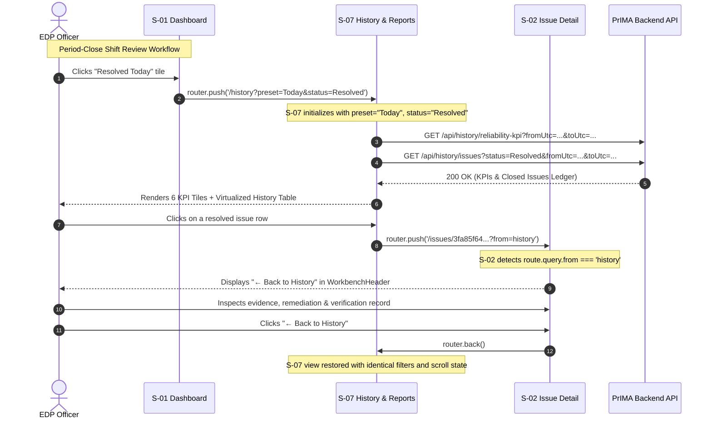

# 1. Overview

This architecture artifact defines the target technical realization for **PrIMA Stage 4: Historical Reliability Analytics, Reporting & v1.0 Quality Gate** (`Code: PRIMA-STAGE-4`, `Type: CHANGE-REQUEST`), delivering the **Feature-Complete PrIMA v1.0 Release Candidate** milestone specified in `docs/PRIMA-DEVELOPMENT-ROADMAP.md` and `docs/issues/IS004-PRIMA-STAGE-4-ISSUE.md`.

Stage 4 completes the functional scope of PrIMA by providing retrospective period-close reliability reporting, historical issue ledger auditing (`S-07`), cross-screen operational deep navigation (`S-01` -> `S-07` and `S-07` -> `S-02`), database indexing optimization for high-volume telemetry, and a consolidated full-stack automated quality gate enforcing every domain invariant (`BR-PRIMA-001` through `BR-PRIMA-010`) and frontend engineering standard prior to hospital pilot rollout (Stage 5).

This architecture realizes the complete set of approved decisions recorded in `docs/issues/IS004-PRIMA-STAGE-4-FEASIBILITY-ASSESSMENT.md` (`Status: READY-FOR-PLANNING`), preserves the foundational architecture established in `docs/PRIMA-ARCHITECTURE.md`, and complies strictly with `docs/PRIMA-UI-UX-GUIDELINE.md` and `docs/PRIMA-SCREEN-INVENTORY.md`.

---

# 2. Architectural Basis

## Business Context

PrIMA functions as the operational watchdog for Hospital Information Systems (SIMRS).
The business knowledge, operational workflows, and domain orchestration realized by this architecture are derived from:

- `docs/PRIMA-DOMAIN.md`: Ubiquitous Language, Aggregate Roots (`Detector`, `Issue`), Value Objects (`CorrelationKey`, `TelemetryEvidence`, `RemediationRecord`, `VerificationRecord`, `DismissalRecord`), and all 10 canonical business rules:
  - `BR-PRIMA-001`: Deterministic Anomaly Deduplication (active anomaly occurrence accumulation).
  - `BR-PRIMA-002`: Recurring Anomaly Reopening (automatic reopening of previously closed issues, resetting governance records).
  - `BR-PRIMA-003`: Dynamic Severity Escalation (unattended SLA breach escalation and recurrence threshold escalation).
  - `BR-PRIMA-004`: Mandatory Verification Gate (remediation and clean verification required prior to resolution).
  - `BR-PRIMA-005`: Fail-Safe Infrastructure Anomaly Synthesis (`SILENT:{id}` and `FAIL:{id}` synthetic issues).
  - `BR-PRIMA-006`: Dismissal Justification & Auditability (minimum 20 characters rationale).
  - `BR-PRIMA-007`: SIMRS Integration Protocol & Probe Ergonomics (lightweight probes with strict 15s execution timeout).
  - `BR-PRIMA-008`: Operational Attribution & Accountability (authenticated EDP officer capturing on all lifecycle mutations).
  - `BR-PRIMA-009`: Occurrence Immutability & Diagnostic Preservation (append-only observation history).
  - `BR-PRIMA-010`: Silence Detection & Heartbeat Invariants (2× cadence silence threshold and cadence-multiplied occurrences).
- `docs/PRIMA-USE-CASE-DISCOVERY.md`: Primary Use Cases:
  - `H-1`: View System Health Summary (Period-close reliability KPIs, pass rates, MTTA/MTTR, and Scope/Severity breakdowns).
  - `H-2`: View Issue History (Filterable historical issue ledger across all lifecycle statuses).
- `docs/PRIMA-SCREEN-INVENTORY.md`: Screen `S-07` (History & Reports, lines 362–389), `S-01` Issue Dashboard (Tile 5 deep link), and `S-02` Issue Detail Workbench (contextual back link).
- `docs/PRIMA-UI-UX-GUIDELINE.md`: Desktop-first layouts, pure CSS horizontal proportion bars (zero external chart libraries per §10), virtualized scrolling without pagination (§10), origin-aware back navigation, and regional `Asia/Jakarta` (`WIB`, UTC+7) temporal boundaries.

## Analysis Input

This architecture consumes and realizes the approved decisions from `docs/issues/IS004-PRIMA-STAGE-4-FEASIBILITY-ASSESSMENT.md` (`Status: READY-FOR-PLANNING`):

- `GAP-001` & `DEC-001`, `DEC-002`: Backend vertical slice `Features/History/GetReliabilityKpi` computing the 6 KPI metrics (`Total Issues`, `Resolution Rate %`, `Avg. Time to Acknowledge`, `Avg. Time to Resolve`, `Detector Pass Rate %`, `Reopened Issues`) and Scope/Severity breakdown counts.
- `GAP-002` & `DEC-003`, `DEC-004`, `DEC-007`: Backend vertical slice `Features/History/GetHistoricalIssues` with status-aware lifecycle date filtering, clamped query limits (`default: 500`, `max: 1000`), and ISO boundary parameters.
- `GAP-003`: Frontend feature slice `src/frontend/src/features/history/` (`S-07`) with Date Range presets (`Today`, `This Week`, `This Month`, `Last Month`, `Custom`), 6-tile KPI grid, pure CSS 2-column breakdown bars, and virtualized issue table.
- `GAP-004` & `DEC-005`: Cross-screen navigation contracts: active `Resolved Today` link on `S-01` (`/history?preset=Today&status=Resolved`), and `?from=history` origin tracking on `S-02` with dynamic `← Back to History` button restoring `S-07` state via `router.back()`.
- `GAP-005` & `DEC-006`: Database index optimization via DbUp migration `004_HistoryAndAnalyticsIndexes.sql` deploying covering and filtered indexes on `dbo.InspectionRuns` and `dbo.Issues`.
- `GAP-006` & `DEC-008`: Automated regression and compliance verification: `DomainBusinessRulesQualityGateTests.cs` covering all 10 domain business rules without skips, and an automated frontend audit asserting zero forbidden anti-patterns and zero cross-slice imports.

---

# 3. Scope

## In Scope (Stage 4)

1. **Database Schema & Indexing Evolution (`004_HistoryAndAnalyticsIndexes.sql`):**
   - Add covering index `IX_InspectionRuns_ExecutionTimestampUtc` on `dbo.InspectionRuns(ExecutionTimestampUtc DESC) INCLUDE (Outcome)`.
   - Add covering index `IX_Issues_CreatedAtUtc` on `dbo.Issues(CreatedAtUtc DESC) INCLUDE (Scope, CurrentSeverity, BaseSeverity, Status)`.
   - Add filtered indexes on `dbo.Issues`: `IX_Issues_ResolvedAtUtc`, `IX_Issues_AcknowledgedAtUtc`, `IX_Issues_ReopenedAtUtc`, and `IX_Issues_DismissedAtUtc` (`WHERE ... IS NOT NULL`).
2. **Backend Minimal API Endpoints & CQRS Projections (`Features/History/*`):**
   - `GET /api/history/reliability-kpi`: Parameterized aggregation query accepting `fromUtc` and `toUtc`, computing the 6 period-close KPI metrics and Scope/Severity distribution counts.
   - `GET /api/history/issues`: Parameterized filterable historical ledger query supporting `status` (`All`, `Resolved`, `Dismissed`, `Reopened`, active), `scope`, `detectorId`, `severity`, `search`, and date range with clamped limits (`default: 500`, `max: 1000`).
3. **Frontend Historical Reporting Slice (`src/frontend/src/features/history/`):**
   - `S-07 History & Reports` view (`/history`, strictly read-only):
     - Date Range Preset Bar (`Today`, `This Week`, `This Month`, `Last Month`, `Custom` + range picker).
     - 6-Tile KPI Grid (`font-mono tabular-nums`, null formatting as `—`).
     - 2-Column Scope & Severity Breakdown tables with pure CSS horizontal proportion bars.
     - Multi-attribute filter controls (Status, Scope, Detector, Severity, Search).
     - Virtualized historical issue table (zero pagination) routing to read-only `S-02`.
4. **Cross-Feature Integrations:**
   - `AppLayout.vue`: Activate `History & Reports` sidebar route (`/history`), update milestone version badges to `v1.0-rc`.
   - `SummaryCountersBar.vue` (`S-01`): Convert disabled `Resolved Today` tile into an active router link to `/history?preset=Today&status=Resolved`.
   - `WorkbenchHeader.vue` (`S-02`): Inspect `route.query.from === 'history'` to dynamically render `← Back to History` and return via `router.back()`.
   - `src/shared/utils/dateUtils.ts`: Add `getWibDateRange(preset, customRange?)` converting Indonesian hospital operational calendar boundaries (`Asia/Jakarta`, UTC+7) to exact UTC ISO boundaries.
5. **Full-Stack v1.0 Quality Gate Infrastructure:**
   - Dedicated backend test suite `DomainBusinessRulesQualityGateTests.cs` verifying `BR-PRIMA-001` through `BR-PRIMA-010` with zero skipped tests.
   - Automated frontend static compliance check verifying zero pagination, zero external charting libraries, zero native alerts/confirms, and zero cross-slice imports.

## Out of Scope (Deferred to Stage 5)

- **Stage 5:** Pilot SIMRS detector suite across real hospital modules (`BR-PRIMA-007`), on-premise production deployment hardening, hospital UAT, and hypercare rollout.

---

# 4. Technical Decisions

## 4.1 Realization of Approved Feasibility Decisions

The 8 gap-closure decisions approved in `IS004-PRIMA-STAGE-4-FEASIBILITY-ASSESSMENT.md` are realized as follows:

| Decision ID | Target GAP / OQ | Target Technical Architecture Realization |
|---|---|---|
| `DEC-001` | `GAP-001`, `OQ-001` | **Closed-Issues Basis for Resolution Rate & Creation Basis for Total Issues:** Total Issues = `COUNT(*) WHERE CreatedAtUtc >= @FromUtc AND CreatedAtUtc <= @ToUtc`. Resolution Rate % = `COUNT(Resolved in period) / (COUNT(Resolved in period) + COUNT(Dismissed in period)) * 100`. Returns `0.0%` if denominator is 0. Formatted to 1 decimal place. |
| `DEC-002` | `GAP-001`, `OQ-002` | **Event-Completion Cohort + Reopening Turnaround for MTTA/MTTR:** MTTA averages `DATEDIFF_BIG(second, CreatedAtUtc, AcknowledgedAtUtc)` for issues acknowledged in period. MTTR averages `DATEDIFF_BIG(second, COALESCE(ReopenedAtUtc, CreatedAtUtc), ResolvedAtUtc)` for issues resolved in period. Returned as decimal hours (or null if count=0, displayed as `—` on frontend). |
| `DEC-003` | `GAP-001`, `GAP-002`, `OQ-003` | **Frontend WIB-to-UTC Boundary Calculation:** API endpoints accept explicit ISO `fromUtc` and `toUtc` parameters. Frontend helper in `dateUtils.ts` computes exact `Asia/Jakarta` (WIB) calendar boundaries (00:00:00 to 23:59:59.999 WIB) and converts them to UTC ISO strings. Backend remains timezone-agnostic and executes index seeks on UTC `DATETIME2` columns. |
| `DEC-004` | `GAP-002`, `OQ-004` | **Status-Aware Lifecycle Date Filtering:** In `GetHistoricalIssuesHandler`, if `status == 'Resolved'`, filter by `ResolvedAtUtc BETWEEN @FromUtc AND @ToUtc`. If `Dismissed`, filter by `DismissedAtUtc`. If `Reopened`, filter by `ReopenedAtUtc`. If `All` or active statuses, filter by `CreatedAtUtc`. Prevents operational blind spots when auditing closed issues. |
| `DEC-005` | `GAP-004`, `OQ-005` | **Query Param Origin Tracking for S-02 Back Navigation:** S-07 appends `?from=history` when routing to `S-02` (`/issues/:id?from=history`). `WorkbenchHeader.vue` inspects `route.query.from === 'history'` to render `← Back to History` and navigate back via `router.back()` (fallback `router.push('/history')`), preserving S-07 date and filter states. |
| `DEC-006` | `GAP-005`, `OQ-006` | **DbUp 004 Covering & Filtered Indexes:** Deploy `004_HistoryAndAnalyticsIndexes.sql` with covering index on `InspectionRuns(ExecutionTimestampUtc)` and filtered indexes on `Issues(ResolvedAtUtc)`, `Issues(AcknowledgedAtUtc)`, `Issues(ReopenedAtUtc)`, `Issues(DismissedAtUtc)`, and `Issues(CreatedAtUtc)`. Ensures sub-second execution under 1,000+ rows. |
| `DEC-007` | `GAP-002`, `GAP-003`, `OQ-007` | **Clamped Result Limit (Default 500, Max 1000) & Virtualized Scrolling:** `GetHistoricalIssues` clamps `limit` between 1 and 1000 (default 500) to protect backend memory and network transfer. S-07 renders rows using zero-pagination virtualized scrolling (`DataTable` with virtual scroll or `VirtualScroller`). |
| `DEC-008` | `GAP-006`, `OQ-008` | **Dedicated Quality Gate Test Suites:** Create `DomainBusinessRulesQualityGateTests.cs` in `PrIMA.Api.Tests` explicitly asserting all 10 domain business rules (`BR-PRIMA-001` through `BR-PRIMA-010`) without skipped tests. Add an automated frontend compliance check asserting zero forbidden anti-patterns and zero cross-slice imports. |

---

## 4.2 Backend History CQRS Architecture (`Features/History/*`)

Historical analytics strictly follow the mandatory CQRS Read Model: queries bypass domain aggregates and execute optimized Dapper queries directly against database indexes, mapping results straight to strongly typed DTOs.

```text
src/backend/PrIMA.Api/Features/History/
├── HistoryEndpoints.cs                 # Endpoint route mapper extension
├── GetReliabilityKpi/
│   ├── GetReliabilityKpiEndpoint.cs    # GET /api/history/reliability-kpi
│   ├── GetReliabilityKpiQuery.cs       # Record with FromUtc, ToUtc
│   ├── GetReliabilityKpiValidator.cs   # FluentValidation rule (FromUtc <= ToUtc)
│   ├── GetReliabilityKpiResponse.cs    # 6 KPI metrics + Scope/Severity breakdown DTOs
│   └── GetReliabilityKpiHandler.cs     # Dapper aggregation query
└── GetHistoricalIssues/
    ├── GetHistoricalIssuesEndpoint.cs  # GET /api/history/issues
    ├── GetHistoricalIssuesQuery.cs     # Query parameters (date range, status, filters, limit)
    ├── GetHistoricalIssuesValidator.cs # FluentValidation rules
    ├── GetHistoricalIssuesResponse.cs  # Paged/Clamped result DTO
    └── GetHistoricalIssuesHandler.cs   # Dynamic parameterized SQL with status-aware date filter
```

### 4.2.1 Parameterized Aggregation Logic (`GetReliabilityKpiHandler`)

The handler executes two efficient Dapper queries using database indexes:

```sql
-- Query 1: Issue Analytics & KPI Aggregates
SELECT
    -- Total Issues created in period (DEC-001)
    COUNT(CASE WHEN CreatedAtUtc >= @FromUtc AND CreatedAtUtc <= @ToUtc THEN 1 END) AS TotalIssuesCreated,

    -- Resolution Rate % components (DEC-001)
    COUNT(CASE WHEN Status = 'Resolved' AND ResolvedAtUtc >= @FromUtc AND ResolvedAtUtc <= @ToUtc THEN 1 END) AS ResolvedInPeriod,
    COUNT(CASE WHEN Status = 'Dismissed' AND DismissedAtUtc >= @FromUtc AND DismissedAtUtc <= @ToUtc THEN 1 END) AS DismissedInPeriod,

    -- MTTA: Avg hours from creation to acknowledgement for issues acknowledged in period (DEC-002)
    AVG(CASE 
        WHEN AcknowledgedAtUtc >= @FromUtc AND AcknowledgedAtUtc <= @ToUtc 
        THEN CAST(DATEDIFF_BIG(second, CreatedAtUtc, AcknowledgedAtUtc) AS FLOAT) / 3600.0 
    END) AS AvgTimeToAcknowledgeHours,

    -- MTTR: Avg hours from latest reopening/creation to resolution for issues resolved in period (DEC-002)
    AVG(CASE 
        WHEN Status = 'Resolved' AND ResolvedAtUtc >= @FromUtc AND ResolvedAtUtc <= @ToUtc 
        THEN CAST(DATEDIFF_BIG(second, COALESCE(ReopenedAtUtc, CreatedAtUtc), ResolvedAtUtc) AS FLOAT) / 3600.0 
    END) AS AvgTimeToResolveHours,

    -- Reopened Issues in period
    COUNT(CASE WHEN ReopenedAtUtc >= @FromUtc AND ReopenedAtUtc <= @ToUtc THEN 1 END) AS ReopenedIssuesCount
FROM dbo.Issues;

-- Query 2: Detector Pass Rate % across all inspection runs in period
SELECT
    COUNT(*) AS TotalRuns,
    COUNT(CASE WHEN Outcome = 'Passed' THEN 1 END) AS PassedRuns
FROM dbo.InspectionRuns
WHERE ExecutionTimestampUtc >= @FromUtc AND ExecutionTimestampUtc <= @ToUtc;

-- Query 3: Scope Breakdown (issues created in period)
SELECT
    Scope,
    COUNT(*) AS [Count]
FROM dbo.Issues
WHERE CreatedAtUtc >= @FromUtc AND CreatedAtUtc <= @ToUtc
GROUP BY Scope;

-- Query 4: Severity Breakdown (issues created in period)
SELECT
    CurrentSeverity AS Severity,
    COUNT(*) AS [Count]
FROM dbo.Issues
WHERE CreatedAtUtc >= @FromUtc AND CreatedAtUtc <= @ToUtc
GROUP BY CurrentSeverity;
```

#### Resolution Rate & Pass Rate Computation:
- `ResolutionRatePercentage`: If `(ResolvedInPeriod + DismissedInPeriod) == 0`, returns `0.0`. Otherwise `Math.Round((double)ResolvedInPeriod / (ResolvedInPeriod + DismissedInPeriod) * 100.0, 1)`.
- `DetectorPassRatePercentage`: If `TotalRuns == 0`, returns `100.0`. Otherwise `Math.Round((double)PassedRuns / TotalRuns * 100.0, 1)`.

### 4.2.2 Status-Aware Historical Ledger Query (`GetHistoricalIssuesHandler`)

The handler clamps `limit` between 1 and 1000 (`Math.Clamp(query.Limit ?? 500, 1, 1000)`) and dynamically constructs the SQL filter clause based on `query.Status` (`DEC-004`):

```csharp
var sqlBuilder = new StringBuilder("""
    SELECT
        Id,
        CorrelationKey,
        Title,
        DetectorId,
        DetectorName,
        Scope,
        CurrentSeverity,
        SeverityRank,
        Status,
        EscalationLevel,
        OccurrenceCount,
        CurrentAssignee,
        CreatedAtUtc,
        ResolvedAtUtc,
        DismissedAtUtc,
        ReopenedAtUtc,
        AcknowledgedAtUtc,
        LastOccurrenceAtUtc
    FROM dbo.Issues
    WHERE 1 = 1
""");

// Status-Aware Date Range Filtering (DEC-004)
if (string.Equals(query.Status, "Resolved", StringComparison.OrdinalIgnoreCase))
{
    sqlBuilder.Append(" AND ResolvedAtUtc >= @FromUtc AND ResolvedAtUtc <= @ToUtc");
}
else if (string.Equals(query.Status, "Dismissed", StringComparison.OrdinalIgnoreCase))
{
    sqlBuilder.Append(" AND DismissedAtUtc >= @FromUtc AND DismissedAtUtc <= @ToUtc");
}
else if (string.Equals(query.Status, "Reopened", StringComparison.OrdinalIgnoreCase))
{
    sqlBuilder.Append(" AND ReopenedAtUtc >= @FromUtc AND ReopenedAtUtc <= @ToUtc");
}
else
{
    // 'All' or active status filters evaluate CreatedAtUtc
    sqlBuilder.Append(" AND CreatedAtUtc >= @FromUtc AND CreatedAtUtc <= @ToUtc");
}

if (!string.IsNullOrWhiteSpace(query.Status) && !string.Equals(query.Status, "All", StringComparison.OrdinalIgnoreCase))
{
    sqlBuilder.Append(" AND Status = @Status");
}
if (!string.IsNullOrWhiteSpace(query.Scope) && !string.Equals(query.Scope, "All", StringComparison.OrdinalIgnoreCase))
{
    sqlBuilder.Append(" AND Scope = @Scope");
}
if (query.DetectorId.HasValue && query.DetectorId.Value != Guid.Empty)
{
    sqlBuilder.Append(" AND DetectorId = @DetectorId");
}
if (!string.IsNullOrWhiteSpace(query.Severity) && !string.Equals(query.Severity, "All", StringComparison.OrdinalIgnoreCase))
{
    sqlBuilder.Append(" AND CurrentSeverity = @Severity");
}
if (!string.IsNullOrWhiteSpace(query.Search))
{
    sqlBuilder.Append(" AND (Title LIKE @SearchPattern OR DetectorName LIKE @SearchPattern OR CorrelationKey LIKE @SearchPattern)");
}

sqlBuilder.Append(" ORDER BY LastOccurrenceAtUtc DESC OFFSET 0 ROWS FETCH NEXT @FetchLimit ROWS ONLY;");
```

---

## 4.3 Frontend Feature Slice Architecture (`src/features/history/`)

The frontend slice follows the standard feature anatomy with strictly zero cross-feature imports:

```text
src/frontend/src/features/history/
├── api/
│   ├── history.keys.ts             # TanStack Query key factory
│   └── useHistoryQueries.ts        # useReliabilityKpiQuery & useHistoricalIssuesQuery
├── components/
│   ├── DateRangePresetBar.vue      # Presets (Today, This Week, This Month, Last Month, Custom) + DatePicker
│   ├── ReliabilityKpiGrid.vue      # 6 KPI tiles (font-mono tabular-nums, null formatting)
│   ├── ScopeSeverityBreakdown.vue  # Pure CSS horizontal proportion bars
│   ├── HistoryIssueFilters.vue     # Status chips, Scope/Detector/Severity dropdowns, search input
│   └── HistoryIssueTable.vue       # Zero-pagination virtualized DataTable with S-02 navigation
├── types/
│   └── history.types.ts            # View filter contracts & preset types
└── views/
    └── HistoryView.vue             # S-07 route orchestrator (Read-Only)
```

### 4.3.1 Date Presets & Operational Timezone Anchoring (`dateUtils.ts`)

To avoid timezone bugs where issues created or closed near midnight WIB appear under the wrong date, the frontend helper `getWibDateRange` computes explicit start and end UTC timestamps:

```typescript
export type DatePreset = 'Today' | 'This Week' | 'This Month' | 'Last Month' | 'Custom';

export interface UtcDateRange {
  fromUtc: string; // ISO 8601 UTC
  toUtc: string;   // ISO 8601 UTC
}

export function getWibDateRange(preset: DatePreset, customRange?: [Date | null, Date | null]): UtcDateRange {
  const now = new Date();
  // Compute current date components in Asia/Jakarta (WIB = UTC+7)
  const wibFormatter = new Intl.DateTimeFormat('en-CA', {
    timeZone: 'Asia/Jakarta',
    year: 'numeric',
    month: '2-digit',
    day: '2-digit',
  });
  const todayWibStr = wibFormatter.format(now); // "YYYY-MM-DD"
  const [year, month, day] = todayWibStr.split('-').map(Number);

  let startWib: Date;
  let endWib: Date;

  switch (preset) {
    case 'Today': {
      // 00:00:00.000 WIB to 23:59:59.999 WIB
      startWib = new Date(Date.UTC(year, month - 1, day, 0, 0, 0, 0) - 7 * 3600 * 1000);
      endWib = new Date(Date.UTC(year, month - 1, day, 23, 59, 59, 999) - 7 * 3600 * 1000);
      break;
    }
    case 'This Week': {
      // Monday of current week WIB to end of today WIB
      const todayDate = new Date(Date.UTC(year, month - 1, day));
      const dayOfWeek = todayDate.getUTCDay(); // 0 is Sun, 1 is Mon
      const diffToMonday = dayOfWeek === 0 ? 6 : dayOfWeek - 1;
      const mondayDate = new Date(todayDate.getTime() - diffToMonday * 86400000);
      startWib = new Date(mondayDate.getTime() - 7 * 3600 * 1000);
      endWib = new Date(Date.UTC(year, month - 1, day, 23, 59, 59, 999) - 7 * 3600 * 1000);
      break;
    }
    case 'This Month': {
      // 1st day of month 00:00:00 WIB to end of today WIB
      startWib = new Date(Date.UTC(year, month - 1, 1, 0, 0, 0, 0) - 7 * 3600 * 1000);
      endWib = new Date(Date.UTC(year, month - 1, day, 23, 59, 59, 999) - 7 * 3600 * 1000);
      break;
    }
    case 'Last Month': {
      // 1st day of last month to last day of last month
      const lastMonthYear = month === 1 ? year - 1 : year;
      const lastMonthIndex = month === 1 ? 11 : month - 2;
      const lastDayOfLastMonth = new Date(Date.UTC(lastMonthYear, lastMonthIndex + 1, 0)).getUTCDate();
      startWib = new Date(Date.UTC(lastMonthYear, lastMonthIndex, 1, 0, 0, 0, 0) - 7 * 3600 * 1000);
      endWib = new Date(Date.UTC(lastMonthYear, lastMonthIndex, lastDayOfLastMonth, 23, 59, 59, 999) - 7 * 3600 * 1000);
      break;
    }
    case 'Custom': {
      if (customRange && customRange[0] && customRange[1]) {
        startWib = new Date(customRange[0].setHours(0, 0, 0, 0));
        endWib = new Date(customRange[1].setHours(23, 59, 59, 999));
      } else {
        startWib = new Date(Date.UTC(year, month - 1, day, 0, 0, 0, 0) - 7 * 3600 * 1000);
        endWib = new Date(Date.UTC(year, month - 1, day, 23, 59, 59, 999) - 7 * 3600 * 1000);
      }
      break;
    }
  }

  return {
    fromUtc: startWib.toISOString(),
    toUtc: endWib.toISOString(),
  };
}
```

### 4.3.2 Pure CSS Horizontal Proportion Bars (`ScopeSeverityBreakdown.vue`)

Per `PRIMA-UI-UX-GUIDELINE.md §10`, external charting libraries (`Chart.js`, `ECharts`) are strictly forbidden. The breakdown tables render proportions using native Tailwind CSS classes:

```html
<!-- Example pure CSS proportion row -->
<div class="flex items-center justify-between text-xs py-1.5">
  <span class="w-36 truncate font-medium text-slate-700">{{ item.name }}</span>
  <div class="flex-1 mx-3 h-2 bg-slate-100 rounded-full overflow-hidden">
    <div
      class="h-full rounded-full transition-all duration-500"
      :class="item.colorClass"
      :style="{ width: `${item.percentage}%` }"
    ></div>
  </div>
  <span class="w-12 text-right font-mono font-semibold text-slate-900 tabular-nums">
    {{ item.count }}
  </span>
  <span class="w-12 text-right font-mono text-slate-500 tabular-nums">
    {{ item.percentage.toFixed(1) }}%
  </span>
</div>
```

---

# 5. Component Responsibilities

| Component | Responsibility |
|---|---|
| `GetReliabilityKpiEndpoint` | Maps `GET /api/history/reliability-kpi` with Swagger docs, JWT authorization, and RFC 7807 problem details. |
| `GetReliabilityKpiHandler` | Executes Dapper aggregation queries calculating the 6 KPI metrics, closed-issue resolution rate, MTTA/MTTR, and breakdowns. |
| `GetHistoricalIssuesEndpoint` | Maps `GET /api/history/issues` with parameters for date range, status, filters, and clamped limit. |
| `GetHistoricalIssuesHandler` | Constructs dynamic parameterized SQL with status-aware lifecycle date filtering and limit clamping. |
| `DbUp Migration 004` | Applies covering and filtered indexes on `dbo.InspectionRuns` and `dbo.Issues` at backend startup. |
| `DomainBusinessRulesQualityGateTests` | Automated integration suite asserting all 10 domain business rules (`BR-PRIMA-001`–`BR-PRIMA-010`) without skips. |
| `dateUtils.ts` (`getWibDateRange`) | Translates calendar presets to UTC ISO strings respecting `Asia/Jakarta` (WIB) midnight boundaries. |
| `HistoryView.vue` (`S-07`) | Orchestrates date controls, KPI tiles, breakdown proportion bars, and virtualized historical issue table. |
| `ReliabilityKpiGrid.vue` | Renders 6 KPI tiles with monospace numbers, null handling (`—`), and pass rate color coding. |
| `ScopeSeverityBreakdown.vue` | Renders 2-column breakdown count tables with pure CSS horizontal progress bars. |
| `HistoryIssueTable.vue` | Renders filterable issue rows in a virtualized table (zero pagination) routing to read-only `S-02`. |
| `SummaryCountersBar.vue` (`S-01`) | Converts `Resolved Today` tile into a clickable link to `/history?preset=Today&status=Resolved`. |
| `WorkbenchHeader.vue` (`S-02`) | Detects `route.query.from === 'history'` to render `← Back to History` and navigate back via `router.back()`. |
| `AppLayout.vue` | Activates `History & Reports` sidebar item and updates version badges to `v1.0-rc`. |

---

# 6. Integration Design

## 6.1 Component Collaborations & Data Flow

| Source | Target | Purpose | Protocol / Contract |
|---|---|---|---|
| `S-01 Dashboard` | `S-07 History` | Deep-link navigation for "Resolved Today" audit | Vue Router: `/history?preset=Today&status=Resolved` |
| `S-07 History` | `S-02 Detail` | Deep audit navigation to view closed issue details | Vue Router: `/issues/:id?from=history` |
| `S-02 Detail` | `S-07 History` | Context-preserving return back to audit view | `router.back()` (preserves date presets and active filters) |
| `S-07 HistoryView` | `GetReliabilityKpi` | Fetch period-close metrics and breakdowns | HTTP GET `/api/history/reliability-kpi?fromUtc=...&toUtc=...` |
| `S-07 HistoryView` | `GetHistoricalIssues` | Fetch filtered historical issue ledger | HTTP GET `/api/history/issues?fromUtc=...&toUtc=...&status=...` |
| `History Handlers` | SQL Server | Execute index-backed aggregation and queries | Dapper SQL queries over `dbo.Issues` and `dbo.InspectionRuns` |
| Backend Startup | SQL Server | Deploy schema indexes via embedded migration | DbUp `004_HistoryAndAnalyticsIndexes.sql` |

## 6.2 Navigation Origin & State Preservation Sequence



---

# 7. Data Ownership

| Data Concept | Owning Component / Entity | Persistence Table | Invariants & Access Rules |
|---|---|---|---|
| Historical Reliability KPIs | `GetReliabilityKpiHandler` | Dynamically computed | Read-only CQRS projection; no state mutations. |
| Historical Issue Ledger | `GetHistoricalIssuesHandler` | `dbo.Issues` | Filtered projection; clamped to max 1000 rows. |
| Performance Indexes | `DbUp MigrationRunner` | `dbo.sys.indexes` | Created idempotently on application bootstrap. |
| Date Boundary Calculations | `src/shared/utils/dateUtils.ts` | Ephemeral (Frontend) | Standardized conversion from WIB calendar to UTC ISO. |
| Origin Navigation State | `Vue Router` (`route.query.from`) | Ephemeral (Browser history) | Preserved across S-07 and S-02 transitions via `router.back()`. |

---

# 8. Database Design

## 8.1 Schema Index Migration (`004_HistoryAndAnalyticsIndexes.sql`)

Stage 4 introduces DbUp script `src/backend/PrIMA.Api/Migrations/Scripts/004_HistoryAndAnalyticsIndexes.sql`:

```sql
-- Migration: 004_HistoryAndAnalyticsIndexes.sql
-- Purpose: Optimize historical reliability analytics and ledger filtering for Stage 4

-- 1. Covering index for period-close detector pass rate queries
IF NOT EXISTS (SELECT 1 FROM sys.indexes WHERE name = 'IX_InspectionRuns_ExecutionTimestampUtc' AND object_id = OBJECT_ID('dbo.InspectionRuns'))
BEGIN
    CREATE NONCLUSTERED INDEX IX_InspectionRuns_ExecutionTimestampUtc
    ON dbo.InspectionRuns (ExecutionTimestampUtc DESC)
    INCLUDE (Outcome);
END;

-- 2. Covering index for issue creation volume and scope/severity breakdown
IF NOT EXISTS (SELECT 1 FROM sys.indexes WHERE name = 'IX_Issues_CreatedAtUtc' AND object_id = OBJECT_ID('dbo.Issues'))
BEGIN
    CREATE NONCLUSTERED INDEX IX_Issues_CreatedAtUtc
    ON dbo.Issues (CreatedAtUtc DESC)
    INCLUDE (Scope, CurrentSeverity, BaseSeverity, Status);
END;

-- 3. Filtered index for Resolved issues (MTTR & Resolution Rate queries)
IF NOT EXISTS (SELECT 1 FROM sys.indexes WHERE name = 'IX_Issues_ResolvedAtUtc' AND object_id = OBJECT_ID('dbo.Issues'))
BEGIN
    CREATE NONCLUSTERED INDEX IX_Issues_ResolvedAtUtc
    ON dbo.Issues (ResolvedAtUtc DESC)
    INCLUDE (CreatedAtUtc, ReopenedAtUtc, CurrentSeverity, Scope, DetectorId, Status)
    WHERE ResolvedAtUtc IS NOT NULL;
END;

-- 4. Filtered index for Acknowledged issues (MTTA queries)
IF NOT EXISTS (SELECT 1 FROM sys.indexes WHERE name = 'IX_Issues_AcknowledgedAtUtc' AND object_id = OBJECT_ID('dbo.Issues'))
BEGIN
    CREATE NONCLUSTERED INDEX IX_Issues_AcknowledgedAtUtc
    ON dbo.Issues (AcknowledgedAtUtc DESC)
    INCLUDE (CreatedAtUtc)
    WHERE AcknowledgedAtUtc IS NOT NULL;
END;

-- 5. Filtered index for Reopened issues
IF NOT EXISTS (SELECT 1 FROM sys.indexes WHERE name = 'IX_Issues_ReopenedAtUtc' AND object_id = OBJECT_ID('dbo.Issues'))
BEGIN
    CREATE NONCLUSTERED INDEX IX_Issues_ReopenedAtUtc
    ON dbo.Issues (ReopenedAtUtc DESC)
    INCLUDE (CreatedAtUtc, Status)
    WHERE ReopenedAtUtc IS NOT NULL;
END;

-- 6. Filtered index for Dismissed issues (Resolution Rate denominator)
IF NOT EXISTS (SELECT 1 FROM sys.indexes WHERE name = 'IX_Issues_DismissedAtUtc' AND object_id = OBJECT_ID('dbo.Issues'))
BEGIN
    CREATE NONCLUSTERED INDEX IX_Issues_DismissedAtUtc
    ON dbo.Issues (DismissedAtUtc DESC)
    INCLUDE (CreatedAtUtc, Status)
    WHERE DismissedAtUtc IS NOT NULL;
END;
```

## 8.2 Query Execution Plan Optimization

1. **KPI Aggregation (`GetReliabilityKpi`):**
   - Pass rate calculation performs an index seek / range scan on `IX_InspectionRuns_ExecutionTimestampUtc` with zero table lookups (`Outcome` is included).
   - MTTR calculation seeks `IX_Issues_ResolvedAtUtc` directly, evaluating only the non-null resolved cohort in the period.
   - MTTA calculation seeks `IX_Issues_AcknowledgedAtUtc` directly, evaluating only acknowledged issues.
   - Total issues and breakdown counts perform an index seek on `IX_Issues_CreatedAtUtc`.
2. **Historical Ledger Query (`GetHistoricalIssues`):**
   - When filtering by `Resolved`, the query seeks `IX_Issues_ResolvedAtUtc`.
   - When filtering by `Dismissed`, the query seeks `IX_Issues_DismissedAtUtc`.
   - When filtering by `All` or active statuses, the query seeks `IX_Issues_CreatedAtUtc`.
   - Result clamping (`FETCH NEXT @Limit ROWS ONLY`) guarantees bounded buffer memory and prevents full table scans.

---

# 9. Cross-Cutting Concerns

## 9.1 Security & Operational Attribution (`BR-PRIMA-008`)

- All `/api/history/*` endpoints require valid JWT Bearer tokens (`[Authorize]`).
- The `S-07` screen is strictly read-only; no state mutating controls or actions are exposed.
- Viewing closed issues in `S-02` renders the screen in read-only mode, with action buttons hidden and historical audit trails intact.

## 9.2 Timezone & Operational Calendar Boundaries

- All backend database records store timestamps in UTC (`DATETIME2`).
- The frontend `getWibDateRange` utility calculates calendar start and end moments anchored to Indonesian hospital business hours in `Asia/Jakarta` (`WIB`, UTC+7):
  - Today: `00:00:00.000 WIB` to `23:59:59.999 WIB` converted to UTC ISO strings.
- Frontend displays timestamps using `formatWibDateTime`, providing consistent local context across `S-01` through `S-07`.

## 9.3 Performance & Anti-Pattern Verification

- **Zero-Pagination Enforcement:** In accordance with `PRIMA-UI-UX-GUIDELINE.md §10`, pagination is prohibited across all audit feeds (`S-01`, `S-03`, `S-06`, `S-07`). Rows are rendered using virtual scrolling (`DataTable` with virtual scroll or `VirtualScroller`).
- **Strict Non-Charting Constraint:** External charting dependencies (`Chart.js`, `ECharts`, etc.) are prohibited. Proportions are displayed via pure Tailwind CSS horizontal bars.
- **Client Stability:** Query results are clamped to a maximum of 1,000 records on the server (`DEC-007`), preventing DOM exhaustion and browser crashes.

## 9.4 Full-Stack v1.0 Quality Gate Infrastructure (`DEC-008`)

### 9.4.1 Backend Quality Gate Test Suite (`DomainBusinessRulesQualityGateTests.cs`)

Located in `src/backend/PrIMA.Api.Tests/Integration/DomainBusinessRulesQualityGateTests.cs`, this class runs against the test database and asserts all 10 domain business rules without skips:

| Rule | Assertion Verified in Quality Gate Suite |
|---|---|
| `BR-PRIMA-001` | Ingesting duplicate finding with matching `CorrelationKey` appends occurrence; does not duplicate `dbo.Issues`. |
| `BR-PRIMA-002` | Ingesting finding on `Resolved` or `Dismissed` issue transitions status to `Reopened`, marks prior governance records `IsSuperseded = 1`, resets assignee, and creates occurrence. |
| `BR-PRIMA-003` | Unacknowledged `Open` issues past SLA timeout elevate severity (+1 step); issues with `>= 5` occurrences elevate severity, capped at `Critical`. |
| `BR-PRIMA-004` | `ResolveIssue` fails with 409 Conflict if no `CleanPassed` verification record exists; succeeds once clean verification is recorded. |
| `BR-PRIMA-005` | Missed heartbeat creates `SILENT:{id}` issue; failed run creates `FAIL:{id}` issue. |
| `BR-PRIMA-006` | `DismissIssue` fails with 422 if rationale length `< 20` characters; succeeds with rationale `>= 20`. |
| `BR-PRIMA-007` | Webhook client enforces 15-second timeout; timeout records `ExecutionFailed` and returns 504 ProblemDetails. |
| `BR-PRIMA-008` | Authenticated officer name is deterministically recorded across `dbo.IssueActivityLogs`, remediation, verification, and dismissal. |
| `BR-PRIMA-009` | Sequential occurrences (#1, #2, #3) are immutable; telemetry evidence snapshot is preserved intact. |
| `BR-PRIMA-010` | Detector health transitions to `Silent` after `2.0 * ExpectedCadenceSeconds`; prolonged silence adds occurrences at cadence multiples (3×, 4×...). |

### 9.4.2 Frontend Static Compliance Audit

An automated static audit test in `src/frontend/` verifies:
- Zero `paginator` props on `S-01`, `S-03`, `S-06`, `S-07` components.
- Zero imports of external charting libraries (`chart.js`, `echarts`, etc.).
- Zero calls to native `window.alert()` or `window.confirm()`.
- Zero cross-slice imports between `src/features/{auth,dashboard,issues,detectors,history}/`.

---

# 10. Implementation Constraints

1. **Framework & Minimal API Boundaries:**
   - History endpoints must be implemented using .NET 8 Minimal APIs in `src/backend/PrIMA.Api/Features/History/`.
   - Use Dapper exclusively for aggregation and query projections; no Entity Framework.
2. **Timezone Cleanliness:**
   - The backend API must remain timezone-agnostic, accepting explicit UTC ISO parameters `fromUtc` and `toUtc`. All calendar boundary calculations belong in frontend `dateUtils.ts`.
3. **Frontend Slice Isolation:**
   - All history views and components must reside in `src/frontend/src/features/history/`.
   - Strictly zero cross-feature imports. Cross-screen navigation must occur strictly via Vue Router (`router.push` / `router.back`).
4. **Contract Synchronization:**
   - Frontend TypeScript types must be regenerated from `/swagger/v1/swagger.json` via `npm run codegen:api` into `src/shared/types/api.generated.ts`. Zero manual edits to generated types.
5. **No External Charting:**
   - `S-07` Scope and Severity breakdown must use pure CSS horizontal proportion bars. External charting libraries are forbidden.
6. **DbUp Idempotency:**
   - `004_HistoryAndAnalyticsIndexes.sql` must check `IF NOT EXISTS` for all index creations to guarantee safe re-execution.

---

# 11. Acceptance Conditions

The implementation of Stage 4 is architecturally complete when:

1. **Database Schema & Indexes (`004_HistoryAndAnalyticsIndexes.sql`):**
   - Covering index `IX_InspectionRuns_ExecutionTimestampUtc` and covering index `IX_Issues_CreatedAtUtc` are deployed.
   - Filtered indexes on `dbo.Issues` (`ResolvedAtUtc`, `AcknowledgedAtUtc`, `ReopenedAtUtc`, `DismissedAtUtc`) are deployed and active.
2. **Backend History Endpoints (`Features/History/*`):**
   - `GET /api/history/reliability-kpi` correctly computes the 6 KPI metrics, closed-issue resolution rate, MTTA/MTTR, and Scope/Severity breakdowns.
   - `GET /api/history/issues` filters historical issues with status-aware lifecycle date filtering and enforces limit clamping (max 1,000).
   - Both endpoints validate parameters using FluentValidation and return RFC 7807 problem details on invalid input.
3. **Frontend History Slice (`S-07`):**
   - Route `/history` is accessible to authenticated officers via sidebar navigation in `AppLayout.vue`.
   - Date range controls offer presets (`Today`, `This Week`, `This Month`, `Last Month`, `Custom`) and calculate accurate UTC ISO boundaries based on `Asia/Jakarta` (WIB).
   - 6-tile KPI grid renders monospace metrics and formats nulls as `—`.
   - Scope and Severity breakdowns render using pure CSS horizontal proportion bars without external charting libraries.
   - Issue table renders via zero-pagination virtualized scrolling and navigates to read-only `S-02`.
4. **Cross-Feature Integrations:**
   - Clicking `Resolved Today` on `S-01` navigates directly to `/history?preset=Today&status=Resolved`.
   - Navigating from `S-07` to `S-02` appends `?from=history`, renders `← Back to History` in `WorkbenchHeader.vue`, and navigates back via `router.back()`, preserving filter state.
   - App version badges in `AppLayout.vue` are updated to `v1.0-rc`.
5. **Quality Gate Verification:**
   - `DomainBusinessRulesQualityGateTests.cs` passes with zero skipped tests, asserting compliance across `BR-PRIMA-001` through `BR-PRIMA-010`.
   - Frontend compliance audit passes with zero forbidden anti-patterns and zero cross-slice imports.
