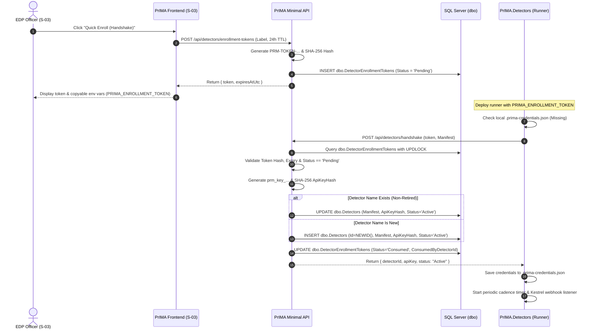
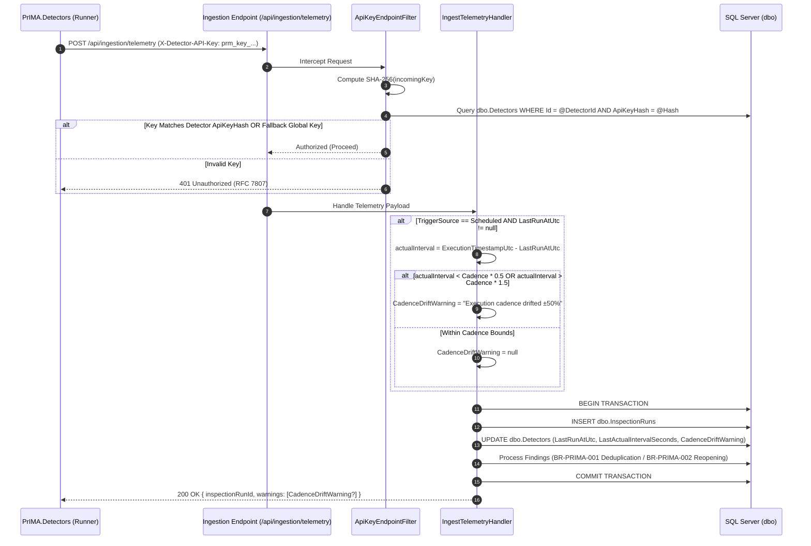

# 1. Overview

This architecture artifact defines the target technical realization for **PrIMA Stage 5: Detector Handshake Protocol, Pilot SIMRS Detector Suite & Hospital Production Rollout** (`Code: PRIMA-STAGE-5`, `Type: CHANGE-REQUEST`), delivering the final **Hospital On-Premise Production Go-Live & Automated Detector Enrollment** milestone specified in `docs/PRIMA-DEVELOPMENT-ROADMAP.md` and `docs/issues/IS005-PRIMA-STAGE-5-ISSUE.md`.

Stage 5 completes the productionization of PrIMA as the autonomous operational watchdog for Hospital Information Systems (SIMRS) by establishing:
1. **Zero-Drift Detector Enrollment & Handshake Protocol:** Short-lived cryptographic enrollment tokens (`PRM-TOKEN-...`) generated by EDP officers, paired with an automated manifest handshake endpoint (`POST /api/detectors/handshake`) that auto-registers edge detectors, provisions unique per-detector API keys (`ApiKeyHash`), and enables idempotent runtime manifest upgrades without configuration drift.
2. **Standardized .NET 8 Reference Detector SDK & Pilot SIMRS Detector Suite (`src/backend/PrIMA.Detectors/`):** A compiled .NET 8 C# WebApplication/Worker Service project hosting the reusable SDK (`IDetectorProbe`, `BootstrapHandshakeService`, `TelemetryIngestionClient`, exception/timeout trapping into `BR-PRIMA-005` `ExecutionFailed`, and Kestrel `/webhooks/{detectorKey}` endpoints) and 6 production pilot SIMRS detectors across all 4 monitoring scopes (`DataIntegrity`, `ProcessIntegrity`, `DataSync`, `Infrastructure`) executing real Dapper SQL queries.
3. **Non-Intrusive Safety & Read-Only Connection Guardrails (`BR-PRIMA-007`):** Programmatic `ReadOnlySimrsConnectionFactory` enforcing `ApplicationIntent=ReadOnly`, `SET TRANSACTION ISOLATION LEVEL READ UNCOMMITTED`, `SET LOCK_TIMEOUT 2000`, 5-second `CommandTimeout`, and static DML/DDL SQL rejection (`SimrsSqlSafetyGuard`), verified by automated xUnit non-interference tests (`SimrsNonInterferenceSafetyTests.cs`).
4. **Cadence Drift Detection & Silence Boundary Protection:** Automated calculation of interval divergence (`±50%` on scheduled runs) during telemetry ingestion, surfacing non-blocking warnings on `S-03` and `S-04` while enforcing cadence bounds (`30 <= expectedCadenceSeconds <= 86400`) to guarantee silence supervision (`BR-PRIMA-010`).
5. **Frontend Enrollment & Canonical Scope Alignment:** Quick Enroll modal and Pending Enrollment Tokens strip with revocation on `S-03`, automated handshake mode switcher on `S-05`, and alignment of detector form schemas to canonical `MonitoringScope` enum values.
6. **On-Premise Deployment Bundle & Operational Runbooks:** Complete `deploy/` packaging (reverse-proxy TLS configurations, Docker Compose, Windows Service scripts, DBA read-only provisioning, SQL retention routines), deep SQL Server health check on `GET /api/health`, automated 90-day retention pruning of clean `Passed` inspection runs in `MonitoringSupervisorWorker`, and EDP operational runbooks (`docs/operations/`).

This architecture realizes the complete set of approved decisions recorded in `docs/issues/IS005-PRIMA-STAGE-5-FEASIBILITY-ASSESSMENT.md` (`Status: READY-FOR-PLANNING`), respects the foundational architecture established in `docs/PRIMA-ARCHITECTURE.md`, and complies strictly with `docs/PRIMA-UI-UX-GUIDELINE.md` and `docs/PRIMA-SCREEN-INVENTORY.md`.

---

# 2. Architectural Basis

## Business Context

PrIMA functions as the operational integrity guardian for Hospital Information Systems (SIMRS). The business knowledge, operational workflows, and domain orchestration realized by this architecture are derived from:

- `docs/PRIMA-DOMAIN.md`: Ubiquitous Language, Aggregate Roots (`Detector`, `Issue`), Value Objects (`CorrelationKey`, `TelemetryEvidence`, `RemediationRecord`, `VerificationRecord`), and all 10 canonical business rules:
  - `BR-PRIMA-001`: Deterministic Anomaly Deduplication (accumulating recurring observations under canonical correlation keys).
  - `BR-PRIMA-002`: Recurring Anomaly Reopening (reopening resolved/dismissed issues if anomalies recur, superseding prior governance).
  - `BR-PRIMA-003`: Dynamic Severity Escalation (time-based unacknowledged SLA breach and recurrence threshold escalation).
  - `BR-PRIMA-004`: Mandatory Verification Gate (remediation and clean verification required prior to resolution, unlocked via automated `D-2` webhook re-run or manual `M-03` verification).
  - `BR-PRIMA-005`: Fail-Safe Infrastructure Anomaly Synthesis (`SILENT:{id}` and `FAIL:{id}` synthetic issues generated on probe communication or execution failure).
  - `BR-PRIMA-006`: Dismissal Justification & Auditability (minimum 20 characters rationale).
  - `BR-PRIMA-007`: SIMRS Integration Protocol & Probe Ergonomics (strictly non-intrusive read-only probes with sub-500ms execution, zero blocking locks on hospital OLTP, and mandatory command timeouts).
  - `BR-PRIMA-008`: Operational Attribution & Accountability (authenticated EDP officer capturing on all lifecycle mutations, detector name uniqueness, and immutable retired detector history).
  - `BR-PRIMA-009`: Occurrence Immutability & Diagnostic Preservation (append-only observation history; retention pruning preserves all `Occurrences` and `Issues`).
  - `BR-PRIMA-010`: Silence Detection & Heartbeat Invariants (2× cadence silence threshold; cadence bounds enforced between 30s and 86400s).
- `docs/PRIMA-DEVELOPMENT-ROADMAP.md`: Stage 5 Milestone ("Hospital On-Premise Production Go-Live & Automated Detector Enrollment", lines 215–264; Guardrail #4 & #6, lines 326–332).
- `docs/PrIMA - Product Definition.md`: §3 Scope of Monitoring, §7.7 Operational Safety, §9 Deployment Concept, §10 Success Criteria.
- `docs/PRIMA-USE-CASE-DISCOVERY.md`: Primary Use Cases:
  - Automated Handshake Enrollment & Manifest Synchronization.
  - `D-2`: Trigger Verification Re-run (Automated webhook re-run from Workbench `S-02`).
  - `E-1` through `E-7`: Detector Portfolio, Health Detail, Status Toggle, and On-Demand Manual Runs (`S-03`, `S-04`, `S-05`, `S-06`).
- `docs/PRIMA-SCREEN-INVENTORY.md`: Screens `S-03` (Detector List), `S-04` (Detector Detail), `S-05` (Detector Form).
- `docs/PRIMA-UI-UX-GUIDELINE.md`: Desktop-first layouts, copyable snippet controls, modal standards, zero pagination, pure CSS indicators, and strict feature slice isolation (`§10`).

## Analysis Input

This architecture strictly consumes and realizes the approved decisions from `docs/issues/IS005-PRIMA-STAGE-5-FEASIBILITY-ASSESSMENT.md` (`Status: READY-FOR-PLANNING`):

- `GAP-001` & `DEC-001`, `DEC-003`: Database schema extensions via DbUp migration `005_Stage5HandshakeAndSimrsSandbox.sql` creating `dbo.DetectorEnrollmentTokens`, adding `ApiKeyHash`, `Version`, `LastActualIntervalSeconds`, and `CadenceDriftWarning` to `dbo.Detectors`, and provisioning the `simrs` sandbox schema.
- `GAP-002` & `DEC-001`, `DEC-002`: Backend vertical slices in `Features/Detectors/Enrollment/*` for token generation, listing, revocation, and automated handshake registration/upgrade (`POST /api/detectors/handshake`), plus dual-mode per-detector hashed API key validation in `ApiKeyEndpointFilter`.
- `GAP-003` & `DEC-003`: Telemetry cadence drift calculation (`±50%` on `Scheduled` runs) in `IngestTelemetryHandler`, populating warnings in `dbo.Detectors` and returning them in `IngestTelemetryResponse.Warnings`.
- `GAP-004` & `DEC-004`: Frontend `S-03` Quick Enroll modal and Pending Tokens strip with revocation, `S-05` Handshake mode switcher, and canonical `MonitoringScope` alignment (`DataIntegrity`, `ProcessIntegrity`, `DataSync`, `Infrastructure`).
- `GAP-005` & `DEC-005`: Standardized .NET 8 Reference Detector SDK (`PrIMA.Detectors`) supporting bootstrap handshake, local JSON credential caching, dual execution modes (continuous daemon vs. `--run-once` CLI), exception trapping to `ExecutionFailed`, and Kestrel `/webhooks/{detectorKey}` listener.
- `GAP-006` & `DEC-006`, `DEC-007`: Unified `PrIMA.Detectors` solution project and deterministic business rules / evidence specifications for the 6 pilot SIMRS detectors running against `simrs.*` tables in local/test environments and switching to `ReadOnlySimrsDb` in production.
- `GAP-007` & `DEC-008`: Programmatic `BR-PRIMA-007` read-only connection guardrails (`ReadOnlySimrsConnectionFactory`, `SimrsSqlSafetyGuard`) and automated xUnit safety tests (`SimrsNonInterferenceSafetyTests.cs`).
- `GAP-008` & `DEC-009`: Production deployment bundle (`deploy/`), deep SQL Server health check on `GET /api/health`, automated daily 90-day retention pruning of clean `Passed` runs in `MonitoringSupervisorWorker`, and operational runbooks in `docs/operations/`.

---

# 3. Scope

## In Scope (Stage 5)

1. **Zero-Drift Detector Enrollment & Handshake Protocol:**
   - Database table `dbo.DetectorEnrollmentTokens` with SHA-256 token hashing, single-use status tracking (`Pending`, `Consumed`, `Revoked`), 24-hour TTL, and officer attribution.
   - Database column additions on `dbo.Detectors`: `ApiKeyHash NVARCHAR(128) NULL`, `Version NVARCHAR(50) NULL`, `LastActualIntervalSeconds INT NULL`, `CadenceDriftWarning NVARCHAR(500) NULL`.
   - Backend vertical slices:
     - `POST /api/detectors/enrollment-tokens`: Generate short-lived enrollment token (authenticated EDP officer).
     - `GET /api/detectors/enrollment-tokens`: List pending unconsumed tokens for EDP review.
     - `DELETE /api/detectors/enrollment-tokens/{id}`: Revoke unconsumed enrollment token.
     - `POST /api/detectors/handshake`: Automated manifest handshake endpoint validating token, registering or idempotently updating detector manifest, provisioning per-detector API key (`prm_key_...`), and returning credentials.
   - Dual-mode `ApiKeyEndpointFilter`: Authenticate `X-Detector-API-Key` using constant-time SHA-256 byte comparison against `dbo.Detectors.ApiKeyHash` with fallback to `Ingestion:ApiKeys` from configuration.
2. **Telemetry Ingestion Cadence Drift Detection:**
   - In `IngestTelemetryHandler`, compute `actualIntervalSeconds` for `Scheduled` runs with prior `LastRunAtUtc`.
   - Flag drift warnings if `actualIntervalSeconds < ExpectedCadenceSeconds * 0.5` or `> ExpectedCadenceSeconds * 1.5`.
   - Store drift warning on `dbo.Detectors` and return in `IngestTelemetryResponse.Warnings`.
3. **Frontend Integration (`S-03`, `S-04`, `S-05`):**
   - `S-03 Detector List`: Add `"Quick Enroll (Handshake)"` button opening `EnrollmentTokenModal.vue` with copyable snippets (`PRIMA_ENROLLMENT_TOKEN`, `PRIMA_SERVER_URL`), collapsible `"Pending Enrollment Tokens (Awaiting Handshake)"` strip with token revocation, and cadence drift warning indicator chips.
   - `S-04 Detector Detail`: Surface non-null `CadenceDriftWarning` in detector header and health stats card.
   - `S-05 Detector Form`: Add segmented mode switcher (`"Automated Handshake (Recommended)"` vs. `"Manual Registration"`), and align scope selection to canonical `MonitoringScope` values.
4. **.NET 8 Reference Detector SDK (`src/backend/PrIMA.Detectors/`):**
   - Reusable runner core: `IDetectorProbe`, `DetectorManifest`, `BootstrapHandshakeService` with local `.prima-credentials.json` caching, `TelemetryIngestionClient`, and automatic exception trapping into `BR-PRIMA-005` `Outcome = ExecutionFailed`.
   - Dual execution modes: continuous background timer loop (`BackgroundService`) and one-shot execution (`--run-once` for Windows Task Scheduler / cron).
   - Embedded Kestrel HTTP listener providing `/webhooks/{detectorKey}` endpoints matching `DetectorWebhookClient`'s 15-second synchronous contract.
   - Template documentation in `src/tools/detector-runner-template/README.md`.
5. **Pilot SIMRS Detector Suite (6 Detectors across 4 Scopes):**
   - *Journal Balance Detector* (`DataIntegrity`, Accounting, `simrs.acc_journal_entries`).
   - *Duplicate Receivable Detector* (`DataIntegrity`, Billing/AR, `simrs.ar_receivables`).
   - *Missing Auto-Journal / Unprocessed Billing Pipeline Detector* (`ProcessIntegrity`, Billing, `simrs.trx_patient_bills`).
   - *EMR Synchronization Detector* (`DataSync`, EMR, `simrs.emr_sync_logs`).
   - *SIMRS–HFIS Doctor Schedule Detector* (`DataSync`, Outpatient/BPJS, `simrs.hfis_doctor_schedules`).
   - *Remote Print Server Queue Detector* (`Infrastructure`, PrintSpooler, `simrs.infra_print_queues`).
   - Backing `simrs` sandbox tables in DbUp migration `005_Stage5HandshakeAndSimrsSandbox.sql` with seeded test fixtures.
6. **Non-Intrusive Safety Guardrails (`BR-PRIMA-007`):**
   - Programmatic `ReadOnlySimrsConnectionFactory` enforcing `ApplicationIntent=ReadOnly`, `READ UNCOMMITTED`, `LOCK_TIMEOUT 2000`, 5s `CommandTimeout`, and static DML/DDL keyword rejection (`SimrsSqlSafetyGuard`).
   - Automated xUnit test suite `SimrsNonInterferenceSafetyTests.cs` verifying sub-500ms execution, zero blocking locks under concurrent simulated SIMRS writes, DML rejection, and timeout trapping.
7. **On-Premise Deployment Bundle & Operational Runbooks:**
   - Deployment assets in `deploy/`: `appsettings.Production.json`, Nginx/IIS reverse-proxy TLS templates, Docker Compose, Windows Service installation script, DBA read-only provisioning script (`provision-simrs-readonly-login.sql`), and backup maintenance script.
   - Deep database health check on `GET /api/health` and `/health` executing `SELECT 1`.
   - Automated daily batch retention pruning of clean `Passed` `InspectionRuns` older than 90 days in `MonitoringSupervisorWorker` (`Retention:InspectionRunsDays`, batch size 1000).
   - Operational documentation in `docs/operations/`: `PRIMA-EDP-REMEDIATION-SOP.md` and `PRIMA-UAT-AND-HYPERCARE-PLAYBOOK.md`.

## Out of Scope (Explicit Non-Goals)

- Automated write-back or self-healing mutations against hospital SIMRS tables (PrIMA remains strictly an observation and advisory platform; SIMRS data corrections are executed by EDP officers per `BR-PRIMA-004`).
- Active Directory / LDAP / OAuth2 enterprise SSO (flat v1 EDP officer accounts with PBKDF2/JWT remain the approved authentication model per `docs/PRIMA-ARCHITECTURE.md §1`).
- Multi-database partitioning or distributed messaging brokers (SQL Server remains the single authoritative store).

---

# 4. Technical Decisions

## 4.1 Realization of Approved Feasibility Decisions

The 9 gap-closure decisions approved in `IS005-PRIMA-STAGE-5-FEASIBILITY-ASSESSMENT.md` are realized as follows:

| Decision ID | Target GAP / OQ | Target Technical Architecture Realization |
|---|---|---|
| `DEC-001` | `GAP-001`, `GAP-002`, `OQ-001` | **Per-Detector Provisioned API Key & Enrollment Token Lifecycle Table:** Deploy `dbo.DetectorEnrollmentTokens` and add `ApiKeyHash NVARCHAR(128) NULL`, `Version NVARCHAR(50) NULL` to `dbo.Detectors` via `005_Stage5HandshakeAndSimrsSandbox.sql`. `POST /api/detectors/enrollment-tokens` generates a cryptographically random token (`PRM-TOKEN-<32-byte-base64url>`), stores its SHA-256 hash with 24h TTL, and returns the plaintext secret once. `POST /api/detectors/handshake` validates the unconsumed token, generates a per-detector API key (`prm_key_<32-byte-base64url>`), stores its SHA-256 hash on `dbo.Detectors`, marks the token `Consumed`, and returns `{ detectorId, apiKey }`. `ApiKeyEndpointFilter` performs constant-time SHA-256 matching against `dbo.Detectors.ApiKeyHash` with fallback to `Ingestion:ApiKeys`. |
| `DEC-002` | `GAP-002`, `OQ-002` | **Idempotent Manifest Sync on Re-Enrollment & Token Revocation:** On `POST /api/detectors/handshake`, if a detector `Name` already exists: if `AdminStatus == Retired`, return `409 Conflict` (retired detectors are immutable per `BR-PRIMA-008`); otherwise perform an idempotent manifest update (`Description`, `Scope`, `TargetModule`, `ExpectedCadenceSeconds`, `WebhookUrl`, `Version`), rotate `ApiKeyHash` to the newly issued key, ensure `AdminStatus = Active`, record an activity log, and return `200 OK` with existing `detectorId` and new `apiKey`. Cadence bounds (`30 <= expectedCadenceSeconds <= 86400`) are strictly validated (else `422`). Unconsumed tokens are revokable via `DELETE /api/detectors/enrollment-tokens/{id}` (`409` if consumed). |
| `DEC-003` | `GAP-001`, `GAP-003`, `OQ-003` | **Non-Blocking Cadence Drift Detection (±50% on Scheduled Runs):** Add `LastActualIntervalSeconds INT NULL` and `CadenceDriftWarning NVARCHAR(500) NULL` to `dbo.Detectors`. In `IngestTelemetryHandler`, when `TriggerSource == Scheduled` and `detector.LastRunAtUtc` exists, calculate `actualIntervalSeconds = (request.ExecutionTimestampUtc - detector.LastRunAtUtc).TotalSeconds`. If `actualIntervalSeconds < ExpectedCadenceSeconds * 0.5` or `> ExpectedCadenceSeconds * 1.5`, set `CadenceDriftWarning` and return in `IngestTelemetryResponse.Warnings`. If within bounds, reset `CadenceDriftWarning = null`. Persist to `dbo.Detectors` and surface as amber badge chips on `S-03` and `S-04`. |
| `DEC-004` | `GAP-004`, `OQ-004` | **S-03 Pending Tokens Strip & Quick Enroll Modal + S-05 Handshake Mode & Canonical Scope Alignment:** On `S-03`, implement `"Quick Enroll (Handshake)"` button opening `EnrollmentTokenModal.vue` (generating token with optional label and copyable environment variable snippets), and render a collapsible `"Pending Enrollment Tokens (Awaiting Handshake)"` strip listing pending tokens with a `Revoke` action. On `S-05`, add a segmented mode switcher between `"Automated Handshake (Recommended)"` and `"Manual Registration"`. Update `detectorForm.schema.ts` and `DetectorFormView.vue` to use canonical `MonitoringScope` values (`DataIntegrity`, `ProcessIntegrity`, `DataSync`, `Infrastructure`). |
| `DEC-005` | `GAP-005`, `OQ-005` | **.NET 8 C# Reference Detector SDK & Dual-Mode Execution:** Implement the Reference Detector SDK in `PrIMA.Detectors` (.NET 8 C#), providing `IDetectorProbe`, `BootstrapHandshakeService` caching credentials in `.prima-credentials.json`, continuous background loops (`BackgroundService`) and CLI `--run-once` modes, automatic exception trapping into `BR-PRIMA-005` `Outcome = ExecutionFailed`, and built-in Kestrel HTTP listener providing `/webhooks/{detectorKey}` matching `DetectorWebhookClient`'s 15s synchronous contract. |
| `DEC-006` | `GAP-005`, `GAP-006`, `OQ-006` | **Unified `PrIMA.Detectors` Solution Project + `simrs` Sandbox Schema:** Add `src/backend/PrIMA.Detectors/PrIMA.Detectors.csproj` to `PrIMA.slnx` hosting the SDK and all 6 pilot SIMRS detectors in a single unified process. Add `simrs` schema and 6 sandbox tables (`simrs.acc_journal_entries`, `simrs.ar_receivables`, `simrs.trx_patient_bills`, `simrs.emr_sync_logs`, `simrs.hfis_doctor_schedules`, `simrs.infra_print_queues`) in `005_Stage5HandshakeAndSimrsSandbox.sql` with seeded test fixtures, switching to `ConnectionStrings:ReadOnlySimrsDb` in hospital production. |
| `DEC-007` | `GAP-006`, `OQ-007` | **Deterministic Business Rules & Evidence Specification for 6 Pilot Detectors:** Implement the 6 pilot detectors with exact deterministic SQL queries, entity references, severities, and evidence mappings: (1) *Journal Balance Detector* (Accounting, High, `VarianceDelta`); (2) *Duplicate Receivable Detector* (Billing, High, duplicate amounts); (3) *Missing Auto-Journal Detector* (Billing, High, unjournaled bills); (4) *EMR Sync Detector* (EMR, Medium, stalled/failed sync); (5) *HFIS Schedule Sync Detector* (Outpatient, Medium, schedule mismatch); (6) *Print Queue Detector* (PrintSpooler, Critical, stalled print jobs). Non-financial detectors set financial evidence fields to `null`. |
| `DEC-008` | `GAP-007`, `OQ-008` | **Programmatic `BR-PRIMA-007` Read-Only Connection Guardrails & Automated Non-Interference Test Suite:** Implement `ReadOnlySimrsConnectionFactory` in `PrIMA.Detectors` enforcing `ApplicationIntent=ReadOnly`, `SET TRANSACTION ISOLATION LEVEL READ UNCOMMITTED; SET LOCK_TIMEOUT 2000;`, 5-second `CommandTimeout`, and `SimrsSqlSafetyGuard.EnsureReadOnlySelect(sql)` rejecting DML/DDL keywords (`INSERT`, `UPDATE`, `DELETE`, `DROP`, `ALTER`, `TRUNCATE`, `EXEC`, `MERGE`, `CREATE`, `GRANT`, `REVOKE`). Deliver `deploy/sql/provision-simrs-readonly-login.sql` and `SimrsNonInterferenceSafetyTests.cs` verifying `< 500ms` latency, zero blocking locks, DML rejection, and timeout trapping. |
| `DEC-009` | `GAP-008`, `OQ-009` | **On-Premise Deployment Bundle, Deep DB Health Check, Automated 90-Day Run Retention & EDP Operational Runbooks:** Deliver `deploy/` bundle (reverse-proxy configs, Docker Compose, Windows Service scripts, DBA provisioning, backup maintenance). Upgrade `GET /api/health` to execute asynchronous `SELECT 1` against SQL Server. Extend `MonitoringSupervisorWorker` with a daily batch retention pass deleting `Passed` `InspectionRuns` older than 90 days in chunks of 1000 while preserving all `Issues` and `Occurrences` (`BR-PRIMA-009`). Publish `PRIMA-EDP-REMEDIATION-SOP.md` and `PRIMA-UAT-AND-HYPERCARE-PLAYBOOK.md` in `docs/operations/`. |

---

# 5. Component Responsibilities

Every implementation responsibility has exactly one clear owner:

| Component | Responsibility |
|---|---|
| `Features/Detectors/Enrollment/GenerateEnrollmentToken` | Generates cryptographically secure 24h enrollment tokens (`PRM-TOKEN-...`), hashes them via SHA-256 into `dbo.DetectorEnrollmentTokens`, attributes to authenticated EDP officer, and returns plaintext once. |
| `Features/Detectors/Enrollment/GetPendingEnrollmentTokens` | Queries `dbo.DetectorEnrollmentTokens` for active `Pending` unexpired tokens to project onto `S-03` pending token strip. |
| `Features/Detectors/Enrollment/RevokeEnrollmentToken` | Validates unconsumed token state and transitions `Status = 'Revoked'` (`DELETE /api/detectors/enrollment-tokens/{id}`). |
| `Features/Detectors/Enrollment/DetectorHandshake` | Authenticates incoming `enrollmentToken`, validates manifest parameters and cadence bounds (`30 <= expectedCadenceSeconds <= 86400`), provisions per-detector API key (`prm_key_...`), creates new detector or idempotently synchronizes existing non-retired detector manifest, marks token `Consumed`, and returns `{ detectorId, apiKey }`. |
| `Features/Ingestion/ApiKeyEndpointFilter` | Validates `X-Detector-API-Key` using constant-time byte comparison against target detector's `ApiKeyHash` (SHA-256) on `dbo.Detectors`, falling back to `Ingestion:ApiKeys` for backward compatibility. |
| `Features/Ingestion/IngestTelemetryHandler` | Evaluates scheduled cadence drift (`±50%` deviation), sets/clears `CadenceDriftWarning` on `dbo.Detectors`, includes warnings in `IngestTelemetryResponse.Warnings`, and processes runs and findings. |
| `BackgroundServices/MonitoringSupervisorWorker` | In addition to 60s silence supervision and SLA escalation, executes a daily retention pass pruning `Passed` `InspectionRuns` older than 90 days in batches of 1000 without deleting any `Occurrences` or `Issues` (`BR-PRIMA-009`). |
| `Program.cs` (Health Check Endpoints) | Maps `GET /api/health` and `/health` executing asynchronous `SELECT 1` against SQL Server, returning `200 OK` (`Database: "Connected"`) or `503 Service Unavailable`. |
| `PrIMA.Detectors` (Host & Engine) | Hosts the unified detector runner process, executes bootstrap handshake on boot, caches credentials locally, starts background cadence loops, and listens on Kestrel `/webhooks/{detectorKey}` for on-demand inspection runs. |
| `PrIMA.Detectors.Services.BootstrapHandshakeService` | Manages local credential storage (`.prima-credentials.json`); if credentials are missing and `PRIMA_ENROLLMENT_TOKEN` is present, executes `POST /api/detectors/handshake` to enroll and persist `{ detectorId, apiKey }`. |
| `PrIMA.Detectors.Services.ReadOnlySimrsConnectionFactory` | Creates SQL connections enforcing `ApplicationIntent=ReadOnly`, executes `READ UNCOMMITTED` + `LOCK_TIMEOUT 2000` on open, and configures 5s `CommandTimeout`. |
| `PrIMA.Detectors.Services.SimrsSqlSafetyGuard` | Validates SQL query strings against static regex rejecting all DML and DDL mutation keywords. |
| `PrIMA.Detectors.Probes.JournalBalanceDetector` | Probes `simrs.acc_journal_entries` for unbalanced journal batches (`ABS(SUM(Debit) - SUM(Credit)) > 0.01`). |
| `PrIMA.Detectors.Probes.DuplicateReceivableDetector` | Probes `simrs.ar_receivables` for duplicate active receivables with identical `source_trx_no`. |
| `PrIMA.Detectors.Probes.UnprocessedBillingPipelineDetector` | Probes `simrs.trx_patient_bills` for settled patient bills older than 15 minutes missing financial journal entries. |
| `PrIMA.Detectors.Probes.EmrSyncDetector` | Probes `simrs.emr_sync_logs` for failed or stalled EMR synchronization transactions. |
| `PrIMA.Detectors.Probes.HfisScheduleSyncDetector` | Probes `simrs.hfis_doctor_schedules` for outpatient doctor schedule and quota discrepancies between SIMRS and BPJS HFIS. |
| `PrIMA.Detectors.Probes.PrintQueueSpoolerDetector` | Probes `simrs.infra_print_queues` for stalled print jobs or offline print spoolers across hospital units. |
| `Frontend: EnrollmentTokenModal.vue` | UI modal generating enrollment tokens, displaying plaintext tokens, and providing ready-to-copy environment variable snippets (`PRIMA_ENROLLMENT_TOKEN`, `PRIMA_SERVER_URL`). |
| `Frontend: PendingEnrollmentsStrip.vue` | Collapsible strip on `S-03` displaying pending tokens with created date, officer attribution, expiry time, and revocation action. |
| `Frontend: DetectorListView.vue` (`S-03`) | Surfaces Quick Enroll CTA, Pending Tokens Strip, and non-blocking cadence drift warning chips. |
| `Frontend: DetectorDetailView.vue` (`S-04`) | Displays cadence drift alerts, actual interval statistics, and detector runtime version. |
| `Frontend: DetectorFormView.vue` (`S-05`) | Segmented mode switcher between automated handshake and manual registration, and canonical `MonitoringScope` dropdown. |
| `Frontend: detectorForm.schema.ts` | Validates detector form inputs against canonical `MonitoringScope` values (`DataIntegrity`, `ProcessIntegrity`, `DataSync`, `Infrastructure`). |
| `deploy/` Infrastructure Bundle | Houses production configuration, reverse-proxy TLS templates, Windows Service scripts, Docker Compose, and SQL maintenance scripts. |
| `docs/operations/` Runbooks | Documents standard operating procedures for EDP remediation and staging UAT / 2-week hypercare checklists. |

---

# 6. Integration Design

## 6.1 Component Collaboration Reference

| Source | Target | Purpose |
|---|---|---|
| EDP Officer (`S-03`) | `POST /api/detectors/enrollment-tokens` | Generates short-lived 24h enrollment token (`PRM-TOKEN-...`). |
| EDP Officer (`S-03`) | `DELETE /api/detectors/enrollment-tokens/{id}` | Revokes unconsumed enrollment token. |
| `PrIMA.Detectors` (Edge Runner) | `POST /api/detectors/handshake` | Auto-registers or updates detector manifest, returns permanent `detectorId` and `apiKey`. |
| `PrIMA.Detectors` (Edge Runner) | `POST /api/ingestion/telemetry` | Submits routine scheduled or manual inspection findings with `X-Detector-API-Key`. |
| `DetectorWebhookClient` (`PrIMA.Api`) | `POST {WebhookUrl}` (`PrIMA.Detectors`) | Triggers synchronous on-demand inspection run for `S-04` (`E-7`) or `S-02` verification (`D-2`). |
| `PrIMA.Detectors` (Probes) | `ReadOnlySimrsConnectionFactory` | Acquires isolated, non-blocking, read-only SQL connection to SIMRS tables. |
| `MonitoringSupervisorWorker` | `dbo.InspectionRuns` | Evaluates silence supervision every 60s and prunes `Passed` runs older than 90 days once daily. |
| Reverse Proxy (Nginx/IIS) | `PrIMA.Api` / `PrIMA.Frontend` | Terminates hospital TLS/HTTPS, proxies `/api/*` to Kestrel, and serves SPA static assets. |

## 6.2 Automated Handshake & Enrollment Flow



## 6.3 Telemetry Ingestion with Cadence Drift & Hashed Key Auth Flow



## 6.4 Non-Interfering SIMRS Database Probe Execution (`BR-PRIMA-007`)

```mermaid
sequenceDiagram
    autonumber
    participant Probe as IDetectorProbe (e.g. JournalBalanceDetector)
    participant Guard as SimrsSqlSafetyGuard
    participant Factory as ReadOnlySimrsConnectionFactory
    participant SIMRS as Hospital SIMRS DB (or Sandbox)

    Probe->>Guard: EnsureReadOnlySelect(sqlQuery)
    alt Contains INSERT, UPDATE, DELETE, DROP, EXEC, etc.
        Guard-->>Probe: Throw SecurityException ("Mutation statement forbidden")
    else Clean SELECT Query
        Guard-->>Probe: Allowed
    end

    Probe->>Factory: CreateConnectionAsync()
    Factory->>SIMRS: Open Connection (ApplicationIntent=ReadOnly)
    Factory->>SIMRS: Execute: SET TRANSACTION ISOLATION LEVEL READ UNCOMMITTED; SET LOCK_TIMEOUT 2000;
    Probe->>SIMRS: QueryAsync(sql, timeout: 5s)
    alt Probe Query Completes within 500ms
        SIMRS-->>Probe: Return Result Set
        Probe->>Probe: Analyze rows -> Formulate TelemetryEvidence
    else Query Exceeds 5s or Database Error
        SIMRS-->>Probe: SqlException / TimeoutException
        Probe->>Probe: Trap Exception -> Outcome = ExecutionFailed (BR-PRIMA-005)
    end
```

---

# 7. Data Ownership

| Data Concept | Authoritative Owner | Mutated By | Notes |
|---|---|---|---|
| `dbo.DetectorEnrollmentTokens` | `Features/Detectors/Enrollment` | `GenerateEnrollmentTokenHandler`, `RevokeEnrollmentTokenHandler`, `DetectorHandshakeHandler` | Ephemeral 24h enrollment tokens. Token secret stored strictly as SHA-256 hash. |
| `dbo.Detectors` (Manifest & Credentials) | `Features/Detectors` & Handshake | `DetectorHandshakeHandler`, `RegisterDetectorHandler`, `UpdateDetectorHandler`, `ToggleDetectorStatusHandler` | `Name` unique (`BR-PRIMA-008`). `ApiKeyHash` stored strictly as SHA-256 hash. |
| `dbo.Detectors` (Health & Cadence Drift) | `Features/Ingestion` & Background Supervisor | `IngestTelemetryHandler`, `MonitoringSupervisorWorker` | Health updated on telemetry receipt or silence; `LastActualIntervalSeconds` and `CadenceDriftWarning` computed during ingestion. |
| `dbo.InspectionRuns` | `Features/Ingestion` | `IngestTelemetryHandler`, `MonitoringSupervisorWorker` (retention) | Append-only execution history. `Passed` runs pruned after 90 days; non-passed runs preserved permanently. |
| `dbo.Issues` & `dbo.Occurrences` | `Domain.Issues.Issue` Aggregate | `IngestTelemetryHandler`, `MonitoringSupervisorWorker`, Issue Lifecycle Handlers | Central operational anomaly ledger. Occurrences are immutable (`BR-PRIMA-009`). |
| `simrs.*` Sandbox Schema | `Migrations` & Test Seeder | DbUp `005_...sql`, `SimrsNonInterferenceSafetyTests` | Realistic hospital table schema used in local dev and automated tests; production points to live SIMRS. |
| `.prima-credentials.json` | `PrIMA.Detectors.BootstrapHandshakeService` | `BootstrapHandshakeService` | Local edge credential store caching `{ detectorId, apiKey }`. |

---

# 8. Database Design

## 8.1 New Tables (`005_Stage5HandshakeAndSimrsSandbox.sql`)

### 1. `dbo.DetectorEnrollmentTokens`
Stores short-lived, single-use enrollment tokens generated by EDP officers for automated detector pairing:

```sql
CREATE TABLE dbo.DetectorEnrollmentTokens (
    Id UNIQUEIDENTIFIER PRIMARY KEY,
    TokenPrefix NVARCHAR(20) NOT NULL,
    TokenHash NVARCHAR(128) NOT NULL,
    Label NVARCHAR(100) NULL,
    Status NVARCHAR(30) NOT NULL,              -- Pending, Consumed, Revoked
    ExpiresAtUtc DATETIME2 NOT NULL,
    CreatedByOfficer NVARCHAR(100) NOT NULL,
    CreatedAtUtc DATETIME2 NOT NULL DEFAULT SYSUTCDATETIME(),
    ConsumedAtUtc DATETIME2 NULL,
    ConsumedByDetectorId UNIQUEIDENTIFIER NULL FOREIGN KEY REFERENCES dbo.Detectors(Id)
);
CREATE INDEX IX_DetectorEnrollmentTokens_Status_Expires ON dbo.DetectorEnrollmentTokens(Status, ExpiresAtUtc);
CREATE UNIQUE INDEX UX_DetectorEnrollmentTokens_TokenHash ON dbo.DetectorEnrollmentTokens(TokenHash);
```

### 2. `simrs` Sandbox Schema & Realistic Test Tables
Provides local and automated test environments with exact SIMRS schema structures matching hospital clinical and financial modules:

```sql
IF NOT EXISTS (SELECT 1 FROM sys.schemas WHERE name = 'simrs')
BEGIN
    EXEC('CREATE SCHEMA simrs');
END

-- 1. Journal Entries (Accounting)
CREATE TABLE simrs.acc_journal_entries (
    id BIGINT IDENTITY(1,1) PRIMARY KEY,
    journal_batch_no NVARCHAR(50) NOT NULL,
    entry_date DATETIME2 NOT NULL,
    account_code NVARCHAR(50) NOT NULL,
    debit DECIMAL(18,2) NOT NULL DEFAULT 0.00,
    credit DECIMAL(18,2) NOT NULL DEFAULT 0.00,
    description NVARCHAR(250) NULL,
    posted_status NVARCHAR(20) NOT NULL DEFAULT 'Posted',
    created_at DATETIME2 NOT NULL DEFAULT SYSUTCDATETIME()
);
CREATE INDEX IX_simrs_acc_journal_batch ON simrs.acc_journal_entries(journal_batch_no, posted_status);

-- 2. Patient Receivables (Billing / AR)
CREATE TABLE simrs.ar_receivables (
    id BIGINT IDENTITY(1,1) PRIMARY KEY,
    source_trx_no NVARCHAR(50) NOT NULL,
    invoice_no NVARCHAR(50) NOT NULL,
    patient_norm NVARCHAR(50) NOT NULL,
    receivable_amount DECIMAL(18,2) NOT NULL,
    status NVARCHAR(20) NOT NULL DEFAULT 'Active',
    created_at DATETIME2 NOT NULL DEFAULT SYSUTCDATETIME()
);
CREATE INDEX IX_simrs_ar_receivables_source ON simrs.ar_receivables(source_trx_no, status);

-- 3. Patient Bills (Billing Pipeline)
CREATE TABLE simrs.trx_patient_bills (
    id BIGINT IDENTITY(1,1) PRIMARY KEY,
    bill_invoice_no NVARCHAR(50) NOT NULL UNIQUE,
    patient_norm NVARCHAR(50) NOT NULL,
    bill_amount DECIMAL(18,2) NOT NULL,
    settlement_status NVARCHAR(20) NOT NULL,   -- Settled, Pending
    settled_at DATETIME2 NOT NULL,
    created_at DATETIME2 NOT NULL DEFAULT SYSUTCDATETIME()
);
CREATE INDEX IX_simrs_trx_patient_bills_settled ON simrs.trx_patient_bills(settlement_status, settled_at);

-- 4. EMR Sync Logs (EMR Integration)
CREATE TABLE simrs.emr_sync_logs (
    id BIGINT IDENTITY(1,1) PRIMARY KEY,
    encounter_no NVARCHAR(50) NOT NULL,
    sync_type NVARCHAR(50) NOT NULL,          -- Diagnosis, Prescription, ClinicalNote
    sync_status NVARCHAR(20) NOT NULL,        -- Synced, Pending, Failed
    error_message NVARCHAR(MAX) NULL,
    created_at DATETIME2 NOT NULL DEFAULT SYSUTCDATETIME(),
    updated_at DATETIME2 NOT NULL DEFAULT SYSUTCDATETIME()
);
CREATE INDEX IX_simrs_emr_sync_status ON simrs.emr_sync_logs(sync_status, created_at);

-- 5. Outpatient Doctor Schedules (BPJS HFIS Sync)
CREATE TABLE simrs.hfis_doctor_schedules (
    id BIGINT IDENTITY(1,1) PRIMARY KEY,
    doctor_schedule_code NVARCHAR(50) NOT NULL UNIQUE,
    doctor_name NVARCHAR(100) NOT NULL,
    clinic_name NVARCHAR(100) NOT NULL,
    schedule_date DATE NOT NULL,
    simrs_start_time TIME NOT NULL,
    simrs_end_time TIME NOT NULL,
    simrs_quota INT NOT NULL,
    hfis_start_time TIME NOT NULL,
    hfis_end_time TIME NOT NULL,
    hfis_quota INT NOT NULL,
    is_active BIT NOT NULL DEFAULT 1,
    created_at DATETIME2 NOT NULL DEFAULT SYSUTCDATETIME()
);
CREATE INDEX IX_simrs_hfis_schedule ON simrs.hfis_doctor_schedules(schedule_date, is_active);

-- 6. Remote Print Server Queues (Infrastructure)
CREATE TABLE simrs.infra_print_queues (
    id BIGINT IDENTITY(1,1) PRIMARY KEY,
    station_queue_name NVARCHAR(100) NOT NULL UNIQUE,
    hospital_unit NVARCHAR(100) NOT NULL,
    printer_name NVARCHAR(150) NOT NULL,
    pending_jobs INT NOT NULL DEFAULT 0,
    oldest_job_age_seconds INT NOT NULL DEFAULT 0,
    spooler_status NVARCHAR(30) NOT NULL DEFAULT 'Online', -- Online, Offline, Error
    last_heartbeat_at DATETIME2 NOT NULL DEFAULT SYSUTCDATETIME()
);
CREATE INDEX IX_simrs_infra_print_status ON simrs.infra_print_queues(spooler_status, pending_jobs);
```

## 8.2 Modified Tables (`dbo.Detectors`)

```sql
ALTER TABLE dbo.Detectors ADD
    ApiKeyHash NVARCHAR(128) NULL,
    Version NVARCHAR(50) NULL,
    LastActualIntervalSeconds INT NULL,
    CadenceDriftWarning NVARCHAR(500) NULL;

CREATE INDEX IX_Detectors_ApiKeyHash ON dbo.Detectors(ApiKeyHash) WHERE ApiKeyHash IS NOT NULL;
```

## 8.3 Relationships

- `dbo.DetectorEnrollmentTokens.ConsumedByDetectorId` references `dbo.Detectors(Id)` (`ON DELETE NO ACTION`).
- `dbo.Occurrences.InspectionRunId` references `dbo.InspectionRuns(Id)` (`ON DELETE NO ACTION`). This foreign key relationship guarantees that retention pruning cannot delete inspection runs that are linked to active or historical issue occurrences.

## 8.4 Migration & Retention Considerations

1. **DbUp Script `005_Stage5HandshakeAndSimrsSandbox.sql`:**
   - Implements idempotent column additions and schema creation.
   - Populates initial baseline clean and anomaly test fixtures for local development and automated testing.
2. **Automated 90-Day Retention Pruning:**
   - Evaluated daily by `MonitoringSupervisorWorker`.
   - Executes batch deletion of `Passed` runs older than `Retention:InspectionRunsDays` (default 90 days):
     ```sql
     DELETE TOP (1000) ir
     FROM dbo.InspectionRuns ir
     WHERE ir.Outcome = 'Passed'
       AND ir.ExecutionTimestampUtc < @CutoffUtc
       AND NOT EXISTS (
           SELECT 1 FROM dbo.Occurrences o WHERE o.InspectionRunId = ir.Id
       );
     ```
   - Loops until 0 rows affected, preventing long-running transactions and lock escalation.

---

# 9. Deterministic Business Rules for Pilot SIMRS Detectors

Each of the 6 pilot detectors in `src/backend/PrIMA.Detectors/Probes/` implements `IDetectorProbe` with deterministic SQL predicates and evidence payloads:

### 1. Journal Balance Detector
- **Scope:** `DataIntegrity` | **Module:** `Accounting` | **Base Severity:** `High`
- **Target Entity Reference:** `batch_no` (`JournalBatchNo`)
- **Correlation Key:** `{DetectorId}:{JournalBatchNo}`
- **SQL Query:**
  ```sql
  SELECT journal_batch_no AS TargetEntityReference,
         SUM(debit) AS DebitTotal,
         SUM(credit) AS CreditTotal,
         ABS(SUM(debit) - SUM(credit)) AS VarianceDelta,
         COUNT(*) AS LineCount
  FROM simrs.acc_journal_entries
  WHERE posted_status = 'Posted'
    AND entry_date >= DATEADD(day, -3, GETUTCDATE())
  GROUP BY journal_batch_no
  HAVING ABS(SUM(debit) - SUM(credit)) > 0.01;
  ```
- **Evidence Payload:** `DebitTotal`, `CreditTotal`, `VarianceDelta` populated. `TraceString` describes batch variance.

### 2. Duplicate Receivable Detector
- **Scope:** `DataIntegrity` | **Module:** `Billing` | **Base Severity:** `High`
- **Target Entity Reference:** `source_trx_no` (`SourceTransactionNo`)
- **Correlation Key:** `{DetectorId}:{SourceTransactionNo}`
- **SQL Query:**
  ```sql
  SELECT source_trx_no AS TargetEntityReference,
         COUNT(*) AS DuplicateCount,
         SUM(receivable_amount) AS DebitTotal,
         MAX(receivable_amount) AS CreditTotal,
         SUM(receivable_amount) - MAX(receivable_amount) AS VarianceDelta
  FROM simrs.ar_receivables
  WHERE status = 'Active'
    AND created_at >= DATEADD(day, -7, GETUTCDATE())
  GROUP BY source_trx_no
  HAVING COUNT(*) > 1;
  ```
- **Evidence Payload:** `DebitTotal` = duplicate sum, `CreditTotal` = single expected amount, `VarianceDelta` = excess duplicate sum.

### 3. Missing Auto-Journal / Unprocessed Billing Pipeline Detector
- **Scope:** `ProcessIntegrity` | **Module:** `Billing` | **Base Severity:** `High`
- **Target Entity Reference:** `bill_invoice_no` (`BillInvoiceNo`)
- **Correlation Key:** `{DetectorId}:{BillInvoiceNo}`
- **SQL Query:**
  ```sql
  SELECT b.bill_invoice_no AS TargetEntityReference,
         b.bill_amount AS DebitTotal,
         0.00 AS CreditTotal,
         b.bill_amount AS VarianceDelta,
         b.settled_at AS SettledAt
  FROM simrs.trx_patient_bills b
  WHERE b.settlement_status = 'Settled'
    AND b.settled_at <= DATEADD(minute, -15, GETUTCDATE())
    AND b.settled_at >= DATEADD(day, -3, GETUTCDATE())
    AND NOT EXISTS (
        SELECT 1 FROM simrs.acc_journal_entries j
        WHERE j.journal_batch_no = b.bill_invoice_no
    );
  ```
- **Evidence Payload:** `DebitTotal` = bill amount, `CreditTotal` = `0.00`, `VarianceDelta` = bill amount.

### 4. EMR Synchronization Detector
- **Scope:** `DataSync` | **Module:** `EMR` | **Base Severity:** `Medium`
- **Target Entity Reference:** `encounter_no` (`EncounterNo`)
- **Correlation Key:** `{DetectorId}:{EncounterNo}`
- **SQL Query:**
  ```sql
  SELECT encounter_no AS TargetEntityReference,
         sync_type AS SyncType,
         sync_status AS SyncStatus,
         error_message AS ErrorMessage,
         DATEDIFF(minute, created_at, GETUTCDATE()) AS StalledMinutes
  FROM simrs.emr_sync_logs
  WHERE sync_status = 'Failed'
     OR (sync_status = 'Pending' AND created_at <= DATEADD(minute, -30, GETUTCDATE()));
  ```
- **Evidence Payload:** Financial fields `null`. `TraceString` contains error details and stalled duration.

### 5. SIMRS–HFIS Doctor Schedule Detector
- **Scope:** `DataSync` | **Module:** `Outpatient` | **Base Severity:** `Medium`
- **Target Entity Reference:** `doctor_schedule_code` (`DoctorScheduleCode`)
- **Correlation Key:** `{DetectorId}:{DoctorScheduleCode}`
- **SQL Query:**
  ```sql
  SELECT doctor_schedule_code AS TargetEntityReference,
         doctor_name AS DoctorName,
         clinic_name AS ClinicName,
         simrs_start_time AS SimrsStart,
         hfis_start_time AS HfisStart,
         simrs_quota AS SimrsQuota,
         hfis_quota AS HfisQuota
  FROM simrs.hfis_doctor_schedules
  WHERE is_active = 1
    AND schedule_date >= CAST(GETUTCDATE() AS DATE)
    AND (simrs_start_time <> hfis_start_time
         OR simrs_end_time <> hfis_end_time
         OR simrs_quota <> hfis_quota);
  ```
- **Evidence Payload:** Financial fields `null`. `TraceString` details schedule/quota divergence between SIMRS and HFIS.

### 6. Remote Print Server Queue Detector
- **Scope:** `Infrastructure` | **Module:** `PrintSpooler` | **Base Severity:** `Critical`
- **Target Entity Reference:** `station_queue_name` (`StationQueueName`)
- **Correlation Key:** `{DetectorId}:{StationQueueName}`
- **SQL Query:**
  ```sql
  SELECT station_queue_name AS TargetEntityReference,
         hospital_unit AS HospitalUnit,
         printer_name AS PrinterName,
         pending_jobs AS PendingJobs,
         oldest_job_age_seconds AS OldestJobAgeSeconds,
         spooler_status AS SpoolerStatus
  FROM simrs.infra_print_queues
  WHERE spooler_status <> 'Online'
     OR (pending_jobs > 0 AND oldest_job_age_seconds >= 300);
  ```
- **Evidence Payload:** Financial fields `null`. `TraceString` captures unit, printer, spooler state, and queue backlog.

---

# 10. Cross-Cutting Concerns

## 10.1 Security & Secret Protection
- **Token and Key Hashing:** Enrollment tokens (`PRM-TOKEN-...`) and per-detector API keys (`prm_key_...`) are cryptographically generated using `RandomNumberGenerator` (32 bytes base64url). Both secrets are hashed using SHA-256 and stored exclusively as hashes (`TokenHash` and `ApiKeyHash`) in SQL Server. Plaintext is returned only once at generation/handshake time.
- **Timing Attack Prevention:** `ApiKeyEndpointFilter` validates incoming API keys using constant-time byte comparison (`CryptographicOperations.FixedTimeEquals`).
- **Dedicated Read-Only SIMRS SQL Login:** Hospital deployment includes `deploy/sql/provision-simrs-readonly-login.sql` provisioning a dedicated `prima_readonly` database user with `GRANT SELECT` restricted to required tables and explicit `DENY INSERT, UPDATE, DELETE, EXECUTE`.

## 10.2 Concurrency & SIMRS Non-Interference (`BR-PRIMA-007`)
- **Zero Blocking Locks:** `ReadOnlySimrsConnectionFactory` issues `SET TRANSACTION ISOLATION LEVEL READ UNCOMMITTED; SET LOCK_TIMEOUT 2000;` on every probe connection, ensuring detector queries read uncommitted pages without placing shared locks or waiting behind hospital OLTP write locks.
- **Strict Query Timeout:** Every probe query enforces a strict 5-second `CommandTimeout`. If a query exceeds 5 seconds, it is terminated and safely converted into an `ExecutionFailed` run (`BR-PRIMA-005`).
- **Static DML/DDL Guard:** `SimrsSqlSafetyGuard.EnsureReadOnlySelect(sql)` scans every SQL query string with case-insensitive boundary regex rejecting `INSERT`, `UPDATE`, `DELETE`, `DROP`, `ALTER`, `TRUNCATE`, `EXEC`, `EXECUTE`, `MERGE`, `CREATE`, `GRANT`, `REVOKE`.

## 10.3 Observability & Deep Health Checking
- **Deep Database Health Probe:** `GET /api/health` and `/health` execute `SELECT 1` asynchronously against SQL Server. Returns `200 OK` (`Database: "Connected"`) when healthy, or `503 Service Unavailable` (`Database: "Disconnected"`) if the database is unreachable.
- **Cadence Drift Visibility:** Non-blocking cadence drift warnings (`±50%` deviation) are surfaced on `S-03` and `S-04` as amber indicator pills, alerting EDP officers to cron misconfigurations before silent detector alarm thresholds (`BR-PRIMA-010`) are breached.

## 10.4 Data Lifecycle & Storage Hygiene
- **Daily 90-Day Retention Pruning:** `MonitoringSupervisorWorker` executes a daily batch deletion of clean `Passed` `dbo.InspectionRuns` older than 90 days (`Retention:InspectionRunsDays`) in chunks of 1000.
- **Diagnostic Preservation (`BR-PRIMA-009`):** Runs linked to `dbo.Occurrences` or with outcomes `FindingDiscovered` or `ExecutionFailed` are exempt from deletion and permanently retained.

---

# 11. Implementation Constraints

1. **Backend & SDK Technology:**
   - .NET 8 (C# 12) Minimal APIs and Worker Services.
   - Dapper for high-speed data access; zero Entity Framework ORM.
   - ASP.NET Core Kestrel listener embedded in `PrIMA.Detectors` for synchronous webhook handling.
2. **Frontend Constraints:**
   - Vue 3.5+ Composition API (`<script setup lang="ts">`).
   - Tailwind CSS v4 + PrimeVue v4 (Aura preset).
   - Zero pagination; virtualized scrolling for data grids.
   - Zero external charting libraries; pure CSS horizontal proportion bars.
   - Zero native browser dialogs (`alert()`, `confirm()`); PrimeVue `Dialog` and `Toast` only.
   - Strict vertical slice isolation (`src/features/*`) with zero cross-feature imports.
3. **Database Constraints:**
   - Microsoft SQL Server 2019+.
   - Embedded DbUp SQL migration scripts in `Migrations/Scripts/` (`005_Stage5HandshakeAndSimrsSandbox.sql`).
   - Pure persistence layer principles: non-destructive migration and explicit indexed queries.
4. **Backward Compatibility:**
   - Global `Ingestion:ApiKeys` array remains fully supported in `ApiKeyEndpointFilter` so Stage 1–4 tests and legacy simulator scripts continue to function without regressions.

---

# 12. Acceptance Conditions

The implementation of Stage 5 is architecturally complete when all of the following conditions are verified:

1. **Database Schema & Migrations:**
   - [ ] Migration `005_Stage5HandshakeAndSimrsSandbox.sql` executes cleanly and idempotently on startup.
   - [ ] `dbo.DetectorEnrollmentTokens` table is created with unique index on `TokenHash` and status/expiry indexes.
   - [ ] `dbo.Detectors` contains `ApiKeyHash`, `Version`, `LastActualIntervalSeconds`, and `CadenceDriftWarning`.
   - [ ] `simrs` schema and all 6 sandbox tables exist and are populated with test fixtures.
2. **Backend Handshake & Ingestion Pipeline:**
   - [ ] `POST /api/detectors/enrollment-tokens` generates valid 24h tokens and returns plaintext secret once.
   - [ ] `GET /api/detectors/enrollment-tokens` lists pending unconsumed tokens; `DELETE ...` revokes unconsumed tokens.
   - [ ] `POST /api/detectors/handshake` authenticates valid tokens, creates or idempotently updates detector manifests, provisions per-detector API keys, enforces cadence bounds (`30`–`86400s`), and marks tokens `Consumed`.
   - [ ] Re-handshaking with a `Retired` detector returns `409 Conflict`.
   - [ ] `ApiKeyEndpointFilter` authenticates per-detector hashed API keys and fallback global keys.
   - [ ] `IngestTelemetryHandler` detects and records cadence drift warnings (`±50%` on scheduled runs).
   - [ ] `GET /api/health` performs deep SQL Server connectivity check and returns `200 OK` or `503`.
   - [ ] `MonitoringSupervisorWorker` executes daily batch pruning of `Passed` runs older than 90 days while preserving occurrences.
3. **Frontend Integration:**
   - [ ] `S-03` renders `"Quick Enroll (Handshake)"` button and opens `EnrollmentTokenModal.vue` with copyable snippets.
   - [ ] `S-03` renders collapsible `"Pending Enrollment Tokens"` strip with token revocation.
   - [ ] `S-03` and `S-04` display non-blocking cadence drift warning badges.
   - [ ] `S-05` provides segmented mode switcher (`"Automated Handshake"` vs. `"Manual Registration"`).
   - [ ] `detectorForm.schema.ts` and `DetectorFormView.vue` use canonical `MonitoringScope` enum values.
4. **Detector Runner SDK & Pilot SIMRS Detectors:**
   - [ ] `PrIMA.Detectors` project builds cleanly in `PrIMA.slnx` with zero warnings.
   - [ ] Bootstrap handshake caches credentials in `.prima-credentials.json` and supports `--run-once` CLI execution.
   - [ ] Built-in Kestrel listener handles `/webhooks/{detectorKey}` synchronously within 15 seconds.
   - [ ] All 6 pilot SIMRS detectors execute valid Dapper queries against `simrs.*` tables and produce deterministic evidence.
   - [ ] `ReadOnlySimrsConnectionFactory` enforces `ApplicationIntent=ReadOnly`, `READ UNCOMMITTED`, `LOCK_TIMEOUT 2000`, and 5s timeout.
   - [ ] `SimrsSqlSafetyGuard` rejects queries containing mutation keywords.
5. **Quality Gates & Operational Assets:**
   - [ ] `SimrsNonInterferenceSafetyTests.cs` passes completely (sub-500ms execution, zero blocking locks, DML rejection, timeout trapping).
   - [ ] Full backend test suite passes with 100% green tests and zero regressions.
   - [ ] Complete on-premise deployment bundle (`deploy/`) and operational runbooks (`docs/operations/`) are delivered.
