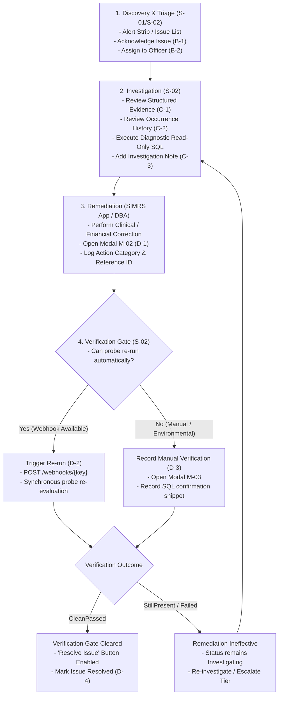

# PrIMA EDP Operational Remediation Standard Operating Procedure (SOP)

**Document ID:** `SOP-PRIMA-EDP-001`  
**Version:** `1.0.0`  
**Applicability:** Hospital EDP / Electronic Data Processing Team, IT Support Officers, Database Administrators (DBA), SIMRS Application Specialists  
**Target System:** PrIMA (Proactive Incident Monitoring & Analytics) & Hospital SIMRS (Sistem Informasi Manajemen Rumah Sakit)  
**Related Architecture Decisions:** `DEC-007`, `DEC-008`, `DEC-009`, `BR-PRIMA-001` through `BR-PRIMA-010`

---

## 1. Executive Summary & Purpose

PrIMA operates as a non-intrusive, read-only autonomous watchdog monitoring the operational integrity of the hospital's Core SIMRS database and clinical/administrative workflows. When an anomaly is discovered, PrIMA generates a structured incident (`dbo.Issues`) with cryptographic correlation keys and audit evidence (`dbo.Occurrences`), alerting the on-duty Electronic Data Processing (EDP) officer on screen **S-01 (Issue Dashboard)**.

**PrIMA observes and verifies, but NEVER mutates hospital clinical or financial records automatically.** 

The purpose of this standard operating procedure is to provide EDP officers and hospital application specialists with deterministic, step-by-step instructions to:
1. Identify the clinical, operational, and financial root causes of detected anomalies.
2. Execute diagnostic queries safely against the SIMRS production database without locking operational tables (`SET TRANSACTION ISOLATION LEVEL READ UNCOMMITTED`).
3. Remediate discrepancies inside SIMRS application modules or controlled database scripts.
4. Execute verification re-runs (`D-2 Trigger Verification Re-run` or `D-3 Record Manual Verification`) to satisfy the **Verification Gate** before closing incidents (`D-4 Mark Issue Resolved`).
5. Escalate unresolved critical incidents in accordance with hospital governance SLAs.

---

## 2. Universal Operational Workflow

All PrIMA incidents must flow through the five-phase incident lifecycle depicted below. Bypassing remediation or verification is structurally prohibited by the system.



### 2.1 Remediation Action Categories (Modal `M-02`)

When recording a remediation action via modal `M-02` (Use Case `D-1`), the EDP officer must select one of the following canonical categories:

| Category | Typical Scenarios | Mandatory Details Required |
|---|---|---|
| `DataCorrection` | Fixing unbalanced journal lines, voiding duplicate AR rows, correcting patient demographic or billing flags. | SIMRS correction menu, batch/transaction ID, authorized approval ticket. |
| `ServiceRestart` | Restarting stalled Windows Print Spooler service, resetting integration gateway daemons, bouncing local listener. | Hostname, service name, restart timestamp, queue status. |
| `ConfigAdjustment` | Correcting clinic consultation quotas, doctor schedule hours, updating BPJS HFIS sync parameters. | Configuration table/key, old value, updated value, approval reference. |
| `CodeRemediation` | Patching vendor SIMRS stored procedures, resolving application bugs causing null references or deadlocks. | Vendor bug tracking ID, release version, migration script name. |

---

## 3. Pilot Detector Operational Reference Sheets

The following operational sheets provide exact diagnostic SQL, root cause trees, remediation SOPs, and verification steps for each of the 6 core pilot detectors deployed across the hospital.

---

### Sheet 01: Journal Balance Discrepancy

```
+----------------------------------------------------------------------------------------------------+
| DETECTOR: Journal Balance Detector                                                                  |
| Webhook Key: journal-balance             | Scope: DataIntegrity       | Base Severity: High         |
| Target Module: Accounting                | Cadence: 300 seconds (5m)  | Entity: journal_batch_no   |
+----------------------------------------------------------------------------------------------------+
```

#### A. Business & Financial Impact
In double-entry hospital accounting, every journal voucher must satisfy $\sum \text{Debit} = \sum \text{Credit}$. An unbalanced batch corrupts the General Ledger (GL), distorts trial balance reports, prevents automated month-end accounting close, and fails external financial audits (KAP / BPK). If patient billing or pharmacy sales are posted without balancing credit offsets, revenue recognition is falsely reported.

#### B. Diagnostic SQL Query for EDP
Execute the following read-only diagnostic query in SQL Server Management Studio (SSMS) against `SimrsDb`:

```sql
-- Diagnostic 01: Inspect All Entries for the Discrepant Journal Batch
SET TRANSACTION ISOLATION LEVEL READ UNCOMMITTED;
SET LOCK_TIMEOUT 2000;

DECLARE @BatchNo NVARCHAR(50) = 'JRN-202611-ERR01'; -- Replace with TargetEntityReference from S-02

SELECT 
    j.entry_id,
    j.journal_batch_no,
    j.entry_date,
    j.account_code,
    j.account_name,
    j.debit,
    j.credit,
    j.posted_status,
    j.notes,
    j.created_by,
    j.created_at
FROM simrs.acc_journal_entries j
WHERE j.journal_batch_no = @BatchNo
ORDER BY j.entry_id ASC;

-- Summary Check
SELECT 
    journal_batch_no,
    SUM(debit) AS TotalDebit,
    SUM(credit) AS TotalCredit,
    ABS(SUM(debit) - SUM(credit)) AS DiscrepancyVariance,
    COUNT(*) AS TotalLines
FROM simrs.acc_journal_entries
WHERE journal_batch_no = @BatchNo
GROUP BY journal_batch_no;
```

#### C. Root Cause Analysis
1. **Network Interruption During Batch Commit:** The client workstation lost connectivity while posting multi-line entries (e.g., pharmacy dispensing batch containing 1 debit line to Accounts Receivable and 5 credit lines to Revenue accounts). Debit was written, but credit transactions were aborted halfway.
2. **SIMRS Integration Adapter Bug:** An external sub-system (e.g., Laboratory Information System or Third-Party Pharmacy Robot) submitted an unbalanced JSON payload that bypassed UI validation checks.
3. **Manual Journal Voucher Modification:** An accounting clerk edited an unposted or draft voucher directly, modified one line amount, and forced posting before validating total credits.

#### D. Hospital SIMRS Correction Procedure
> [!IMPORTANT]
> Never execute `UPDATE` or `DELETE` directly on `simrs.acc_journal_entries` unless authorized by the Head of Finance. Always use the SIMRS Accounting Correction UI whenever possible.

1. **Via SIMRS Application (Preferred):**
   - Log into SIMRS Accounting Module with **Accounting Supervisor** credentials.
   - Navigate to: **Keuangan & Akuntansi > Jurnal Umum > Koreksi & Penyesuaian Jurnal**.
   - Input the `journal_batch_no` from PrIMA S-02.
   - Click **Unpost / Koreksi Jurnal** (requires supervisor approval token).
   - Add the balancing entry (e.g., credit line to appropriate clearing account such as `110-999 Kas/Bank Kliring` or correct the incorrect line).
   - Validate that Total Debit equals Total Credit.
   - Click **Simpan & Post Ulang**.

2. **Emergency Scripted Remediation (DBA / Senior EDP Only):**
   - If the SIMRS UI rejects editing already-posted batches, generate an offsetting adjustment voucher with approval from Finance:
   ```sql
   -- Insert Offsetting Adjustment Entry under New Balancing Batch
   INSERT INTO simrs.acc_journal_entries (
       journal_batch_no, entry_date, account_code, account_name, 
       debit, credit, posted_status, notes, created_by, created_at
   ) VALUES (
       @BatchNo, GETUTCDATE(), '110-999', 'Selisih Pembulatan / Suspense Clearing',
       0.00, 150000.00, 'Posted', 'Koreksi Selisih Batch via SOP-PRIMA-EDP-001', 'edp_admin', GETUTCDATE()
   );
   ```

#### E. Verification Procedure
1. **Automated Verification Re-Run (`D-2`):**
   - In PrIMA screen **S-02 (Issue Detail)**, click the **"Trigger Verification Re-run"** button.
   - PrIMA invokes `POST /webhooks/journal-balance`. The runner executes `JournalBalanceDetector.cs`.
   - When the discrepancy is resolved, the probe returns `Outcome: Passed`.
   - The UI records a `CleanPassed` verification entry and unlocks the **"Resolve Issue"** button.
2. **Manual Verification (`D-3`):**
   - If webhook runner is paused, execute Diagnostic SQL Summary Check above.
   - Click **"Record Manual Verification"** in S-02 (Modal `M-03`).
   - Paste the SQL query confirmation showing `DiscrepancyVariance = 0.00`.
   - Click **"Save Verification"** and proceed to **"Mark Issue Resolved"** (`D-4`).

---

### Sheet 02: Duplicate Active Patient Receivable

```
+----------------------------------------------------------------------------------------------------+
| DETECTOR: Duplicate Receivable Detector                                                             |
| Webhook Key: duplicate-receivable        | Scope: DataIntegrity       | Base Severity: High         |
| Target Module: Billing                   | Cadence: 300 seconds (5m)  | Entity: source_trx_no      |
+----------------------------------------------------------------------------------------------------+
```

#### A. Business & Financial Impact
Multiple active receivable records linked to a single inpatient or outpatient transaction cause patients or third-party payers (BPJS Kesehatan / Private Insurance) to be billed twice for the same medical encounter. This leads to patient disputes, cashier accounting errors, audit penalties, and legal liability.

#### B. Diagnostic SQL Query for EDP
```sql
-- Diagnostic 02: Inspect Duplicate Active Receivables by Source Transaction
SET TRANSACTION ISOLATION LEVEL READ UNCOMMITTED;
SET LOCK_TIMEOUT 2000;

DECLARE @SourceTrxNo NVARCHAR(50) = 'TRX-AR-202611-DUP01'; -- TargetEntityReference from S-02

SELECT 
    r.receivable_id,
    r.source_trx_no,
    r.patient_norm,
    r.patient_name,
    r.receivable_amount,
    r.status,
    r.due_date,
    r.created_at,
    r.created_by
FROM simrs.ar_receivables r
WHERE r.source_trx_no = @SourceTrxNo
ORDER BY r.created_at ASC;
```

#### C. Root Cause Analysis
1. **Cashier Double-Clicking / Client Lag:** In the cashier desktop client, the officer clicked "Proses Piutang" twice due to network latency, creating two concurrent database inserts before the client UI button disabled.
2. **Automated Discharge Pipeline Retried Without Idempotency:** An automated billing batch failed on timeout, and the retry mechanism re-inserted the receivable without checking existing records for that encounter.
3. **Split Billing Confusion:** An insurance guarantor adjustment was entered as a brand new receivable rather than modifying the existing transaction.

#### D. Hospital SIMRS Correction Procedure
1. **Via SIMRS Billing Module:**
   - Log into SIMRS: **Kasir & Billing > Piutang Pasien > Daftar Piutang Aktif**.
   - Search by `source_trx_no` or Patient Medical Record Number (`patient_norm`).
   - Identify the duplicate entry (verify `created_at` timestamp; keep the primary verified record).
   - Select the duplicate record and click **"Batalkan / Void Piutang"**.
   - Input reason: *"Duplikasi sistem terdeteksi oleh PrIMA Issue #[IssueId]"*.
   - Verify that only one active receivable remains.

2. **Emergency Scripted Remediation (DBA Only):**
   ```sql
   -- Mark the duplicate secondary record as Voided
   UPDATE simrs.ar_receivables
   SET status = 'Voided',
       notes = 'Voided duplicate per SOP-PRIMA-EDP-001 / PrIMA alert'
   WHERE receivable_id = @DuplicateReceivableId
     AND status = 'Active';
   ```

#### E. Verification Procedure
- **Automated (`D-2`):** Click **"Trigger Verification Re-run"** on S-02. Probe `DuplicateReceivableDetector.cs` verifies `COUNT(*) <= 1` on `source_trx_no` with `status = 'Active'`.
- Upon `CleanPassed`, mark the issue as **Resolved (`D-4`)**.

---

### Sheet 03: Unprocessed Billing Pipeline (Missing Auto-Journal)

```
+----------------------------------------------------------------------------------------------------+
| DETECTOR: Unprocessed Billing Pipeline Detector                                                     |
| Webhook Key: unprocessed-billing         | Scope: ProcessIntegrity    | Base Severity: High         |
| Target Module: Billing                   | Cadence: 300 seconds (5m)  | Entity: bill_invoice_no     |
+----------------------------------------------------------------------------------------------------+
```

#### A. Business & Financial Impact
Patient bills that have been settled at the cashier (cash, debit, or QRIS) but fail to create corresponding general ledger auto-journal batches after 15 minutes represent stalled revenue recognition. Money is physically collected in the cash register, but the accounting ledger shows no transaction, creating an immediate discrepancy between the cashier shift handover report and accounting cash balances.

#### B. Diagnostic SQL Query for EDP
```sql
-- Diagnostic 03: Inspect Settled Bill and Check Journal Link
SET TRANSACTION ISOLATION LEVEL READ UNCOMMITTED;
SET LOCK_TIMEOUT 2000;

DECLARE @BillInvoiceNo NVARCHAR(50) = 'BILL-202611-NOJRN01'; -- TargetEntityReference from S-02

-- 1. Check Bill Details
SELECT 
    b.bill_id,
    b.bill_invoice_no,
    b.patient_norm,
    b.patient_name,
    b.bill_amount,
    b.settlement_status,
    b.settled_at,
    DATEDIFF(minute, b.settled_at, GETUTCDATE()) AS MinutesSinceSettlement
FROM simrs.trx_patient_bills b
WHERE b.bill_invoice_no = @BillInvoiceNo;

-- 2. Verify Absence in General Ledger
SELECT * 
FROM simrs.acc_journal_entries
WHERE journal_batch_no = @BillInvoiceNo;
```

#### C. Root Cause Analysis
1. **Background Auto-Journal Worker Stalled:** The SIMRS background message queue or Windows Task Scheduler executing `sp_auto_journal_billing` crashed or paused due to database deadlocks.
2. **Missing Chart of Accounts (COA) Mapping:** The settled bill contained a newly introduced medical item or service charge that has no COA account mapping configured in `simrs.cfg_coa_mapping`.
3. **Database Transaction Timeout:** The auto-journal stored procedure timed out during cashier peak hours (e.g. 11:00 AM - 13:00 PM).

#### D. Hospital SIMRS Correction Procedure
1. **Check SIMRS Auto-Journal Service:**
   - Check if the background posting daemon is running:
     ```powershell
     Get-Service -Name "SIMRSAutoJournalService"
     ```
   - If stopped, restart the service.
2. **Manual Batch Reposting via SIMRS:**
   - Open SIMRS: **Kasir & Billing > Utility Kasir > Posting Ulang Jurnal Kasir**.
   - Input date range and Invoice Number `@BillInvoiceNo`.
   - Click **"Proses Integrasi Jurnal"**.
   - Confirm in the UI that the journal batch reference is successfully generated.
3. **Database Execution (DBA Fallback):**
   ```sql
   -- Execute the standard SIMRS auto-journal generator stored procedure
   EXEC simrs.sp_generate_billing_journal @invoice_no = @BillInvoiceNo;
   ```

#### E. Verification Procedure
- **Automated (`D-2`):** In S-02, trigger verification re-run. Probe queries `simrs.trx_patient_bills` with `NOT EXISTS` check against `simrs.acc_journal_entries`. When the journal is present, probe passes cleanly.
- Record remediation via `M-02` (Category: `DataCorrection` or `ServiceRestart`) and resolve issue (`D-4`).

---

### Sheet 04: Hospital EMR Synchronization Stalled / Failed

```
+----------------------------------------------------------------------------------------------------+
| DETECTOR: EMR Sync Detector                                                                         |
| Webhook Key: emr-sync                    | Scope: DataSync            | Base Severity: Medium       |
| Target Module: EMR                       | Cadence: 300 seconds (5m)  | Entity: encounter_no        |
+----------------------------------------------------------------------------------------------------+
```

#### A. Clinical & Operational Impact
Electronic Medical Record (EMR / Rekam Medis Elektronik) synchronization failure prevents doctors in subsequent clinics or inpatient wards from seeing real-time clinical notes, diagnosis, laboratory results, or prescriptions entered during an encounter. Furthermore, stalled EMR sync blocks integration with the Ministry of Health's SatuSehat national platform, violating regulatory compliance.

#### B. Diagnostic SQL Query for EDP
```sql
-- Diagnostic 04: Inspect Stalled or Failed EMR Sync Log
SET TRANSACTION ISOLATION LEVEL READ UNCOMMITTED;
SET LOCK_TIMEOUT 2000;

DECLARE @EncounterNo NVARCHAR(50) = 'ENC-202611-FAIL01'; -- TargetEntityReference from S-02

SELECT 
    sync_id,
    encounter_no,
    patient_norm,
    sync_type,
    sync_status,
    retry_count,
    error_message,
    created_at,
    updated_at,
    DATEDIFF(minute, created_at, GETUTCDATE()) AS StalledMinutes
FROM simrs.emr_sync_logs
WHERE encounter_no = @EncounterNo
ORDER BY created_at DESC;
```

#### C. Root Cause Analysis
1. **SatuSehat / Third-Party Gateway API Timeout:** External OAuth2 token expired or Ministry of Health endpoint returned HTTP 502 / 504.
2. **Invalid Clinical Payload / Schema Validation:** Doctor entered unencoded special characters, or mandatory fields (e.g. ICD-10 code, practitioner NIK) were null.
3. **Worker Thread Exhaustion:** Heavy batch sync clogged the EMR integration dispatcher thread pool.

#### D. Hospital SIMRS Correction Procedure
1. **Review Error Trace in S-02 Evidence Panel:** Inspect the exact `error_message` captured by PrIMA.
2. **If Data Error (e.g., Invalid NIK / ICD-10):**
   - Contact the Outpatient Poliklinik nurse or EMR coder.
   - Have them update the patient encounter record in SIMRS EMR.
3. **Trigger Immediate EMR Sync Retry:**
   - In SIMRS: **Rekam Medis > Monitoring SatuSehat / EMR Sync > Log Antrian**.
   - Filter by `encounter_no`.
   - Click **"Kirim Ulang / Retry Sync"**.
   - If the sync worker is stalled, restart the sync service:
     ```powershell
     Restart-Service -Name "SimrsEmrSyncBridge"
     ```

#### E. Verification Procedure
- **Automated (`D-2`):** In S-02, click **"Trigger Verification Re-run"**. Probe verifies that `sync_status` is no longer `'Failed'` and not `'Pending'` > 30 minutes. Status transitions to `CleanPassed`.
- Mark issue as **Resolved (`D-4`)**.

---

### Sheet 05: BPJS HFIS Doctor Schedule Mismatch

```
+----------------------------------------------------------------------------------------------------+
| DETECTOR: HFIS Doctor Schedule Detector                                                             |
| Webhook Key: hfis-schedule-sync          | Scope: DataSync            | Base Severity: Medium       |
| Target Module: Outpatient                | Cadence: 300 seconds (5m)  | Entity: doctor_schedule_code|
+----------------------------------------------------------------------------------------------------+
```

#### A. Clinical & Operational Impact
BPJS Kesehatan patients book outpatient clinic appointments via Mobile JKN. If the doctor's practice schedule hours or consultation quotas in SIMRS disagree with BPJS HFIS (Health Facilities Information System), patients booking via Mobile JKN arrive when the doctor is not practicing, or BPJS Mobile JKN rejects valid patients due to artificial quota depletion. This causes severe patient queue chaos in outpatient registration lobbies.

#### B. Diagnostic SQL Query for EDP
```sql
-- Diagnostic 05: Compare SIMRS vs BPJS HFIS Doctor Schedule
SET TRANSACTION ISOLATION LEVEL READ UNCOMMITTED;
SET LOCK_TIMEOUT 2000;

DECLARE @SchedCode NVARCHAR(50) = 'SCH-OBG-002'; -- TargetEntityReference from S-02

SELECT 
    schedule_id,
    doctor_schedule_code,
    doctor_name,
    clinic_name,
    schedule_date,
    simrs_start_time,
    hfis_start_time,
    simrs_end_time,
    hfis_end_time,
    simrs_quota,
    hfis_quota,
    is_active,
    last_synced_at
FROM simrs.hfis_doctor_schedules
WHERE doctor_schedule_code = @SchedCode;
```

#### C. Root Cause Analysis
1. **Doctor Schedule Changed Only in SIMRS:** Outpatient medical division adjusted doctor clinic hours in SIMRS without executing the BPJS HFIS bridging update.
2. **BPJS Bridging API Sync Failure:** SIMRS attempted to push schedule updates to BPJS Antrean / HFIS API, but the request was rejected (e.g. invalid signature, timestamp out of sync).
3. **Quota Adjustment Desynchronization:** Additional walk-in patient slots were added locally in SIMRS without updating the HFIS Mobile JKN quota cap.

#### D. Hospital SIMRS Correction Procedure
1. **Coordinate with Outpatient Clinic Supervisor (Rawat Jalan):** Confirm whether the actual intended schedule is the SIMRS version or the HFIS version.
2. **Synchronize via SIMRS BPJS Bridging Menu:**
   - Navigate to: **SIMRS Bridging > BPJS Kesehatan > Manajemen Jadwal HFIS**.
   - Search for Doctor and Schedule Code `@SchedCode`.
   - Click **"Tarik Jadwal HFIS"** (to fetch current BPJS master) or **"Sinkronisasi Jadwal ke HFIS"** (to push SIMRS schedule to BPJS).
   - Ensure start time, end time, and patient quotas match exactly.
   - Click **"Simpan & Kirim Update BPJS"**.

#### E. Verification Procedure
- **Automated (`D-2`):** In S-02, trigger verification re-run. Probe queries `simrs.hfis_doctor_schedules` to verify `(simrs_start = hfis_start AND simrs_end = hfis_end AND simrs_quota = hfis_quota)`.
- Record remediation (`M-02`, Category: `ConfigAdjustment`), and click **"Mark Issue Resolved"** (`D-4`).

---

### Sheet 06: Hospital Print Queue & Spooler Anomaly

```
+----------------------------------------------------------------------------------------------------+
| DETECTOR: Print Queue Spooler Detector                                                              |
| Webhook Key: print-queue-spooler         | Scope: Infrastructure      | Base Severity: Critical     |
| Target Module: PrintSpooler              | Cadence: 60 seconds (1m)   | Entity: station_queue_name  |
+----------------------------------------------------------------------------------------------------+
```

#### A. Clinical & Operational Impact
**Critical Severity.** In a hospital, thermal wristband printers, prescription barcode label printers, and cashier invoice printers are vital to patient safety and operational flow. A print spooler failure in the Emergency Department (IGD) halts patient admission wristband printing. In the Pharmacy, it stops medication label generation. In the Cashier, it blocks billing receipts, immediately paralyzing hospital operations.

#### B. Diagnostic SQL Query for EDP
```sql
-- Diagnostic 06: Inspect Print Queue Spooler Anomaly
SET TRANSACTION ISOLATION LEVEL READ UNCOMMITTED;
SET LOCK_TIMEOUT 2000;

DECLARE @QueueName NVARCHAR(100) = 'PRN-KASIR-02'; -- TargetEntityReference from S-02

SELECT 
    queue_id,
    station_queue_name,
    hospital_unit,
    printer_name,
    ip_address,
    spooler_status,
    pending_jobs,
    oldest_job_age_seconds,
    last_reported_at
FROM simrs.infra_print_queues
WHERE station_queue_name = @QueueName;
```

#### C. Root Cause Analysis
1. **Windows Print Spooler Service Crash:** The Windows `spoolsv.exe` service on the station print server stopped or froze due to a corrupted print job.
2. **Network Disconnection / Printer Offline:** Network cable unplugged, Wi-Fi dropped, or printer powered off with jobs backing up > 300 seconds (5 minutes).
3. **Hardware Jam / Paper Out:** The thermal label roll is empty or jammed, causing subsequent patient print jobs to stack up indefinitely in the Windows print queue.

#### D. Hospital SIMRS & Infrastructure Correction Procedure
1. **Remote Spooler Diagnostic & Flush (PowerShell):**
   - Connect remotely to the affected station or print server:
     ```powershell
     # Check Print Spooler Service
     Get-Service -ComputerName $StationHost -Name Spooler

     # If Spooler is stopped, restart it
     Restart-Service -ComputerName $StationHost -Name Spooler -Force
     ```
2. **Clear Stuck Corrupted Print Jobs (if spooler hangs):**
   ```powershell
   Stop-Service -ComputerName $StationHost -Name Spooler -Force
   Remove-Item "\\$StationHost\c$\Windows\System32\spool\PRINTERS\*" -Force
   Start-Service -ComputerName $StationHost -Name Spooler
   ```
3. **Physical Station Verification:**
   - Call the on-duty unit nurse or cashier (e.g., Extension for IGD or Kasir).
   - Verify that thermal paper is loaded, printer power light is green, and USB/LAN cable is securely connected.
   - Update `simrs.infra_print_queues` status via station agent or diagnostic update.

#### E. Verification Procedure
- **Automated (`D-2`):** In S-02, trigger verification re-run. Probe queries `simrs.infra_print_queues` every 60 seconds. When `spooler_status = 'Online'` and `pending_jobs = 0`, probe returns `CleanPassed`.
- Record remediation (`M-02`, Category: `ServiceRestart`), and resolve issue immediately (`D-4`).

---

## 4. Escalation Matrix & Notification Governance

### 4.1 Automated SLA Escalation Rule (`BR-PRIMA-004`)
PrIMA automatically monitors all open issues every 60 seconds (`MonitoringSupervisorWorker.cs`). If an issue with severity `High` or `Critical` remains in `Open` status without being acknowledged (`B-1`) or assigned (`B-2`) within **30 minutes**, PrIMA auto-escalates the severity and fires an alert strip warning on **S-01 (Issue Dashboard)**.

### 4.2 Escalation Tiers & Response Expectations

| Tier | Role | Responsibilities | Target Acknowledgment SLA |
|---|---|---|---|
| **Tier 1** | **On-Duty EDP Helpdesk Officer** | Initial triage on S-01, acknowledgment (`B-1`), assignment (`B-2`), basic diagnostic query execution, printer spooler restarts. | **< 15 minutes** (Critical)<br/>**< 30 minutes** (High) |
| **Tier 2** | **Senior EDP Specialist / DBA** | In-depth root cause investigation, executing corrective SQL procedures, addressing auto-journal / EMR bridge worker failures. | **< 45 minutes** from Tier 1 escalation |
| **Tier 3** | **Hospital Division Leads**<br/>*(Head of Finance, Head of Medical Records, Head of Outpatient)* | Authorizing manual balance adjustments, approving patient invoice voiding, reconciling clinic doctor quota shifts. | **< 2 hours** |
| **Tier 4** | **SIMRS Software Vendor / Infrastructure Head** | Resolving persistent software bugs, code remediation, patching database deadlocks or network infrastructure outages. | Contractual Vendor SLA |

### 4.3 Department Contact Directory

| Department / Unit | Scope | Key Contact Channel | Typical Incidents |
|---|---|---|---|
| **Keuangan & Akuntansi (Finance)** | `DataIntegrity` | Ext. 1042 / WhatsApp Group: *Keuangan-EDP* | Unbalanced journal batches (`journal-balance`) |
| **Kasir & Billing (Cashier)** | `DataIntegrity`<br/>`ProcessIntegrity` | Ext. 1015 / Direct Radio: *Kasir-Sentral* | Duplicate receivables, missing billing auto-journal |
| **Rekam Medis (EMR / SatuSehat)** | `DataSync` | Ext. 1088 / Internal Chat: *@rm_support* | Stalled EMR encounters, SatuSehat sync failures |
| **Rawat Jalan (Poliklinik)** | `DataSync` | Ext. 1030 / Poliklinik Coordinator | Doctor schedule mismatch, Mobile JKN quota errors |
| **IT Infrastructure & Networking** | `Infrastructure` | Ext. 1000 / Server Room Direct | Print queue offline, SQL Server connection timeouts |

---

## 5. False Positive Dismissal Governance (`BR-PRIMA-006`)

If an EDP officer determines that an anomaly reported by PrIMA is a known planned maintenance event or a verified false positive:
1. Open modal **`M-01 (Dismiss Issue)`** from screen S-02.
2. Select a standardized **Dismissal Reason**:
   - `PlannedMaintenance`
   - `KnownAcceptableDiscrepancy`
   - `SandboxTestingArtifact`
   - `DuplicateReporting`
3. **Mandatory Minimum Rationale Rule (`BR-PRIMA-006`):** The officer must supply an explicit justification text of **at least 20 characters**. Terse or blank rationales (e.g., *"not a bug"*, *"ignore"*) will be rejected by client validation and backend API.
4. Dismissed issues are permanently archived into **S-07 (History & Reports)** and excluded from active dashboard queues.

---

**Approval & Authority:**  
*Published by PrIMA Core Engineering Team for Hospital Information Technology Division.*  
*Reviewed & Approved: 2026-11-22*
